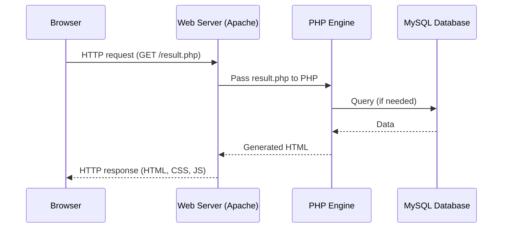

# Unit 1: Introduction
**Course:** Internet Technology II (CMP 273) · **Teaching hours:** 4

## Learning Objectives

After this unit, you will be able to:

- Explain what server-side scripting is and why web applications need it.
- Differentiate between client-side and server-side scripting, and between static and dynamic web pages.
- Describe the request/response cycle and how a PHP page is processed by the web server.
- Explain the importance of PHP in building dynamic web applications, along with its history and main features.
- Install and configure a PHP development environment (XAMPP, WAMP or an alternative) and run your first PHP script.
- Write PHP code using correct basic syntax: PHP tags, statements, `echo`/`print`, and comments.
- Identify PHP's eight data types and inspect values with `var_dump()` and `gettype()`.
- Declare and use variables and constants, including magic constants.
- Use arithmetic, assignment, logical, comparison, string, and increment/decrement operators correctly, keeping operator precedence in mind.

---

## 1.1 Understanding Server-Side Scripting and PHP Programming

### 1.1.1 What is a script?

A **script** is a program that is interpreted (read and executed line by line by another program) instead of being compiled into a standalone executable file in advance. On the web, scripts run in one of two places:

- In the **browser** (the client). This is **client-side scripting**, for example JavaScript.
- On the **web server**. This is **server-side scripting**, for example PHP, Python, Node.js, Ruby, or Java.

### 1.1.2 Client-side vs server-side scripting

In Internet Technology I you wrote HTML, CSS and JavaScript. All of these are sent to the browser and run there. The browser can show them, but it cannot safely do jobs such as checking a password against a database, because the user can read and change everything that is sent to the browser.

**Server-side scripting** means the code runs on the web server **before** the page is sent. The server runs the script, the script produces HTML, and only that HTML goes to the browser. The user never sees the PHP source code.

| Feature | Client-side scripting | Server-side scripting |
|---|---|---|
| Where the code runs | In the user's browser | On the web server |
| Example languages | JavaScript (also TypeScript compiled to JS) | PHP, Python, Node.js, Java, Ruby, C# |
| Can the user see the source? | Yes (View Source / DevTools) | No, the user only sees the output (HTML) |
| Access to database/files on server | No | Yes |
| Depends on browser support | Yes | No, the server decides |
| Typical jobs | Form checks before submit, animations, menus, DOM changes | Login, database queries, sessions, sending email, file upload, generating pages |
| Security | Cannot be trusted (user can change it) | Can be trusted, because it is under the server owner's control |
| Load | Uses the visitor's computer | Uses the server's CPU and memory |

Both are used together in real sites. Example: on a college admission form, JavaScript can warn "Email is required" instantly, but PHP must **also** check the email on the server, because a user can turn JavaScript off or send a fake request directly.

> **Common Mistake:** "We validated the form with JavaScript, so the server doesn't need to check it." This is wrong. Client-side validation only makes things easier for the user. Security checks must always be done again on the server (in PHP).

### 1.1.3 Static vs dynamic web pages

A **static web page** is a file (usually `.html`) that is stored on the server and sent exactly as it is. Every visitor sees the same content until a developer edits the file by hand.

A **dynamic web page** is generated by a program at the moment it is requested. The content can change based on who the user is, what they typed, the time of day, or data in a database.

| Point | Static page | Dynamic page |
|---|---|---|
| How content is made | Written by hand in an HTML file | Generated by a script (e.g. PHP) on each request |
| File extension (typical) | `.html`, `.htm` | `.php`, `.py`, `.jsp`, `.aspx` |
| Same for every user? | Yes | No, it can be personalised |
| Database use | No | Usually yes (e.g. MySQL) |
| Updating content | Edit the file and upload again | Change data in the database or through an admin panel |
| Speed | Very fast (no processing) | Slightly slower (server must run code) |
| Examples | A college "About Us" page, a personal portfolio | Facebook feed, Daraz product search, exam result portal, online banking |

**Example.** The Pokhara University result page shows a different result for each symbol number. Nobody writes thousands of separate HTML files. One PHP script reads the symbol number, looks up the database, and builds the HTML for that student.

### 1.1.4 The request/response flow

The web works on the **HTTP request/response** model. The browser (client) sends a **request**; the server sends back a **response**.

**Static page (`about.html`):**

```
 Browser                                   Web Server (Apache)
   |  1. GET /about.html  ------------------->  |
   |                                            |  2. Finds about.html on disk
   |  <------------------ 3. Sends file as-is   |
   |  4. Browser renders HTML                   |
```

**Dynamic page (`result.php`):**

```
 Browser               Web Server (Apache)        PHP Engine            MySQL
   | 1. GET /result.php?symbol=12345 |                 |                    |
   |-------------------------------->|                 |                    |
   |                                 | 2. .php file?   |                    |
   |                                 |   pass it to PHP|                    |
   |                                 |---------------->|                    |
   |                                 |                 | 3. Run the script  |
   |                                 |                 |   SELECT ... ----->|
   |                                 |                 |<---- 4. rows ------|
   |                                 |                 | 5. Build HTML      |
   |                                 |<-- 6. HTML -----|                    |
   |<--- 7. HTTP response (HTML only)|                 |                    |
   | 8. Browser renders the HTML     |                 |                    |
```

The same flow as a Mermaid diagram:



Key points of the flow:

1. The user types a URL or submits a form. The browser sends an HTTP request.
2. The web server (Apache, Nginx, etc.) receives it.
3. If the file ends in `.php`, the server hands it to the **PHP interpreter** instead of sending it directly.
4. PHP executes the code. It may read form data, talk to a database, or read files.
5. Whatever the script outputs (using `echo`, or plain HTML outside PHP tags) becomes the response body.
6. The server sends this HTML back. The browser never receives PHP code.

> **Teacher's Note:** A restaurant analogy works well here. The customer (browser) orders from the waiter (web server). For a cold drink (static page), the waiter just takes it from the fridge. For a cooked dish (dynamic page), the waiter passes the order to the cook (PHP), who may fetch ingredients from the store room (database). The customer only gets the finished dish, never the recipe. To prove it, open any `.php` page in the browser and press Ctrl+U: students will see only HTML.

### 1.1.5 What is PHP?

**PHP** stands for **PHP: Hypertext Preprocessor**. This is a *recursive acronym*: the first word of the expansion is the acronym itself. PHP is a free, open-source, server-side scripting language designed for web development. It can be embedded directly inside HTML.

**Why PHP matters (significance in building dynamic web apps):**

- PHP runs a very large share of the web. Surveys such as W3Techs regularly show that roughly three-quarters of websites with a known server-side language use PHP.
- Well-known platforms are written in PHP: WordPress (which powers a large share of all websites), Wikipedia (MediaWiki), Drupal, Joomla, Moodle (used by many universities), Magento, and early Facebook.
- Modern frameworks such as **Laravel**, **Symfony** and **CodeIgniter** are widely used in industry, including by many software companies in Nepal.
- Cheap shared hosting almost always supports PHP, so it is easy to put a project online.
- It is easy for beginners, but modern PHP 8 is also fast and supports advanced features (OOP, type declarations, JIT compilation).

### 1.1.6 Brief history of PHP

| Year | Version | Key point |
|---|---|---|
| 1994 | Personal Home Page Tools | Rasmus Lerdorf wrote a set of C programs (CGI scripts) to track visits to his online resume. |
| 1995 | PHP/FI | "Personal Home Page / Forms Interpreter" released publicly. Could handle forms and databases. |
| 1998 | PHP 3 | Rewritten by Zeev Suraski and Andi Gutmans. Renamed "PHP: Hypertext Preprocessor". |
| 2000 | PHP 4 | Powered by the new **Zend Engine**; much faster; sessions added. |
| 2004 | PHP 5 | Proper object-oriented programming, PDO, better MySQL support (MySQLi). |
| — | PHP 6 | Never released (the Unicode project was abandoned). |
| 2015 | PHP 7 | Around twice as fast as PHP 5, scalar type declarations, `??` operator, `<=>` operator. |
| 2020 | PHP 8.0 | JIT compiler, named arguments, `match` expression, nullsafe operator `?->`, union types. |
| 2021 onward | PHP 8.1, 8.2, 8.3, 8.4 ... | Enums, readonly properties, and yearly improvements. A new 8.x release comes roughly every November. |

In this course we use **PHP 8.x**. Old tutorials on the internet often use PHP 5 code (for example, `mysql_*` functions). Those functions were **removed** in PHP 7. Do not use them.

### 1.1.7 Features of PHP

1. **Open source and free.** No licence fee to use it.
2. **Server-side.** Code runs on the server; source code stays hidden from users.
3. **Embedded in HTML.** You can mix PHP and HTML in one file.
4. **Cross-platform.** Runs on Windows, Linux and macOS, with Apache, Nginx, IIS and others.
5. **Database support.** Works with MySQL/MariaDB, PostgreSQL, SQLite, Oracle, SQL Server and more.
6. **Loosely (dynamically) typed.** You do not declare a variable's type; PHP works it out. (PHP 8 also allows optional type declarations.)
7. **Interpreted.** No separate compile step for the developer. Save the file and refresh the browser.
8. **Fast.** PHP 7 and 8 use the Zend Engine with OPcache, and PHP 8 adds a JIT compiler.
9. **Large built-in library.** Thousands of functions for strings, arrays, dates, files, email, JSON, images, etc.
10. **Supports OOP.** Classes, interfaces, traits, namespaces (Unit 6 and later).
11. **Session and cookie support** built in, for login systems.
12. **Huge community.** Documentation at php.net, many frameworks, and plenty of hosting.

> **Exam Tip:** "Explain features of PHP" is a common 5-mark question. Write 8 to 10 features, each with one line of explanation. Start with the full form "PHP: Hypertext Preprocessor" and a one-line definition.

### 1.1.8 How PHP is processed

When the server receives a request for a `.php` file, PHP goes through these stages:

```
  hello.php (source code)
        |
        v
  1. Lexing      -> breaks the code into tokens (keywords, variables, strings ...)
        |
        v
  2. Parsing     -> checks syntax and builds an Abstract Syntax Tree (AST)
        |
        v
  3. Compiling   -> converts the AST into opcodes (Zend bytecode)
        |              (OPcache stores these opcodes so the next request skips steps 1-3)
        v
  4. Executing   -> the Zend Engine runs the opcodes and produces output
        |
        v
  Output (HTML text) -> sent by the web server to the browser
```

Important consequences:

- Anything **outside** `<?php ... ?>` tags is sent to the browser unchanged.
- Anything **inside** PHP tags is executed. Only its output (from `echo`, `print`, etc.) goes to the browser.
- If there is a **syntax error** (for example, a missing semicolon), parsing fails and nothing in that file runs. PHP shows a "Parse error" message instead.
- PHP must be opened through a **web server** (`http://localhost/...`). If you double-click a `.php` file, the browser opens it from disk (`file:///...`), the PHP engine never runs, and you see raw code or a download prompt.

**Example: what goes in and what comes out**

```php
<!DOCTYPE html>
<html>
<body>
    <h1>Welcome</h1>
    <p>Today is <?php echo date('l'); ?>.</p>
</body>
</html>
```

**Output** (HTML received by the browser, if today is Monday):

```html
<!DOCTYPE html>
<html>
<body>
    <h1>Welcome</h1>
    <p>Today is Monday.</p>
</body>
</html>
```

The browser receives no PHP at all. `date('l')` returns the full name of the current day.

---

## 1.2 Installing and Setting Up PHP Development Environment (XAMPP, WAMP, or Alternatives)

### 1.2.1 What do we need?

To develop PHP applications on your own computer you need:

| Component | Role | Common choice |
|---|---|---|
| Web server | Receives HTTP requests and returns responses | Apache (or Nginx) |
| PHP interpreter | Runs `.php` files | PHP 8.x |
| Database server | Stores data (needed from Unit 7 onward) | MySQL / MariaDB |
| Database GUI | Manage the database in the browser | phpMyAdmin |
| Code editor | Write code | Visual Studio Code |
| Browser | View the result | Chrome, Firefox, Edge |

Installing each one separately is slow, so we use a **bundle** (a "stack"). Common names:

- **LAMP** = Linux + Apache + MySQL + PHP
- **WAMP** = Windows + Apache + MySQL + PHP
- **MAMP** = macOS + Apache + MySQL + PHP
- **XAMPP** = **X** (cross-platform: Windows, Linux, macOS) + **A**pache + **M**ariaDB/MySQL + **P**HP + **P**erl

### 1.2.2 Comparison of popular local environments

| Tool | Platform | Notes |
|---|---|---|
| **XAMPP** | Windows, macOS, Linux | Most popular for teaching; includes Apache, MariaDB, PHP, phpMyAdmin. Used in this course. |
| **WampServer** | Windows only | Easy switching between PHP versions; tray icon turns green when ready. |
| **MAMP** | macOS (and Windows) | Simple Mac app; free and paid (Pro) versions. |
| **Laragon** | Windows | Lightweight and fast; creates pretty URLs like `myapp.test`. |
| **PHP built-in server** | Any (needs PHP installed) | `php -S localhost:8000`; good for quick testing, not for production. |
| **Docker** | Any | Professional choice; same setup for every developer. Beyond this course. |
| **Homebrew / apt** | macOS / Linux | Install PHP directly: `brew install php` or `sudo apt install php`. |

### 1.2.3 Installing XAMPP on Windows (step by step)

1. **Download.** Go to the official site `https://www.apachefriends.org` and download XAMPP for Windows with the latest PHP 8.x version.
2. **Run the installer** (`xampp-windows-x64-8.x.x-installer.exe`). If Windows shows a UAC (User Account Control) warning about installing in `C:\Program Files`, click OK. We will install to `C:\xampp` instead, which avoids permission problems.
3. **Select components.** Keep **Apache**, **MySQL**, **PHP** and **phpMyAdmin** ticked. You can untick FileZilla, Mercury, Tomcat and Perl if you do not need them.
4. **Installation folder.** Keep the default `C:\xampp`.
5. Click **Next** until the installation finishes, then tick "Start the Control Panel now".
6. **Start the servers.** In the **XAMPP Control Panel**, click **Start** next to **Apache** (and **MySQL** when you need the database). The module name turns green and shows port numbers (Apache: 80, 443; MySQL: 3306).
7. If Windows Firewall asks, allow Apache on **private** networks.
8. **Test.** Open a browser and visit `http://localhost`. You should see the XAMPP dashboard page.

**If Apache does not start (port 80 is busy):** another program (Skype, IIS, VMware or another web server) is using port 80.

- In the Control Panel, click **Config** next to Apache, then open `httpd.conf`.
- Change `Listen 80` to `Listen 8080` and `ServerName localhost:80` to `ServerName localhost:8080`.
- Save, restart Apache, and now use `http://localhost:8080`.

**Optional, to use `php` in the terminal:** add `C:\xampp\php` to the Windows **PATH** environment variable (System Properties, then Environment Variables, then Path, then New). Open a new Command Prompt and run `php -v`.

### 1.2.4 Installing XAMPP on macOS (step by step)

1. Download the macOS version (`.dmg`) from `https://www.apachefriends.org`.
2. Open the `.dmg` file and drag/run the installer. If macOS blocks it ("cannot be opened because it is from an unidentified developer"), open **System Settings, then Privacy & Security**, and click **Open Anyway**.
3. XAMPP installs to `/Applications/XAMPP`.
4. Open **XAMPP** (the `manager-osx` app) from `/Applications/XAMPP`. Go to the **Manage Servers** tab, select **Apache Web Server**, and click **Start**. Start **MySQL Database** too when needed.
5. Visit `http://localhost` in the browser to confirm it works.
6. Your web root is `/Applications/XAMPP/xamppfiles/htdocs`.

**On Linux**, the installer is a `.run` file. Make it executable (`chmod +x xampp-linux-*.run`), run it with `sudo`, and start it with `sudo /opt/lampp/lampp start`. The web root is `/opt/lampp/htdocs`.

### 1.2.5 The `htdocs` folder and `localhost`

- **`htdocs`** (short for "HyperText documents") is the **document root** of Apache in XAMPP. Only files inside this folder can be opened through the web server.
  - Windows: `C:\xampp\htdocs`
  - macOS: `/Applications/XAMPP/xamppfiles/htdocs`
  - Linux: `/opt/lampp/htdocs`
- **`localhost`** is the name your computer uses for itself. It always points to the IP address `127.0.0.1` (the *loopback* address). When you visit `http://localhost`, the browser talks to the web server running on your own machine, not on the internet.

**How a URL maps to a file:**

| URL in browser | File on disk (Windows) |
|---|---|
| `http://localhost/` | `C:\xampp\htdocs\index.php` (or `index.html`) |
| `http://localhost/hello.php` | `C:\xampp\htdocs\hello.php` |
| `http://localhost/it2/unit1/hello.php` | `C:\xampp\htdocs\it2\unit1\hello.php` |
| `http://localhost:8080/hello.php` | same file, if Apache runs on port 8080 |

**Good practice:** create one folder per project or per unit, for example `htdocs/it2/unit1/`, instead of putting everything directly in `htdocs`.

### 1.2.6 Your first PHP program: `hello.php`

**Steps:**

1. Make sure Apache is running (green in the Control Panel).
2. Create a folder `C:\xampp\htdocs\it2\unit1`.
3. Open the folder in VS Code and create a file named **`hello.php`** (not `hello.php.txt`; turn on "File name extensions" in Windows Explorer to check).
4. Type the code below and save.
5. Open `http://localhost/it2/unit1/hello.php` in the browser.

**Example 1.1: Hello World**

```php
<?php
// hello.php - my first PHP program
echo "Hello, World!";
```

**Output:**

```
Hello, World!
```

**Example 1.2: Hello World inside an HTML page**

```php
<!DOCTYPE html>
<html lang="en">
<head>
    <meta charset="UTF-8">
    <title>My First PHP Page</title>
</head>
<body>
    <h1><?php echo "Namaste from PHP!"; ?></h1>
    <p>This page was generated on <?php echo date('Y-m-d'); ?>.</p>
</body>
</html>
```

**Output** (as shown in the browser, date will be the current date):

```
Namaste from PHP!
This page was generated on 2026-11-22.
```

> **Common Mistake:** Opening the file by double-clicking it, so the address bar shows `file:///C:/xampp/htdocs/hello.php`. PHP does not run this way. Always type `http://localhost/...` in the address bar.

> **Common Mistake:** Saving the file outside `htdocs` (for example on the Desktop) and then trying `http://localhost/hello.php`. You get "Object not found! Error 404". Move the file into `htdocs`.

### 1.2.7 PHP's built-in web server (`php -S`)

PHP (version 5.4 and later) includes a small development web server. It is useful when you do not want to start Apache, or when you are using PHP installed through Homebrew or apt.

```bash
# Go to your project folder
cd C:\xampp\htdocs\it2\unit1        # Windows
cd ~/projects/it2/unit1             # macOS/Linux

# Check the PHP version
php -v

# Start the server on port 8000, serving the current folder
php -S localhost:8000
```

Now open `http://localhost:8000/hello.php`. The terminal shows a log line for every request. Press **Ctrl+C** to stop the server.

You can also run a PHP file directly in the terminal (CLI mode), without a browser:

```bash
php hello.php
```

**Output:**

```
Hello, World!
```

> **Teacher's Note:** The built-in server is single-threaded and meant only for development. Tell students never to use it on a live website. It is handy in the lab when Apache's port is blocked: `php -S localhost:8000` works almost every time.

### 1.2.8 Checking the configuration with `phpinfo()`

`phpinfo()` prints a large HTML page with details of your PHP installation: version, loaded extensions (mysqli, pdo_mysql, gd ...), the location of `php.ini`, and configuration settings.

**Example 1.3: info.php**

```php
<?php
// info.php - shows PHP configuration
phpinfo();
```

**Output:** a long formatted page that begins with the PHP version (for example, "PHP Version 8.2.x") followed by tables of settings.

Useful things to look for in `phpinfo()`:

| Item | Why it matters |
|---|---|
| PHP Version | Must be 8.x for this course |
| Loaded Configuration File | Path of `php.ini`, the main configuration file |
| `display_errors` | Should be **On** on your development machine so you can see errors |
| `error_reporting` | Should be `E_ALL` during development |
| `mysqli` section | Needed for database work in later units |
| `upload_max_filesize` | Limit for file uploads (Unit 5) |

To see errors while learning, open `php.ini`, set `display_errors = On` and `error_reporting = E_ALL`, then restart Apache.

> **Common Mistake:** Leaving `info.php` on a live server. It tells attackers exactly which versions and settings you use. Use it only on your own computer and delete it afterwards. Likewise, `display_errors` should be **Off** on a production server (errors are logged instead).

### 1.2.9 Setting up VS Code for PHP

1. Download and install **Visual Studio Code** from `https://code.visualstudio.com`.
2. Open your project folder: **File, then Open Folder**, and choose `C:\xampp\htdocs\it2`.
3. Install useful extensions from the Extensions panel (Ctrl+Shift+X):
   - **PHP Intelephense**: auto-complete, error checking, go to definition.
   - **PHP Debug** (Xdebug): step-by-step debugging (optional).
   - **Live Server** is for static HTML only; it does **not** run PHP. Use XAMPP or `php -S` for PHP files.
4. Tell VS Code where PHP is (for error checking): **Settings, then search** `php.validate.executablePath`, and set it to `C:\\xampp\\php\\php.exe` (Windows) or `/Applications/XAMPP/xamppfiles/bin/php` (macOS).
5. Use the built-in terminal (Ctrl+`) to run `php -v`, `php file.php` or `php -S localhost:8000`.

**Development workflow:** edit the file in VS Code, press Ctrl+S, switch to the browser, press F5 to refresh.

> **Teacher's Note:** Spend the first lab session only on setup. Ask every student to show you three things before leaving: (1) the XAMPP dashboard at `http://localhost`, (2) their `hello.php` output, and (3) the `phpinfo()` page with PHP 8.x. Fixing port 80 conflicts on a few machines is normal, so plan 10 extra minutes.

---

## 1.3 Basic Syntax and Data Types

### 1.3.1 PHP tags

PHP code must be written inside **PHP tags**. The parser only runs what is between them.

| Tag | Use | Recommended? |
|---|---|---|
| `<?php ... ?>` | Standard opening and closing tag | Yes, always use this |
| `<?= ... ?>` | Short echo tag; same as `<?php echo ... ?>` | Yes, for printing a value inside HTML |
| `<? ... ?>` | Short open tag; works only if `short_open_tag` is On | No, not portable |
| `<% ... %>`, `<script language="php">` | ASP-style and script tags | Removed in PHP 7; do not use |

**Example 1.4: Standard and short echo tags**

```php
<?php
$college = "Pokhara University";
?>
<p>Welcome to <?= $college ?></p>
<p>Welcome to <?php echo $college; ?></p>
```

**Output:**

```html
<p>Welcome to Pokhara University</p>
<p>Welcome to Pokhara University</p>
```

**Rule for pure PHP files:** if a file contains only PHP code (no HTML), leave out the closing `?>`. Any blank line or space after `?>` would be sent as output and can cause "headers already sent" errors later when using `header()`, sessions or cookies.

### 1.3.2 Statements and semicolons

A **statement** is one instruction. Every PHP statement ends with a semicolon `;`.

```php
<?php
$name = "Hari";        // statement 1
$age  = 20;            // statement 2
echo $name;            // statement 3
```

- The semicolon may be left out only on the last line right before `?>`, but always writing it is good habit.
- Whitespace (spaces, tabs, new lines) is ignored by PHP, so indent your code for readability.
- A **block** of statements is grouped with curly braces `{ }`, for example the body of an `if` (Unit 2).

> **Common Mistake:** Forgetting a semicolon gives an error like `Parse error: syntax error, unexpected token "echo"` on the **next** line. When the error line looks correct, check the end of the line above it.

### 1.3.3 Output: `echo` and `print`

`echo` and `print` are language constructs (not real functions) used to send output. Parentheses are optional.

**Example 1.5: echo and print**

```php
<?php
$name  = "Sita";
$marks = 88;

echo "Hello, $name!<br>";                 // variable inside double quotes
echo "Marks: ", $marks, "<br>";           // echo can take several arguments
print "Printed with print<br>";
$result = print "print returns 1<br>";    // print returns 1
echo "Return value of print: $result";
```

**Output** (as HTML):

```html
Hello, Sita!<br>Marks: 88<br>Printed with print<br>print returns 1<br>Return value of print: 1
```

| Point | `echo` | `print` |
|---|---|---|
| Type | Language construct | Language construct |
| Number of arguments | One or more (comma-separated) | Exactly one |
| Return value | None (cannot be used in an expression) | Always returns `1` |
| Speed | Marginally faster | Marginally slower |
| Usage | Most common | Rare; can be used inside expressions |

**Single quotes vs double quotes.** This difference is used everywhere in PHP:

- **Double quotes** `"..."`: variables inside are replaced by their values (*interpolation*), and escape sequences like `\n` (new line) and `\t` (tab) work.
- **Single quotes** `'...'`: text is taken literally. Variables and `\n` are not processed (only `\'` and `\\` are).

**Example 1.6: Quotes**

```php
<?php
$city = "Pokhara";
echo "I live in $city.\n";
echo 'I live in $city.\n';
echo "\n";
echo "I live in {$city}City.\n";   // curly braces mark where the variable name ends
```

**Output:**

```
I live in Pokhara.
I live in $city.\n
I live in PokharaCity.
```

> **Exam Tip:** "Differentiate between echo and print" is a frequent 2-3 mark question. A 4-row table (arguments, return value, speed, usage) with a short example earns full marks.

### 1.3.4 Comments

Comments are notes for humans. PHP ignores them. Use them to explain *why* code does something.

**Example 1.7: Types of comments**

```php
<?php
// Single-line comment (C++ style)

# Single-line comment (shell style)

/*
   Multi-line comment (C style).
   Useful for longer explanations or for
   temporarily disabling a block of code.
*/

/**
 * Documentation comment (DocBlock).
 * Used by editors and tools such as phpDocumentor.
 */

$price = 500; // A comment can also come after code on the same line
echo $price;
```

**Output:**

```
500
```

| Syntax | Type | Notes |
|---|---|---|
| `// ...` | Single-line | Most common |
| `# ...` | Single-line | Works, but less common; note that `#[` starts a PHP 8 *attribute*, not a comment |
| `/* ... */` | Multi-line | Cannot be nested |
| `/** ... */` | DocBlock | Describes functions and classes for documentation tools |

> **Common Mistake:** Nesting multi-line comments: `/* outer /* inner */ still outer */`. The comment ends at the first `*/`, so `still outer */` becomes code and causes a parse error.

### 1.3.5 Case sensitivity

| Item | Case-sensitive? | Example |
|---|---|---|
| Variable names | **Yes** | `$name`, `$Name` and `$NAME` are three different variables |
| Constants (user-defined) | **Yes** | `MAX` and `max` are different |
| Keywords (`if`, `echo`, `while`, ...) | No | `ECHO`, `Echo` and `echo` all work |
| Function names | No | `strlen()` and `STRLEN()` both work |
| Class names | No | `new Student` and `new student` are the same class |

**Example 1.8: Case sensitivity**

```php
<?php
$color = "red";
$Color = "blue";

echo $color . "\n";
ECHO $Color . "\n";
echo STRTOUPPER("pokhara") . "\n";
```

**Output:**

```
red
blue
POKHARA
```

Even though keywords and functions are not case-sensitive, always write them in lowercase. That is the standard style (PSR-12).

### 1.3.6 Embedding PHP in HTML

PHP can be mixed with HTML. The server sends HTML parts as they are and replaces PHP parts with their output. You can switch in and out of PHP many times in one file.

**Example 1.9: Student profile card**

```php
<?php
$name    = "Anish Gurung";
$program = "BCSIT";
$sem     = 3;
$gpa     = 3.65;
?>
<!DOCTYPE html>
<html lang="en">
<head>
    <meta charset="UTF-8">
    <title>Student Profile</title>
</head>
<body>
    <h2>Student Profile</h2>
    <table border="1" cellpadding="6">
        <tr><th>Name</th><td><?= htmlspecialchars($name) ?></td></tr>
        <tr><th>Program</th><td><?= htmlspecialchars($program) ?></td></tr>
        <tr><th>Semester</th><td><?= $sem ?></td></tr>
        <tr><th>GPA</th><td><?= $gpa ?></td></tr>
    </table>
</body>
</html>
```

**Output** (as shown in the browser):

```
Student Profile
+----------+--------------+
| Name     | Anish Gurung |
| Program  | BCSIT        |
| Semester | 3            |
| GPA      | 3.65         |
+----------+--------------+
```

`htmlspecialchars()` converts special characters such as `<`, `>`, `&` and `"` into HTML entities (`&lt;`, `&gt;` ...). When a value might come from a user or a database, always pass it through `htmlspecialchars()` before printing. This prevents **Cross-Site Scripting (XSS)**, where an attacker injects `<script>` code into your page. You will use this in every unit from now on.

You can also produce HTML with `echo`:

```php
<?php
$course = "Internet Technology II";
echo "<h1>" . htmlspecialchars($course) . "</h1>";
```

**Output:**

```html
<h1>Internet Technology II</h1>
```

> **Teacher's Note:** Show the same page twice: once as a `.html` file containing `<?= $name ?>` (the browser shows nothing or the raw tag in View Source) and once as `.php`. This makes the role of the file extension and the server very clear.

### 1.3.7 Data types

A **data type** tells PHP what kind of value a variable holds and what operations are allowed on it. PHP is **dynamically typed**: you do not declare the type; PHP decides it from the value, and the type can change when you assign a new value.

PHP has **eight** primitive data types in three groups:

| Group | Type | Description | Example |
|---|---|---|---|
| **Scalar** (single value) | `bool` (boolean) | `true` or `false` | `$isPassed = true;` |
| | `int` (integer) | Whole numbers, positive or negative | `$age = 20;` |
| | `float` (double) | Numbers with a decimal point or exponent | `$gpa = 3.65;` |
| | `string` | Sequence of characters | `$name = "Ram";` |
| **Compound** (many values) | `array` | Ordered map of keys to values | `$marks = [80, 75, 90];` |
| | `object` | Instance of a class | `$s = new Student();` |
| **Special** | `resource` | Reference to an external resource (open file, stream) | `$f = fopen("a.txt", "r");` |
| | `NULL` | A variable with no value | `$x = null;` |

#### Inspecting types: `var_dump()`, `gettype()`, `get_debug_type()`

- `var_dump($x)` prints the **type and value** (and length for strings). It is the best debugging tool for beginners.
- `gettype($x)` returns the type name as a string: `"boolean"`, `"integer"`, `"double"`, `"string"`, `"array"`, `"object"`, `"resource"`, `"NULL"`.
- `get_debug_type($x)` (PHP 8) returns modern names: `"bool"`, `"int"`, `"float"`, `"string"`, `"array"`, `"null"`, or the class name for objects.
- Checking functions: `is_int()`, `is_float()`, `is_string()`, `is_bool()`, `is_array()`, `is_null()`, `is_numeric()`.

#### 1. Boolean

Holds `true` or `false` (case-insensitive, but write lowercase). Used for conditions.

```php
<?php
$isLoggedIn = true;
$hasPaidFee = false;

var_dump($isLoggedIn);
var_dump($hasPaidFee);
echo "true prints as: [" . true . "]\n";
echo "false prints as: [" . false . "]\n";
```

**Output:**

```
bool(true)
bool(false)
true prints as: [1]
false prints as: []
```

Note: when printed with `echo`, `true` becomes `"1"` and `false` becomes an empty string.

**Falsy values.** When converted to boolean, these values are `false`: `false`, `0`, `0.0`, `""` (empty string), `"0"`, `[]` (empty array), and `null`. **Everything else is `true`**, including `"0.0"`, `"false"`, `" "` (a space) and `-1`.

#### 2. Integer

Whole numbers without a decimal point. They can be written in decimal, hexadecimal (`0x`), octal (`0` or `0o`), or binary (`0b`). Underscores can be used as separators for readability (PHP 7.4+).

```php
<?php
$students = 48;
$temperature = -5;
$hex = 0x1A;          // 26
$oct = 0o17;          // 15 (PHP 8.1+; 017 also works)
$bin = 0b1010;        // 10
$population = 1_000_000;

var_dump($students, $temperature, $hex, $oct, $bin, $population);
echo PHP_INT_MAX, "\n";
```

**Output** (on a 64-bit system):

```
int(48)
int(-5)
int(26)
int(15)
int(10)
int(1000000)
9223372036854775807
```

If a calculation goes beyond `PHP_INT_MAX`, PHP automatically converts the result to `float`.

#### 3. Float (double)

Numbers with a decimal point or in exponent form. `gettype()` reports `"double"` for historical reasons.

```php
<?php
$gpa = 3.65;
$distance = 1.2e3;   // 1.2 x 10^3 = 1200
$tiny = 7E-4;        // 0.0007

var_dump($gpa, $distance, $tiny);
echo gettype($gpa), "\n";
var_dump(0.1 + 0.2);
echo round(0.1 + 0.2, 2), "\n";
```

**Output:**

```
float(3.65)
float(1200)
float(0.0007)
double
float(0.30000000000000004)
0.3
```

Floats are stored in binary, so some decimals cannot be represented exactly (`0.1 + 0.2` is not exactly `0.3`). Use `round()` for display. For money in real systems, store amounts in paisa as integers or use a decimal library.

#### 4. String

A sequence of characters inside single quotes, double quotes, heredoc or nowdoc.

```php
<?php
$first = "Ram";
$last  = 'Sharma';
$full  = $first . " " . $last;        // . joins strings

var_dump($full);
echo strlen($full), "\n";
echo $full[0], "\n";                  // first character (index starts at 0)

$message = <<<TEXT
Dear $first,
Your exam starts on Sunday.
TEXT;
echo $message, "\n";
```

**Output:**

```
string(10) "Ram Sharma"
10
R
Dear Ram,
Your exam starts on Sunday.
```

The `<<<TEXT ... TEXT;` syntax is called a **heredoc**. It behaves like a double-quoted string over many lines. A **nowdoc** (`<<<'TEXT'`) behaves like a single-quoted string. String functions are covered in detail in Unit 3.

#### 5. Array

An array stores many values in one variable. Each value has a key (index). Arrays are covered fully in Unit 3; here is a preview.

```php
<?php
$subjects = ["PHP", "DBMS", "Statistics"];          // indexed array
$student  = ["name" => "Gita", "roll" => 12];        // associative array

var_dump($subjects);
echo $subjects[0], "\n";
echo $student["name"], "\n";
```

**Output:**

```
array(3) {
  [0]=>
  string(3) "PHP"
  [1]=>
  string(4) "DBMS"
  [2]=>
  string(10) "Statistics"
}
PHP
Gita
```

#### 6. Object

An object is an instance of a **class** (a blueprint). OOP is covered in a later unit; here is a preview.

```php
<?php
class Student
{
    public string $name = "Sita";
    public int $marks = 88;
}

$s = new Student();
var_dump($s);
echo $s->name, " scored ", $s->marks, "\n";
echo get_debug_type($s), "\n";
```

**Output:**

```
object(Student)#1 (2) {
  ["name"]=>
  string(4) "Sita"
  ["marks"]=>
  int(88)
}
Sita scored 88
Student
```

#### 7. Resource

A resource is a special handle to something outside PHP, such as an open file or a network stream. You do not create resources directly; functions like `fopen()` return them.

```php
<?php
$handle = fopen("php://memory", "r");   // open an in-memory stream
echo gettype($handle), "\n";
var_dump(is_resource($handle));
fclose($handle);
```

**Output:**

```
resource
bool(true)
```

(If you `var_dump()` a resource, you see something like `resource(5) of type (stream)`; the number varies.) In PHP 8, many old resources (for example, MySQLi connections and cURL handles) have been replaced by objects.

#### 8. NULL

`null` means "no value". A variable is `null` if it was assigned `null`, or if it was destroyed with `unset()`.

```php
<?php
$middleName = null;
var_dump($middleName);
var_dump(is_null($middleName));

$temp = 25;
unset($temp);              // destroy the variable
var_dump(isset($temp));    // isset() is false for null or undefined variables
```

**Output:**

```
NULL
bool(true)
bool(false)
```

**Example 1.10: All types with `gettype()`**

```php
<?php
$values = [true, 42, 3.14, "Kathmandu", [1, 2], new stdClass(), null];

foreach ($values as $v) {
    echo str_pad(gettype($v), 10), " | ", get_debug_type($v), "\n";
}
```

**Output:**

```
boolean    | bool
integer    | int
double     | float
string     | string
array      | array
object     | stdClass
NULL       | null
```

(`foreach` loops through each element; you will study it in Unit 2. `str_pad()` adds spaces to align the columns.)

> **Exam Tip:** "List and explain the data types supported by PHP" appears often. Draw the three-group table (scalar, compound, special), give a one-line example of each, and mention that PHP is loosely typed and that `var_dump()` shows the type.

### 1.3.8 Type juggling (automatic conversion)

**Type juggling** means PHP automatically converts a value from one type to another when an operation needs it. For example, `+` needs numbers, so PHP converts numeric strings to numbers; `.` needs strings, so PHP converts numbers to strings.

**Example 1.11: Type juggling**

```php
<?php
var_dump("10" + 5);        // numeric string becomes int
var_dump("2.5" * 2);       // numeric string becomes float
var_dump(10 . 5);          // numbers become strings for concatenation
var_dump(5 + true);        // true becomes 1
var_dump("5" == 5);        // loose comparison converts types
var_dump("5" === 5);       // strict comparison: types differ
```

**Output:**

```
int(15)
float(5)
string(3) "105"
int(6)
bool(true)
bool(false)
```

Note: in `10 . 5` the spaces around the dot are required; `10.5` without spaces is the float 10.5.

**PHP 8 behaviour for non-numeric strings:**

| Expression | PHP 8 result |
|---|---|
| `"10" + 5` | `15` (numeric string, fine) |
| `"10 apples" + 5` | `15` plus a **Warning**: "A non-numeric value encountered" |
| `"apples" + 5` | **TypeError**: "Unsupported operand types: string + int" (the script stops) |
| `0 == "apples"` | `false` (in PHP 7 this was `true`) |

The lesson: do not rely on juggling for user input. Validate and convert values yourself (Unit 4 shows `filter_input()`).

### 1.3.9 Type casting (manual conversion)

**Type casting** means converting a value explicitly by writing the target type in parentheses before it.

| Cast | Converts to | Function alternative |
|---|---|---|
| `(int)` or `(integer)` | integer | `intval()` |
| `(float)` or `(double)` | float | `floatval()` |
| `(string)` | string | `strval()` |
| `(bool)` or `(boolean)` | boolean | `boolval()` |
| `(array)` | array | — |
| `(object)` | object | — |

**Example 1.12: Type casting**

```php
<?php
var_dump((int) "12abc");    // takes leading digits
var_dump((int) "abc");      // no leading digits -> 0
var_dump((int) 3.99);       // decimal part is cut off, not rounded
var_dump((float) "7.5kg");
var_dump((string) 25);
var_dump((bool) "0");       // "0" is falsy
var_dump((bool) "0.0");     // non-empty, not "0" -> true
var_dump((bool) []);        // empty array is falsy
var_dump((string) false);   // empty string
var_dump(intval("101", 2)); // "101" read as binary
```

**Output:**

```
int(12)
int(0)
int(3)
float(7.5)
string(2) "25"
bool(false)
bool(true)
bool(false)
string(0) ""
int(5)
```

`settype($var, "integer")` changes the type of the variable itself, while a cast returns a new value and leaves the original variable unchanged.

| Point | Type juggling | Type casting |
|---|---|---|
| Who converts | PHP, automatically | The programmer, explicitly |
| Syntax | None (happens during operations) | `(int) $x`, `intval($x)`, `settype()` |
| Control | Less; can give surprises | Full; intention is clear |
| Example | `"5" + 3` gives `8` | `(int) "5" + 3` gives `8` |

> **Common Mistake:** Thinking `(int) 3.99` gives `4`. Casting to int **truncates** (cuts off) the decimal part, so the result is `3`. Use `round(3.99)` to get `4` (as a float, `4.0`).

---

## 1.4 Variables and Constants

### 1.4.1 Variables

A **variable** is a named storage location in memory that holds a value which can change during the execution of the script.

In PHP:

- A variable name always starts with the dollar sign `$`.
- No declaration or type is needed; a variable is created when you first assign a value to it.
- The same variable can hold values of different types at different times.

```php
<?php
$studentName = "Bikash Thapa";   // string
$rollNo = 15;                    // int
$percentage = 78.5;              // float
$rollNo = "BCSIT-015";           // now a string: allowed in PHP

echo "$studentName ($rollNo) scored $percentage%";
```

**Output:**

```
Bikash Thapa (BCSIT-015) scored 78.5%
```

#### Naming rules

| Rule | Valid | Invalid |
|---|---|---|
| Must start with `$` | `$name` | `name` |
| After `$`, first character must be a letter or underscore | `$_total`, `$total` | `$1total` |
| Remaining characters: letters, digits, underscores only | `$total_2`, `$mark1` | `$total-marks`, `$my name` |
| Case-sensitive | `$Age` and `$age` are different | — |
| `$this` is reserved (used in classes) | — | `$this = 5;` |

**Naming conventions (good style, not rules):**

- Use meaningful names: `$totalMarks`, not `$tm`.
- Use **camelCase** (`$firstName`) or **snake_case** (`$first_name`) and stay consistent within a project.

#### Assigning by value and by reference

By default, assigning one variable to another **copies** the value. Using `&` creates a **reference**: both names point to the same value.

**Example 1.13: By value vs by reference**

```php
<?php
$a = 10;
$b = $a;      // copy
$b = 20;
echo "a = $a, b = $b\n";

$x = 10;
$y = &$x;     // reference
$y = 20;
echo "x = $x, y = $y\n";
```

**Output:**

```
a = 10, b = 20
x = 20, y = 20
```

#### Useful variable functions

| Function | Purpose |
|---|---|
| `isset($v)` | `true` if the variable exists and is not `null` |
| `empty($v)` | `true` if the variable does not exist or is falsy (`""`, `0`, `"0"`, `null`, `[]`, `false`) |
| `unset($v)` | Destroys the variable |
| `var_dump($v)` | Shows type and value |
| `print_r($v)` | Human-readable output, mainly for arrays |

Using an undefined variable gives a **Warning: Undefined variable** in PHP 8. Always assign a value before using a variable.

(Variable **scope**, meaning local, global and static variables inside functions, is covered with functions in Unit 3.)

### 1.4.2 Variable variables (brief)

A **variable variable** uses the *value* of one variable as the *name* of another variable. It is written with two dollar signs: `$$name`.

**Example 1.14: Variable variables**

```php
<?php
$field = "city";
$$field = "Pokhara";     // creates $city = "Pokhara"

echo $city, "\n";
echo $$field, "\n";
echo ${$field}, "\n";    // braces make it clearer
```

**Output:**

```
Pokhara
Pokhara
Pokhara
```

Variable variables are rarely needed. Arrays (`$data["city"]`) are almost always clearer and safer. Never build variable names from user input.

### 1.4.3 Constants

A **constant** is a name for a value that **cannot change** once it is defined, for example the VAT rate, the site name or a database host name.

Differences from variables:

- No `$` sign before the name.
- Cannot be changed or undefined after definition.
- Automatically available everywhere (global scope), including inside functions.
- By convention, written in UPPERCASE with underscores: `MAX_STUDENTS`.
- Can hold scalar values and arrays (not objects or resources in normal use).

There are two ways to create a constant: the `define()` function and the `const` keyword.

**Example 1.15: define() and const**

```php
<?php
define("SITE_NAME", "PU Result Portal");
define("VAT_RATE", 0.13);
const PASS_MARK = 40;
const SUBJECTS = ["PHP", "DBMS", "OS"];

echo SITE_NAME, "\n";
echo "Pass mark: " . PASS_MARK . "\n";
echo "First subject: " . SUBJECTS[0] . "\n";

$price = 1000;
echo "Price with VAT: Rs. " . ($price + $price * VAT_RATE) . "\n";

var_dump(defined("VAT_RATE"));
echo constant("SITE_NAME"), "\n";   // read a constant by its name
```

**Output:**

```
PU Result Portal
Pass mark: 40
First subject: PHP
Price with VAT: Rs. 1130
bool(true)
PU Result Portal
```

Trying to change a constant causes an error:

```php
<?php
const PASS_MARK = 40;
PASS_MARK = 45;   // Parse error: syntax error, unexpected token "="
```

Constants are **not** replaced inside double-quoted strings. `"Pass mark: PASS_MARK"` prints the word `PASS_MARK`. Use concatenation instead, as in the example above.

#### `define()` vs `const`

| Point | `define()` | `const` |
|---|---|---|
| What it is | A function, runs at runtime | A language keyword, resolved at compile time |
| Inside `if` / loops / functions | Allowed | Not allowed (only at top level or inside a class) |
| Name can be an expression | Yes: `define("LEVEL_" . $n, 1);` | No, the name must be fixed |
| Class constants | Cannot be used | Used inside classes: `const MAX = 10;` |
| Namespaces | Defines in global namespace unless the full name is given | Defines in the current namespace |
| Case-insensitive option | Removed in PHP 8 (always case-sensitive) | Always case-sensitive |
| Readability | Slightly longer | Shorter and clearer; preferred in modern code |

**Example: `define()` inside a condition**

```php
<?php
$mode = "development";

if ($mode === "development") {
    define("DEBUG", true);
} else {
    define("DEBUG", false);
}

var_dump(DEBUG);
```

**Output:**

```
bool(true)
```

Writing `const DEBUG = true;` inside that `if` would be a parse error.

**Predefined constants** come built in, for example `PHP_VERSION`, `PHP_OS`, `PHP_INT_MAX`, `PHP_EOL` (the end-of-line character for the current system), `M_PI`, `E_ALL`, `true`, `false`, `null`.

```php
<?php
echo "PHP version: " . PHP_VERSION . PHP_EOL;
echo "Pi: " . round(M_PI, 4) . PHP_EOL;
```

**Output** (version depends on your installation):

```
PHP version: 8.2.4
Pi: 3.1416
```

> **Exam Tip:** For "Differentiate between variables and constants" write: `$` sign, changeable or not, scope, how they are declared, naming convention, and one example of each. For "define() vs const", the main points are runtime vs compile time and use inside conditional blocks or classes.

### 1.4.4 Magic constants

**Magic constants** are predefined constants whose value **changes depending on where they are used**. They start and end with two underscores and are case-insensitive (but write them in uppercase).

| Magic constant | Value |
|---|---|
| `__LINE__` | Current line number in the file |
| `__FILE__` | Full path and file name of the current file |
| `__DIR__` | Directory of the current file (same as `dirname(__FILE__)`) |
| `__FUNCTION__` | Name of the current function |
| `__CLASS__` | Name of the current class |
| `__METHOD__` | Class and method name, e.g. `Student::show` |
| `__NAMESPACE__` | Name of the current namespace |
| `__TRAIT__` | Name of the current trait |
| `ClassName::class` | Fully qualified class name (not exactly a magic constant, but similar) |

**Example 1.16: Magic constants**

```php
<?php
// Save as C:\xampp\htdocs\it2\unit1\magic.php
echo "Line: " . __LINE__ . "<br>";
echo "File: " . __FILE__ . "<br>";
echo "Folder: " . __DIR__ . "<br>";

function showGrade()
{
    echo "Inside function: " . __FUNCTION__ . "<br>";
}
showGrade();

class Student
{
    public function show()
    {
        echo "Class: " . __CLASS__ . ", Method: " . __METHOD__ . "<br>";
    }
}
(new Student())->show();
```

**Output:**

```
Line: 3
File: C:\xampp\htdocs\it2\unit1\magic.php
Folder: C:\xampp\htdocs\it2\unit1
Inside function: showGrade
Class: Student, Method: Student::show
```

A very common real use is `__DIR__` for including files reliably, regardless of the folder from which the script was started:

```php
<?php
require __DIR__ . '/config.php';
```

(`include` and `require` are covered in Unit 3.)

> **Teacher's Note:** Ask students to add a few blank lines at the top of `magic.php` and refresh. `__LINE__` changes, which shows why these are called "magic": the value depends on the position in the code. Time hint: 10 minutes for 1.4.4.

---

## 1.5 Operators

An **operator** is a symbol that performs an operation on one or more values, called **operands**. In `$a + $b`, `+` is the operator and `$a` and `$b` are operands.

By the number of operands:

- **Unary** operators take one operand: `!$x`, `-$x`, `$i++`.
- **Binary** operators take two operands: `$a + $b`, `$a && $b`.
- **Ternary** operator takes three operands: `$cond ? $x : $y`.

### 1.5.1 Arithmetic Operators

| Operator | Name | Example (`$a = 17`, `$b = 5`) | Result |
|---|---|---|---|
| `+` | Addition | `$a + $b` | `22` |
| `-` | Subtraction | `$a - $b` | `12` |
| `*` | Multiplication | `$a * $b` | `85` |
| `/` | Division | `$a / $b` | `3.4` |
| `%` | Modulus (remainder) | `$a % $b` | `2` |
| `**` | Exponentiation (power) | `$a ** 2` | `289` |
| `-` (unary) | Negation | `-$a` | `-17` |
| `+` (unary) | Identity / convert to number | `+"5"` | `5` |

**Example 1.17: Arithmetic operators**

```php
<?php
$a = 17;
$b = 5;

echo "a + b  = " . ($a + $b) . "\n";
echo "a - b  = " . ($a - $b) . "\n";
echo "a * b  = " . ($a * $b) . "\n";
echo "a / b  = " . ($a / $b) . "\n";
echo "a % b  = " . ($a % $b) . "\n";
echo "a ** 2 = " . ($a ** 2) . "\n";
echo "intdiv(a, b) = " . intdiv($a, $b) . "\n";
```

**Output:**

```
a + b  = 22
a - b  = 12
a * b  = 85
a / b  = 3.4
a % b  = 2
a ** 2 = 289
intdiv(a, b) = 3
```

**Important details:**

- `/` returns a **float** if the division is not exact (`10 / 4` is `2.5`) and an **int** if it is exact (`10 / 2` is `5`).
- `intdiv($a, $b)` gives integer division (the quotient without the remainder).
- `%` works with integers. Floats are converted to int first (`7.5 % 2` is `1`). Use `fmod()` for float remainders.
- The sign of `%` follows the **first** operand: `-7 % 3` is `-1`, and `7 % -3` is `1`.
- Dividing by zero (`/ 0` or `% 0`) throws a **DivisionByZeroError** in PHP 8.
- `**` is right-associative: `2 ** 3 ** 2` is `2 ** 9` = `512`.

**Example 1.18: Real-world use: marks percentage and even/odd check**

```php
<?php
$name  = "Pratima";
$php   = 78;
$dbms  = 85;
$stats = 69;

$total      = $php + $dbms + $stats;
$percentage = $total / 300 * 100;

echo "Student: $name\n";
echo "Total: $total / 300\n";
echo "Percentage: " . round($percentage, 2) . "%\n";

$roll = 27;
echo "Roll $roll is " . ($roll % 2 === 0 ? "even" : "odd") . "\n";
```

**Output:**

```
Student: Pratima
Total: 232 / 300
Percentage: 77.33%
Roll 27 is odd
```

**Example 1.19: Convert seconds to hours, minutes and seconds**

```php
<?php
$seconds = 7384;

$hours   = intdiv($seconds, 3600);
$minutes = intdiv($seconds % 3600, 60);
$secs    = $seconds % 60;

echo "$seconds seconds = {$hours}h {$minutes}m {$secs}s";
```

**Output:**

```
7384 seconds = 2h 3m 4s
```

> **Common Mistake:** Writing `$avg = $a + $b + $c / 3;`. Division has higher precedence than addition, so only `$c` is divided by 3. Correct: `$avg = ($a + $b + $c) / 3;`

### 1.5.2 Assignment Operators

The basic assignment operator `=` stores the value on the right into the variable on the left. It does **not** mean "equal to" (that is `==`). **Compound assignment** operators combine an operation with assignment.

| Operator | Example | Same as | If `$x = 10` before, `$x` after |
|---|---|---|---|
| `=` | `$x = 5` | — | `5` |
| `+=` | `$x += 5` | `$x = $x + 5` | `15` |
| `-=` | `$x -= 3` | `$x = $x - 3` | `7` |
| `*=` | `$x *= 2` | `$x = $x * 2` | `20` |
| `/=` | `$x /= 4` | `$x = $x / 4` | `2.5` |
| `%=` | `$x %= 3` | `$x = $x % 3` | `1` |
| `**=` | `$x **= 2` | `$x = $x ** 2` | `100` |
| `.=` | `$s .= "abc"` | `$s = $s . "abc"` | (string append) |
| `??=` | `$x ??= 0` | `$x = $x ?? 0` | `10` (unchanged, because `$x` is not null) |

**Example 1.20: Shopping cart total with assignment operators**

```php
<?php
$total = 0;

$total += 1200;    // T-shirt
$total += 2 * 350; // two notebooks
$total -= 100;     // discount coupon
echo "Subtotal: Rs. $total\n";

$total *= 1.13;    // add 13% VAT
echo "Total with VAT: Rs. " . round($total, 2) . "\n";

$receipt  = "Thank you";
$receipt .= " for shopping";
$receipt .= " at Lakeside Store!";
echo $receipt . "\n";

$discountCode = null;
$discountCode ??= "NONE";   // assign only if null or not set
echo "Discount code: $discountCode\n";
```

**Output:**

```
Subtotal: Rs. 1800
Total with VAT: Rs. 2034
Thank you for shopping at Lakeside Store!
Discount code: NONE
```

An assignment is itself an expression, and its value is the assigned value. That is why `$a = $b = 5;` sets both to `5` (assignment works right to left).

> **Common Mistake:** Using `=` instead of `==` in a condition: `if ($marks = 40)` assigns 40 to `$marks` and the condition is always true. Write `if ($marks == 40)` or, better, `if ($marks === 40)`.

### 1.5.3 Logical Operators

Logical operators combine boolean conditions. They are essential for `if` statements and loops (Unit 2).

| Operator | Name | Result is `true` when ... | Example |
|---|---|---|---|
| `&&` | AND | both operands are true | `$age >= 18 && $hasCitizenship` |
| `and` | AND (low precedence) | both operands are true | `$a and $b` |
| `\|\|` | OR | at least one operand is true | `$isAdmin \|\| $isTeacher` |
| `or` | OR (low precedence) | at least one operand is true | `$a or $b` |
| `!` | NOT | the operand is false | `!$isBlocked` |
| `xor` | Exclusive OR | exactly one operand is true (not both) | `$a xor $b` |

**Truth table:**

| `$a` | `$b` | `$a && $b` | `$a \|\| $b` | `$a xor $b` | `!$a` |
|---|---|---|---|---|---|
| true | true | true | true | false | false |
| true | false | false | true | true | false |
| false | true | false | true | true | true |
| false | false | false | false | false | true |

**Example 1.21: Exam eligibility check**

```php
<?php
$attendance = 82;     // percent
$feePaid    = true;
$internal   = 18;     // internal marks out of 40
$isBlocked  = false;

$eligible = $attendance >= 80 && $feePaid && $internal >= 16 && !$isBlocked;
echo "Eligible for exam: " . ($eligible ? "Yes" : "No") . "\n";

$isTopper  = false;
$hasSports = true;
$scholarship = $isTopper || $hasSports;
echo "Scholarship: " . ($scholarship ? "Yes" : "No") . "\n";

var_dump(true xor true);
var_dump(true xor false);
```

**Output:**

```
Eligible for exam: Yes
Scholarship: Yes
bool(false)
bool(true)
```

#### Short-circuit evaluation

PHP stops evaluating a logical expression as soon as the result is known:

- In `A && B`, if `A` is false, `B` is **not** evaluated (the result must be false).
- In `A || B`, if `A` is true, `B` is **not** evaluated (the result must be true).

```php
<?php
function check(string $label, bool $value): bool
{
    echo "checking $label\n";
    return $value;
}

$r1 = check("A", false) && check("B", true);
$r2 = check("C", true) || check("D", false);
```

**Output:**

```
checking A
checking C
```

`B` and `D` are never checked. This is useful for safe checks such as `$count > 0 && $total / $count > 50`, which avoids division by zero.

#### `&&`/`||` vs `and`/`or`

`and` and `or` do the same logic but have **lower precedence than `=`**. This causes surprising results:

```php
<?php
$x = true and false;   // read as: ($x = true) and false
$y = true && false;    // read as: $y = (true && false)

var_dump($x);
var_dump($y);
```

**Output:**

```
bool(true)
bool(false)
```

> **Common Mistake:** Using `and`/`or` in assignments, as shown above. Always use `&&` and `||` in conditions and assignments. (You may still see `or` in old code like `$conn = mysqli_connect(...) or die(...);`, which only works because of this low precedence.)

> **Teacher's Note:** Use a real eligibility rule that students know (attendance at least 80 percent AND fee paid) to explain `&&`, and "topper OR sports quota" for `||`. Then have students fill in the truth table on the board before showing the code. Time hint: 20 minutes for 1.5.3 including short-circuit.

### 1.5.4 Comparison Operators

Comparison operators compare two values and return a boolean. They are needed to build conditions for logical operators.

| Operator | Name | `true` when ... | Example | Result |
|---|---|---|---|---|
| `==` | Equal | values are equal after type juggling | `5 == "5"` | `true` |
| `===` | Identical | values **and** types are equal | `5 === "5"` | `false` |
| `!=` or `<>` | Not equal | values differ after juggling | `5 != "6"` | `true` |
| `!==` | Not identical | value or type differs | `5 !== "5"` | `true` |
| `<` | Less than | | `3 < 7` | `true` |
| `>` | Greater than | | `3 > 7` | `false` |
| `<=` | Less than or equal | | `40 <= 40` | `true` |
| `>=` | Greater than or equal | | `39 >= 40` | `false` |
| `<=>` | Spaceship (PHP 7) | returns `-1`, `0` or `1` | `2 <=> 5` | `-1` |

**Example 1.22: `==` vs `===`**

```php
<?php
var_dump(100 == "100");     // same value
var_dump(100 === "100");    // int vs string
var_dump(0 == "");          // PHP 8: false
var_dump(null == false);    // both falsy
var_dump("1" == "01");      // numeric strings compared as numbers
var_dump("abc" == "ABC");   // strings are case-sensitive
var_dump(5 <=> 3, 3 <=> 3, 1 <=> 3);
```

**Output:**

```
bool(true)
bool(false)
bool(false)
bool(true)
bool(true)
bool(false)
int(1)
int(0)
int(-1)
```

Prefer `===` and `!==` unless you specifically want type juggling. They avoid surprises, especially with values like `0`, `""`, `"0"` and `null`.

> **Exam Tip:** "Differentiate between `==` and `===`" is a classic short question. Give the definition and one example where they disagree, such as `5 == "5"` (true) and `5 === "5"` (false).

### 1.5.5 String Operators

| Operator | Name | Example | Result |
|---|---|---|---|
| `.` | Concatenation | `"Pokhara" . " University"` | `"Pokhara University"` |
| `.=` | Concatenation assignment | `$s .= "!"` | appends `"!"` to `$s` |

```php
<?php
$first = "Laxmi";
$last  = "Adhikari";

$full = $first . " " . $last;
$greeting = "Hello, ";
$greeting .= $full;

echo $greeting . "\n";
echo "Marks: " . 45 + 5 . "\n";
```

**Output:**

```
Hello, Laxmi Adhikari
Marks: 50
```

In PHP 8, `+` and `-` have **higher** precedence than `.`, so `"Marks: " . 45 + 5` is evaluated as `"Marks: " . (45 + 5)`. (In PHP 7 this gave a different result.) Use parentheses anyway to make your intention clear.

> **Common Mistake:** Using `+` to join strings as in JavaScript: `"Ram" + "Shyam"`. In PHP, `+` is only for numbers, and this throws a TypeError. Use the dot: `"Ram" . "Shyam"`.

### 1.5.6 Increment and Decrement Operators

| Operator | Name | Effect |
|---|---|---|
| `++$x` | Pre-increment | Increase `$x` by 1, **then** return `$x` |
| `$x++` | Post-increment | Return `$x`, **then** increase it by 1 |
| `--$x` | Pre-decrement | Decrease `$x` by 1, then return `$x` |
| `$x--` | Post-decrement | Return `$x`, then decrease it by 1 |

**Example 1.23: Pre vs post**

```php
<?php
$a = 5;
echo $a++, "\n";   // prints 5, then $a becomes 6
echo $a, "\n";     // 6

$b = 5;
echo ++$b, "\n";   // $b becomes 6, prints 6

$c = 10;
$d = $c--;         // $d = 10, $c = 9
echo "c = $c, d = $d\n";

$visitors = 99;
$visitors++;
echo "Visitor number: $visitors\n";
```

**Output:**

```
5
6
6
c = 9, d = 10
Visitor number: 100
```

When `++` or `--` is used alone on a line (`$i++;`), pre and post give the same result. The difference matters only when the value is used in the same expression. These operators are used heavily in loops (Unit 2).

### 1.5.7 Other operators you will meet soon (brief)

| Operator | Name | Example | Meaning |
|---|---|---|---|
| `? :` | Ternary | `$marks >= 40 ? "Pass" : "Fail"` | If the condition is true, the first value, otherwise the second |
| `?:` | Short ternary (Elvis) | `$name ?: "Guest"` | `$name` if truthy, otherwise `"Guest"` |
| `??` | Null coalescing | `$_GET['page'] ?? 1` | Left value if it is set and not null, otherwise the right value |

```php
<?php
$marks = 35;
echo $marks >= 40 ? "Pass" : "Fail", "\n";

$nickname = "";
echo $nickname ?: "Guest", "\n";

$settings = ["theme" => "dark"];
echo $settings["language"] ?? "English", "\n";
```

**Output:**

```
Fail
Guest
English
```

The `??` operator is very useful with form data: `$name = $_POST['name'] ?? '';` avoids an "Undefined array key" warning when the field was not sent. Conditions are covered fully in Unit 2.

### 1.5.8 Operator precedence and associativity

**Precedence** decides which operator is applied first when an expression contains several operators (like BODMAS in mathematics). **Associativity** decides the order when operators have the same precedence: left to right (left-associative) or right to left (right-associative).

Simplified precedence table, highest first:

| Level | Operators | Associativity |
|---|---|---|
| 1 (highest) | `clone`, `new` | — |
| 2 | `**` | right |
| 3 | `++`, `--`, unary `+`/`-`, casts `(int)` etc. | — |
| 4 | `!` | — |
| 5 | `*`, `/`, `%` | left |
| 6 | `+`, `-` | left |
| 7 | `.` | left |
| 8 | `<`, `<=`, `>`, `>=` | non-associative |
| 9 | `==`, `!=`, `===`, `!==`, `<>`, `<=>` | non-associative |
| 10 | `&&` | left |
| 11 | `\|\|` | left |
| 12 | `??` | right |
| 13 | `? :` | non-associative |
| 14 | `=`, `+=`, `-=`, `.=`, `??=`, etc. | right |
| 15 | `and` | left |
| 16 | `xor` | left |
| 17 (lowest) | `or` | left |

**Example 1.24: Precedence in action**

```php
<?php
echo 2 + 3 * 4, "\n";          // * before +
echo (2 + 3) * 4, "\n";        // parentheses first
echo 2 ** 3 ** 2, "\n";        // right-associative: 2 ** 9
echo 20 - 10 - 5, "\n";        // left-associative: (20 - 10) - 5
echo -3 ** 2, "\n";            // ** before unary minus: -(3 ** 2)

$marks = 65;
$attendance = 85;
var_dump($marks >= 40 && $attendance >= 80);   // comparisons before &&
var_dump(!$marks > 50);                         // (!$marks) > 50  ->  false > 50
```

**Output:**

```
14
20
512
5
-9
bool(true)
bool(false)
```

In the last line, `!` is applied to `$marks` first (giving `false`), and `false > 50` is `false`. The intended meaning was probably `!($marks > 50)`.

**Golden rule:** when in doubt, use parentheses. They cost nothing and make the code easier to read.

> **Exam Tip:** A typical question gives an expression such as `$x = 10 + 4 * 3 % 5 - 2;` and asks for the output. Work it step by step: `4 * 3 = 12`, `12 % 5 = 2` (same level, left to right), then `10 + 2 - 2 = 10`. Showing each step earns marks even if the final answer slips.

**Example 1.25: Putting it together: grade calculator**

```php
<?php
const PASS_MARK = 40;

$name = "Sujan Shrestha";
$marks = ["PHP" => 82, "DBMS" => 74, "Statistics" => 38];

$total   = $marks["PHP"] + $marks["DBMS"] + $marks["Statistics"];
$average = $total / 3;
$allPass = $marks["PHP"] >= PASS_MARK
        && $marks["DBMS"] >= PASS_MARK
        && $marks["Statistics"] >= PASS_MARK;

$report  = "Name: " . htmlspecialchars($name) . "\n";
$report .= "Total: $total\n";
$report .= "Average: " . round($average, 2) . "\n";
$report .= "Result: " . ($allPass ? "Passed" : "Failed") . "\n";

echo $report;
```

**Output:**

```
Name: Sujan Shrestha
Total: 194
Average: 64.67
Result: Failed
```

The student failed because Statistics (38) is below the pass mark, even though the average is above 40. This shows why `&&` is needed: every subject must pass.

---

## Summary

- **Server-side scripting** runs on the web server and sends only the generated HTML to the browser; **client-side scripting** (JavaScript) runs in the browser and can be seen and changed by the user.
- **Static pages** are fixed files that are the same for everyone; **dynamic pages** are generated per request, usually using a database.
- In the request/response cycle, the web server passes `.php` files to the PHP engine, which runs them and returns HTML. The browser never sees PHP code.
- **PHP: Hypertext Preprocessor** was created by Rasmus Lerdorf in 1994. It is open source, embedded in HTML, cross-platform, loosely typed, and powers a large part of the web (WordPress, Moodle, Laravel apps).
- PHP code is lexed, parsed, compiled to opcodes, and executed by the Zend Engine; OPcache stores opcodes for speed.
- **XAMPP** bundles Apache, MariaDB/MySQL, PHP and phpMyAdmin. Put files in `htdocs` and open them through `http://localhost/...`, never by double-clicking.
- `php -S localhost:8000` starts PHP's built-in development server; `phpinfo()` shows the configuration (do not leave it on a live site).
- PHP code goes inside `<?php ... ?>`; `<?= ... ?>` is a shortcut for echo. Every statement ends with `;`. Omit `?>` in pure PHP files.
- `echo` accepts multiple arguments and returns nothing; `print` accepts one and returns 1. Double quotes interpolate variables; single quotes do not.
- Comments: `//`, `#`, `/* ... */`, and `/** ... */` DocBlocks.
- Variables and constants are case-sensitive; keywords, functions and class names are not.
- PHP has **8 data types**: bool, int, float, string (scalar); array, object (compound); resource, NULL (special). Use `var_dump()` and `gettype()` to inspect them.
- **Type juggling** is automatic conversion; **type casting** (`(int)`, `(string)` ...) is manual. Falsy values: `false`, `0`, `0.0`, `""`, `"0"`, `[]`, `null`.
- Variables start with `$`, then a letter or underscore. **Constants** have no `$`, cannot change, and are global. `define()` works at runtime (even inside `if`); `const` works at compile time and inside classes.
- **Magic constants** (`__LINE__`, `__FILE__`, `__DIR__`, `__FUNCTION__`, `__CLASS__`, `__METHOD__`) change value depending on where they are used.
- Operators: arithmetic (`+ - * / % **`), assignment (`= += -= *= /= %= .= ??=`), logical (`&& || ! xor and or`), comparison (`== === != !== < > <= >= <=>`), string (`.` `.=`), and increment/decrement (pre and post).
- Prefer `===` over `==`, and `&&`/`||` over `and`/`or`. Use parentheses when precedence is unclear.

---

## Practice Questions

### Short Answer Questions (2-3 marks)

1. What is server-side scripting? Name any three server-side scripting languages.
2. Differentiate between static and dynamic web pages with one example of each.
3. What is the full form of PHP? Why is it called a recursive acronym?
4. What is `htdocs` in XAMPP? What URL would you use to open `C:\xampp\htdocs\shop\cart.php`?
5. Differentiate between `echo` and `print`.
6. List the rules for naming a variable in PHP. Which of these are invalid: `$2name`, `$_name`, `$first-name`, `$firstName`?
7. What is the difference between `==` and `===`? Give an example.
8. What are magic constants? Explain any three.
9. What is the difference between `$i++` and `++$i`? Show with an example.
10. What will the following print? Explain why.
    ```php
    <?php
    $x = "5";
    $y = 10;
    echo $x . $y, " ", $x + $y;
    ```
    (Answer: `510 15`. The dot joins strings; `+` converts `"5"` to a number.)

### Long Answer Questions (5-10 marks)

1. Explain the difference between client-side and server-side scripting. Describe, with a neat diagram, how a request for a PHP page is processed from the browser to the server and back.
2. What is PHP? Explain the history and major features of PHP. Why is PHP still popular for developing dynamic web applications?
3. Explain step by step how to install XAMPP on Windows and run your first PHP program. What would you do if Apache fails to start because port 80 is busy?
4. List and explain the data types supported by PHP with suitable examples. What is the difference between type juggling and type casting?
5. Differentiate between variables and constants. Explain the difference between `define()` and `const` with examples. Write a PHP program that uses a constant for the VAT rate (13%) to calculate the total bill of a product.
6. Explain arithmetic, assignment and logical operators in PHP with examples. What is operator precedence? Evaluate `$r = 5 + 3 * 2 ** 2 % 7 - 1;` step by step. (Answer: `2 ** 2 = 4`, `3 * 4 = 12`, `12 % 7 = 5`, `5 + 5 - 1 = 9`.)

### Programming Exercises

1. **(Easy)** Write a PHP page that prints your name, program (BCSIT), semester and college inside an HTML table, using variables and `<?= ?>`.
2. **(Easy)** Write a PHP program that stores two numbers in variables and prints their sum, difference, product, quotient, remainder and the first number raised to the power of the second.
3. **(Easy)** Write a program that declares one variable of each of the eight data types (use `fopen("php://memory", "r")` for the resource) and prints each one's type using `gettype()`.
4. **(Medium)** Write a program to convert a temperature from Celsius to Fahrenheit (`F = C * 9 / 5 + 32`) and from Fahrenheit to Celsius. Use constants where suitable.
5. **(Medium)** Write a program that calculates simple interest (`SI = P * T * R / 100`) for a loan of Rs. 50,000 for 3 years at 11.5 percent, and prints the total amount payable.
6. **(Medium)** A shop gives a 10 percent discount and then adds 13 percent VAT. Using compound assignment operators (`-=`, `*=`, `.=`), calculate the final price of items worth Rs. 2,500 and build a receipt string.
7. **(Hard)** Write a program that takes a number of days (for example 1000) and converts it into years, months and days (assume 365 days per year and 30 days per month) using `intdiv()` and `%`.
8. **(Hard)** Store marks of five subjects in variables. Calculate total and percentage, and decide (using logical operators and the ternary operator) whether the student passed, given that the student must score at least 40 in **every** subject and have at least 80 percent attendance. Print the result with `htmlspecialchars()` for the student's name.

---

## Lab Work

### Lab 1: Setting up the PHP environment and running your first scripts

**Objective:** Install XAMPP, understand `htdocs` and `localhost`, and run PHP through Apache and through the built-in server.

**Steps:**

1. Install XAMPP (Section 1.2.3 or 1.2.4) and start Apache from the Control Panel.
2. Open `http://localhost` and confirm the XAMPP dashboard appears.
3. Create the folder `htdocs/it2/lab1`.
4. Create `hello.php` (Example 1.1) and open `http://localhost/it2/lab1/hello.php`.
5. Create `info.php` with `phpinfo();`. Note the PHP version and the path of the loaded `php.ini`. Delete the file afterwards.
6. Open a terminal in the `lab1` folder, run `php -v`, then `php -S localhost:8000`, and open `http://localhost:8000/hello.php`.
7. View the page source (Ctrl+U) and confirm that no PHP code is visible.

**Expected outcome:** "Hello, World!" appears both at `http://localhost/it2/lab1/hello.php` and at `http://localhost:8000/hello.php`; the student can state the PHP version and explain why double-clicking the file does not work.

### Lab 2: Student marksheet using variables, constants and operators

**Objective:** Practise variables, constants, data types, arithmetic, assignment, comparison and logical operators, and embedding PHP in HTML.

**Steps:**

1. Create `marksheet.php` in `htdocs/it2/lab1`.
2. Define constants for the college name, full marks per subject (100) and pass mark (40).
3. Store the student's name, roll number and marks of four subjects in variables.
4. Calculate the total, percentage and result (Pass only if every subject is at least the pass mark).
5. Display everything in an HTML table, using `htmlspecialchars()` for text values.
6. At the bottom, print `var_dump()` of the total and the percentage to see their data types.

**Expected outcome:** A neat marksheet page showing the total, the percentage rounded to two decimals, and "Pass" or "Fail".

**Reference solution:**

```php
<?php
const COLLEGE    = "School of Engineering, Pokhara University";
const FULL_MARKS = 100;
const PASS_MARK  = 40;

$name = "Rojina Poudel";
$roll = 21;
$php  = 81;
$dbms = 67;
$os   = 72;
$math = 58;

$total      = $php + $dbms + $os + $math;
$percentage = $total / (4 * FULL_MARKS) * 100;
$passed     = $php >= PASS_MARK && $dbms >= PASS_MARK
           && $os >= PASS_MARK && $math >= PASS_MARK;
?>
<!DOCTYPE html>
<html lang="en">
<head>
    <meta charset="UTF-8">
    <title>Marksheet</title>
</head>
<body>
    <h2><?= htmlspecialchars(COLLEGE) ?></h2>
    <p>Name: <?= htmlspecialchars($name) ?> | Roll: <?= $roll ?></p>
    <table border="1" cellpadding="6">
        <tr><th>Subject</th><th>Marks</th></tr>
        <tr><td>PHP</td><td><?= $php ?></td></tr>
        <tr><td>DBMS</td><td><?= $dbms ?></td></tr>
        <tr><td>Operating System</td><td><?= $os ?></td></tr>
        <tr><td>Mathematics</td><td><?= $math ?></td></tr>
        <tr><th>Total</th><th><?= $total ?> / <?= 4 * FULL_MARKS ?></th></tr>
        <tr><th>Percentage</th><th><?= round($percentage, 2) ?>%</th></tr>
        <tr><th>Result</th><th><?= $passed ? "Pass" : "Fail" ?></th></tr>
    </table>
    <pre><?php var_dump($total, $percentage); ?></pre>
</body>
</html>
```

**Output** (as shown in the browser):

```
School of Engineering, Pokhara University
Name: Rojina Poudel | Roll: 21

Subject           Marks
PHP               81
DBMS              67
Operating System  72
Mathematics       58
Total             278 / 400
Percentage        69.5%
Result            Pass

int(278)
float(69.5)
```
