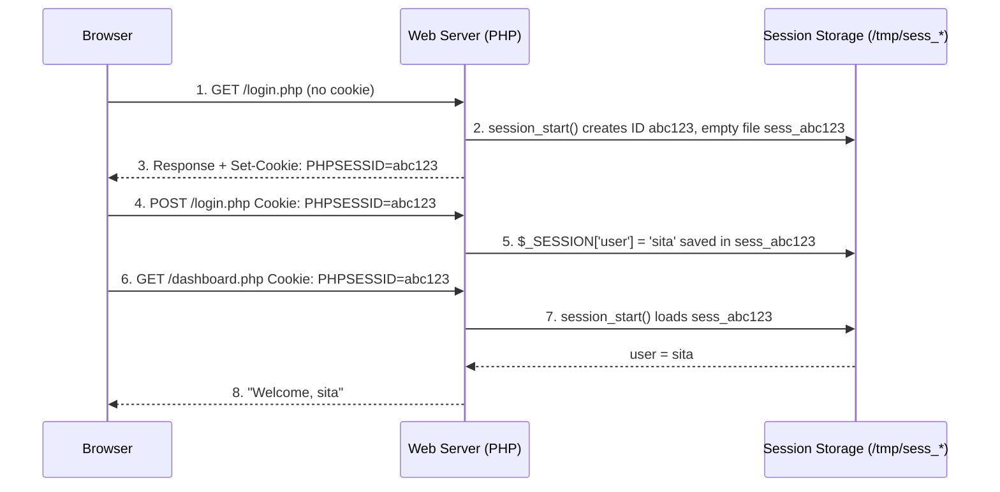

# Unit 5: File Handling, Sessions, and Error Handling
**Course:** Internet Technology II (CMP 273) · **Teaching hours:** 6

## Learning Objectives

After this unit, you will be able to:

- Explain why file handling matters in web applications: reading content, storing user-generated content, and logging.
- Choose the correct file mode (`r`, `w`, `a`, `x` and their `+` versions) for a given task, and read and write files in PHP.
- Describe file permissions and the main security risks of working with files (path traversal, uploads in the web root, race conditions).
- Differentiate between `include`, `require`, `include_once` and `require_once`, and use them to build reusable templates and config files.
- Manage user state with cookies and sessions, and explain how a session works behind the scenes.
- Implement session-based authentication (login/logout) and role-based authorization (admin vs user).
- Handle errors and exceptions gracefully using `try`/`catch`/`finally`, custom exceptions, and global handlers.

---

## 5.1 Reading from and writing to files

### What is file handling?

**File handling** means opening, reading, writing, and closing files on the server's disk from a PHP script. The file lives on the **server**, not on the visitor's computer. PHP runs on the server, so it can only touch the server's file system.

### Why file handling matters

A database is the usual place to store data, but files are still used every day in web applications:

| Use | Example |
|-----|---------|
| **Reading content** | Load a terms-and-conditions text, a JSON config, a template, or a list of districts of Nepal from a file. |
| **Storing user-generated content** | Save uploaded profile photos, assignments (PDF), feedback messages, or exported reports (CSV). |
| **Logging** | Record logins, errors, and payments in a log file so the admin can check what happened later. |
| **Simple data storage** | Small sites (a visitor counter, a guestbook) can store data in a text file without a database. |
| **Data exchange** | Import student marks from a CSV prepared in Excel, or export them for the exam section. |

> **Teacher's Note:** Start with an analogy. Opening a file is like borrowing a register from the college office: you must say *why* you want it (to read, to write, or to add new entries at the end), you work with it, and you must give it back (close it). The "why" is the **mode**.

### 5.1.1 Opening a file: `fopen()` and file modes

```php
$handle = fopen(string $filename, string $mode);
```

`fopen()` returns a **file handle** (a resource) on success, or `false` on failure. You then pass this handle to `fread()`, `fwrite()`, `fgets()`, and finally `fclose()`.

The **mode** tells PHP what you want to do and where the **file pointer** (the current read/write position) starts.

| Mode | Meaning | Read? | Write? | If file does not exist | If file exists | Pointer starts at |
|------|---------|:-----:|:------:|------------------------|----------------|-------------------|
| `r`  | Read only | Yes | No | Fails (returns `false`, warning) | Opens it | Beginning |
| `r+` | Read and write | Yes | Yes | Fails | Opens it (no truncation) | Beginning |
| `w`  | Write only | No | Yes | Creates it | **Erases all content** (truncates to 0) | Beginning |
| `w+` | Read and write | Yes | Yes | Creates it | **Erases all content** | Beginning |
| `a`  | Append (write only) | No | Yes | Creates it | Keeps content | End (all writes go to end) |
| `a+` | Read and append | Yes | Yes | Creates it | Keeps content | Reading: beginning; writing: always end |
| `x`  | Exclusive create, write only | No | Yes | Creates it | **Fails** (returns `false`, warning) | Beginning |
| `x+` | Exclusive create, read and write | Yes | Yes | Creates it | **Fails** | Beginning |

**When to use which mode:**

| Task | Best mode | Why |
|------|-----------|-----|
| Show the contents of a notice file | `r` | Only reading, file must already exist. |
| Update a counter stored in a file | `r+` (or `c+`) | Read the number, then overwrite it. |
| Generate a fresh report every day | `w` | Old content should be replaced. |
| Write to a log or guestbook | `a` | New lines must be added, never lose old ones. |
| Read old log entries and add a new one | `a+` | Read from start, write at end. |
| Create a file only if it is new (e.g. a lock file, a unique receipt) | `x` | Prevents accidentally overwriting an existing file. |

> **Common Mistake:** Using `w` to "add" a line to a log file. `w` empties the file first, so you lose all previous entries. Use `a` to add to the end.

> **Exam Tip:** The fopen modes table is a favourite 5-mark question ("Explain different file opening modes in PHP"). Write the table with columns *mode, read/write, file missing, file exists, pointer position*, then give one use case per mode.

### 5.1.2 Writing to a file: `fwrite()` and `fclose()`

`fwrite($handle, $string)` writes a string and returns the number of bytes written (or `false` on failure). `fclose($handle)` closes the file and frees the resource. `fputs()` is an alias of `fwrite()`.

**Example 5.1: Writing student names to a file**

```php
<?php
// write_students.php
$file = 'students.txt';

$handle = fopen($file, 'w');          // create or empty the file
if ($handle === false) {
    die("Cannot open $file for writing.");
}

$students = ['Aarav Shrestha', 'Sita Gurung', 'Bikash Thapa'];

foreach ($students as $name) {
    fwrite($handle, $name . PHP_EOL);  // PHP_EOL = newline for the server OS
}

fclose($handle);
echo "Saved " . count($students) . " students to $file";
```

**Output:**
```
Saved 3 students to students.txt
```

Contents of `students.txt`:
```
Aarav Shrestha
Sita Gurung
Bikash Thapa
```

### 5.1.3 Reading a file: `fread()`, `fgets()`, `fgetc()`, `feof()`

| Function | Reads | Typical use |
|----------|-------|-------------|
| `fread($h, $length)` | Up to `$length` bytes | Read a whole small file, or a binary file in chunks |
| `fgets($h)` | One line (including the newline) | Process a file line by line (logs, lists) |
| `fgetc($h)` | One character | Count characters, simple parsing |
| `feof($h)` | Returns `true` when the pointer is at end of file | Loop condition |
| `filesize($file)` | Size in bytes | Used with `fread()` to read everything |

**Example 5.2: Reading the whole file with `fread()`**

```php
<?php
$file = 'students.txt';
$handle = fopen($file, 'r');
$content = fread($handle, filesize($file));  // read all bytes
fclose($handle);

echo nl2br(htmlspecialchars($content));      // safe output, newlines -> <br>
```

**Output (in browser):**
```
Aarav Shrestha
Sita Gurung
Bikash Thapa
```

**Example 5.3: Reading line by line with `fgets()`**

```php
<?php
$handle = fopen('students.txt', 'r');
$lineNo = 1;

// fgets() returns false at end of file, so this loop stops cleanly
while (($line = fgets($handle)) !== false) {
    echo $lineNo . ". " . htmlspecialchars(trim($line)) . "<br>";
    $lineNo++;
}
fclose($handle);
```

**Output:**
```
1. Aarav Shrestha
2. Sita Gurung
3. Bikash Thapa
```

Reading line by line uses very little memory, so it works even for a 500 MB log file. `fread($h, filesize(...))` loads everything into memory at once.

> **Common Mistake:** Writing `while (!feof($handle)) { $line = fgets($handle); ... }`. After the last line, `feof()` is still `false` until a read *fails*, so the loop runs one extra time with `$line === false`, and you print an empty line. The safer pattern is `while (($line = fgets($handle)) !== false)`.

**Example 5.4: Counting vowels with `fgetc()` and `feof()`**

```php
<?php
file_put_contents('word.txt', 'Pokhara');   // create a small test file

$handle = fopen('word.txt', 'r');
$vowels = 0;

while (!feof($handle)) {
    $ch = fgetc($handle);            // returns false at the very end
    if ($ch !== false && str_contains('aeiouAEIOU', $ch)) {
        $vowels++;
    }
}
fclose($handle);

echo "Vowels: $vowels";
```

**Output:**
```
Vowels: 3
```

("Pokhara" has o, a, a.)

### 5.1.4 The shortcut functions: `file_get_contents()`, `file_put_contents()`, `file()`

For most everyday tasks you do not need `fopen`/`fclose`. These functions open, read/write, and close in one call.

| Function | What it does | Returns |
|----------|-------------|---------|
| `file_get_contents($file)` | Reads the whole file into a string | String, or `false` |
| `file_put_contents($file, $data)` | Writes data, **replacing** the file (like `w`) | Bytes written, or `false` |
| `file_put_contents($file, $data, FILE_APPEND)` | Writes data at the **end** (like `a`) | Bytes written, or `false` |
| `file_put_contents($file, $data, FILE_APPEND \| LOCK_EX)` | Appends with an exclusive lock | Bytes written, or `false` |
| `file($file)` | Reads the file into an **array**, one element per line | Array, or `false` |

`file()` accepts useful flags: `FILE_IGNORE_NEW_LINES` (remove `\n` from each element) and `FILE_SKIP_EMPTY_LINES`.

**Example 5.5: Shortcut functions in action**

```php
<?php
$file = 'notice.txt';

file_put_contents($file, "Exam starts on Baisakh 10." . PHP_EOL);         // overwrite
file_put_contents($file, "Bring your admit card." . PHP_EOL, FILE_APPEND); // append

echo file_get_contents($file);
echo "-----" . PHP_EOL;

$lines = file($file, FILE_IGNORE_NEW_LINES | FILE_SKIP_EMPTY_LINES);
echo "Number of lines: " . count($lines) . PHP_EOL;
echo "First line: " . $lines[0] . PHP_EOL;
```

**Output (CLI):**
```
Exam starts on Baisakh 10.
Bring your admit card.
-----
Number of lines: 2
First line: Exam starts on Baisakh 10.
```

> **Teacher's Note:** Run examples from the command line (`php example.php`) when the output is plain text; it avoids the "why are my newlines missing?" confusion in the browser. In the browser, use `nl2br()` or `<pre>`.

### 5.1.5 Other useful file-system functions

| Function | Purpose | Example |
|----------|---------|---------|
| `file_exists($path)` | Does the file or folder exist? | `if (file_exists('data.txt'))` |
| `is_file($path)` / `is_dir($path)` | Is it a regular file / a directory? | `is_dir('uploads')` |
| `filesize($file)` | Size in bytes | `filesize('photo.jpg')` |
| `unlink($file)` | Delete a file | `unlink('old.log')` |
| `copy($src, $dest)` | Copy a file | `copy('a.txt', 'backup/a.txt')` |
| `rename($old, $new)` | Rename **or move** a file | `rename('a.txt', 'archive/a.txt')` |
| `mkdir($dir, $perm, $recursive)` | Create a directory | `mkdir('uploads/2025', 0755, true)` |
| `rmdir($dir)` | Remove an **empty** directory | `rmdir('temp')` |
| `scandir($dir)` | List files in a directory | `scandir('uploads')` |
| `filemtime($file)` | Last modified time (Unix timestamp) | `date('Y-m-d', filemtime('a.txt'))` |

**Example 5.6: Managing files safely**

```php
<?php
$file = 'report.txt';
file_put_contents($file, "Semester III result report");

if (file_exists($file)) {
    echo "$file exists, size: " . filesize($file) . " bytes" . PHP_EOL;
}

if (!is_dir('backup')) {
    mkdir('backup', 0755);                 // create folder once
}

copy($file, 'backup/report_copy.txt');
rename($file, 'final_report.txt');

echo file_exists('report.txt') ? "report.txt still here" : "report.txt renamed";
echo PHP_EOL;

unlink('final_report.txt');                 // delete
echo file_exists('final_report.txt') ? "Not deleted" : "final_report.txt deleted";
```

**Output:**
```
report.txt exists, size: 26 bytes
report.txt renamed
final_report.txt deleted
```

> **Common Mistake:** Calling `unlink()` or `filesize()` without first checking `file_exists()`. On a missing file PHP raises a warning. Always check, or handle the `false` return value.

### 5.1.6 Working with CSV files: `fputcsv()` and `fgetcsv()`

**CSV** (Comma-Separated Values) is a plain-text table format that Excel and Google Sheets can open. `fputcsv()` writes one array as one CSV row (adding quotes where needed), and `fgetcsv()` reads one row back as an array.

**Example 5.7: Writing and reading student marks as CSV**

```php
<?php
$file = 'marks.csv';

// ---- Write ----
$rows = [
    ['Roll', 'Name', 'Marks'],
    [1, 'Aarav Shrestha', 78],
    [2, 'Sita Gurung', 91],
    [3, 'Thapa, Bikash', 65],     // comma inside the value: fputcsv quotes it
];

$out = fopen($file, 'w');
foreach ($rows as $row) {
    fputcsv($out, $row, ',', '"', '\\');
}
fclose($out);

// ---- Read ----
$in = fopen($file, 'r');
$header = fgetcsv($in, null, ',', '"', '\\');   // first row = column names
$total = 0;
$count = 0;

while (($data = fgetcsv($in, null, ',', '"', '\\')) !== false) {
    echo str_pad($data[1], 16) . $data[2] . PHP_EOL;
    $total += (int) $data[2];
    $count++;
}
fclose($in);

echo "Average: " . round($total / $count, 2) . PHP_EOL;
```

**Output:**
```
Aarav Shrestha  78
Sita Gurung     91
Thapa, Bikash   65
Average: 78
```

The file `marks.csv` contains:
```
Roll,Name,Marks
1,"Aarav Shrestha",78
2,"Sita Gurung",91
3,"Thapa, Bikash",65
```

(`fputcsv` quotes values that contain spaces or commas.)

> **Beyond the syllabus:** In PHP 8.4 you get a deprecation notice if you do not pass the `escape` argument to `fputcsv`/`fgetcsv`. That is why the example passes `','`, `'"'`, `'\\'` explicitly.

### 5.1.7 Practical example: visitor counter

**Example 5.8: Text-file visitor counter**

```php
<?php
// counter.php
$file = 'counter.txt';

if (!file_exists($file)) {
    file_put_contents($file, '0');
}

$count = (int) file_get_contents($file);
$count++;
file_put_contents($file, (string) $count, LOCK_EX);  // lock while writing
?>
<!DOCTYPE html>
<html>
<head><title>Visitor Counter</title></head>
<body>
    <h2>Welcome to Pokhara University BCSIT Portal</h2>
    <p>You are visitor number <strong><?= $count ?></strong>.</p>
</body>
</html>
```

**Output (third time the page is loaded):**
```
Welcome to Pokhara University BCSIT Portal
You are visitor number 3.
```

This simple version can lose a count if two visitors arrive at the exact same moment (both read 5, both write 6). Section 5.2.5 fixes this with `flock()`.

### 5.1.8 Practical example: a simple log

**Example 5.9: Logging events to a file**

```php
<?php
// logger.php
function writeLog(string $level, string $message): void
{
    $line = sprintf("[%s] [%s] %s%s",
        date('Y-m-d H:i:s'),
        strtoupper($level),
        $message,
        PHP_EOL
    );
    // FILE_APPEND keeps old entries, LOCK_EX prevents mixed-up lines
    file_put_contents(__DIR__ . '/app.log', $line, FILE_APPEND | LOCK_EX);
}

writeLog('info', 'User sita logged in');
writeLog('warning', 'Wrong password for user bikash');
writeLog('error', 'Database connection failed');

// Show the last 2 log lines
$lines = file(__DIR__ . '/app.log', FILE_IGNORE_NEW_LINES);
foreach (array_slice($lines, -2) as $l) {
    echo $l . PHP_EOL;
}
```

**Output (date and time will differ):**
```
[2025-04-23 10:15:02] [WARNING] Wrong password for user bikash
[2025-04-23 10:15:02] [ERROR] Database connection failed
```

> **Teacher's Note:** Ask students: "Where would you look if a user says *I could not log in yesterday at 3 PM*?" The answer, a log file, makes the purpose of logging obvious. Keep this `writeLog()` function; it is reused in 5.6.

---

## 5.2 Understanding file permissions and security considerations

### 5.2.1 File permissions (rwx)

On Linux servers (where most PHP sites run), every file and folder has **permissions** for three groups of people:

| Who | Meaning |
|-----|---------|
| **Owner (u)** | The user who owns the file (often your account or `www-data`) |
| **Group (g)** | Users in the file's group |
| **Others (o)** | Everyone else |

Each group can have three rights:

| Letter | Right | On a file | On a directory | Value |
|--------|-------|-----------|----------------|-------|
| `r` | read | View contents | List the files inside | 4 |
| `w` | write | Change contents | Create/delete files inside | 2 |
| `x` | execute | Run as a program | Enter (`cd`) the directory | 1 |

You add the values to get one digit per group. For example `rw-` = 4 + 2 + 0 = **6**, and `r-x` = 4 + 0 + 1 = **5**.

| Octal | Symbolic | Meaning | Typical use |
|-------|----------|---------|-------------|
| `644` | `rw-r--r--` | Owner reads/writes, others read only | Normal PHP, HTML, CSS files |
| `755` | `rwxr-xr-x` | Owner full, others read and enter | Directories, scripts |
| `600` | `rw-------` | Only the owner can read/write | Config file with DB password |
| `700` | `rwx------` | Only the owner can do anything | Private directory |
| `777` | `rwxrwxrwx` | **Everyone can do everything** | **Never use in production** |

When you run `ls -l` you see something like:

```
-rw-r--r--  1 www-data www-data  1024 Apr 23 10:00 index.php
drwxr-xr-x  2 www-data www-data  4096 Apr 23 10:00 uploads
```

The first character is `-` for a file and `d` for a directory; the next nine characters are the rwx bits for owner, group, others.

### 5.2.2 Changing and checking permissions in PHP

| Function | Purpose |
|----------|---------|
| `chmod($file, 0644)` | Change permissions (the leading `0` means octal, it is required) |
| `is_readable($file)` | Can PHP read this file? |
| `is_writable($file)` | Can PHP write to this file/folder? |
| `fileperms($file)` | Get the permission bits |

**Example 5.10: Checking permissions before writing**

```php
<?php
$file = 'settings.txt';
file_put_contents($file, "theme=dark");

chmod($file, 0644);                                   // rw-r--r--
printf("Permissions: %o\n", fileperms($file) & 0777); // show as octal

echo is_readable($file) ? "Readable\n" : "Not readable\n";
echo is_writable($file) ? "Writable\n" : "Not writable\n";

$dir = 'uploads';
if (!is_dir($dir)) {
    mkdir($dir, 0755);
}
echo is_writable($dir) ? "Can save uploads\n" : "Fix folder permissions first\n";
```

**Output (when run by the file owner):**
```
Permissions: 644
Readable
Writable
Can save uploads
```

> **Common Mistake:** Writing `chmod($file, 644)` without the leading zero. PHP reads 644 as a *decimal* number, which is a completely different set of permissions. Always write `0644`, `0755`.

> **Common Mistake:** "My upload does not work, so I set the folder to 777." This lets any user on the server write and run files there. Instead, make the web server user the owner of the folder and use `755`.

### 5.2.3 Path traversal and `basename()`

**Path traversal** (also called directory traversal) is an attack where the user supplies a file name containing `../` to escape the intended folder and read secret files.

Vulnerable code:

```php
<?php
// view.php?file=notice1.txt  -- DANGEROUS, do not use
$file = $_GET['file'];
echo file_get_contents('notices/' . $file);
```

An attacker visits:

```
view.php?file=../../../../etc/passwd
view.php?file=../config.php
```

and the script happily prints the system's user list or your database password.

**Defences:**

1. Strip directory parts with `basename()`: `basename('../../etc/passwd')` returns `'passwd'`.
2. Better: use a **whitelist** of allowed files.
3. Check the final real path stays inside the allowed folder using `realpath()`.

**Example 5.11: Safe file viewer**

```php
<?php
// view.php?file=exam.txt
$allowed = ['exam.txt', 'holiday.txt', 'fees.txt'];   // whitelist

$requested = basename($_GET['file'] ?? '');            // remove any ../ parts

if (!in_array($requested, $allowed, true)) {
    http_response_code(404);
    exit('Notice not found.');
}

$path = __DIR__ . '/notices/' . $requested;

if (!is_readable($path)) {
    exit('Notice is not available right now.');
}

echo '<pre>' . htmlspecialchars(file_get_contents($path)) . '</pre>';
```

**Output for `view.php?file=../../etc/passwd`:**
```
Notice not found.
```

### 5.2.4 Storing uploads outside the web root

The **web root** (document root) is the folder the web server serves directly, for example `/var/www/html` or `C:\xampp\htdocs`. Anything inside it can be opened with a URL.

If a user uploads `shell.php` into `htdocs/uploads/` and you do not check it, they can visit `http://site/uploads/shell.php` and **run their own PHP code on your server**.

Safer layout:

```
/var/www/
├── private_uploads/      <- NOT reachable by URL
│   └── 6631a9f2c1e4.pdf
├── config/
│   └── db.php            <- secrets also outside web root
└── html/                 <- web root
    ├── index.php
    └── download.php      <- checks login, then streams the file
```

Rules for user files:

- Save uploads **outside** the web root (or in a folder where PHP execution is disabled).
- **Rename** files to a random name (`bin2hex(random_bytes(8)) . '.pdf'`); never keep the user's file name.
- Do not trust `$_FILES['x']['type']`; the browser sends it and it can be faked. Check the real type with `finfo_file()` and check the extension against a whitelist.
- Serve the file through a PHP script (`download.php`) that checks the user is logged in, then uses `readfile()`.

**Example 5.12: Serving a private file through PHP**

```php
<?php
// download.php?id=6631a9f2c1e4
session_start();
if (!isset($_SESSION['user_id'])) {
    http_response_code(403);
    exit('Please log in.');
}

$id = $_GET['id'] ?? '';
if (!preg_match('/^[a-f0-9]{12}$/', $id)) {   // only our own random names
    exit('Invalid file id.');
}

$path = dirname(__DIR__) . '/private_uploads/' . $id . '.pdf';
if (!is_file($path)) {
    exit('File not found.');
}

header('Content-Type: application/pdf');
header('Content-Disposition: attachment; filename="assignment.pdf"');
header('Content-Length: ' . filesize($path));
readfile($path);
```

**Output:** The browser downloads `assignment.pdf` for a logged-in user, or shows `Please log in.` otherwise.

### 5.2.5 File locking with `flock()`

When two requests write to the same file at the same moment, their data can mix or one update can be lost (a **race condition**). `flock()` lets one script lock the file while it works.

| Lock constant | Meaning |
|---------------|---------|
| `LOCK_SH` | Shared lock: many readers allowed at once |
| `LOCK_EX` | Exclusive lock: only one writer, no readers |
| `LOCK_UN` | Release the lock |

**Example 5.13: Race-free visitor counter**

```php
<?php
$file = 'counter.txt';

$fp = fopen($file, 'c+');          // c+ : read/write, create if missing, do NOT truncate
if (flock($fp, LOCK_EX)) {          // wait until we get the exclusive lock
    $count = (int) stream_get_contents($fp);
    $count++;

    ftruncate($fp, 0);              // empty the file
    rewind($fp);                    // move pointer back to start
    fwrite($fp, (string) $count);
    fflush($fp);                    // push data to disk before unlocking

    flock($fp, LOCK_UN);            // release the lock
}
fclose($fp);

echo "Total visits: $count";
```

**Output (if the file held 41 before):**
```
Total visits: 42
```

`c+` is not in the main syllabus table but is handy here: it opens for read/write like `r+`, yet creates the file if it is missing, and does not empty it like `w+` would.

> **Teacher's Note:** Demonstrate the race condition by explaining two cashiers updating the same paper ledger: both read "Rs. 5000", both add Rs. 500, both write "Rs. 5500". One deposit is lost. A lock means "only one cashier holds the ledger at a time".

> **Exam Tip:** For "What are the security considerations while handling files in PHP?", list: correct permissions (644/755, never 777), validate file names (basename/whitelist against path traversal), store uploads outside the web root with random names, validate real file type, use `flock()` for concurrent writes, and check return values.

---

## 5.3 File Inclusion (Include and Require)

### What is file inclusion?

**File inclusion** lets you insert the contents of one PHP file into another, at the point where the statement appears, before that code runs. It is how we avoid copying the same header, menu, footer, database connection, or functions into every page (the **DRY** principle: Don't Repeat Yourself).

```php
include 'header.php';
require 'config.php';
include_once 'functions.php';
require_once 'db.php';
```

They are language constructs, so brackets are optional: `require 'a.php';` and `require('a.php');` both work.

### include vs require

The only difference is what happens when the file **cannot be found**:

- `include` gives a **warning** (`E_WARNING`) and the script **continues**.
- `require` gives a **fatal error** and the script **stops**.

The `_once` versions do the same but first check whether that file has already been included; if yes, they skip it.

| Feature | `include` | `require` | `include_once` | `require_once` |
|---------|-----------|-----------|----------------|----------------|
| File missing | Warning, script continues | Fatal error, script stops | Warning, continues | Fatal error, stops |
| Includes same file twice? | Yes, every time it is called | Yes | No, only the first time | No, only the first time |
| Speed | Slightly faster | Slightly faster | Small extra check | Small extra check |
| Return value | `false` on failure (or the file's `return` value) | File's `return` value | `true` if already included | `true` if already included |
| Best for | Optional parts (ads, sidebar, banner) | Essential parts that the page cannot work without | Optional files with functions | Config, DB connection, function and class libraries |

> **Exam Tip:** "Differentiate between include and require" appears very often. Write the table, then one line: *use `require` when the page cannot work without the file (config, DB), and `include` when the page can still work without it (a sidebar or advertisement)*. Mention that `_once` prevents "Cannot redeclare function" errors.

**Example 5.14: Seeing the difference**

```php
<?php
echo "Start" . PHP_EOL;
include 'missing_sidebar.php';     // warning, keeps going
echo "After include" . PHP_EOL;
require 'missing_config.php';      // fatal error, stops here
echo "After require" . PHP_EOL;    // never printed
```

**Output:**
```
Start
Warning: include(missing_sidebar.php): Failed to open stream: No such file or directory in ... on line 3
Warning: include(): Failed opening 'missing_sidebar.php' for inclusion ... on line 3
After include
Warning: require(missing_config.php): Failed to open stream: No such file or directory in ... on line 5
Fatal error: Uncaught Error: Failed opening required 'missing_config.php' ... on line 5
```

**Example 5.15: Why `_once` matters**

```php
<?php
// functions.php
function grade(int $marks): string
{
    return match (true) {
        $marks >= 90 => 'A+',
        $marks >= 80 => 'A',
        $marks >= 70 => 'B+',
        $marks >= 60 => 'B',
        default      => 'C or below',
    };
}
```

```php
<?php
// result.php
require_once 'functions.php';
require_once 'functions.php';   // skipped: already included

echo "Sita: " . grade(91) . PHP_EOL;
echo "Bikash: " . grade(65) . PHP_EOL;
```

**Output:**
```
Sita: A+
Bikash: B
```

If you used plain `require` twice, PHP would stop with `Fatal error: Cannot redeclare grade()`.

### 5.3.1 Header/footer template example

Most websites share the same header, navigation, and footer. Put them in separate files and include them in every page.

```
project/
├── includes/
│   ├── header.php
│   └── footer.php
├── index.php
└── about.php
```

**`includes/header.php`**

```php
<?php
// $pageTitle should be set by the page before including this file
$pageTitle = $pageTitle ?? 'BCSIT Portal';
?>
<!DOCTYPE html>
<html lang="en">
<head>
    <meta charset="UTF-8">
    <title><?= htmlspecialchars($pageTitle) ?></title>
    <link rel="stylesheet" href="style.css">
</head>
<body>
<header>
    <h1>BCSIT Student Portal</h1>
    <nav>
        <a href="index.php">Home</a> |
        <a href="about.php">About</a>
    </nav>
</header>
<main>
```

**`includes/footer.php`**

```php
</main>
<footer>
    <p>&copy; <?= date('Y') ?> Pokhara University. All rights reserved.</p>
</footer>
</body>
</html>
```

**`index.php`**

```php
<?php
$pageTitle = 'Home';
require __DIR__ . '/includes/header.php';
?>
    <h2>Welcome</h2>
    <p>Check the latest notices and your results here.</p>
<?php require __DIR__ . '/includes/footer.php'; ?>
```

**Output (HTML sent to the browser, year will match the current year):**
```html
<!DOCTYPE html>
<html lang="en">
<head>
    <meta charset="UTF-8">
    <title>Home</title>
    ...
<h1>BCSIT Student Portal</h1>
...
    <h2>Welcome</h2>
    <p>Check the latest notices and your results here.</p>
</main>
<footer>
    <p>&copy; 2025 Pokhara University. All rights reserved.</p>
</footer>
```

Changing the menu now means editing **one** file, not twenty.

> **Common Mistake:** Using a relative path like `include 'includes/header.php';` from a page inside a sub-folder. Relative paths are resolved from the current working directory, which may not be the folder you think. Use `__DIR__ . '/includes/header.php'` to build a path from the current file's own folder.

### 5.3.2 Config file example

A config file keeps settings (database credentials, site name, debug mode) in one place. A neat pattern is a file that **returns an array**.

**`config.php`** (keep it outside the web root in real projects, permission `600` or `640`)

```php
<?php
return [
    'site_name' => 'BCSIT Student Portal',
    'db' => [
        'host' => 'localhost',
        'user' => 'portal_user',
        'pass' => 'S3cret!Pass',
        'name' => 'bcsit_db',
    ],
    'debug' => false,
];
```

**`db.php`**

```php
<?php
$config = require __DIR__ . '/config.php';   // require returns the array

mysqli_report(MYSQLI_REPORT_ERROR | MYSQLI_REPORT_STRICT);
$conn = new mysqli(
    $config['db']['host'],
    $config['db']['user'],
    $config['db']['pass'],
    $config['db']['name']
);
$conn->set_charset('utf8mb4');
```

**`test.php`**

```php
<?php
$config = require __DIR__ . '/config.php';
echo "Site: " . $config['site_name'] . PHP_EOL;
echo "Debug mode: " . ($config['debug'] ? 'ON' : 'OFF') . PHP_EOL;
```

**Output:**
```
Site: BCSIT Student Portal
Debug mode: OFF
```

> **Teacher's Note:** Show that a `.php` config file is safer than `config.txt` or `config.ini` inside the web root: if someone requests `config.php` by URL, PHP runs it and prints nothing, while a `.txt` file would be displayed in plain text with the password.

> **Common Mistake:** Including a file using user input: `include $_GET['page'] . '.php';`. This allows **Local/Remote File Inclusion (LFI/RFI)** attacks. If you need dynamic pages, map the input to a whitelist: `$pages = ['home' => 'home.php', 'about' => 'about.php']; include $pages[$page] ?? 'home.php';`.

---

## 5.4 Managing sessions and cookies

### 5.4.1 HTTP is stateless

**HTTP is a stateless protocol.** Every request the browser sends is independent; the server does not automatically remember anything about the previous request. When Sita logs in on `login.php` and then clicks "My Results", the server sees the second request as coming from a stranger.

To remember a user across pages (logged-in status, shopping cart, language choice), we need **state management**. PHP gives two main tools:

- **Cookies**: small pieces of data stored in the **browser**, sent back to the server with every request.
- **Sessions**: data stored on the **server**, linked to the browser by a session ID (which itself travels in a cookie).

> **Teacher's Note:** Analogy: a cookie is like writing your preferences on a card and carrying it in your pocket; you show it every time you enter the shop. A session is like a locker at the shop: the shop keeps your things, you only carry the locker number (session ID).

### 5.4.2 Cookie vs session

| Feature | Cookie | Session |
|---------|--------|---------|
| Where data is stored | Client (browser) | Server (files by default, or DB/Redis) |
| What the browser holds | The actual data | Only a session ID (`PHPSESSID`) |
| Size limit | About 4 KB per cookie | Limited only by server resources |
| Security | User can see and edit it; do not store secrets | Data hidden from the user; safer |
| Lifetime | Until the `expires` time (can be days/months) | Usually until the browser closes or after inactivity (~24 min default GC) |
| Sent with every request? | Yes, all cookies for that path/domain | Only the ID is sent |
| PHP functions | `setcookie()`, `$_COOKIE` | `session_start()`, `$_SESSION` |
| Typical use | "Remember me", language/theme preference, tracking | Login state, user role, shopping cart, flash messages |

> **Exam Tip:** "Differentiate between cookies and sessions" is a very common 5-mark question. Write at least 6 rows of the table and end with a one-line example of each (cookie: remember theme; session: logged-in user).

### 5.4.3 Creating cookies with `setcookie()`

```php
setcookie(string $name, string $value = "", array $options = []): bool
```

Since PHP 7.3 the recommended form passes an **options array**:

| Option | Meaning | Example |
|--------|---------|---------|
| `expires` | Unix timestamp when the cookie expires. `0` = session cookie (deleted when browser closes) | `time() + 86400 * 30` (30 days) |
| `path` | URL path where the cookie is sent | `'/'` = whole site |
| `domain` | Domain that receives the cookie | `'example.com.np'` |
| `secure` | Send only over HTTPS | `true` |
| `httponly` | JavaScript cannot read it (`document.cookie`); protects against XSS cookie theft | `true` |
| `samesite` | Controls cross-site sending: `'Strict'`, `'Lax'`, or `'None'` (None needs `secure`); protects against CSRF | `'Lax'` |

**Important rule:** `setcookie()` sends an HTTP header, so it must be called **before any output** (before any HTML, `echo`, or even a blank line before `<?php`). Otherwise you get "Cannot modify header information - headers already sent".

Also, a new cookie is **not visible in `$_COOKIE` on the same request**; it appears from the next request, because the browser has to send it back first.

**Example 5.16: Setting a theme preference cookie**

```php
<?php
// set_theme.php?theme=dark
$allowed = ['light', 'dark'];
$theme = $_GET['theme'] ?? 'light';

if (in_array($theme, $allowed, true)) {
    setcookie('theme', $theme, [
        'expires'  => time() + 60 * 60 * 24 * 30,  // 30 days
        'path'     => '/',
        'secure'   => false,      // set true on an HTTPS site
        'httponly' => true,
        'samesite' => 'Lax',
    ]);
    echo "Theme set to $theme. Reload any page to see it.";
} else {
    echo "Invalid theme.";
}
```

**Output (`set_theme.php?theme=dark`):**
```
Theme set to dark. Reload any page to see it.
```

### 5.4.4 Reading cookies with `$_COOKIE`

**Example 5.17: Reading the cookie**

```php
<?php
// home.php
$theme = $_COOKIE['theme'] ?? 'light';            // default if not set
if (!in_array($theme, ['light', 'dark'], true)) {  // cookies can be edited by the user
    $theme = 'light';
}
?>
<!DOCTYPE html>
<html>
<head>
    <title>Home</title>
    <style>
        body.dark  { background: #222; color: #eee; }
        body.light { background: #fff; color: #222; }
    </style>
</head>
<body class="<?= htmlspecialchars($theme) ?>">
    <p>Current theme: <?= htmlspecialchars($theme) ?></p>
</body>
</html>
```

**Output (after Example 5.16 ran):**
```
Current theme: dark
```

> **Common Mistake:** Trusting a cookie value, e.g. `setcookie('role', 'user')` and later `if ($_COOKIE['role'] === 'admin')`. The user can change the cookie to `admin` in the browser's developer tools in seconds. Never store roles, prices, or login status in a cookie; store them in the session.

### 5.4.5 Deleting a cookie

To delete a cookie, set it again with the **same name and path** and an expiry time in the **past**.

**Example 5.18: Deleting the theme cookie**

```php
<?php
setcookie('theme', '', [
    'expires' => time() - 3600,   // one hour ago
    'path'    => '/',             // must match the path used when setting
]);
unset($_COOKIE['theme']);         // also remove it from the current request
echo "Theme preference removed.";
```

**Output:**
```
Theme preference removed.
```

### 5.4.6 Sessions: `session_start()` and `$_SESSION`

A **session** stores data on the server for one visitor. PHP gives each visitor a unique, random **session ID**, stores it in a cookie named `PHPSESSID`, and keeps the data in a file on the server (for example `/tmp/sess_k3j9...`).

| Function / variable | Purpose |
|---------------------|---------|
| `session_start()` | Start a new session or resume the existing one. Call at the top of **every** page that uses sessions, before any output. |
| `$_SESSION['key'] = value` | Store a value |
| `$_SESSION['key']` | Read a value |
| `unset($_SESSION['key'])` | Remove one value |
| `session_unset()` | Remove **all** values (same as `$_SESSION = []`), session still exists |
| `session_destroy()` | Destroy the session data on the server (the cookie stays in the browser) |
| `session_id()` | Get the current session ID |
| `session_regenerate_id(true)` | Give the session a new ID and delete the old one (use after login) |
| `session_status()` | `PHP_SESSION_ACTIVE`, `PHP_SESSION_NONE`, or `PHP_SESSION_DISABLED` |

### 5.4.7 How a session works



The same flow in plain text (for exam answers):

```
 Browser                          Server
 -------                          ------
 1st request (no cookie)  ----->  session_start()
                                  creates ID = abc123, file sess_abc123
                          <-----  Set-Cookie: PHPSESSID=abc123

 Next request             ----->  Cookie: PHPSESSID=abc123
                                  session_start() reads sess_abc123
                                  fills $_SESSION array
                          <-----  page using $_SESSION data

 End of script: PHP writes $_SESSION back to sess_abc123 automatically
```

> **Exam Tip:** For "Explain how session works in PHP", draw the diagram above and mention three points: (1) the server creates a unique session ID, (2) the ID is sent to the browser as the `PHPSESSID` cookie, (3) on each request the browser sends the ID back and PHP loads the matching data into `$_SESSION`.

**Example 5.19: Storing and reading session data across two pages**

```php
<?php
// page1.php
session_start();
$_SESSION['name'] = 'Sita Gurung';
$_SESSION['program'] = 'BCSIT';
echo "Session data saved. Session ID: " . session_id();
echo '<br><a href="page2.php">Go to page 2</a>';
```

```php
<?php
// page2.php
session_start();
if (isset($_SESSION['name'])) {
    echo "Hello, " . htmlspecialchars($_SESSION['name'])
       . " (" . htmlspecialchars($_SESSION['program']) . ")";
} else {
    echo "No session data found.";
}
```

**Output (page1.php, ID will differ):**
```
Session data saved. Session ID: 9q1vbl3m0d5p8k2u7fh4rj6c1s
Go to page 2
```

**Output (page2.php):**
```
Hello, Sita Gurung (BCSIT)
```

### 5.4.8 Ending a session: `session_unset()` and `session_destroy()`

`session_destroy()` deletes the server-side data but does not empty `$_SESSION` for the rest of the current script and does not delete the browser's cookie. A complete "end session" therefore has three steps:

```php
<?php
session_start();

$_SESSION = [];                          // 1. clear the array (or session_unset())

if (ini_get('session.use_cookies')) {    // 2. delete the session cookie
    $p = session_get_cookie_params();
    setcookie(session_name(), '', [
        'expires'  => time() - 42000,
        'path'     => $p['path'],
        'domain'   => $p['domain'],
        'secure'   => $p['secure'],
        'httponly' => $p['httponly'],
        'samesite' => $p['samesite'],
    ]);
}

session_destroy();                       // 3. delete the data on the server
echo "Session ended.";
```

**Output:**
```
Session ended.
```

| | `session_unset()` | `session_destroy()` |
|---|---|---|
| What it does | Empties all variables in `$_SESSION` | Deletes the session file on the server |
| Session ID still valid? | Yes | No (a new one is created on next `session_start()`) |
| `$_SESSION` in current script | Becomes empty | Still holds the values until script ends |
| Use | "Clear the cart" | Logout (together with unset) |

> **Common Mistake:** Forgetting `session_start()` on a page and then wondering why `$_SESSION` is empty. Every page that reads or writes session data must call `session_start()` first.

### 5.4.9 Example: page-visit counter with a session

**Example 5.20: Counting how many times *this visitor* opened the page**

```php
<?php
session_start();

if (!isset($_SESSION['visits'])) {
    $_SESSION['visits'] = 0;
}
$_SESSION['visits']++;

echo "You have visited this page {$_SESSION['visits']} time(s) in this session.";
```

**Output (fourth reload):**
```
You have visited this page 4 time(s) in this session.
```

Compare with Example 5.8: the file counter counts **all** visitors; the session counter counts visits by **one** visitor. Open the page in a different browser and its counter starts again at 1.

### 5.4.10 Example: "Remember me" with a cookie

A "remember me" checkbox keeps the user's **username** filled in on the login form for 30 days. (Real sites also remember the *login* using a random token stored in the database; that is shown briefly below.)

**Example 5.21: Remember the username**

```php
<?php
// remember_login.php
$message = '';

if ($_SERVER['REQUEST_METHOD'] === 'POST') {
    $username = trim(filter_input(INPUT_POST, 'username') ?? '');

    if (isset($_POST['remember'])) {
        setcookie('remember_user', $username, [
            'expires'  => time() + 60 * 60 * 24 * 30,
            'path'     => '/',
            'httponly' => true,
            'samesite' => 'Lax',
        ]);
        $message = "We will remember you, " . htmlspecialchars($username) . ".";
    } else {
        setcookie('remember_user', '', ['expires' => time() - 3600, 'path' => '/']);
        $message = "Username will not be remembered.";
    }
}

$saved = $_COOKIE['remember_user'] ?? '';
?>
<!DOCTYPE html>
<html>
<body>
    <p><?= $message ?></p>
    <form method="post">
        Username: <input name="username" value="<?= htmlspecialchars($saved) ?>">
        <label><input type="checkbox" name="remember"
               <?= $saved !== '' ? 'checked' : '' ?>> Remember me</label>
        <button type="submit">Login</button>
    </form>
</body>
</html>
```

**Output (after submitting `sita` with the box ticked, then reopening the page later):**
```
Username: [sita]   [x] Remember me   [Login]
```

> **Beyond the syllabus:** To remember the *login itself*, never put the username or password in a cookie. Generate a random token (`bin2hex(random_bytes(32))`), store its hash in the database with the user ID and an expiry date, and put only the token in a `secure`, `httponly` cookie. On a later visit, look up the token, log the user in, and issue a new token.

---

## 5.5 Implementing session-based authentication and authorization

### Authentication vs authorization

| | Authentication | Authorization |
|---|---|---|
| Question it answers | **Who are you?** | **What are you allowed to do?** |
| How | Check username + password | Check the user's role/permissions |
| When | At login | On every protected page/action |
| Failure result | "Invalid username or password" | "403 Access denied" |
| Example | Sita logs in with her password | Only an admin can open `admin.php` |

**Session-based authentication** works like this: after the password is verified, the server stores the user's ID, name, and role in `$_SESSION`. Every protected page checks `$_SESSION` to decide whether the visitor is logged in and what they may see.

```
 login.php                     auth.php (guard)               dashboard.php / admin.php
 ---------                     ----------------               -------------------------
 form -> POST                  session_start()                require 'auth.php'
 find user                     not logged in? -> login.php    requireRole('admin') (admin only)
 password_verify() OK?         role check helper              show page
   session_regenerate_id(true)
   $_SESSION['user'] = [...]
   redirect to dashboard.php
                                                              logout.php: clear + destroy session
```

### 5.5.1 Key security practices

1. **Never store plain passwords.** Store `password_hash($password, PASSWORD_DEFAULT)` and check with `password_verify()`. Do **not** use `md5()` or `sha1()` for passwords; they are fast to crack.
2. **Call `session_regenerate_id(true)` right after a successful login.** This prevents **session fixation**, where an attacker gives the victim a known session ID and waits for them to log in.
3. **Use the same error message** for wrong username and wrong password, so attackers cannot discover valid usernames.
4. **Check login on the server for every protected page** (a guard include), not only by hiding links.
5. **Escape output** with `htmlspecialchars()`.
6. **Logout must destroy the session** completely.

> **Common Mistake:** Hiding the "Admin" link for normal users and thinking the admin page is protected. A user can still type `admin.php` in the address bar. The **admin page itself** must check the role.

### 5.5.2 Full mini example (syllabus lab)

File structure:

```
auth_demo/
├── users.php       <- user "database" (array with hashed passwords)
├── auth.php        <- guard: starts session, checks login, role helper
├── login.php       <- login form + verification
├── dashboard.php   <- any logged-in user
├── admin.php       <- admin only
└── logout.php      <- ends the session
```

The password hashes below were generated once with `php -r 'echo password_hash("Admin@123", PASSWORD_DEFAULT);'`. Test accounts:

| Username | Password | Role |
|----------|----------|------|
| `admin` | `Admin@123` | admin |
| `sita` | `Sita@123` | user |

**`users.php`**

```php
<?php
// In a real project this data comes from a MySQL `users` table
// (fetched with a prepared statement). Single quotes keep the $ signs literal.
return [
    'admin' => [
        'id'       => 1,
        'name'     => 'Ram Bahadur Karki',
        'role'     => 'admin',
        'password' => '$2y$10$eJ/bLGuG/i/40K69uFeR.u3rzjCMCYSvGnFUd1ohxKNIMplBjFMIO',
    ],
    'sita' => [
        'id'       => 2,
        'name'     => 'Sita Gurung',
        'role'     => 'user',
        'password' => '$2y$10$GrwHxNa475fGcizKiDWKRuoHvK3.MXSFVX.Oy/rjYQNGEuYimJM7S',
    ],
];
```

**`auth.php`** (the guard, included at the top of every protected page)

```php
<?php
// auth.php
session_start();

// 1. Authentication: is anyone logged in?
if (!isset($_SESSION['user'])) {
    header('Location: login.php');
    exit;                                   // always stop after a redirect
}

// 2. Authorization helper: does the user have the required role?
function requireRole(string $role): void
{
    if ($_SESSION['user']['role'] !== $role) {
        http_response_code(403);
        exit('403 - Access denied. This page is for ' . htmlspecialchars($role) . ' only.');
    }
}

// Small helper to print the current user safely
function currentUserName(): string
{
    return htmlspecialchars($_SESSION['user']['name']);
}
```

**`login.php`**

```php
<?php
// login.php
session_start();

// Already logged in? Go straight to the dashboard.
if (isset($_SESSION['user'])) {
    header('Location: dashboard.php');
    exit;
}

$users = require __DIR__ . '/users.php';
$error = '';

if ($_SERVER['REQUEST_METHOD'] === 'POST') {
    $username = trim(filter_input(INPUT_POST, 'username') ?? '');
    $password = filter_input(INPUT_POST, 'password') ?? '';

    $user = $users[$username] ?? null;

    if ($user !== null && password_verify($password, $user['password'])) {
        session_regenerate_id(true);        // new ID: prevents session fixation

        $_SESSION['user'] = [               // never store the password hash here
            'id'       => $user['id'],
            'username' => $username,
            'name'     => $user['name'],
            'role'     => $user['role'],
        ];
        $_SESSION['login_time'] = time();

        header('Location: dashboard.php');
        exit;
    }

    $error = 'Invalid username or password.';   // same message for both cases
}
?>
<!DOCTYPE html>
<html lang="en">
<head>
    <meta charset="UTF-8">
    <title>Login</title>
</head>
<body>
    <h2>BCSIT Portal Login</h2>

    <?php if ($error !== ''): ?>
        <p style="color:red"><?= htmlspecialchars($error) ?></p>
    <?php endif; ?>

    <form method="post" action="login.php">
        <label>Username: <input type="text" name="username" required></label><br><br>
        <label>Password: <input type="password" name="password" required></label><br><br>
        <button type="submit">Login</button>
    </form>
</body>
</html>
```

**`dashboard.php`** (any logged-in user)

```php
<?php
// dashboard.php
require __DIR__ . '/auth.php';      // guard: redirects if not logged in
?>
<!DOCTYPE html>
<html lang="en">
<head><meta charset="UTF-8"><title>Dashboard</title></head>
<body>
    <h2>Welcome, <?= currentUserName() ?>!</h2>
    <p>Role: <?= htmlspecialchars($_SESSION['user']['role']) ?></p>
    <p>Logged in at: <?= date('H:i:s', $_SESSION['login_time']) ?></p>

    <ul>
        <li><a href="dashboard.php">My Dashboard</a></li>
        <?php if ($_SESSION['user']['role'] === 'admin'): ?>
            <li><a href="admin.php">Admin Panel</a></li>
        <?php endif; ?>
        <li><a href="logout.php">Logout</a></li>
    </ul>
</body>
</html>
```

**`admin.php`** (admin only)

```php
<?php
// admin.php
require __DIR__ . '/auth.php';      // 1. must be logged in
requireRole('admin');               // 2. must be an admin

$users = require __DIR__ . '/users.php';
?>
<!DOCTYPE html>
<html lang="en">
<head><meta charset="UTF-8"><title>Admin Panel</title></head>
<body>
    <h2>Admin Panel</h2>
    <p>Hello <?= currentUserName() ?>, here are all registered users:</p>
    <table border="1" cellpadding="5">
        <tr><th>ID</th><th>Username</th><th>Name</th><th>Role</th></tr>
        <?php foreach ($users as $uname => $u): ?>
            <tr>
                <td><?= $u['id'] ?></td>
                <td><?= htmlspecialchars($uname) ?></td>
                <td><?= htmlspecialchars($u['name']) ?></td>
                <td><?= htmlspecialchars($u['role']) ?></td>
            </tr>
        <?php endforeach; ?>
    </table>
    <p><a href="dashboard.php">Back</a> | <a href="logout.php">Logout</a></p>
</body>
</html>
```

**`logout.php`**

```php
<?php
// logout.php
session_start();

$_SESSION = [];                                   // clear data

$p = session_get_cookie_params();                 // delete the session cookie
setcookie(session_name(), '', [
    'expires'  => time() - 42000,
    'path'     => $p['path'],
    'domain'   => $p['domain'],
    'secure'   => $p['secure'],
    'httponly' => $p['httponly'],
    'samesite' => $p['samesite'],
]);

session_destroy();                                // delete server data

header('Location: login.php');
exit;
```

**Output / behaviour:**

| Action | Result |
|--------|--------|
| Open `dashboard.php` without logging in | Redirected to `login.php` |
| Login as `sita` / `wrongpass` | `Invalid username or password.` |
| Login as `sita` / `Sita@123` | Dashboard shows `Welcome, Sita Gurung!`, `Role: user`, no Admin Panel link |
| As `sita`, type `admin.php` in the address bar | `403 - Access denied. This page is for admin only.` |
| Login as `admin` / `Admin@123` | Dashboard shows `Welcome, Ram Bahadur Karki!` and an Admin Panel link |
| Open `admin.php` as admin | Table listing users 1 (admin) and 2 (sita) |
| Click Logout, then press Back and reload `dashboard.php` | Redirected to `login.php` |

> **Teacher's Note:** Demo this live in about 20 minutes. Open the browser's developer tools (Application > Cookies) and show that the `PHPSESSID` value **changes** after login because of `session_regenerate_id(true)`, and that no username or role appears in the cookie. Then log in as `sita` and type `admin.php` to show authorization working.

> **Teacher's Note:** A good extension for strong students: add an inactivity timeout. In `auth.php`, if `time() - $_SESSION['last_activity'] > 900` (15 minutes), destroy the session and redirect to login; otherwise update `$_SESSION['last_activity'] = time()`.

> **Exam Tip:** In "Write a PHP program for login using session", examiners look for: `session_start()`, `password_verify()` (not plain comparison), `session_regenerate_id(true)`, storing the user in `$_SESSION`, a check on the protected page with redirect + `exit`, and a logout that calls `session_destroy()`. Writing these six pieces clearly earns most of the marks even if the HTML is minimal.

---

## 5.6 Error handling in PHP: try-catch blocks, exception handling

### 5.6.1 Why error handling matters

Programs fail: a file is missing, the database server is down, a user enters text where a number is expected. **Error handling** means detecting these problems and responding gracefully:

- show the user a friendly message instead of a scary error with file paths,
- log technical details for the developer,
- keep the application secure (error messages can leak passwords, paths, and SQL),
- clean up resources (close files, roll back transactions).

### 5.6.2 Types of PHP errors

| Type | Constant | When it happens | Script continues? | Example |
|------|----------|-----------------|-------------------|---------|
| **Parse (syntax) error** | `E_PARSE` | Code is not valid PHP; detected before running | No, nothing runs | Missing `;` or `}` |
| **Fatal error** | `E_ERROR` (many are thrown as `Error` in PHP 7+) | A serious problem at run time | No, stops immediately | Calling an undefined function, `require` of a missing file, out of memory |
| **Warning** | `E_WARNING` | A non-fatal problem | Yes | `include` of a missing file, `fopen` on a missing file, undefined variable or array key (PHP 8) |
| **Notice** | `E_NOTICE` | Minor issue, code may still be wrong | Yes | Minor issues; in PHP 8 most old notices (undefined variable/index) became warnings |
| **Deprecated** | `E_DEPRECATED` | Feature will be removed in future | Yes | Using a function marked deprecated |

**Example 5.22: Seeing the error types**

```php
<?php
// Parse error example (the whole file would fail to run):
// echo "Hello"      <- missing semicolon -> Parse error: syntax error, unexpected end of file

echo $undefinedVar;                 // Warning: Undefined variable $undefinedVar
$marks = ['math' => 80];
echo $marks['science'];             // Warning: Undefined array key "science"
$fp = fopen('nofile.txt', 'r');     // Warning: fopen(nofile.txt): Failed to open stream

echo "Still running after warnings" . PHP_EOL;

undefinedFunction();                // Fatal error: Uncaught Error: Call to undefined function
echo "This line never runs";
```

**Output (display_errors on, file paths shortened):**
```
Warning: Undefined variable $undefinedVar in ... on line 5
Warning: Undefined array key "science" in ... on line 7
Warning: fopen(nofile.txt): Failed to open stream: No such file or directory in ... on line 8
Still running after warnings
Fatal error: Uncaught Error: Call to undefined function undefinedFunction() in ...:12
```

### 5.6.3 Controlling errors: `error_reporting`, `display_errors`, `log_errors`, `error_log`

| Setting / function | What it does |
|--------------------|--------------|
| `error_reporting(E_ALL)` | Which error levels PHP reports. Use `E_ALL` always. |
| `display_errors` | Show errors in the browser output. **On** in development, **Off** in production. |
| `log_errors` | Write errors to a log file. **On** in both. |
| `error_log` (ini setting) | Path of the PHP error log file. |
| `error_log($message)` (function) | Write your own message to the error log. With type 3, write to a specific file. |

| | Development (your laptop/XAMPP) | Production (live server) |
|---|---|---|
| `error_reporting` | `E_ALL` | `E_ALL` |
| `display_errors` | `On` (see problems quickly) | `Off` (never show paths/SQL to visitors) |
| `log_errors` | `On` | `On` |

Set them in `php.ini`:

```ini
error_reporting = E_ALL
display_errors = Off
log_errors = On
error_log = /var/log/php/app_errors.log
```

or at the top of a script:

```php
<?php
error_reporting(E_ALL);
ini_set('display_errors', '0');
ini_set('log_errors', '1');
ini_set('error_log', __DIR__ . '/php_errors.log');

error_log('Payment gateway timeout for order #1045');                 // to the error log
error_log("Custom message\n", 3, __DIR__ . '/custom.log');            // type 3 = this file

echo "Something went wrong. Please try again later.";
```

**Output (browser):**
```
Something went wrong. Please try again later.
```

`php_errors.log` receives a line like `[23-Apr-2025 10:20:11 UTC] Payment gateway timeout for order #1045`.

> **Common Mistake:** Leaving `display_errors = On` on a live site. An error like `mysqli_connect(): Access denied for user 'root'@'localhost'` tells attackers your DB username and file paths.

> **Common Mistake:** Hiding errors with the `@` operator (`@fopen(...)`) and not checking the result. The error is still there; you just cannot see it. Check the return value or use exceptions.

### 5.6.4 Exceptions: `try`, `catch`, `finally`, `throw`

An **exception** is an object that represents an error. When something goes wrong, code **throws** an exception; the normal flow stops and PHP jumps to the nearest matching **catch** block. If no block catches it, PHP shows "Fatal error: Uncaught ...".

```php
try {
    // code that may throw an exception
} catch (ExceptionType $e) {
    // handle the problem
} finally {
    // always runs (cleanup), whether an exception happened or not
}
```

| Keyword | Purpose |
|---------|---------|
| `try` | Wraps code that might fail |
| `throw` | Creates/raises an exception: `throw new Exception('message', code);` |
| `catch` | Handles a specific exception type |
| `finally` | Runs always, even after `return` or an uncaught exception; used for cleanup |

**Example 5.23: Basic try/catch/finally**

```php
<?php
function divide(int $a, int $b): float
{
    if ($b === 0) {
        throw new Exception("Cannot divide by zero", 100);
    }
    return $a / $b;
}

try {
    echo "10 / 2 = " . divide(10, 2) . PHP_EOL;
    echo "10 / 0 = " . divide(10, 0) . PHP_EOL;  // throws, next line skipped
    echo "This is not printed" . PHP_EOL;
} catch (Exception $e) {
    echo "Error: " . $e->getMessage() . PHP_EOL;
} finally {
    echo "Calculation finished." . PHP_EOL;
}
```

**Output:**
```
10 / 2 = 5
Error: Cannot divide by zero
Calculation finished.
```

### 5.6.5 Exception methods

| Method | Returns |
|--------|---------|
| `getMessage()` | The error message |
| `getCode()` | The error code (integer) |
| `getFile()` | Full path of the file where it was thrown |
| `getLine()` | Line number where it was thrown |
| `getTrace()` / `getTraceAsString()` | The call stack (which functions led here) |
| `getPrevious()` | The previous (wrapped) exception, if any |

**Example 5.24: Using exception methods**

```php
<?php
function findStudent(int $roll): string
{
    $students = [1 => 'Aarav', 2 => 'Sita'];
    if (!isset($students[$roll])) {
        throw new Exception("Student with roll $roll not found", 404);
    }
    return $students[$roll];
}

try {
    echo findStudent(7);
} catch (Exception $e) {
    echo "Message: " . $e->getMessage() . PHP_EOL;
    echo "Code: " . $e->getCode() . PHP_EOL;
    echo "File: " . basename($e->getFile()) . PHP_EOL;
    echo "Line: " . $e->getLine() . PHP_EOL;
}
```

**Output (file saved as `exception_methods.php`):**
```
Message: Student with roll 7 not found
Code: 404
File: exception_methods.php
Line: 6
```

### 5.6.6 Multiple catch blocks

A `try` can have several `catch` blocks for different exception types. PHP checks them **top to bottom** and runs the first one that matches, so put **specific** types first and general ones (`Exception`, `Throwable`) last. Since PHP 7.1 you can also catch several types in one block with `|`.

**Example 5.25: Validating marks with multiple catch blocks**

```php
<?php
function checkMarks(mixed $marks): string
{
    if (!is_numeric($marks)) {
        throw new InvalidArgumentException("Marks must be a number");
    }
    if ($marks < 0 || $marks > 100) {
        throw new RangeException("Marks must be between 0 and 100");
    }
    return "Valid marks: $marks";
}

foreach ([85, 'abc', 150] as $input) {
    try {
        echo checkMarks($input) . PHP_EOL;
    } catch (InvalidArgumentException $e) {
        echo "Input error: " . $e->getMessage() . PHP_EOL;
    } catch (RangeException $e) {
        echo "Range error: " . $e->getMessage() . PHP_EOL;
    } catch (Exception $e) {
        echo "Other error: " . $e->getMessage() . PHP_EOL;  // fallback
    }
}
```

**Output:**
```
Valid marks: 85
Input error: Marks must be a number
Range error: Marks must be between 0 and 100
```

Single block for several types:

```php
} catch (InvalidArgumentException | RangeException $e) {
    echo "Validation failed: " . $e->getMessage();
}
```

### 5.6.7 Custom exception classes

You can create your own exception by **extending** `Exception`. This gives meaningful names to errors in your domain and lets you catch them separately.

**Example 5.26: Bank account with a custom exception**

```php
<?php
class InsufficientBalanceException extends Exception
{
    public function __construct(
        private float $balance,
        private float $requested
    ) {
        parent::__construct("Insufficient balance", 402);
    }

    public function details(): string
    {
        return sprintf("Balance Rs. %.2f, requested Rs. %.2f, short by Rs. %.2f",
            $this->balance, $this->requested, $this->requested - $this->balance);
    }
}

class BankAccount
{
    public function __construct(private string $owner, private float $balance) {}

    public function withdraw(float $amount): void
    {
        if ($amount <= 0) {
            throw new InvalidArgumentException("Amount must be positive");
        }
        if ($amount > $this->balance) {
            throw new InsufficientBalanceException($this->balance, $amount);
        }
        $this->balance -= $amount;
        echo "{$this->owner} withdrew Rs. $amount. New balance: Rs. {$this->balance}" . PHP_EOL;
    }
}

$acc = new BankAccount('Bikash', 5000);

foreach ([2000, 4000, -50] as $amt) {
    try {
        $acc->withdraw($amt);
    } catch (InsufficientBalanceException $e) {
        echo $e->getMessage() . ": " . $e->details() . PHP_EOL;
    } catch (InvalidArgumentException $e) {
        echo "Invalid: " . $e->getMessage() . PHP_EOL;
    }
}
```

**Output:**
```
Bikash withdrew Rs. 2000. New balance: Rs. 3000
Insufficient balance: Balance Rs. 3000.00, requested Rs. 4000.00, short by Rs. 1000.00
Invalid: Amount must be positive
```

> **Teacher's Note:** Ask students why a custom exception is better than `throw new Exception("Insufficient balance")`. Answer: the caller can catch *exactly this problem* and react differently (offer a smaller amount) without parsing message strings, and the exception can carry extra data (balance, requested amount).

### 5.6.8 Throwable and Error in PHP 7+

Before PHP 7, fatal errors could not be caught. From PHP 7, most fatal errors are thrown as objects of class **`Error`**. Both `Exception` and `Error` implement the **`Throwable`** interface.

```
Throwable (interface)
├── Exception                     <- problems your code expects and handles
│   ├── ErrorException
│   ├── InvalidArgumentException  (via LogicException)
│   ├── RangeException            (via RuntimeException)
│   ├── mysqli_sql_exception      (via RuntimeException)
│   └── YourCustomException
└── Error                         <- internal PHP engine errors
    ├── TypeError
    │   └── ArgumentCountError
    ├── ArithmeticError
    │   └── DivisionByZeroError
    ├── ValueError (PHP 8)
    └── ParseError (via CompileError)
```

`catch (Exception $e)` does **not** catch an `Error`. Use `catch (Error $e)` or `catch (Throwable $t)` for those.

**Example 5.27: Catching engine errors**

```php
<?php
function addMarks(int $a, int $b): int
{
    return $a + $b;
}

try {
    echo intdiv(10, 0);
} catch (DivisionByZeroError $e) {
    echo "Math error: " . $e->getMessage() . PHP_EOL;
}

try {
    echo addMarks(40, "forty");          // wrong type
} catch (TypeError $e) {
    echo "Type error caught" . PHP_EOL;
}

try {
    undefinedFunction();
} catch (Throwable $t) {                 // catches both Exception and Error
    echo get_class($t) . ": " . $t->getMessage() . PHP_EOL;
}
```

**Output:**
```
Math error: Division by zero
Type error caught
Error: Call to undefined function undefinedFunction()
```

### 5.6.9 Global handlers: `set_error_handler()` and `set_exception_handler()`

**`set_error_handler()`** replaces PHP's normal handling of warnings and notices with your own function. A common pattern converts warnings into `ErrorException` so they can be caught with `try/catch`.

**`set_exception_handler()`** sets a last-resort function that runs when an exception is **not caught** anywhere. Use it to log the error and show a friendly page. After it runs, the script stops.

**Example 5.28: Converting warnings to exceptions**

```php
<?php
set_error_handler(function (int $errno, string $errstr, string $errfile, int $errline): bool {
    // Turn every warning/notice into an exception
    throw new ErrorException($errstr, 0, $errno, $errfile, $errline);
});

try {
    $content = file_get_contents('missing_notice.txt');   // normally just a warning
    echo $content;
} catch (ErrorException $e) {
    echo "Could not read notice: " . $e->getMessage() . PHP_EOL;
}

restore_error_handler();   // go back to PHP's default handler
```

**Output:**
```
Could not read notice: file_get_contents(missing_notice.txt): Failed to open stream: No such file or directory
```

**Example 5.29: A global exception handler for friendly error pages**

```php
<?php
ini_set('display_errors', '0');

set_exception_handler(function (Throwable $e): void {
    // 1. log full details for the developer
    error_log(sprintf("[%s] %s in %s:%d",
        get_class($e), $e->getMessage(), $e->getFile(), $e->getLine()));

    // 2. show a friendly message to the user
    http_response_code(500);
    echo "<h2>Sorry, something went wrong.</h2>";
    echo "<p>Our team has been notified. Please try again later.</p>";
});

echo "Loading results..." . "<br>";
throw new RuntimeException("Results database is offline");   // not caught anywhere
echo "Never printed";
```

**Output:**
```
Loading results...
Sorry, something went wrong.
Our team has been notified. Please try again later.
```

The error log gets: `[RuntimeException] Results database is offline in /var/www/html/results.php:15`.

> **Exam Tip:** For "Explain exception handling in PHP with example", write: (1) definition of exception, (2) the keywords try, catch, throw, finally with one-line meaning each, (3) a short program like Example 5.23 with output, (4) mention custom exceptions and `Throwable`/`Error` in PHP 7+. For "Differentiate error and exception", say that errors are raised by the PHP engine (warnings, notices, fatal), while exceptions are objects thrown by code that can be caught and handled; since PHP 7, many fatal errors are also thrown as `Error` objects.

### 5.6.10 Putting it together: safe file reading with logging

**Example 5.30: Reading a marks file with full error handling**

```php
<?php
function loadMarks(string $file): array
{
    if (!is_readable($file)) {
        throw new RuntimeException("Marks file '$file' is missing or unreadable");
    }

    $fp = fopen($file, 'r');
    try {
        $marks = [];
        while (($row = fgetcsv($fp, null, ',', '"', '\\')) !== false) {
            if (!is_numeric($row[1] ?? null)) {
                throw new UnexpectedValueException("Bad marks for " . ($row[0] ?? '?'));
            }
            $marks[$row[0]] = (int) $row[1];
        }
        return $marks;
    } finally {
        fclose($fp);                 // runs even if an exception was thrown
    }
}

file_put_contents('sem3.csv', "Aarav,78\nSita,91\n");
file_put_contents('bad.csv', "Aarav,78\nBikash,absent\n");

foreach (['sem3.csv', 'bad.csv', 'none.csv'] as $f) {
    try {
        $m = loadMarks($f);
        echo "$f: " . count($m) . " students, top = " . max($m) . PHP_EOL;
    } catch (RuntimeException | UnexpectedValueException $e) {
        error_log($e->getMessage());
        echo "$f: could not load (" . $e->getMessage() . ")" . PHP_EOL;
    }
}
```

**Output:**
```
sem3.csv: 2 students, top = 91
bad.csv: could not load (Bad marks for Bikash)
none.csv: could not load (Marks file 'none.csv' is missing or unreadable)
```

The two `error_log()` messages go to the PHP error log, not to the page. (When you run this from the command line without an `error_log` setting, they appear on the terminal as extra lines.)

(Note: `UnexpectedValueException` is a child of `RuntimeException`, so `catch (RuntimeException $e)` alone would also catch it; listing both just makes the intent clear.)

---

## Summary

- File handling lets PHP read content, store user-generated content, and write logs on the **server's** disk.
- `fopen()` modes: `r` read, `w` write and truncate, `a` append, `x` create-only (fails if exists); adding `+` allows both reading and writing.
- Read with `fread()` (bytes), `fgets()` (one line), `fgetc()` (one character); loop with `while (($line = fgets($h)) !== false)`; always `fclose()`.
- `file_get_contents()`, `file_put_contents()` (with `FILE_APPEND`, `LOCK_EX`) and `file()` are one-line shortcuts; `fputcsv()`/`fgetcsv()` handle CSV rows.
- `file_exists`, `filesize`, `unlink`, `copy`, `rename`, `mkdir` manage files and folders; check before acting.
- Permissions: r=4, w=2, x=1 for owner/group/others; use `0644` for files, `0755` for folders, never `777`; check with `is_readable()`/`is_writable()`.
- Prevent path traversal with `basename()` and whitelists; store uploads outside the web root with random names; use `flock()` for concurrent writes.
- `include` gives a warning and continues; `require` gives a fatal error and stops; `_once` versions include a file only once. Use `require_once` for config, DB, and function files.
- HTTP is stateless; cookies store small data in the browser, sessions store data on the server and only the session ID travels in a cookie.
- `setcookie()` must be called before any output; use the options array with `expires`, `path`, `secure`, `httponly`, `samesite`; delete by setting a past expiry.
- `session_start()` must be on every page that uses `$_SESSION`; `session_unset()` clears data, `session_destroy()` removes it from the server.
- Authentication = who you are (`password_verify`), authorization = what you may do (role check on every protected page). Call `session_regenerate_id(true)` after login.
- Error types: parse, fatal, warning, notice (and deprecated). Production: `display_errors = Off`, `log_errors = On`.
- Exceptions use `try`/`catch`/`finally`/`throw`; use `getMessage()`, `getCode()`, `getFile()`, `getLine()`; order catch blocks from specific to general; extend `Exception` for custom types.
- Since PHP 7, `Throwable` is the parent of `Exception` and `Error`; `set_error_handler()` and `set_exception_handler()` give central control over errors.

---

## Practice Questions

### Short Answer Questions (2-3 marks)

1. Why is file handling important in web applications? Give three uses.
2. What is the difference between the `w` and `a` file modes? When would you use `x`?
3. Write the purpose of `fgets()`, `fgetc()`, and `feof()`.
4. How does `file_put_contents()` with `FILE_APPEND` differ from without it?
5. What does the permission `0755` mean? Why should `777` be avoided?
6. What is path traversal? How does `basename()` help prevent it?
7. Differentiate between `include` and `require` in two points.
8. Why is HTTP called a stateless protocol? Name two ways PHP maintains state.
9. What is the purpose of the `httponly` and `samesite` cookie options?
10. What is the role of `session_regenerate_id()` during login?
11. Differentiate between `display_errors` and `log_errors`.
12. What is the use of the `finally` block?

### Long Answer Questions (5-10 marks)

1. Explain the different file opening modes in PHP with a table. Write a PHP program that writes five student names to a file and then reads and displays them line by line.
2. Differentiate between `include`, `require`, `include_once` and `require_once`. Show with an example how header and footer files are reused across multiple pages.
3. Differentiate between cookies and sessions. Explain how a session works in PHP with a suitable diagram.
4. Write a PHP program to implement session-based login and logout with role-based access (admin and user). Explain the security measures you used.
5. What is exception handling? Explain `try`, `catch`, `throw` and `finally` with an example. How do you create a custom exception class in PHP?
6. Discuss the security considerations while handling files in PHP, including file permissions, path traversal, file uploads, and file locking.

### Programming Exercises

1. **(Easy)** Write a script that creates `about.txt`, writes three lines about your college, and then displays the file using `file_get_contents()` and `nl2br()`.
2. **(Easy)** Create a session-based page counter that also shows the time of the visitor's first visit in this session.
3. **(Easy-Medium)** Build a theme switcher: two links (Light / Dark) set a cookie for 7 days; every page reads the cookie and applies the theme. Add a "Reset" link that deletes the cookie.
4. **(Medium)** Build a guestbook: a form with name and message appends each entry (with date) to `guestbook.txt` using `FILE_APPEND | LOCK_EX`; the page lists all entries newest first, escaped with `htmlspecialchars()`.
5. **(Medium)** Read `marks.csv` (Roll, Name, Marks) with `fgetcsv()` and display a table with each student's grade, the class average, and the topper.
6. **(Medium-Hard)** Write a `writeLog()` function and a custom exception `ValidationException`. Build a registration form that throws `ValidationException` for invalid email or a short password, catches it, shows the message, and logs it.
7. **(Hard)** Create a site layout with `header.php`, `footer.php`, and `config.php` (returns an array). Add a login system so that the header shows "Login" or "Hello, name | Logout" depending on the session.
8. **(Hard)** Implement a shopping cart stored in `$_SESSION`: list five products (name, price in Rs.), "Add to cart" and "Remove" buttons, and a cart page showing quantity, subtotal and total. Add a "Clear cart" button using `unset()`.

---

## Lab Work

### Lab 5.1: Session-based authentication and authorization (syllabus lab)

**Objective:** Build a small login system using sessions with password hashing, a guard include, role-based access, and logout.

**Steps:**

1. In `htdocs`, create a folder `auth_demo`.
2. Create `users.php` returning an array of at least three users (one `admin`, two `user`). Generate each hash with `php -r 'echo password_hash("YourPass", PASSWORD_DEFAULT);'` and paste it inside single quotes.
3. Create `login.php` with a form (POST). Verify with `password_verify()`. On success call `session_regenerate_id(true)`, store `id`, `name`, `role` in `$_SESSION['user']`, and redirect to `dashboard.php`. On failure show "Invalid username or password."
4. Create `auth.php` that calls `session_start()`, redirects to `login.php` when not logged in, and defines `requireRole()`.
5. Create `dashboard.php` (any logged-in user) and `admin.php` (admin only), both starting with `require __DIR__ . '/auth.php';`.
6. Create `logout.php` that clears `$_SESSION`, deletes the session cookie, calls `session_destroy()`, and redirects to the login page.
7. Test every row of the behaviour table in Section 5.5.2. Watch the `PHPSESSID` cookie in developer tools before and after login.
8. **Extension:** log each successful and failed login attempt to `logs/auth.log` using `file_put_contents(..., FILE_APPEND | LOCK_EX)`, and add a 15-minute inactivity timeout.

**Expected outcome:** Unauthenticated visitors cannot open `dashboard.php` or `admin.php`; normal users get a 403 message on `admin.php`; admins see the user list; after logout the protected pages redirect to login; the session ID changes after login.

**Reference solution:** See the six files in Section 5.5.2.

### Lab 5.2: File-based feedback system with error handling

**Objective:** Practise file writing/reading, CSV, file locking, include files, and exception handling together.

**Steps:**

1. Create `includes/header.php` and `includes/footer.php` and use them on every page.
2. Create `feedback.php` with a form: name, email, rating (1-5), comment.
3. Validate input with `filter_input()` (`FILTER_VALIDATE_EMAIL`, `FILTER_VALIDATE_INT` with range 1-5). Throw an `InvalidArgumentException` for invalid input and catch it to show the error above the form.
4. Save valid feedback to `data/feedback.csv` with `fputcsv()` after taking an exclusive lock with `flock()`.
5. Create `view_feedback.php` that reads the CSV with `fgetcsv()` and shows a table (all output through `htmlspecialchars()`) plus the average rating. If the file does not exist, throw a `RuntimeException` and show "No feedback yet."
6. Register a `set_exception_handler()` in `includes/header.php` that logs uncaught exceptions with `error_log()` and shows a friendly message.

**Expected outcome:** Valid feedback is appended to the CSV, invalid input shows a clear message without losing the page layout, the viewer page shows all entries and the average, and no raw PHP errors are ever shown to the user.
