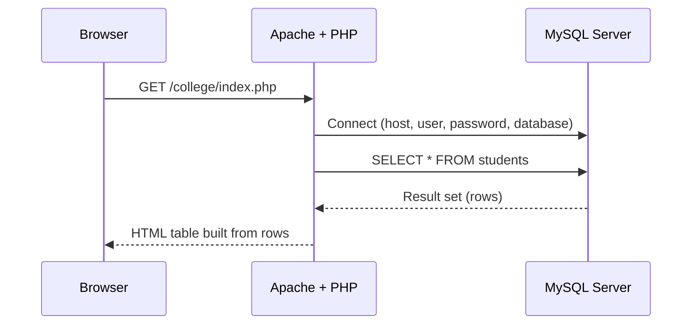
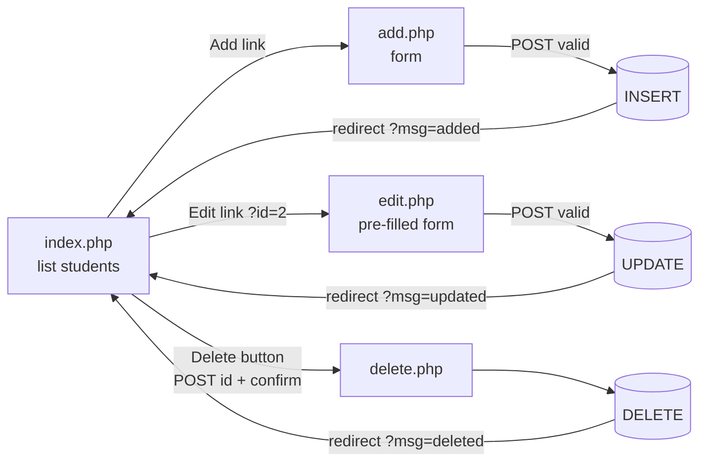
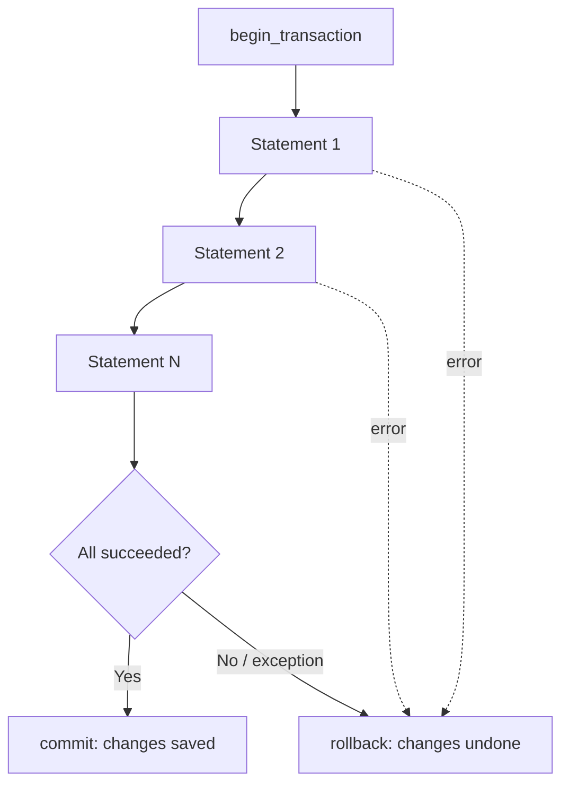

# Unit 6: Working with Database
**Course:** Internet Technology II (CMP 273) · **Teaching hours:** 8

## Learning Objectives

After this unit, you will be able to:

- Explain why databases are important in PHP applications for storing, retrieving and managing data.
- Describe the basic ideas of a relational database: tables, rows, columns, primary keys and foreign keys.
- Write basic SQL statements: `CREATE`, `INSERT`, `SELECT`, `UPDATE` and `DELETE`.
- Connect a PHP script to a MySQL database using MySQLi (procedural and object-oriented styles).
- Execute SQL queries dynamically from PHP using prepared statements, and explain how they prevent SQL injection.
- Build a complete CRUD (Create, Read, Update, Delete) application.
- Build a secure user registration and login system with `password_hash()`, `password_verify()` and sessions.
- Handle database errors with `try`/`catch` and use transactions to keep data consistent in multi-step operations.

---

## 6.1 Introduction to MySQL database management system

### What is a database?

A **database** is an organised collection of related data stored so that it can be easily accessed, managed and updated. A **Database Management System (DBMS)** is the software that creates, stores, protects and retrieves that data for you.

A **Relational DBMS (RDBMS)** stores data in **tables** that are related to each other through common columns (keys). **MySQL** is a free, open-source RDBMS. It is the "M" in the popular LAMP/XAMPP stack (Linux/Windows, Apache, MySQL/MariaDB, PHP). XAMPP actually ships **MariaDB**, a drop-in replacement for MySQL; everything in this unit works on both.

### Why do PHP applications need a database?

PHP variables live only while one request is running. When the script finishes, the data is gone. Files can store data, but they become slow and messy when many users read and write at the same time. A database solves this.

| Need | Without a database (files/variables) | With MySQL |
|------|--------------------------------------|------------|
| Permanent storage | Data lost after the request, or stored in loose text files | Data is stored permanently on disk |
| Searching | Read the whole file and loop through it | `SELECT ... WHERE` finds rows quickly using indexes |
| Many users at once | Two users writing to one file can corrupt it | DBMS handles concurrent access safely |
| Relationships | Hard to link students to marks, orders to items | Foreign keys link tables |
| Security | Anyone with file access can read everything | User accounts and privileges |
| Consistency | Half-finished writes leave broken data | Constraints and transactions |

Real examples: a college portal stores students and marks; an online shop stores products, carts and orders; a login system stores user accounts.

### Tables, rows and columns

| Term | Also called | Meaning | Example |
|------|-------------|---------|---------|
| Table | Relation | A collection of data about one kind of thing | `students` |
| Row | Record, tuple | One item in the table | One student: Sita Gurung |
| Column | Field, attribute | One property of every item | `name`, `gpa` |
| Value | Cell | The data at one row and one column | `3.80` |

```
students table
+----+-------------+----------------+---------+----------+------+
| id | roll_no     | name           | program | semester | gpa  |   <- columns
+----+-------------+----------------+---------+----------+------+
|  1 | PU-2023-001 | Aarav Shrestha | BCSIT   |        3 | 3.45 |   <- a row
|  2 | PU-2023-002 | Sita Gurung    | BCSIT   |        3 | 3.80 |
+----+-------------+----------------+---------+----------+------+
```

### Primary key and foreign key

- A **primary key (PK)** is a column (or set of columns) that **uniquely identifies each row**. It cannot be `NULL` and cannot repeat. Usually an `id INT AUTO_INCREMENT` column, where MySQL assigns 1, 2, 3 ... automatically.
- A **foreign key (FK)** is a column in one table that **refers to the primary key of another table**. It creates a relationship and stops you from inserting "orphan" rows (for example, marks for a student who does not exist).
- A **unique key** (`UNIQUE`) also prevents duplicates, but a table can have many of them and they may allow `NULL`. Example: `email` or `roll_no`.

```
students                         results
+----+----------------+          +----+------------+-----------+-------+
| id | name           |          | id | student_id | subject   | marks |
+----+----------------+          +----+------------+-----------+-------+
|  1 | Aarav Shrestha | <------- |  1 |          1 | IT II     |    78 |
|  2 | Sita Gurung    | <---+--- |  2 |          2 | IT II     |    91 |
+----+----------------+     +--- |  3 |          2 | DBMS      |    85 |
   PK                            +----+------------+-----------+-------+
                                       FK -> students.id
```

| Feature | Primary key | Foreign key |
|---------|-------------|-------------|
| Purpose | Identifies each row uniquely | Links a row to a row in another table |
| Duplicates | Not allowed | Allowed (many results for one student) |
| NULL | Not allowed | Allowed unless declared `NOT NULL` |
| Number per table | Only one | Can be many |

### Common MySQL data types

| Category | Type | Use for | Example |
|----------|------|---------|---------|
| Integer | `TINYINT` | Small numbers (-128 to 127) | semester |
| Integer | `INT` | Normal whole numbers (about +/- 2.1 billion) | id, quantity |
| Integer | `BIGINT` | Very large whole numbers | view counters |
| Exact decimal | `DECIMAL(p,s)` | Money, GPA (exact, no rounding errors) | `DECIMAL(10,2)` for 12345678.90 |
| Approximate | `FLOAT`, `DOUBLE` | Scientific values where tiny errors are OK | temperature |
| Fixed text | `CHAR(n)` | Text of always the same length | country code `NP` |
| Variable text | `VARCHAR(n)` | Names, emails, short text up to n characters | `VARCHAR(100)` |
| Long text | `TEXT` | Long descriptions, comments | blog post body |
| Date/time | `DATE` | Date only, `YYYY-MM-DD` | date of birth |
| Date/time | `DATETIME` | Date and time | appointment |
| Date/time | `TIMESTAMP` | Date and time, often auto-filled | `created_at` |
| Boolean | `BOOLEAN` | True/false (stored as `TINYINT(1)`) | `is_active` |
| List | `ENUM('a','b')` | One value from a fixed list | `ENUM('male','female','other')` |

> **Common Mistake:** Storing money or GPA as `FLOAT`. `FLOAT` is approximate, so `0.1 + 0.2` may not equal exactly `0.3`. Use `DECIMAL(10,2)` for money and `DECIMAL(3,2)` for GPA.

### phpMyAdmin in XAMPP

**phpMyAdmin** is a web-based tool (written in PHP) for managing MySQL through the browser.

1. Open the **XAMPP Control Panel** and click **Start** for **Apache** and **MySQL**.
2. Visit `http://localhost/phpmyadmin` in the browser.
3. Click **New** in the left panel to create a database, or use the **SQL** tab to run SQL statements directly.
4. Default XAMPP login: user `root`, empty password. This is fine for learning on your own computer, but never on a real server.
5. Your PHP files go in `C:\xampp\htdocs\` (Windows) or `/Applications/XAMPP/htdocs/` (macOS) and are opened as `http://localhost/<folder>/<file>.php`.

> **Teacher's Note:** Spend the first 15 minutes in phpMyAdmin. Create the `college` database with the GUI first, then show the **SQL** tab and point out that every button simply generates SQL. Students then trust that the SQL they write in PHP is the same thing.

### Basic SQL

SQL (Structured Query Language) is the language used to talk to an RDBMS. SQL keywords are not case-sensitive, but writing them in CAPITALS makes queries easier to read. Strings are written in single quotes.

#### Creating the sample `college` database (used throughout this unit)

```sql
-- setup.sql : run this in phpMyAdmin > SQL tab
CREATE DATABASE IF NOT EXISTS college
    CHARACTER SET utf8mb4
    COLLATE utf8mb4_unicode_ci;

USE college;

CREATE TABLE students (
    id         INT AUTO_INCREMENT PRIMARY KEY,
    roll_no    VARCHAR(20)  NOT NULL UNIQUE,
    name       VARCHAR(100) NOT NULL,
    email      VARCHAR(150) NOT NULL,
    program    VARCHAR(20)  NOT NULL,
    semester   TINYINT      NOT NULL,
    gpa        DECIMAL(3,2) NOT NULL,
    created_at TIMESTAMP    DEFAULT CURRENT_TIMESTAMP
) ENGINE=InnoDB;

-- A second table to demonstrate a foreign key
CREATE TABLE results (
    id         INT AUTO_INCREMENT PRIMARY KEY,
    student_id INT NOT NULL,
    subject    VARCHAR(50) NOT NULL,
    marks      TINYINT NOT NULL,
    FOREIGN KEY (student_id) REFERENCES students(id)
        ON DELETE CASCADE
) ENGINE=InnoDB;
```

`ON DELETE CASCADE` means: when a student is deleted, that student's results are deleted automatically.

#### INSERT: adding rows

```sql
INSERT INTO students (roll_no, name, email, program, semester, gpa) VALUES
('PU-2023-001', 'Aarav Shrestha', 'aarav@example.com',  'BCSIT', 3, 3.45),
('PU-2023-002', 'Sita Gurung',    'sita@example.com',   'BCSIT', 3, 3.80),
('PU-2023-003', 'Bikash Thapa',   'bikash@example.com', 'BBA',   3, 2.95),
('PU-2023-004', 'Priya Karki',    'priya@example.com',  'BCSIT', 3, 3.62),
('PU-2023-005', 'Nabin Rai',      'nabin@example.com',  'BCA',   3, 3.10);

INSERT INTO results (student_id, subject, marks) VALUES
(1, 'IT II', 78), (2, 'IT II', 91), (2, 'DBMS', 85);
```

We do not give a value for `id` or `created_at`; MySQL fills them automatically.

#### SELECT: reading rows

```sql
SELECT * FROM students;                          -- all columns, all rows
SELECT name, gpa FROM students;                  -- only some columns
SELECT name, gpa FROM students WHERE program = 'BCSIT';
SELECT name, gpa FROM students WHERE gpa >= 3.5 AND program = 'BCSIT';
SELECT name, gpa FROM students ORDER BY gpa DESC;    -- highest first
SELECT name, gpa FROM students ORDER BY gpa DESC LIMIT 3;  -- top 3
SELECT name FROM students WHERE name LIKE 'S%';  -- names starting with S
SELECT COUNT(*) AS total FROM students;          -- how many rows
```

Example query and result:

```sql
SELECT name, gpa FROM students
WHERE program = 'BCSIT'
ORDER BY gpa DESC
LIMIT 2;
```

**Output:**
```
+-------------+------+
| name        | gpa  |
+-------------+------+
| Sita Gurung | 3.80 |
| Priya Karki | 3.62 |
+-------------+------+
```

| Clause | Purpose | Example |
|--------|---------|---------|
| `WHERE` | Filter rows by a condition | `WHERE semester = 3` |
| `ORDER BY` | Sort rows (`ASC` default, `DESC` for reverse) | `ORDER BY name ASC` |
| `LIMIT n` | Return at most n rows | `LIMIT 10` |
| `LIMIT n OFFSET m` | Skip m rows, then return n (used for pagination) | `LIMIT 10 OFFSET 20` |
| `LIKE` | Pattern match: `%` = any characters, `_` = one character | `WHERE email LIKE '%@gmail.com'` |

#### UPDATE: changing rows

```sql
UPDATE students SET gpa = 3.55 WHERE id = 1;
UPDATE students SET semester = semester + 1 WHERE program = 'BCSIT';
```

#### DELETE: removing rows

```sql
DELETE FROM students WHERE id = 5;
```

> **Common Mistake:** Forgetting the `WHERE` clause. `UPDATE students SET gpa = 4.00;` changes **every** student, and `DELETE FROM students;` removes **every** row. Always write the `WHERE` part first, and test it with a `SELECT` using the same `WHERE` before running `UPDATE`/`DELETE`.

> **Exam Tip:** A common 5-mark question is "Write SQL statements to create a table and perform insert, select, update and delete on it." Use a small, meaningful table (students, books, products), show the `PRIMARY KEY`, and always include `WHERE` in `UPDATE`/`DELETE`.

---

## 6.2 Connecting PHP with MySQL database

### How PHP talks to MySQL

PHP and MySQL are two separate programs. PHP acts as a **client**: it opens a connection to the MySQL server, sends SQL text, receives the result, and turns it into HTML.



### APIs for MySQL in PHP

PHP has three ways to talk to MySQL. Only two are still usable.

| API | Status | Notes |
|-----|--------|-------|
| `mysql_*` functions (`mysql_connect`) | **Removed in PHP 7. Do not use.** | Old, insecure, no prepared statements. You may still see it in old tutorials. |
| **MySQLi** (MySQL improved) | Current, used in this course | Works only with MySQL/MariaDB. Has both procedural and object-oriented styles. Supports prepared statements and transactions. |
| **PDO** (PHP Data Objects) | Current | Object-oriented only. Works with many databases (MySQL, PostgreSQL, SQLite, ...) using the same code. Supports named placeholders like `:email`. |

PDO is a good choice when an application may switch databases. The syllabus and the prescribed text use MySQLi, so this unit uses MySQLi.

### MySQLi: procedural vs object-oriented

MySQLi offers the same features in two styles. The OO style is shorter and is what most modern code uses.

| Task | Procedural style | Object-oriented style |
|------|------------------|-----------------------|
| Connect | `$conn = mysqli_connect($h, $u, $p, $db);` | `$conn = new mysqli($h, $u, $p, $db);` |
| Connection error | `mysqli_connect_error()` | `$conn->connect_error` |
| Set charset | `mysqli_set_charset($conn, 'utf8mb4');` | `$conn->set_charset('utf8mb4');` |
| Run a query | `mysqli_query($conn, $sql)` | `$conn->query($sql)` |
| Fetch a row | `mysqli_fetch_assoc($result)` | `$result->fetch_assoc()` |
| Prepare | `mysqli_prepare($conn, $sql)` | `$conn->prepare($sql)` |
| Bind | `mysqli_stmt_bind_param($stmt, 's', $x)` | `$stmt->bind_param('s', $x)` |
| Execute | `mysqli_stmt_execute($stmt)` | `$stmt->execute()` |
| Close | `mysqli_close($conn)` | `$conn->close()` |
| First argument | Connection/result is passed every time | Called as a method on the object |

#### Example 6.2.1: Connecting (procedural style)

```php
<?php
// connect_procedural.php
mysqli_report(MYSQLI_REPORT_ERROR | MYSQLI_REPORT_STRICT); // errors become exceptions

$conn = mysqli_connect('localhost', 'root', '', 'college');
mysqli_set_charset($conn, 'utf8mb4');

echo 'Connected to MySQL server version ' . mysqli_get_server_info($conn);

mysqli_close($conn);
```

**Output:** (version number depends on your XAMPP)
```
Connected to MySQL server version 10.4.32-MariaDB
```

#### Example 6.2.2: Connecting (object-oriented style)

```php
<?php
// connect_oo.php
mysqli_report(MYSQLI_REPORT_ERROR | MYSQLI_REPORT_STRICT);

$conn = new mysqli('localhost', 'root', '', 'college');
$conn->set_charset('utf8mb4');

echo 'Connected to MySQL server version ' . $conn->server_info;

$conn->close();
```

**Output:**
```
Connected to MySQL server version 10.4.32-MariaDB
```

The four connection arguments are: **host** (`localhost` for XAMPP), **username**, **password**, and **database name**. An optional fifth argument is the port (default `3306`).

### Checking connection errors: `connect_error` vs exceptions

There are two ways to detect a failed connection.

**Old style (silent errors):** MySQLi returns an object, and you check `connect_error` yourself.

```php
<?php
mysqli_report(MYSQLI_REPORT_OFF);           // turn exceptions off (old behaviour)

$conn = new mysqli('localhost', 'root', 'wrongpass', 'college');

if ($conn->connect_error) {
    die('Connection failed: ' . $conn->connect_error);
}
echo 'Connected';
```

**Output:**
```
Connection failed: Access denied for user 'root'@'localhost' (using password: YES)
```

**Modern style (recommended):** `mysqli_report(MYSQLI_REPORT_ERROR | MYSQLI_REPORT_STRICT)` tells MySQLi to **throw a `mysqli_sql_exception`** whenever any MySQL error happens (connect, query, prepare, execute). You no longer need to check the return value of every function; you catch the exception once.

- `MYSQLI_REPORT_ERROR` reports errors from MySQLi function calls.
- `MYSQLI_REPORT_STRICT` turns those reports into exceptions instead of warnings.
- Since PHP 8.1 this is the **default**, but writing it explicitly makes your code behave the same on older versions and shows the reader what to expect.

```php
<?php
mysqli_report(MYSQLI_REPORT_ERROR | MYSQLI_REPORT_STRICT);

try {
    $conn = new mysqli('localhost', 'root', 'wrongpass', 'college');
    echo 'Connected';
} catch (mysqli_sql_exception $e) {
    error_log($e->getMessage());             // full details go to the server log
    echo 'Sorry, the database is not available right now.'; // safe message for users
}
```

**Output:**
```
Sorry, the database is not available right now.
```

> **Common Mistake:** Printing `$e->getMessage()` or `connect_error` to visitors on a live site. It can reveal the database user name, host and table names to attackers. Show a friendly message to users and write the details to the log with `error_log()`.

### Why `set_charset('utf8mb4')`?

The character set decides how text is stored and sent between PHP and MySQL. `utf8mb4` is full Unicode, so it can store English, Nepali (देवनागरी), and emoji correctly. MySQL's older `utf8` stores only up to 3 bytes per character and cannot store emoji, so always use **utf8mb4** for the database, the tables and the connection. Setting the charset on the connection is also part of safe escaping.

### A reusable `db.php` configuration file

Every page of an application needs the same connection. Instead of copying the connection code into every file, put it in one file and `require` it. If the password changes, you edit only one file.

#### Example 6.2.3: `db.php` (used by every example in the rest of this unit)

```php
<?php
// db.php : database connection + small helper, included by every page
declare(strict_types=1);

const DB_HOST = 'localhost';
const DB_USER = 'root';
const DB_PASS = '';          // XAMPP default; use a strong password on a real server
const DB_NAME = 'college';

mysqli_report(MYSQLI_REPORT_ERROR | MYSQLI_REPORT_STRICT);

try {
    $conn = new mysqli(DB_HOST, DB_USER, DB_PASS, DB_NAME);
    $conn->set_charset('utf8mb4');
} catch (mysqli_sql_exception $e) {
    error_log('DB connection failed: ' . $e->getMessage());
    http_response_code(500);
    exit('Database connection failed. Please try again later.');
}

// Escape any value before printing it inside HTML (prevents XSS)
function e(string|int|float|null $value): string
{
    return htmlspecialchars((string) $value, ENT_QUOTES, 'UTF-8');
}
```

Using it from another page:

```php
<?php
// test_db.php
require __DIR__ . '/db.php';   // require (not include): the page cannot work without it

echo 'Connected to database: ' . e(DB_NAME);
```

**Output:**
```
Connected to database: college
```

> **Teacher's Note:** Ask students why we use `require` and not `include` here (Unit 3 revision). `require` stops with a fatal error if `db.php` is missing, which is what we want: there is no point continuing without a database. `__DIR__` makes the path work no matter which folder the page is called from.

### Closing the connection

```php
$conn->close();          // OO style
mysqli_close($conn);     // procedural style
```

PHP closes the connection automatically when the script ends, so in short page scripts closing is optional. Close it explicitly in long-running scripts (for example, a script that sends thousands of emails after querying), or when you finish database work early and the rest of the page does slow work. You can also free a large result early with `$result->free()` and close a statement with `$stmt->close()`.

> **Exam Tip:** For "Explain how PHP connects to MySQL with an example", write: (1) the four connection parameters, (2) a short `new mysqli(...)` example with `set_charset`, (3) how errors are detected (`connect_error` or `mysqli_sql_exception`), and (4) closing the connection. Mention the difference between procedural and OO styles in one or two lines.

---

## 6.3 Performing CRUD operations (Create, Read, Update, Delete)

**CRUD** stands for the four basic operations every data-driven application performs. Almost every web app (student records, shop products, blog posts) is a CRUD app at its core.

| Operation | SQL | HTTP method in our app | Page |
|-----------|-----|------------------------|------|
| **C**reate | `INSERT` | GET shows form, POST saves | `add.php` |
| **R**ead | `SELECT` | GET | `index.php` |
| **U**pdate | `UPDATE` | GET shows filled form, POST saves | `edit.php` |
| **D**elete | `DELETE` | POST only | `delete.php` |

### Mini application: Student Records

We build a complete, runnable app on the `students` table from 6.1.

**Folder structure** (inside `htdocs`):

```
htdocs/
└── college/
    ├── db.php        (connection + e() helper, Example 6.2.3)
    ├── index.php     (Read: list all students)
    ├── add.php       (Create: form + insert)
    ├── edit.php      (Update: pre-filled form + update)
    └── delete.php    (Delete: POST handler)
```

Open it at `http://localhost/college/index.php`.

**Flow of the app:**



Design rules used in every file:

1. Every SQL statement that contains user data uses a **prepared statement**.
2. Every value printed into HTML goes through `e()` (`htmlspecialchars`).
3. Input is validated with `filter_var` / `filter_input` before it reaches the database.
4. After a successful POST, the page **redirects** (Post/Redirect/Get pattern), so refreshing the browser does not submit the form again.
5. Delete uses **POST**, never a GET link, because GET requests can be triggered by search engines, browser pre-fetch or a malicious ``.

### Read: `index.php`

```php
<?php
// index.php : list all students (READ)
require __DIR__ . '/db.php';

// No user input here, so $conn->query() would also be safe.
// We use a prepared statement to keep the same pattern everywhere.
$stmt = $conn->prepare(
    'SELECT id, roll_no, name, email, program, semester, gpa
     FROM students ORDER BY id'
);
$stmt->execute();
$students = $stmt->get_result()->fetch_all(MYSQLI_ASSOC);

// Only fixed messages can be shown, never raw text from the URL
$messages = [
    'added'   => 'Student added successfully.',
    'updated' => 'Student updated successfully.',
    'deleted' => 'Student deleted successfully.',
];
$msg = $messages[$_GET['msg'] ?? ''] ?? '';
?>
<!DOCTYPE html>
<html lang="en">
<head>
    <meta charset="UTF-8">
    <title>Student Records</title>
    <style>
        table { border-collapse: collapse; }
        th, td { border: 1px solid #999; padding: 6px 10px; }
        .msg { color: green; }
    </style>
</head>
<body>
    <h1>Student Records</h1>
    <?php if ($msg !== ''): ?>
        <p class="msg"><?= e($msg) ?></p>
    <?php endif; ?>

    <p><a href="add.php">+ Add new student</a></p>

    <?php if (count($students) === 0): ?>
        <p>No students found.</p>
    <?php else: ?>
    <table>
        <tr>
            <th>Roll No</th><th>Name</th><th>Email</th>
            <th>Program</th><th>Sem</th><th>GPA</th><th>Actions</th>
        </tr>
        <?php foreach ($students as $s): ?>
        <tr>
            <td><?= e($s['roll_no']) ?></td>
            <td><?= e($s['name']) ?></td>
            <td><?= e($s['email']) ?></td>
            <td><?= e($s['program']) ?></td>
            <td><?= e($s['semester']) ?></td>
            <td><?= e($s['gpa']) ?></td>
            <td>
                <a href="edit.php?id=<?= (int) $s['id'] ?>">Edit</a>
                <form action="delete.php" method="post" style="display:inline"
                      onsubmit="return confirm(<?= e(json_encode('Delete ' . $s['name'] . '?')) ?>);">
                    <input type="hidden" name="id" value="<?= (int) $s['id'] ?>">
                    <button type="submit">Delete</button>
                </form>
            </td>
        </tr>
        <?php endforeach; ?>
    </table>
    <?php endif; ?>
</body>
</html>
```

**Output:** (rendered in the browser)
```
Student Records

+ Add new student

| Roll No     | Name           | Email              | Program | Sem | GPA  | Actions       |
|-------------|----------------|--------------------|---------|-----|------|---------------|
| PU-2023-001 | Aarav Shrestha | aarav@example.com  | BCSIT   | 3   | 3.45 | Edit [Delete] |
| PU-2023-002 | Sita Gurung    | sita@example.com   | BCSIT   | 3   | 3.80 | Edit [Delete] |
| PU-2023-003 | Bikash Thapa   | bikash@example.com | BBA     | 3   | 2.95 | Edit [Delete] |
| PU-2023-004 | Priya Karki    | priya@example.com  | BCSIT   | 3   | 3.62 | Edit [Delete] |
| PU-2023-005 | Nabin Rai      | nabin@example.com  | BCA     | 3   | 3.10 | Edit [Delete] |
```

### Create: `add.php`

```php
<?php
// add.php : show the form (GET) and insert a new student (POST)  (CREATE)
require __DIR__ . '/db.php';

$programs = ['BCSIT', 'BCA', 'BBA', 'BE'];
$errors   = [];
$old      = ['roll_no' => '', 'name' => '', 'email' => '',
             'program' => '', 'semester' => '', 'gpa' => ''];

if ($_SERVER['REQUEST_METHOD'] === 'POST') {
    // 1. Collect and trim input
    foreach ($old as $field => $_) {
        $old[$field] = trim($_POST[$field] ?? '');
    }

    // 2. Validate
    if ($old['roll_no'] === '')               $errors[] = 'Roll number is required.';
    if ($old['name'] === '')                  $errors[] = 'Name is required.';
    if (!filter_var($old['email'], FILTER_VALIDATE_EMAIL))
                                              $errors[] = 'A valid email is required.';
    if (!in_array($old['program'], $programs, true))
                                              $errors[] = 'Choose a valid program.';
    $semester = filter_var($old['semester'], FILTER_VALIDATE_INT,
        ['options' => ['min_range' => 1, 'max_range' => 8]]);
    if ($semester === false)                  $errors[] = 'Semester must be 1 to 8.';
    $gpa = filter_var($old['gpa'], FILTER_VALIDATE_FLOAT);
    if ($gpa === false || $gpa < 0 || $gpa > 4) $errors[] = 'GPA must be between 0 and 4.';

    // 3. Insert if valid
    if (!$errors) {
        try {
            $stmt = $conn->prepare(
                'INSERT INTO students (roll_no, name, email, program, semester, gpa)
                 VALUES (?, ?, ?, ?, ?, ?)'
            );
            $stmt->bind_param('ssssid', $old['roll_no'], $old['name'], $old['email'],
                              $old['program'], $semester, $gpa);
            $stmt->execute();
            header('Location: index.php?msg=added');
            exit;
        } catch (mysqli_sql_exception $e) {
            if ($e->getCode() === 1062) {           // duplicate value in a UNIQUE column
                $errors[] = 'This roll number already exists.';
            } else {
                throw $e;                            // unexpected error: let it fail
            }
        }
    }
}
?>
<!DOCTYPE html>
<html lang="en">
<head><meta charset="UTF-8"><title>Add Student</title></head>
<body>
    <h1>Add Student</h1>

    <?php if ($errors): ?>
        <ul style="color:red">
            <?php foreach ($errors as $err): ?><li><?= e($err) ?></li><?php endforeach; ?>
        </ul>
    <?php endif; ?>

    <form method="post" action="add.php">
        <p>Roll No: <input name="roll_no" value="<?= e($old['roll_no']) ?>" required></p>
        <p>Name: <input name="name" value="<?= e($old['name']) ?>" required></p>
        <p>Email: <input type="email" name="email" value="<?= e($old['email']) ?>" required></p>
        <p>Program:
            <select name="program">
                <?php foreach ($programs as $p): ?>
                    <option <?= $old['program'] === $p ? 'selected' : '' ?>><?= e($p) ?></option>
                <?php endforeach; ?>
            </select>
        </p>
        <p>Semester: <input type="number" name="semester" min="1" max="8"
                            value="<?= e($old['semester']) ?>" required></p>
        <p>GPA: <input type="number" name="gpa" step="0.01" min="0" max="4"
                       value="<?= e($old['gpa']) ?>" required></p>
        <button type="submit">Save</button>
        <a href="index.php">Cancel</a>
    </form>
</body>
</html>
```

**Output:** Submitting Roll No `PU-2023-006`, Name `Anisha Magar`, Email `anisha@example.com`, Program `BCA`, Semester `3`, GPA `3.25` redirects to the list, which now shows:
```
Student added successfully.
...
| PU-2023-006 | Anisha Magar | anisha@example.com | BCA | 3 | 3.25 | Edit [Delete] |
```
Submitting the same roll number again shows:
```
Add Student
  • This roll number already exists.
(form fields keep the values typed by the user)
```

Note the browser `required`/`min`/`max` attributes are only for user convenience. They can be bypassed easily, so the PHP validation is the real protection.

### Update: `edit.php`

```php
<?php
// edit.php : load one student into a pre-filled form (GET) and save changes (POST)  (UPDATE)
require __DIR__ . '/db.php';

$programs = ['BCSIT', 'BCA', 'BBA', 'BE'];
$errors   = [];

// The id comes from the URL on GET and from a hidden field on POST
$id = filter_input(INPUT_GET, 'id', FILTER_VALIDATE_INT)
   ?? filter_input(INPUT_POST, 'id', FILTER_VALIDATE_INT);
if (!$id) {
    exit('Invalid student id.');
}

// Load the existing row
$stmt = $conn->prepare(
    'SELECT id, roll_no, name, email, program, semester, gpa FROM students WHERE id = ?'
);
$stmt->bind_param('i', $id);
$stmt->execute();
$student = $stmt->get_result()->fetch_assoc();
if ($student === null) {
    http_response_code(404);
    exit('Student not found.');
}

if ($_SERVER['REQUEST_METHOD'] === 'POST') {
    // Overwrite loaded values with submitted values (keeps the form filled on error)
    foreach (['roll_no', 'name', 'email', 'program', 'semester', 'gpa'] as $f) {
        $student[$f] = trim($_POST[$f] ?? '');
    }

    if ($student['roll_no'] === '') $errors[] = 'Roll number is required.';
    if ($student['name'] === '')    $errors[] = 'Name is required.';
    if (!filter_var($student['email'], FILTER_VALIDATE_EMAIL)) $errors[] = 'A valid email is required.';
    if (!in_array($student['program'], $programs, true))       $errors[] = 'Choose a valid program.';
    $semester = filter_var($student['semester'], FILTER_VALIDATE_INT,
        ['options' => ['min_range' => 1, 'max_range' => 8]]);
    if ($semester === false) $errors[] = 'Semester must be 1 to 8.';
    $gpa = filter_var($student['gpa'], FILTER_VALIDATE_FLOAT);
    if ($gpa === false || $gpa < 0 || $gpa > 4) $errors[] = 'GPA must be between 0 and 4.';

    if (!$errors) {
        try {
            $upd = $conn->prepare(
                'UPDATE students
                 SET roll_no = ?, name = ?, email = ?, program = ?, semester = ?, gpa = ?
                 WHERE id = ?'
            );
            $upd->bind_param('ssssidi', $student['roll_no'], $student['name'],
                             $student['email'], $student['program'], $semester, $gpa, $id);
            $upd->execute();
            header('Location: index.php?msg=updated');
            exit;
        } catch (mysqli_sql_exception $e) {
            if ($e->getCode() !== 1062) throw $e;
            $errors[] = 'Another student already has this roll number.';
        }
    }
}
?>
<!DOCTYPE html>
<html lang="en">
<head><meta charset="UTF-8"><title>Edit Student</title></head>
<body>
    <h1>Edit Student</h1>

    <?php if ($errors): ?>
        <ul style="color:red">
            <?php foreach ($errors as $err): ?><li><?= e($err) ?></li><?php endforeach; ?>
        </ul>
    <?php endif; ?>

    <form method="post" action="edit.php">
        <input type="hidden" name="id" value="<?= (int) $id ?>">
        <p>Roll No: <input name="roll_no" value="<?= e($student['roll_no']) ?>" required></p>
        <p>Name: <input name="name" value="<?= e($student['name']) ?>" required></p>
        <p>Email: <input type="email" name="email" value="<?= e($student['email']) ?>" required></p>
        <p>Program:
            <select name="program">
                <?php foreach ($programs as $p): ?>
                    <option <?= $student['program'] === $p ? 'selected' : '' ?>><?= e($p) ?></option>
                <?php endforeach; ?>
            </select>
        </p>
        <p>Semester: <input type="number" name="semester" min="1" max="8"
                            value="<?= e($student['semester']) ?>" required></p>
        <p>GPA: <input type="number" name="gpa" step="0.01" min="0" max="4"
                       value="<?= e($student['gpa']) ?>" required></p>
        <button type="submit">Update</button>
        <a href="index.php">Cancel</a>
    </form>
</body>
</html>
```

**Output:** Clicking **Edit** for Aarav (`edit.php?id=1`) shows the form already filled with `PU-2023-001`, `Aarav Shrestha`, `aarav@example.com`, `BCSIT`, `3`, `3.45`. Changing GPA to `3.55` and clicking **Update** returns to the list:
```
Student updated successfully.
| PU-2023-001 | Aarav Shrestha | aarav@example.com | BCSIT | 3 | 3.55 | Edit [Delete] |
```

### Delete: `delete.php`

```php
<?php
// delete.php : delete one student (DELETE). Accepts POST only.
require __DIR__ . '/db.php';

if ($_SERVER['REQUEST_METHOD'] !== 'POST') {
    http_response_code(405);              // 405 Method Not Allowed
    exit('Invalid request method.');
}

$id = filter_input(INPUT_POST, 'id', FILTER_VALIDATE_INT);
if (!$id) {
    exit('Invalid student id.');
}

$stmt = $conn->prepare('DELETE FROM students WHERE id = ?');
$stmt->bind_param('i', $id);
$stmt->execute();

// affected_rows is 0 if no student had this id
if ($stmt->affected_rows === 0) {
    exit('Student not found or already deleted.');
}

header('Location: index.php?msg=deleted');
exit;
```

**Output:** Clicking **Delete** next to Nabin Rai shows a browser dialog `Delete Nabin Rai?`. Clicking **OK** returns to the list:
```
Student deleted successfully.
(Nabin Rai's row is no longer in the table)
```
Because `results.student_id` has `ON DELETE CASCADE`, any results for that student are removed too. Opening `delete.php` directly in the address bar (a GET request) prints `Invalid request method.`

> **Teacher's Note:** Build the app live in this order: `db.php` -> `index.php` -> `add.php` -> `delete.php` -> `edit.php`. Edit is the hardest because it combines Read and Update in one page. After it works, type `<script>alert(1)</script>` as a student name to show that `e()` prints it as harmless text. This takes about two lecture hours plus one lab.

> **Common Mistake:** Writing `header('Location: index.php');` without `exit;` after it. `header()` only sends a header; the rest of the script still runs. Always follow a redirect with `exit;`. Also, `header()` must be called before any HTML is output.

> **Beyond the syllabus:** Real applications also protect POST forms (especially delete) with a **CSRF token**: a random value stored in the session and included as a hidden field, which the server checks on submit. This stops another website from tricking a logged-in user's browser into submitting your form.

---

## 6.4 Executing SQL queries using PHP

### Two ways to run SQL: `query()` vs prepared statements

| | `$conn->query($sql)` | Prepared statement (`prepare` -> `bind_param` -> `execute`) |
|---|---|---|
| How | SQL text sent in one step | SQL template with `?` placeholders sent first, values sent separately |
| User input in SQL | **Unsafe** if values are joined into the string | **Safe**: values are never treated as SQL |
| Best for | Fixed SQL with no variables (`SELECT COUNT(*) FROM students`) | Any SQL that contains user data or variables |
| Repeated execution | Parsed every time | Prepare once, execute many times with different values |
| Return value (SELECT) | `mysqli_result` object | Call `$stmt->get_result()` to get a `mysqli_result` |
| Return value (INSERT/UPDATE/DELETE) | `true` | `execute()` returns `true` |

#### Example 6.4.1: `query()` for fixed SQL

```php
<?php
require __DIR__ . '/db.php';

$result = $conn->query('SELECT COUNT(*) AS total FROM students');
$row    = $result->fetch_assoc();

echo 'Total students: ' . $row['total'];
```

**Output:**
```
Total students: 5
```

### Prepared statements step by step

```
1. prepare()     "SELECT name, gpa FROM students WHERE program = ? AND gpa >= ?"
                  -> MySQL parses and plans the query; ? marks a hole for data
2. bind_param()  'sd', $program, $minGpa
                  -> link PHP variables to the holes, with their types
3. execute()     -> values are sent separately and filled in as pure data
4. get_result()  -> fetch rows (for SELECT)
```

#### Example 6.4.2: A prepared SELECT

```php
<?php
require __DIR__ . '/db.php';

$program = 'BCSIT';
$minGpa  = 3.5;

$stmt = $conn->prepare(
    'SELECT name, gpa FROM students WHERE program = ? AND gpa >= ? ORDER BY gpa DESC'
);
$stmt->bind_param('sd', $program, $minGpa);   // s = string, d = double
$stmt->execute();
$result = $stmt->get_result();

echo "BCSIT students with GPA >= 3.5:\n";
while ($row = $result->fetch_assoc()) {
    echo $row['name'] . ' - ' . $row['gpa'] . "\n";
}
```

**Output:**
```
BCSIT students with GPA >= 3.5:
Sita Gurung - 3.80
Priya Karki - 3.62
```

(Examples in this section print plain text with `\n` so the output is easy to read; run them from the command line with `php file.php`, or wrap the output in `<pre>` in a browser.)

### `bind_param()` type characters

The first argument of `bind_param()` is a string with **one character per placeholder**, in the same order.

| Character | Type | Use for | Example column |
|-----------|------|---------|----------------|
| `i` | integer | Whole numbers | `id`, `semester`, `qty` |
| `d` | double | Decimal numbers | `gpa`, `price`, `balance` |
| `s` | string | Text, dates, and also `DECIMAL` if you want exact values | `name`, `email`, `'2025-01-15'` |
| `b` | blob | Binary data sent in packets (rarely used) | images stored in DB |

Example: `$stmt->bind_param('ssid', $name, $email, $semester, $gpa);` has 4 placeholders and 4 characters.

> **Common Mistake:** Passing literals or expressions to `bind_param()`, such as `$stmt->bind_param('i', 5);` or `$stmt->bind_param('s', trim($x));`. `bind_param()` binds **by reference**, so it needs variables. Store the value in a variable first: `$id = 5; $stmt->bind_param('i', $id);`. (Since PHP 8.1 you can also pass an array to `$stmt->execute([$a, $b])`, where every value is sent as a string.)

### Fetching results

`get_result()` returns a `mysqli_result` object. It needs the **mysqlnd** driver, which is included by default in XAMPP and modern PHP. The result object offers several fetch methods:

| Method | Returns | Access a column |
|--------|---------|-----------------|
| `fetch_assoc()` | One row as an associative array, or `null` when no rows left | `$row['name']` |
| `fetch_row()` | One row as a numeric (indexed) array | `$row[0]` |
| `fetch_object()` | One row as an object | `$row->name` |
| `fetch_array()` | One row as both numeric and associative (default `MYSQLI_BOTH`) | `$row[0]` or `$row['name']` |
| `fetch_all(MYSQLI_ASSOC)` | **All** rows as an array of associative arrays | `$rows[0]['name']` |

#### Example 6.4.3: Comparing fetch methods

```php
<?php
require __DIR__ . '/db.php';

$sql = 'SELECT roll_no, name FROM students ORDER BY id LIMIT 2';

// fetch_assoc(): column names as keys
$res = $conn->query($sql);
$row = $res->fetch_assoc();
echo "assoc : {$row['roll_no']} {$row['name']}\n";

// fetch_row(): numeric indexes in SELECT order
$res = $conn->query($sql);
$row = $res->fetch_row();
echo "row   : {$row[0]} {$row[1]}\n";

// fetch_object(): properties
$res = $conn->query($sql);
$obj = $res->fetch_object();
echo "object: {$obj->roll_no} {$obj->name}\n";

// fetch_all(): every row at once
$res  = $conn->query($sql);
$rows = $res->fetch_all(MYSQLI_ASSOC);
echo 'all   : ' . count($rows) . " rows, second is {$rows[1]['name']}\n";
```

**Output:**
```
assoc : PU-2023-001 Aarav Shrestha
row   : PU-2023-001 Aarav Shrestha
object: PU-2023-001 Aarav Shrestha
all   : 2 rows, second is Sita Gurung
```

Use `while ($row = $result->fetch_assoc())` for looping row by row, and `fetch_all()` when you want an array to pass to a template or `foreach`.

### `num_rows`, `affected_rows` and `insert_id`

| Property | Belongs to | Meaning | Used after |
|----------|-----------|---------|------------|
| `$result->num_rows` | result object | Number of rows returned | `SELECT` |
| `$stmt->affected_rows` or `$conn->affected_rows` | statement / connection | Number of rows changed | `INSERT`, `UPDATE`, `DELETE` |
| `$conn->insert_id` or `$stmt->insert_id` | connection / statement | The `AUTO_INCREMENT` id generated by the last `INSERT` | `INSERT` |

#### Example 6.4.4: Using the three properties

```php
<?php
require __DIR__ . '/db.php';

// num_rows: how many BCSIT students?
$program = 'BCSIT';
$stmt = $conn->prepare('SELECT id FROM students WHERE program = ?');
$stmt->bind_param('s', $program);
$stmt->execute();
$result = $stmt->get_result();
echo "BCSIT students found: {$result->num_rows}\n";

// insert_id: id of the new row
$roll = 'PU-2023-010'; $name = 'Rojina Tamang'; $email = 'rojina@example.com';
$prog = 'BCA'; $sem = 1; $gpa = 3.00;
$ins = $conn->prepare(
    'INSERT INTO students (roll_no, name, email, program, semester, gpa) VALUES (?, ?, ?, ?, ?, ?)'
);
$ins->bind_param('ssssid', $roll, $name, $email, $prog, $sem, $gpa);
$ins->execute();
echo "New student id: {$conn->insert_id}\n";

// affected_rows: promote all BCSIT students to the next semester
$upd = $conn->prepare('UPDATE students SET semester = semester + 1 WHERE program = ?');
$upd->bind_param('s', $program);
$upd->execute();
echo "Rows updated: {$upd->affected_rows}\n";
```

**Output:** (on the fresh `setup.sql` data)
```
BCSIT students found: 3
New student id: 6
Rows updated: 3
```

> **Exam Tip:** Students often mix these up. Remember: **num_rows = rows read** (SELECT), **affected_rows = rows changed** (INSERT/UPDATE/DELETE), **insert_id = new primary key**. Note that `UPDATE` counts only rows whose value actually changed: setting a GPA to the same value it already has gives `affected_rows` of 0.

### SQL injection: the attack and the fix

**SQL injection** happens when user input is joined directly into an SQL string, so the input can change the meaning of the query. It is one of the most common and most damaging web attacks: attackers can read, change or delete the whole database.

#### Example 6.4.5: Vulnerable code (do not use)

```php
<?php
// search_vulnerable.php  -- DO NOT USE: for demonstration only
require __DIR__ . '/db.php';

// Imagine this came from a form: $roll = $_GET['roll'];
$roll = "' OR '1'='1";

$sql = "SELECT name, gpa FROM students WHERE roll_no = '$roll'";
echo "SQL sent: $sql\n\n";

$result = $conn->query($sql);
while ($row = $result->fetch_assoc()) {
    echo $row['name'] . ' - ' . $row['gpa'] . "\n";
}
```

**Output:**
```
SQL sent: SELECT name, gpa FROM students WHERE roll_no = '' OR '1'='1'

Aarav Shrestha - 3.45
Sita Gurung - 3.80
Bikash Thapa - 2.95
Priya Karki - 3.62
Nabin Rai - 3.10
```

The quote in the input closed the string early, and `OR '1'='1'` is always true, so **every** student's record is shown. On a login form the same trick can log in without a password; with other input an attacker can read the `users` table or delete data.

#### Example 6.4.6: The fix with a prepared statement

```php
<?php
// search_safe.php
require __DIR__ . '/db.php';

$roll = "' OR '1'='1";      // the same malicious input

$stmt = $conn->prepare('SELECT name, gpa FROM students WHERE roll_no = ?');
$stmt->bind_param('s', $roll);
$stmt->execute();
$result = $stmt->get_result();

echo "Rows found: {$result->num_rows}\n";
```

**Output:**
```
Rows found: 0
```

The database now searches for a student whose roll number is literally the text `' OR '1'='1`. There is no such student, so nothing leaks. The input is **data**, never **code**.

| Defence | Effective? |
|---------|-----------|
| Prepared statements with bound parameters | **Yes, the main defence** |
| Validating input (e.g. `FILTER_VALIDATE_INT` for ids) | Yes, as an extra layer |
| `mysqli_real_escape_string()` | Works if used perfectly, but easy to forget; prefer prepared statements |
| `htmlspecialchars()` | **No**: it prevents XSS in HTML output, not SQL injection |
| Hiding the form field / JavaScript validation | **No**: attackers send requests directly |

> **Teacher's Note:** Run Example 6.4.5 live, then type the input into a real search box. Seeing all records appear is far more memorable than any definition. Then change only three lines to the prepared version and run it again.

### Searching with `LIKE`

To search part of a name, put the `%` wildcards **into the bound value**, not into the SQL string.

#### Example 6.4.7: Search students by name

```php
<?php
// search.php : search students by part of the name
require __DIR__ . '/db.php';

$q = trim($_GET['q'] ?? 'ra');            // e.g. search.php?q=ra
$like = '%' . $q . '%';

$stmt = $conn->prepare('SELECT name, program FROM students WHERE name LIKE ? ORDER BY name');
$stmt->bind_param('s', $like);
$stmt->execute();
$rows = $stmt->get_result()->fetch_all(MYSQLI_ASSOC);

echo 'Results for "' . e($q) . '": ' . count($rows) . "\n";
foreach ($rows as $r) {
    echo '- ' . e($r['name']) . ' (' . e($r['program']) . ")\n";
}
```

**Output:** (with the default collation, `LIKE` is not case-sensitive)
```
Results for "ra": 2
- Aarav Shrestha (BCSIT)
- Nabin Rai (BCA)
```

> **Common Mistake:** Writing `WHERE name LIKE '%?%'`. Inside quotes, `?` is just a question mark character, not a placeholder. Build `'%' . $q . '%'` in PHP and use `LIKE ?`.

### Pagination with `LIMIT` and `OFFSET`

When a table has thousands of rows, we show a fixed number per page.

```
OFFSET = (page - 1) * perPage

perPage = 2
page 1 -> LIMIT 2 OFFSET 0 -> rows 1-2
page 2 -> LIMIT 2 OFFSET 2 -> rows 3-4
page 3 -> LIMIT 2 OFFSET 4 -> row 5
total pages = ceil(totalRows / perPage) = ceil(5 / 2) = 3
```

#### Example 6.4.8: Paginated student list

```php
<?php
// list_paged.php : students, 2 per page  (list_paged.php?page=2)
require __DIR__ . '/db.php';

$perPage = 2;
$page = filter_input(INPUT_GET, 'page', FILTER_VALIDATE_INT,
    ['options' => ['default' => 1, 'min_range' => 1]]);

$total      = (int) $conn->query('SELECT COUNT(*) FROM students')->fetch_row()[0];
$totalPages = max(1, (int) ceil($total / $perPage));
$page       = min($page, $totalPages);          // do not go past the last page
$offset     = ($page - 1) * $perPage;

$stmt = $conn->prepare('SELECT name, gpa FROM students ORDER BY id LIMIT ? OFFSET ?');
$stmt->bind_param('ii', $perPage, $offset);
$stmt->execute();
$rows = $stmt->get_result()->fetch_all(MYSQLI_ASSOC);
?>
<h2>Students (page <?= $page ?> of <?= $totalPages ?>)</h2>
<ul>
    <?php foreach ($rows as $r): ?>
        <li><?= e($r['name']) ?> - <?= e($r['gpa']) ?></li>
    <?php endforeach; ?>
</ul>
<p>
    <?php if ($page > 1): ?><a href="?page=<?= $page - 1 ?>">&laquo; Prev</a><?php endif; ?>
    <?php for ($p = 1; $p <= $totalPages; $p++): ?>
        <?= $p === $page ? "<strong>$p</strong>" : "<a href=\"?page=$p\">$p</a>" ?>
    <?php endfor; ?>
    <?php if ($page < $totalPages): ?><a href="?page=<?= $page + 1 ?>">Next &raquo;</a><?php endif; ?>
</p>
```

**Output:** for `list_paged.php?page=2` (rendered)
```
Students (page 2 of 3)
  • Bikash Thapa - 2.95
  • Priya Karki - 3.62
« Prev  1  [2]  3  Next »
```

`filter_input()` with `default` returns 1 when `page` is missing or invalid (for example `?page=abc` or `?page=-5`), so the query is always safe.

> **Exam Tip:** For a pagination question, write the formula `OFFSET = (page - 1) * perPage` and `totalPages = ceil(total / perPage)`, then show the SQL `LIMIT ? OFFSET ?` with `bind_param('ii', ...)`.

---

## 6.5 User Registration and Login

Almost every web application needs user accounts. This section combines everything so far: forms (Unit 4), sessions (Unit 5), and prepared statements.

### Security rules for passwords

| Do | Do not |
|----|--------|
| Store `password_hash($password, PASSWORD_DEFAULT)` | Store the plain password |
| Check with `password_verify($input, $hash)` | Use `md5()` or `sha1()` for passwords (fast to crack; **do not use**) |
| Use a `VARCHAR(255)` column for the hash | Use a short column (hashes can grow in future PHP versions) |
| Show one message, "Invalid email or password" | Say "email not found" (helps attackers find valid emails) |
| Call `session_regenerate_id(true)` after login | Keep the same session id before and after login (session fixation) |

`password_hash()` uses a strong, slow algorithm (bcrypt by default) and adds a random **salt** automatically, so two users with the same password get different hashes. The salt and algorithm are stored inside the hash string itself, which is why `password_verify()` needs only the password and the hash.

```php
<?php
$hash1 = password_hash('Nepal@123', PASSWORD_DEFAULT);
$hash2 = password_hash('Nepal@123', PASSWORD_DEFAULT);

echo strlen($hash1) . "\n";                                   // bcrypt hash length
echo ($hash1 === $hash2 ? 'same' : 'different') . "\n";       // random salt
echo (password_verify('Nepal@123', $hash1) ? 'match' : 'no match') . "\n";
echo (password_verify('nepal@123', $hash1) ? 'match' : 'no match') . "\n";
```

**Output:**
```
60
different
match
no match
```

### The `users` table

```sql
USE college;

CREATE TABLE users (
    id            INT AUTO_INCREMENT PRIMARY KEY,
    name          VARCHAR(100) NOT NULL,
    email         VARCHAR(150) NOT NULL UNIQUE,   -- no two accounts with the same email
    password_hash VARCHAR(255) NOT NULL,
    created_at    TIMESTAMP DEFAULT CURRENT_TIMESTAMP
) ENGINE=InnoDB;
```

### Files and flow

```
college/
├── db.php          (from 6.2)
├── register.php    (sign up)
├── login.php       (sign in)
├── dashboard.php   (protected page)
└── logout.php      (sign out)
```

```
register.php --(POST valid, INSERT)--> login.php?registered=1
login.php    --(POST, password_verify OK)--> session_regenerate_id
                                         --> $_SESSION['user_id'] --> dashboard.php
dashboard.php --(no $_SESSION['user_id'])--> login.php
logout.php   --(clear session, destroy)--> login.php
```

### `register.php`

```php
<?php
// register.php : create a new account
require __DIR__ . '/db.php';

$errors = [];
$name = $email = '';

if ($_SERVER['REQUEST_METHOD'] === 'POST') {
    $name     = trim($_POST['name'] ?? '');
    $email    = trim($_POST['email'] ?? '');
    $password = $_POST['password'] ?? '';      // never trim or change passwords
    $confirm  = $_POST['confirm'] ?? '';

    // 1. Validation
    if ($name === '' || mb_strlen($name) > 100) $errors[] = 'Name is required (max 100 characters).';
    if (!filter_var($email, FILTER_VALIDATE_EMAIL)) $errors[] = 'Enter a valid email address.';
    if (strlen($password) < 8)                  $errors[] = 'Password must be at least 8 characters.';
    if ($password !== $confirm)                 $errors[] = 'Passwords do not match.';

    // 2. Duplicate email check
    if (!$errors) {
        $stmt = $conn->prepare('SELECT id FROM users WHERE email = ?');
        $stmt->bind_param('s', $email);
        $stmt->execute();
        if ($stmt->get_result()->num_rows > 0) {
            $errors[] = 'An account with this email already exists.';
        }
    }

    // 3. Insert with a hashed password
    if (!$errors) {
        $hash = password_hash($password, PASSWORD_DEFAULT);
        try {
            $stmt = $conn->prepare('INSERT INTO users (name, email, password_hash) VALUES (?, ?, ?)');
            $stmt->bind_param('sss', $name, $email, $hash);
            $stmt->execute();
            header('Location: login.php?registered=1');
            exit;
        } catch (mysqli_sql_exception $e) {
            // Two people registering the same email at the same moment:
            // the UNIQUE index is the final guard.
            if ($e->getCode() !== 1062) throw $e;
            $errors[] = 'An account with this email already exists.';
        }
    }
}
?>
<!DOCTYPE html>
<html lang="en">
<head><meta charset="UTF-8"><title>Register</title></head>
<body>
    <h1>Create an account</h1>
    <?php foreach ($errors as $err): ?>
        <p style="color:red"><?= e($err) ?></p>
    <?php endforeach; ?>
    <form method="post" action="register.php">
        <p>Name: <input name="name" value="<?= e($name) ?>" required></p>
        <p>Email: <input type="email" name="email" value="<?= e($email) ?>" required></p>
        <p>Password: <input type="password" name="password" minlength="8" required></p>
        <p>Confirm password: <input type="password" name="confirm" required></p>
        <button type="submit">Register</button>
    </form>
    <p>Already registered? <a href="login.php">Log in</a></p>
</body>
</html>
```

**Output:** Registering `Sita Gurung`, `sita@example.com`, password `Pokhara2025` redirects to `login.php?registered=1`. In phpMyAdmin the row looks like:
```
| id | name        | email            | password_hash                                                 |
|  1 | Sita Gurung | sita@example.com | $2y$10$Jk3...(60 characters, different every time)...         |
```
Trying the same email again shows: `An account with this email already exists.`

> **Common Mistake:** Checking duplicates only in PHP and not adding `UNIQUE` to the column. If two requests arrive at the same moment, both may pass the `SELECT` check. The `UNIQUE` constraint in the database is the real guarantee; the PHP check just gives a friendly message earlier.

### `login.php`

```php
<?php
// login.php : verify email + password and start a logged-in session
session_start();
require __DIR__ . '/db.php';

if (isset($_SESSION['user_id'])) {           // already logged in
    header('Location: dashboard.php');
    exit;
}

$error = '';
$email = '';

if ($_SERVER['REQUEST_METHOD'] === 'POST') {
    $email    = trim($_POST['email'] ?? '');
    $password = $_POST['password'] ?? '';

    $stmt = $conn->prepare('SELECT id, name, password_hash FROM users WHERE email = ?');
    $stmt->bind_param('s', $email);
    $stmt->execute();
    $user = $stmt->get_result()->fetch_assoc();

    if ($user && password_verify($password, $user['password_hash'])) {
        session_regenerate_id(true);         // new session id: prevents session fixation
        $_SESSION['user_id']   = $user['id'];
        $_SESSION['user_name'] = $user['name'];
        header('Location: dashboard.php');
        exit;
    }
    $error = 'Invalid email or password.';   // same message for both cases
}
?>
<!DOCTYPE html>
<html lang="en">
<head><meta charset="UTF-8"><title>Login</title></head>
<body>
    <h1>Log in</h1>
    <?php if (isset($_GET['registered'])): ?>
        <p style="color:green">Registration successful. Please log in.</p>
    <?php endif; ?>
    <?php if ($error): ?>
        <p style="color:red"><?= e($error) ?></p>
    <?php endif; ?>
    <form method="post" action="login.php">
        <p>Email: <input type="email" name="email" value="<?= e($email) ?>" required></p>
        <p>Password: <input type="password" name="password" required></p>
        <button type="submit">Log in</button>
    </form>
    <p>New user? <a href="register.php">Register</a></p>
</body>
</html>
```

**Output:**
```
Correct email + password  -> redirected to dashboard.php
Wrong password            -> "Invalid email or password."
Unknown email             -> "Invalid email or password."
```

### `dashboard.php` (protected page)

```php
<?php
// dashboard.php : only for logged-in users
session_start();
require __DIR__ . '/db.php';

if (!isset($_SESSION['user_id'])) {
    header('Location: login.php');
    exit;
}
?>
<!DOCTYPE html>
<html lang="en">
<head><meta charset="UTF-8"><title>Dashboard</title></head>
<body>
    <h1>Welcome, <?= e($_SESSION['user_name']) ?>!</h1>
    <p>This page is visible only after logging in.</p>
    <p><a href="index.php">Manage students</a> | <a href="logout.php">Log out</a></p>
</body>
</html>
```

**Output:** (logged in as Sita)
```
Welcome, Sita Gurung!
This page is visible only after logging in.
Manage students | Log out
```
Opening `dashboard.php` without logging in redirects straight to `login.php`.

To protect the CRUD pages from 6.3 as well, put the same four-line check at the top of `index.php`, `add.php`, `edit.php` and `delete.php` (or in a shared `auth.php` that each page requires).

### `logout.php`

```php
<?php
// logout.php : end the session completely
session_start();

$_SESSION = [];                                      // 1. clear session data

if (ini_get('session.use_cookies')) {                // 2. delete the session cookie
    $p = session_get_cookie_params();
    setcookie(session_name(), '', time() - 42000,
              $p['path'], $p['domain'], $p['secure'], $p['httponly']);
}

session_destroy();                                   // 3. destroy session on the server

header('Location: login.php');
exit;
```

**Output:** The user is sent to `login.php`. Pressing the browser Back button and reloading `dashboard.php` redirects to login again, because the session no longer exists.

> **Teacher's Note:** After demonstrating login, open the browser developer tools (Application > Cookies) and show the `PHPSESSID` value before and after logging in. Students can see that `session_regenerate_id(true)` changes it. This connects Unit 5 (sessions) with this unit nicely.

> **Exam Tip:** "Write a PHP program for user registration and login using MySQL" is a very common 10-mark question. Include: the `users` table with `UNIQUE` email, validation, `password_hash()` on registration, a prepared `SELECT` plus `password_verify()` on login, `session_regenerate_id(true)`, a session check on the protected page, and logout. Mention clearly why `md5()` must not be used.

---

## 6.6 Error handling and transaction management

### Error handling with `try`/`catch`

With `mysqli_report(MYSQLI_REPORT_ERROR | MYSQLI_REPORT_STRICT)`, every MySQL error throws a **`mysqli_sql_exception`**. The exception carries:

- `$e->getMessage()`: the MySQL error text, e.g. `Duplicate entry 'PU-2023-001' for key 'roll_no'`
- `$e->getCode()`: the MySQL error number, e.g. `1062`

Checking the code lets the application respond differently to expected errors (show a friendly message) and unexpected ones (log them and show a general error page).

| Error code | Meaning | Typical cause |
|------------|---------|---------------|
| 1045 | Access denied | Wrong username or password in `db.php` |
| 1049 | Unknown database | Database name misspelled or not created |
| 1054 | Unknown column | Column name typo in SQL |
| 1062 | Duplicate entry | Value already exists in a `PRIMARY KEY` or `UNIQUE` column |
| 1064 | SQL syntax error | Mistake in the SQL text |
| 1146 | Table doesn't exist | Table name typo or table not created |
| 1451 | Cannot delete or update a parent row | Deleting a row that other rows still refer to (FK without CASCADE) |
| 1452 | Cannot add or update a child row | Foreign key value does not exist in the parent table |
| 2002 | Can't connect to server | MySQL is not started in XAMPP |

#### Example 6.6.1: Catching a duplicate entry (1062)

```php
<?php
require __DIR__ . '/db.php';

$roll = 'PU-2023-001';   // already used by Aarav
$name = 'Test Student'; $email = 'test@example.com';
$prog = 'BCSIT'; $sem = 3; $gpa = 3.00;

try {
    $stmt = $conn->prepare(
        'INSERT INTO students (roll_no, name, email, program, semester, gpa) VALUES (?, ?, ?, ?, ?, ?)'
    );
    $stmt->bind_param('ssssid', $roll, $name, $email, $prog, $sem, $gpa);
    $stmt->execute();
    echo "Student added.\n";
} catch (mysqli_sql_exception $e) {
    if ($e->getCode() === 1062) {
        echo "Error: roll number $roll is already registered.\n";
    } else {
        error_log($e->getMessage());
        echo "Something went wrong. Please try again later.\n";
    }
}
```

**Output:**
```
Error: roll number PU-2023-001 is already registered.
```

#### Example 6.6.2: Foreign key error (1452)

```php
<?php
require __DIR__ . '/db.php';

$studentId = 999;        // no such student
$subject = 'IT II'; $marks = 80;

try {
    $stmt = $conn->prepare('INSERT INTO results (student_id, subject, marks) VALUES (?, ?, ?)');
    $stmt->bind_param('isi', $studentId, $subject, $marks);
    $stmt->execute();
} catch (mysqli_sql_exception $e) {
    echo 'Code ' . $e->getCode() . ': cannot add result, student does not exist.';
}
```

**Output:**
```
Code 1452: cannot add result, student does not exist.
```

> **Common Mistake:** Wrapping code in `try`/`catch` and leaving the `catch` block empty. The error disappears silently and the user sees a blank or wrong page. Either handle the error (show a message, roll back) or log it and re-throw it.

### Why transactions?

Many real operations need **several SQL statements that must all succeed together**. Example: transferring Rs. 5,000 from Ram to Hari needs two updates:

```
Step 1: UPDATE accounts SET balance = balance - 5000 WHERE id = 1;   -- Ram
Step 2: UPDATE accounts SET balance = balance + 5000 WHERE id = 2;   -- Hari
```

If the server crashes or an error happens **after step 1 but before step 2**, Rs. 5,000 disappears from Ram's account and never reaches Hari. A **transaction** groups statements into one unit: either **all** of them are saved, or **none** of them are.

A **transaction** is a sequence of one or more SQL operations treated as a single logical unit of work.

### ACID properties

| Property | Meaning | Bank transfer example |
|----------|---------|-----------------------|
| **A**tomicity | All or nothing. If any step fails, every step is undone. | Both debit and credit happen, or neither does. |
| **C**onsistency | The database moves from one valid state to another; rules (constraints) are never broken. | Total money in the bank is the same before and after; balance never becomes negative. |
| **I**solation | Transactions running at the same time do not see each other's half-finished work. | While a transfer is running, another user cannot read Ram's balance in the middle state. |
| **D**urability | Once committed, the change is permanent, even after a power cut or crash. | After "Transfer successful", the new balances survive a server restart. |

### InnoDB storage engine

MySQL stores tables using a **storage engine**. Transactions work only with engines that support them.

| Feature | InnoDB (default since MySQL 5.5) | MyISAM (old) |
|---------|----------------------------------|--------------|
| Transactions (COMMIT/ROLLBACK) | Yes | **No** |
| Foreign keys | Yes | No |
| Crash recovery | Yes | Limited |
| Locking | Row-level | Whole table |

Always use `ENGINE=InnoDB` for tables used in transactions. You can check a table's engine in phpMyAdmin (Operations tab) or with `SHOW TABLE STATUS;`.

### Transactions in MySQLi

By default MySQL runs in **autocommit** mode: every single statement is saved immediately. A transaction switches this off temporarily.

| Method | What it does |
|--------|--------------|
| `$conn->begin_transaction()` | Start a transaction. Changes after this are not permanent yet. |
| `$conn->commit()` | Save all changes since `begin_transaction()` permanently. |
| `$conn->rollback()` | Undo all changes since `begin_transaction()`. |
| `$conn->autocommit(false)` | Older way to start manual transaction mode. |

The standard pattern:

```php
$conn->begin_transaction();
try {
    // statement 1
    // statement 2
    // ... (throw an exception if a business rule fails)
    $conn->commit();          // all good: save everything
} catch (Throwable $e) {
    $conn->rollback();        // anything failed: undo everything
    throw $e;                 // or show a message
}
```



### Example 6.6.3: Bank fund transfer

**Tables:**

```sql
USE college;

CREATE TABLE accounts (
    id      INT AUTO_INCREMENT PRIMARY KEY,
    holder  VARCHAR(100) NOT NULL,
    balance DECIMAL(12,2) NOT NULL DEFAULT 0
) ENGINE=InnoDB;

CREATE TABLE transfers (
    id         INT AUTO_INCREMENT PRIMARY KEY,
    from_id    INT NOT NULL,
    to_id      INT NOT NULL,
    amount     DECIMAL(12,2) NOT NULL,
    created_at TIMESTAMP DEFAULT CURRENT_TIMESTAMP,
    FOREIGN KEY (from_id) REFERENCES accounts(id),
    FOREIGN KEY (to_id)   REFERENCES accounts(id)
) ENGINE=InnoDB;

INSERT INTO accounts (holder, balance) VALUES
('Ram Bahadur', 50000.00),
('Hari Prasad', 10000.00);
```

**PHP:**

```php
<?php
// transfer.php : move money between two accounts in one transaction
require __DIR__ . '/db.php';

function transferFunds(mysqli $conn, int $fromId, int $toId, float $amount): void
{
    if ($amount <= 0 || $fromId === $toId) {
        throw new InvalidArgumentException('Invalid transfer details.');
    }

    $conn->begin_transaction();
    try {
        // 1. Read and LOCK the sender's row so no other transfer changes it meanwhile
        $stmt = $conn->prepare('SELECT balance FROM accounts WHERE id = ? FOR UPDATE');
        $stmt->bind_param('i', $fromId);
        $stmt->execute();
        $sender = $stmt->get_result()->fetch_assoc();

        if ($sender === null) {
            throw new RuntimeException('Sender account not found.');
        }
        if ((float) $sender['balance'] < $amount) {
            throw new RuntimeException('Insufficient balance.');
        }

        // 2. Debit the sender
        $debit = $conn->prepare('UPDATE accounts SET balance = balance - ? WHERE id = ?');
        $debit->bind_param('di', $amount, $fromId);
        $debit->execute();

        // 3. Credit the receiver
        $credit = $conn->prepare('UPDATE accounts SET balance = balance + ? WHERE id = ?');
        $credit->bind_param('di', $amount, $toId);
        $credit->execute();
        if ($credit->affected_rows !== 1) {
            throw new RuntimeException('Receiver account not found.');
        }

        // 4. Record the transfer
        $log = $conn->prepare('INSERT INTO transfers (from_id, to_id, amount) VALUES (?, ?, ?)');
        $log->bind_param('iid', $fromId, $toId, $amount);
        $log->execute();

        $conn->commit();                         // all four steps saved together
    } catch (Throwable $e) {
        $conn->rollback();                       // undo every step
        throw $e;
    }
}

function showBalances(mysqli $conn): void
{
    $res = $conn->query('SELECT holder, balance FROM accounts ORDER BY id');
    while ($a = $res->fetch_assoc()) {
        echo '  ' . $a['holder'] . ': Rs. ' . number_format((float) $a['balance'], 2) . "\n";
    }
}

$tests = [[1, 2, 5000], [1, 2, 100000], [1, 99, 1000]];

foreach ($tests as [$from, $to, $amount]) {
    try {
        transferFunds($conn, $from, $to, $amount);
        echo "Transfer of Rs. $amount: SUCCESS\n";
    } catch (Exception $e) {
        echo "Transfer of Rs. $amount: FAILED (" . $e->getMessage() . ") - rolled back\n";
    }
    showBalances($conn);
}
```

**Output:**
```
Transfer of Rs. 5000: SUCCESS
  Ram Bahadur: Rs. 45,000.00
  Hari Prasad: Rs. 15,000.00
Transfer of Rs. 100000: FAILED (Insufficient balance.) - rolled back
  Ram Bahadur: Rs. 45,000.00
  Hari Prasad: Rs. 15,000.00
Transfer of Rs. 1000: FAILED (Receiver account not found.) - rolled back
  Ram Bahadur: Rs. 45,000.00
  Hari Prasad: Rs. 15,000.00
```

Look at the third test carefully. Ram's account was **already debited** by Rs. 1,000 in step 2 before the code discovered that account 99 does not exist. Because of `rollback()`, that debit was undone and Ram still has Rs. 45,000. Without a transaction, Rs. 1,000 would have vanished.

`SELECT ... FOR UPDATE` locks the sender's row until `commit` or `rollback`. If two transfers from the same account run at the same moment, the second one waits, so both cannot read the same old balance and overdraw the account (this is the **Isolation** property in action).

> **Teacher's Note:** A good live demo: comment out `begin_transaction()`, `commit()` and `rollback()`, reset the balances, and run the third test. Students see Ram lose Rs. 1,000 with nobody receiving it. Then restore the transaction lines and run again. The bank analogy makes ACID easy to remember.

### Example 6.6.4: Order with order items (online shop)

Placing an order touches three tables: insert one `orders` row, insert one `order_items` row per product, and reduce product `stock`. If any product is out of stock, nothing should be saved.

**Tables:**

```sql
USE college;

CREATE TABLE products (
    id    INT AUTO_INCREMENT PRIMARY KEY,
    name  VARCHAR(100) NOT NULL,
    price DECIMAL(10,2) NOT NULL,
    stock INT NOT NULL
) ENGINE=InnoDB;

CREATE TABLE orders (
    id            INT AUTO_INCREMENT PRIMARY KEY,
    customer_name VARCHAR(100) NOT NULL,
    total         DECIMAL(10,2) NOT NULL,
    created_at    TIMESTAMP DEFAULT CURRENT_TIMESTAMP
) ENGINE=InnoDB;

CREATE TABLE order_items (
    id         INT AUTO_INCREMENT PRIMARY KEY,
    order_id   INT NOT NULL,
    product_id INT NOT NULL,
    qty        INT NOT NULL,
    price      DECIMAL(10,2) NOT NULL,      -- price at the time of the order
    FOREIGN KEY (order_id)   REFERENCES orders(id),
    FOREIGN KEY (product_id) REFERENCES products(id)
) ENGINE=InnoDB;

INSERT INTO products (name, price, stock) VALUES
('Notebook',     120.00,  50),
('Pen',           25.00, 200),
('Geometry Box', 350.00,  10);
```

**PHP:**

```php
<?php
// place_order.php : create an order and its items in one transaction
require __DIR__ . '/db.php';

/** @param array<int,int> $cart  product_id => quantity */
function placeOrder(mysqli $conn, string $customer, array $cart): int
{
    $conn->begin_transaction();
    try {
        // 1. Lock each product, check stock, and work out the total
        $select = $conn->prepare('SELECT name, price, stock FROM products WHERE id = ? FOR UPDATE');
        $items = [];
        $total = 0.0;
        foreach ($cart as $productId => $qty) {
            $select->bind_param('i', $productId);
            $select->execute();
            $p = $select->get_result()->fetch_assoc();
            if ($p === null) {
                throw new RuntimeException("Product $productId does not exist.");
            }
            if ($p['stock'] < $qty) {
                throw new RuntimeException("Not enough stock for {$p['name']} (available: {$p['stock']}).");
            }
            $items[] = ['id' => $productId, 'qty' => $qty, 'price' => (float) $p['price']];
            $total  += $p['price'] * $qty;
        }

        // 2. Insert the order header and get its new id
        $order = $conn->prepare('INSERT INTO orders (customer_name, total) VALUES (?, ?)');
        $order->bind_param('sd', $customer, $total);
        $order->execute();
        $orderId = $conn->insert_id;

        // 3. Insert each item and reduce the stock
        $addItem = $conn->prepare(
            'INSERT INTO order_items (order_id, product_id, qty, price) VALUES (?, ?, ?, ?)'
        );
        $reduce = $conn->prepare('UPDATE products SET stock = stock - ? WHERE id = ?');
        foreach ($items as $it) {
            $addItem->bind_param('iiid', $orderId, $it['id'], $it['qty'], $it['price']);
            $addItem->execute();
            $reduce->bind_param('ii', $it['qty'], $it['id']);
            $reduce->execute();
        }

        $conn->commit();
        return $orderId;
    } catch (Throwable $e) {
        $conn->rollback();
        throw $e;
    }
}

$orders = [
    ['Sita Gurung',  [1 => 5, 2 => 10, 3 => 4]],   // 600 + 250 + 1400
    ['Bikash Thapa', [2 => 2, 3 => 20]],            // only 6 geometry boxes left
];

foreach ($orders as [$customer, $cart]) {
    try {
        $id = placeOrder($conn, $customer, $cart);
        $row = $conn->query("SELECT total FROM orders WHERE id = $id")->fetch_assoc();
        echo "Order #$id for $customer placed. Total: Rs. " . number_format((float) $row['total'], 2) . "\n";
    } catch (RuntimeException $e) {
        echo "Order for $customer failed: " . $e->getMessage() . "\n";
    }
}

$res = $conn->query('SELECT name, stock FROM products ORDER BY id');
echo "Stock now:\n";
while ($p = $res->fetch_assoc()) {
    echo "  {$p['name']}: {$p['stock']}\n";
}
```

**Output:**
```
Order #1 for Sita Gurung placed. Total: Rs. 2,250.00
Order for Bikash Thapa failed: Not enough stock for Geometry Box (available: 6).
Stock now:
  Notebook: 45
  Pen: 190
  Geometry Box: 6
```

Notice that Bikash's order wanted 2 pens as well. Those pens were not removed from stock and no empty order row was created, because the whole order was rolled back. (`"... WHERE id = $id"` is safe here only because `$id` is an integer we generated ourselves, not user input.)

`$conn->insert_id` gives the new order's id, which is then used as the foreign key `order_id` in every `order_items` row. This "insert parent, get id, insert children" pattern is very common.

> **Common Mistake:** Calling `begin_transaction()` on MyISAM tables. MyISAM ignores transactions silently, so `rollback()` does nothing and data is left half-saved. Check that every table in the transaction uses `ENGINE=InnoDB`.

> **Exam Tip:** For "Explain transaction management with example", write: (1) definition of a transaction, (2) the four ACID properties with a one-line bank example each, (3) `begin_transaction()`, `commit()`, `rollback()` inside `try`/`catch`, and (4) a short fund-transfer program. Draw the commit/rollback flowchart if time allows.

---

## Summary

- A **database** stores data permanently and lets many users search and update it safely. **MySQL** (MariaDB in XAMPP) is a relational DBMS that stores data in tables of rows and columns.
- A **primary key** uniquely identifies each row; a **foreign key** links a row to a row in another table; `UNIQUE` prevents duplicate values such as emails.
- Choose data types carefully: `INT` for ids, `VARCHAR` for text, `DECIMAL` for money and GPA, `TIMESTAMP` for created dates.
- Basic SQL: `CREATE DATABASE/TABLE`, `INSERT`, `SELECT ... WHERE ... ORDER BY ... LIMIT`, `UPDATE ... WHERE`, `DELETE ... WHERE`. Never forget `WHERE` in `UPDATE`/`DELETE`.
- Use **MySQLi** or **PDO**. The old `mysql_*` functions were removed in PHP 7. MySQLi has procedural and object-oriented styles with the same features.
- Connect with `new mysqli(host, user, pass, db)`, call `set_charset('utf8mb4')`, and enable `mysqli_report(MYSQLI_REPORT_ERROR | MYSQLI_REPORT_STRICT)` so errors throw `mysqli_sql_exception`.
- Keep the connection in one `db.php` file and `require` it on every page.
- **CRUD** = Create (`INSERT`), Read (`SELECT`), Update (`UPDATE`), Delete (`DELETE`). Use POST for changes, redirect after POST, and escape all output with `htmlspecialchars()`.
- Use `query()` only for fixed SQL; use **prepared statements** (`prepare`, `bind_param`, `execute`, `get_result`) for anything containing user data. Type characters: `i`, `d`, `s`, `b`.
- `fetch_assoc()`, `fetch_row()`, `fetch_object()` read one row; `fetch_all(MYSQLI_ASSOC)` reads all rows.
- `num_rows` = rows returned, `affected_rows` = rows changed, `insert_id` = new auto-increment id.
- **SQL injection** happens when input is joined into SQL text; prepared statements stop it. For `LIKE`, put `%` in the bound value. For pagination, `OFFSET = (page - 1) * perPage`.
- Registration: validate, check duplicates, store `password_hash()`, rely on a `UNIQUE` email. Login: `password_verify()`, `session_regenerate_id(true)`, generic error message. Never use `md5()` for passwords.
- Catch `mysqli_sql_exception` and check `getCode()` (1062 = duplicate entry, 1452 = foreign key fails).
- A **transaction** makes several statements all-or-nothing. **ACID** = Atomicity, Consistency, Isolation, Durability. Use InnoDB tables with `begin_transaction()`, `commit()` and `rollback()` inside `try`/`catch`.

---

## Practice Questions

### Short Answer Questions (2-3 marks)

1. What is an RDBMS? Name two RDBMS products.
2. Differentiate between a primary key and a foreign key with an example.
3. Why should `DECIMAL` be used instead of `FLOAT` for storing money?
4. What is phpMyAdmin? How do you open it in XAMPP?
5. Write the SQL to display the top 3 students by GPA from the `students` table.
6. What is the purpose of `mysqli_report(MYSQLI_REPORT_ERROR | MYSQLI_REPORT_STRICT)`?
7. Why should `set_charset('utf8mb4')` be called after connecting?
8. Differentiate between `num_rows` and `affected_rows`.
9. What does `$conn->insert_id` return? Give one situation where it is needed.
10. What is SQL injection? Name the main technique to prevent it.

### Long Answer Questions (5-10 marks)

1. Explain the steps to connect PHP with a MySQL database using MySQLi. Differentiate between the procedural and object-oriented styles of MySQLi with examples.
2. What is a prepared statement? Explain `prepare()`, `bind_param()`, `execute()` and `get_result()` with an example. How does a prepared statement prevent SQL injection? Show a vulnerable query and its secure version.
3. Write a PHP program to perform CRUD operations (insert, display, update and delete) on a `books` table with fields `id`, `title`, `author` and `price` using prepared statements.
4. Write PHP scripts for user registration and login using MySQL. Store passwords securely and protect a dashboard page using sessions.
5. What is a transaction? Explain the ACID properties. Write a PHP program to transfer an amount from one bank account to another using MySQLi transactions.
6. Explain error handling in PHP database programming using `try`/`catch` and `mysqli_sql_exception`. How can you detect a duplicate entry error? Write a PHP program to implement pagination of records using `LIMIT` and `OFFSET`.

### Programming Exercises

1. **(Easy)** Write SQL to create a database `library` and a table `books` (`id`, `title`, `author`, `price`, `published_year`). Insert five books and write `SELECT` queries for: all books, books costing more than Rs. 500, and books sorted by year (newest first).
2. **(Easy)** Write `db.php` for the `library` database, then a page that prints the total number of books and the average price using `query()`.
3. **(Easy-Medium)** Display all students of a program chosen from a drop-down (`BCSIT`, `BCA`, `BBA`) in an HTML table, using a prepared statement. Show "No students found" when the result is empty.
4. **(Medium)** Add a search box to `index.php` from 6.3 that filters students by name or roll number using `LIKE`, and keep the search text in the box after searching.
5. **(Medium)** Add pagination (5 per page) to the student list, with Prev/Next links and page numbers.
6. **(Medium-Hard)** Add a "Change Password" page for logged-in users: ask for the current password, verify it with `password_verify()`, validate the new password, and update the hash.
7. **(Hard)** Using the `results` table, build a page that enters marks for one student in three subjects at once inside a transaction. If any mark is outside 0-100, roll back and show an error; otherwise commit and show the total and percentage.
8. **(Hard)** Extend the shop example: show a product list with quantity boxes, place the order with `placeOrder()`, and show an order receipt page that lists each item, quantity, price, line total and grand total by joining `orders`, `order_items` and `products`.

---

## Lab Work

### Lab 6.1: Student Records CRUD Application

**Objective:** Build a complete CRUD web application with PHP and MySQL using MySQLi prepared statements.

**Steps:**

1. Start Apache and MySQL in XAMPP. Open phpMyAdmin and run `setup.sql` from 6.1 to create the `college` database, `students` table and sample data.
2. Create the folder `htdocs/college/`.
3. Create `db.php` (Example 6.2.3) and test it with `test_db.php`.
4. Create `index.php` to list all students in an HTML table.
5. Create `add.php` with a form, server-side validation and a prepared `INSERT`. Handle a duplicate roll number (error 1062) with a friendly message.
6. Create `edit.php` that loads a student by `id`, shows a pre-filled form and saves with a prepared `UPDATE`.
7. Create `delete.php` that accepts only POST, deletes with a prepared `DELETE` and redirects back.
8. Test: add, edit and delete students; try an invalid GPA (5.0), an empty name, a duplicate roll number, and a name containing `<b>Hi</b>` (it must appear as text, not bold).

**Expected outcome:** A working app at `http://localhost/college/index.php` where all four operations work, invalid input is rejected with clear messages, refreshing after a save does not submit twice, and no user input is ever joined directly into SQL.

**Reference solution:** The five files in Section 6.3.

### Lab 6.2: Secure Registration and Login with a Transactional Feature

**Objective:** Implement user authentication with hashed passwords and sessions, and use a transaction for a multi-step operation.

**Steps:**

1. Create the `users` table from 6.5.
2. Create `register.php`, `login.php`, `dashboard.php` and `logout.php` as in Section 6.5.
3. Protect the CRUD pages from Lab 6.1 so they can be opened only after login.
4. Create the `accounts` and `transfers` tables from 6.6 and write `transfer.php` with a form (from account, to account, amount) that calls `transferFunds()`.
5. Test: register two users, try registering the same email twice, log in with a wrong password, open `dashboard.php` after logout, and perform one valid and one failing transfer (insufficient balance).

**Expected outcome:** Passwords appear only as 60-character hashes in phpMyAdmin; the session id changes after login; protected pages redirect to login when not logged in; a failed transfer leaves both balances unchanged.
