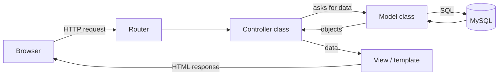

# Unit 7: Advanced PHP Concepts
**Course:** Internet Technology II (CMP 273) · **Teaching hours:** 6

## Learning Objectives

After this unit, you will be able to:

- Explain the importance and benefits of object-oriented programming (OOP) in PHP and compare it with procedural programming.
- Create classes and objects to organize and encapsulate code.
- Define properties and methods, control access to them with `public`, `private` and `protected`, and explain how they improve organization and reusability.
- Apply inheritance, encapsulation and polymorphism (using abstract classes and interfaces) in PHP programs.
- Use static properties and methods, and access them without creating an object.
- Explain PHP magic methods such as `__construct`, `__get`, `__set`, `__call` and `__toString`, and state when each one is triggered.
- Use OOP in practical PHP work: namespaces, autoloading, a database wrapper class, and user/student classes.

---

## 7.1 Object-oriented programming (OOP) in PHP

### What is OOP?

**Object-oriented programming (OOP)** is a way of writing programs in which data and the functions that work on that data are grouped together into a single unit called an **object**. The template that describes an object is called a **class**.

In the units so far, most of our PHP code was **procedural**: a list of statements and functions that run from top to bottom, with data stored in separate variables and arrays. Procedural code works well for small scripts. As a project grows (hundreds of files, many developers), it becomes hard to know which function changes which variable. OOP solves this by keeping related data and behaviour together.

PHP has supported OOP since PHP 4, but the modern object model arrived in PHP 5 and has improved in every release. PHP 8.x adds constructor property promotion, typed properties, `readonly` properties, enums and more. All major PHP frameworks (Laravel, Symfony, CodeIgniter 4) are written in OOP style.

### Why OOP matters (benefits)

| Benefit | Meaning |
|---|---|
| **Modularity** | Code is divided into self-contained classes (e.g. `Student`, `Course`, `Database`). Each class can be developed and tested separately. |
| **Reusability** | A class written once can be used in many scripts and projects. Inheritance lets a new class reuse an old one. |
| **Encapsulation / data protection** | Internal data can be hidden (`private`) and changed only through approved methods, so invalid values cannot sneak in. |
| **Maintainability** | A change inside a class (e.g. how a password is stored) does not break code that uses the class. |
| **Real-world modelling** | Objects map naturally to real things: a student, a product, a bank account, an order. |
| **Team work** | Different developers can work on different classes with a clear "contract" (interface) between them. |
| **Framework support** | Laravel, Symfony and almost every modern library expect OOP knowledge. |

### Procedural vs Object-oriented programming

| Basis | Procedural programming | Object-oriented programming |
|---|---|---|
| Basic unit | Function | Object (created from a class) |
| Focus | Steps / procedures to perform | Data and the things that act on it |
| Data and functions | Kept separately; data is often global or passed around | Bundled together inside a class |
| Data security | Weak; any function can change global data | Strong; access modifiers hide data |
| Reusability | Copy functions or include files | Inheritance, interfaces, traits |
| Approach | Top-down | Bottom-up (build objects, then combine them) |
| Suitable for | Small scripts, quick tasks | Medium and large applications |
| Maintenance | Harder as code grows | Easier; changes are localized |
| Example in PHP | `calculateGrade($marks)` | `$student->calculateGrade()` |

#### Example 7.1: The same task in procedural and OOP style

Procedural version:

```php
<?php
// Procedural: data and functions are separate
$name  = "Sita Sharma";
$marks = [78, 85, 92];

function averageMarks(array $marks): float
{
    return array_sum($marks) / count($marks);
}

echo $name . " scored an average of " . averageMarks($marks) . "\n";
```

**Output:**
```
Sita Sharma scored an average of 85
```

OOP version:

```php
<?php
// OOP: data (name, marks) and behaviour (average) live together
class Student
{
    public string $name;
    public array $marks;

    public function __construct(string $name, array $marks)
    {
        $this->name  = $name;
        $this->marks = $marks;
    }

    public function average(): float
    {
        return array_sum($this->marks) / count($this->marks);
    }
}

$s = new Student("Sita Sharma", [78, 85, 92]);
echo $s->name . " scored an average of " . $s->average() . "\n";
```

**Output:**
```
Sita Sharma scored an average of 85
```

Both print the same result. The difference is organization: in the OOP version, anything to do with a student is inside the `Student` class. If we later add `grade()` or `rank()`, we know exactly where to put it.

### The four pillars of OOP

OOP rests on four main ideas. Each is covered in detail later in this unit.

| Pillar | Simple meaning | PHP feature | Covered in |
|---|---|---|---|
| **Encapsulation** | Wrap data and methods together and hide internal details | `private`, `protected`, getters/setters | 7.3, 7.4 |
| **Abstraction** | Show only *what* an object does, hide *how* it does it | `abstract` classes, `interface` | 7.4 |
| **Inheritance** | A new class reuses and extends an existing class | `extends`, `parent::` | 7.4 |
| **Polymorphism** | One interface, many forms: the same method call behaves differently for different objects | Method overriding, interfaces | 7.4 |

A simple real-life illustration using a mobile phone:

- **Encapsulation:** the battery, chip and circuits are sealed inside the case.
- **Abstraction:** you press "Call"; you do not need to know how the radio signal works.
- **Inheritance:** a new phone model inherits all features of the old model and adds a better camera.
- **Polymorphism:** the "share" button sends a photo by Viber, Messenger or email; same button, different behaviour.

### Class vs Object: the blueprint analogy

A **class** is a blueprint or template. An **object** is a real thing built from that blueprint. One class can produce many objects, and each object has its own data.

- Class = the architect's drawing of a house. Object = the actual houses built in Kathmandu, Pokhara and Butwal from that same drawing.
- Class = the admission form format of a college. Object = each filled-in form for a specific student.

```
            class Student  (blueprint)
        +---------------------------+
        |  properties: name, roll   |
        |  methods:    average()    |
        +---------------------------+
             |          |          |
           new        new        new
             v          v          v
     +-----------+ +-----------+ +-----------+
     | $s1       | | $s2       | | $s3       |
     | name=Ram  | | name=Sita | | name=Hari |
     | roll=1    | | roll=2    | | roll=3    |
     +-----------+ +-----------+ +-----------+
        (objects / instances in memory)
```

| Class | Object |
|---|---|
| A template / blueprint | An instance of a class |
| Declared once with the `class` keyword | Created many times with the `new` keyword |
| Logical entity; uses no memory for data by itself | Physical entity; occupies memory |
| Example: `class Car { ... }` | Example: `$myCar = new Car();` |

> **Teacher's Note:** Start the unit by asking students to describe a "student" in a college system: what data does it have (name, roll, marks) and what can you do with it (enroll, calculate result)? Write the two lists on the board and label them "properties" and "methods". This makes the jump to `class` syntax very natural. Spend about 30 minutes on 7.1.

> **Exam Tip:** "Differentiate between procedural and object-oriented programming" and "Explain the features (pillars) of OOP" are very common 5-mark questions. Write a comparison table with at least 6 points and give one short PHP example for each pillar.

---

## 7.2 Creating and using classes and objects

### Defining a class

A class is defined with the `class` keyword, followed by the class name and a pair of braces. By convention, class names use **PascalCase** (`Student`, `BankAccount`, `ShoppingCart`) and each class lives in its own file named after the class (`Student.php`).

```php
<?php
class ClassName
{
    // properties (variables that belong to the class)
    // methods    (functions that belong to the class)
}
```

### Creating objects with `new` and accessing members with `->`

- `new ClassName()` creates an object (also called an **instance**).
- The **object operator** `->` is used to access the object's properties and methods.
- Note that when accessing a property, you do **not** write the `$` again: `$obj->name`, not `$obj->$name`.

#### Example 7.2: First class and object

```php
<?php
class Car
{
    // properties
    public string $brand = "Unknown";
    public string $color = "White";

    // method
    public function describe(): string
    {
        return "This is a {$this->color} {$this->brand}.";
    }
}

$car1 = new Car();          // create first object
$car1->brand = "Toyota";    // set properties
$car1->color = "Red";

$car2 = new Car();          // second object, uses default values
$car2->brand = "Tata";

echo $car1->describe() . "\n";
echo $car2->describe() . "\n";
```

**Output:**
```
This is a Red Toyota.
This is a White Tata.
```

Each object keeps its own copy of the properties. Changing `$car1->color` does not affect `$car2`.

### The `$this` variable

Inside a method, `$this` refers to **the current object**: the object on which the method was called. When `$car1->describe()` runs, `$this` is `$car1`; when `$car2->describe()` runs, `$this` is `$car2`.

> **Common Mistake:** Forgetting `$this->` inside a method.
> ```php
> public function describe(): string
> {
>     return "Brand: $brand";      // Wrong: $brand is an undefined local variable
> }
> ```
> Correct version: `return "Brand: {$this->brand}";`

### Constructor: `__construct()`

A **constructor** is a special method that PHP calls **automatically** when an object is created with `new`. It is used to give initial values to properties so the object is ready to use immediately.

- Its name is always `__construct` (two underscores).
- It can take parameters; the arguments are passed in `new ClassName(arg1, arg2)`.
- It does not return a value.

#### Example 7.3: Constructor

```php
<?php
class Book
{
    public string $title;
    public string $author;
    public float $price;

    public function __construct(string $title, string $author, float $price)
    {
        $this->title  = $title;
        $this->author = $author;
        $this->price  = $price;
        echo "Book object created: $title\n";
    }

    public function info(): string
    {
        return "{$this->title} by {$this->author} costs Rs. {$this->price}";
    }
}

$b = new Book("Muna Madan", "Laxmi Prasad Devkota", 250);
echo $b->info() . "\n";
```

**Output:**
```
Book object created: Muna Madan
Muna Madan by Laxmi Prasad Devkota costs Rs. 250
```

### Constructor property promotion (PHP 8.0+)

Writing each property three times (declare, parameter, assign) is repetitive. PHP 8.0 introduced **constructor property promotion**: if you put an access modifier in front of a constructor parameter, PHP automatically declares the property and assigns the value.

#### Example 7.4: Constructor property promotion

```php
<?php
// PHP 8: properties are declared and assigned in one place
class Book
{
    public function __construct(
        public string $title,
        public string $author,
        public float $price = 0.0     // default value allowed
    ) {
        // body can be empty, or contain extra logic
    }
}

$b = new Book("Palpasa Cafe", "Narayan Wagle", 450);
echo $b->title . " - " . $b->author . " - Rs. " . $b->price . "\n";
```

**Output:**
```
Palpasa Cafe - Narayan Wagle - Rs. 450
```

This is exactly the same as Example 7.3 without the echo, but shorter. You will see this style in Laravel and other modern code.

### Destructor: `__destruct()`

A **destructor** is called automatically when an object is destroyed: when there are no more references to it, when `unset()` is used, or when the script ends. It is used for clean-up work such as closing a file or a database connection.

#### Example 7.5: Destructor

```php
<?php
class FileLogger
{
    public function __construct(private string $name)
    {
        echo "Opening log: {$this->name}\n";
    }

    public function write(string $msg): void
    {
        echo "[{$this->name}] $msg\n";
    }

    public function __destruct()
    {
        echo "Closing log: {$this->name}\n";
    }
}

$log = new FileLogger("app.log");
$log->write("User logged in");
unset($log);                 // destructor runs here
echo "End of script\n";
```

**Output:**
```
Opening log: app.log
[app.log] User logged in
Closing log: app.log
End of script
```

If we removed `unset($log)`, "Closing log" would print **after** "End of script", because the object would be destroyed when the script finishes.

### Checking an object's type: `instanceof`

The `instanceof` operator checks whether an object belongs to a class (or to a parent class or interface of it). It returns `true` or `false`.

#### Example 7.6: `instanceof`

```php
<?php
class Car {}
class Bike {}

$v = new Car();

var_dump($v instanceof Car);    // true
var_dump($v instanceof Bike);   // false
echo get_class($v) . "\n";      // name of the object's class
```

**Output:**
```
bool(true)
bool(false)
Car
```

### Objects are passed by handle; cloning with `clone`

When you assign an object to another variable, PHP does **not** copy the object. Both variables point to the **same** object (the variable holds an object "handle"). To create a separate copy, use the `clone` keyword.

#### Example 7.7: Assignment vs clone

```php
<?php
class Point
{
    public function __construct(public int $x = 0, public int $y = 0) {}
}

$a = new Point(1, 2);
$b = $a;            // same object, two names
$b->x = 100;
echo "a->x = {$a->x}\n";   // a is also changed

$c = clone $a;      // a new, independent copy
$c->x = 5;
echo "a->x = {$a->x}, c->x = {$c->x}\n";
```

**Output:**
```
a->x = 100
a->x = 100, c->x = 5
```

The magic method `__clone()` (Section 7.6) lets you customize what happens during cloning.

> **Teacher's Note:** Demonstrate Example 7.7 live. Many students expect `$b = $a` to copy the object, as it does for arrays. Drawing two arrows from `$a` and `$b` to one box on the board clears this up quickly.

> **Exam Tip:** For "What is a constructor? Explain with example", define it, state that it is called automatically by `new`, show a class with `__construct()` and the output. Mentioning constructor property promotion (PHP 8) earns extra credit.

---

## 7.3 Properties and Methods

**Properties** are variables that belong to a class; they hold the **state** (data) of an object. **Methods** are functions that belong to a class; they define the **behaviour** of an object. Together they are called the **members** of a class.

Grouping properties and methods in a class improves:

- **Organization:** everything about a product (name, price, discount logic) is in the `Product` class.
- **Reusability:** the same `Product` class is used on the listing page, cart page and admin page.
- **Safety:** with access modifiers, outside code can only use the methods you allow.

### Typed properties (PHP 7.4+)

Since PHP 7.4, properties can have a declared type. PHP then refuses to store a value of the wrong type (a `TypeError` is thrown, or the value is converted if it is a compatible scalar in non-strict mode).

```php
<?php
class Product
{
    public string $name;
    public float $price = 0.0;
    public int $stock = 0;
    public ?string $description = null;   // nullable: string or null
    public array $tags = [];
}
```

A typed property without a default value is **uninitialized** until a value is assigned. Reading it before that causes an `Error`. Assign it in the constructor to be safe.

### Access modifiers (visibility)

Access modifiers control **where** a property or method can be used.

| Modifier | Inside the same class | Inside a child (sub) class | Outside the class (via object) |
|---|---|---|---|
| `public` | Yes | Yes | Yes |
| `protected` | Yes | Yes | No |
| `private` | Yes | No | No |

- If no modifier is written for a method, it is `public` by default. Properties must always have a modifier (or a type with `var`, which is old style and not recommended).
- General rule: make properties `private` (or `protected` if child classes need them) and expose only the methods that outside code needs.

#### Example 7.8: Access modifiers in action

```php
<?php
class Employee
{
    public string $name;
    protected string $department;
    private float $salary;

    public function __construct(string $name, string $dept, float $salary)
    {
        $this->name       = $name;
        $this->department = $dept;
        $this->salary     = $salary;
    }

    public function showSalary(): string
    {
        // private member is accessible inside the class
        return "{$this->name} earns Rs. {$this->salary}";
    }
}

$e = new Employee("Hari Thapa", "IT", 60000);
echo $e->name . "\n";          // OK: public
echo $e->showSalary() . "\n";  // OK: public method reads private data

try {
    echo $e->salary;           // Not allowed: private
} catch (Error $err) {
    echo "Error: " . $err->getMessage() . "\n";
}
```

**Output:**
```
Hari Thapa
Hari Thapa earns Rs. 60000
Error: Cannot access private property Employee::$salary
```

### Getters and setters

Because properties are usually private, we provide public methods to read and change them:

- A **getter** (accessor) returns a property's value: `getName()`.
- A **setter** (mutator) changes a property's value, usually after **validating** it: `setMarks()`.

The big advantage of a setter is validation. With a public property, anyone can write `$student->marks = -50;`. With a setter, the class can reject bad data.

#### Example 7.9: Getters and setters with validation

```php
<?php
class Student
{
    private string $name;
    private int $marks = 0;

    public function __construct(string $name)
    {
        $this->setName($name);
    }

    public function getName(): string
    {
        return $this->name;
    }

    public function setName(string $name): void
    {
        $name = trim($name);
        if ($name === '') {
            throw new InvalidArgumentException("Name cannot be empty.");
        }
        $this->name = $name;
    }

    public function getMarks(): int
    {
        return $this->marks;
    }

    public function setMarks(int $marks): void
    {
        if ($marks < 0 || $marks > 100) {
            throw new InvalidArgumentException("Marks must be between 0 and 100.");
        }
        $this->marks = $marks;
    }
}

$s = new Student("Anish Gurung");
$s->setMarks(88);
echo $s->getName() . ": " . $s->getMarks() . "\n";

try {
    $s->setMarks(150);
} catch (InvalidArgumentException $e) {
    echo "Rejected: " . $e->getMessage() . "\n";
}
echo "Marks are still: " . $s->getMarks() . "\n";
```

**Output:**
```
Anish Gurung: 88
Rejected: Marks must be between 0 and 100.
Marks are still: 88
```

### `readonly` properties (PHP 8.1+)

A **readonly** property can be assigned **only once**, from inside the class (normally in the constructor). After that, any attempt to change it throws an `Error`. It is useful for values that must never change, such as an ID or a registration number.

#### Example 7.10: readonly property

```php
<?php
class Citizen
{
    public function __construct(
        public readonly string $citizenshipNo,
        public string $address
    ) {}
}

$c = new Citizen("27-01-75-12345", "Lalitpur");
echo $c->citizenshipNo . "\n";   // reading is fine
$c->address = "Bhaktapur";       // normal property can change

try {
    $c->citizenshipNo = "00-00";  // cannot change readonly
} catch (Error $e) {
    echo "Error: " . $e->getMessage() . "\n";
}
```

**Output:**
```
27-01-75-12345
Error: Cannot modify readonly property Citizen::$citizenshipNo
```

A readonly property must have a type. (`readonly` needs PHP 8.1 or later; XAMPP with PHP 8.2 supports it.)

### Method chaining (returning `$this`)

If a method returns `$this` (the current object), you can call another method directly on the result. This is called **method chaining** or a **fluent interface**. It is widely used in query builders, for example Laravel's `DB::table('users')->where(...)->orderBy(...)->get()`.

#### Example 7.11: Method chaining in a shopping cart

```php
<?php
class Cart
{
    private array $items = [];

    public function add(string $item, float $price): static
    {
        $this->items[$item] = $price;
        return $this;              // return the same object
    }

    public function remove(string $item): static
    {
        unset($this->items[$item]);
        return $this;
    }

    public function total(): float
    {
        return array_sum($this->items);
    }
}

$cart = new Cart();
$total = $cart->add("Notebook", 120)
              ->add("Pen", 25)
              ->add("Bag", 1500)
              ->remove("Pen")
              ->total();

echo "Total: Rs. $total\n";
```

**Output:**
```
Total: Rs. 1620
```

The return type `static` means "an object of the same class". You may also write `self` or the class name `Cart`.

### Class constants

A **class constant** is a fixed value that belongs to the class, not to any object. It is declared with `const`, written in UPPER_CASE by convention, and accessed with the **scope resolution operator** `::`.

- Outside the class: `ClassName::CONSTANT`
- Inside the class: `self::CONSTANT`
- Constants can have visibility (`public`, `protected`, `private`) since PHP 7.1.

#### Example 7.12: Class constants for grading

```php
<?php
class Exam
{
    public const PASS_MARK = 40;
    public const FULL_MARK = 100;

    public static function result(int $marks): string
    {
        return $marks >= self::PASS_MARK ? "Pass" : "Fail";
    }
}

echo "Pass mark is " . Exam::PASS_MARK . " out of " . Exam::FULL_MARK . "\n";
echo "65 => " . Exam::result(65) . "\n";
echo "32 => " . Exam::result(32) . "\n";
```

**Output:**
```
Pass mark is 40 out of 100
65 => Pass
32 => Fail
```

(`static` methods are explained in 7.5.)

> **Common Mistake:** Using `$this->PASS_MARK` or `$PASS_MARK` for a class constant. Constants are not properties and have no `$`. Use `self::PASS_MARK` inside the class and `Exam::PASS_MARK` outside.

> **Teacher's Note:** A good 10-minute activity: give students a public `$marks` property, let them set it to `-500`, then ask "how do we stop this?". Lead them to `private` plus a setter. This shows *why* encapsulation exists, not just the syntax.

> **Exam Tip:** A table of `public`, `protected` and `private` with "same class / child class / outside" columns is the best way to answer "Explain access modifiers in PHP". Add a short code example.

---

## 7.4 Inheritance, encapsulation, and polymorphism

### 7.4.1 Inheritance

**Inheritance** is the mechanism by which one class (the **child**, **derived** or **sub** class) acquires the properties and methods of another class (the **parent**, **base** or **super** class). The child can use everything that is `public` or `protected` in the parent, add new members, and change (override) inherited methods.

- Keyword: `extends`
- PHP supports **single inheritance** only: a class can extend only one parent. (Multiple inheritance of behaviour is possible with interfaces and traits.)
- Inheritance represents an **"is-a"** relationship: a `Teacher` *is a* `Person`; a `Car` *is a* `Vehicle`.

```
              Person
        (name, address, introduce())
               /         \
          extends       extends
             /             \
        Student           Teacher
   (roll, faculty)    (subject, salary)
```

Types of inheritance possible in PHP:

| Type | Description | Possible in PHP? |
|---|---|---|
| Single | One child, one parent (`B extends A`) | Yes |
| Multilevel | Chain (`C extends B`, `B extends A`) | Yes |
| Hierarchical | Many children, one parent | Yes |
| Multiple | One child, many parents | No (use interfaces/traits) |

#### Example 7.13: Basic inheritance with `parent::__construct`

```php
<?php
class Person
{
    public function __construct(
        protected string $name,
        protected string $address
    ) {}

    public function introduce(): string
    {
        return "I am {$this->name} from {$this->address}.";
    }
}

class Student extends Person
{
    public function __construct(string $name, string $address, private int $roll)
    {
        parent::__construct($name, $address);   // let the parent set its part
        // $this->roll is set by promotion
    }

    public function getRoll(): int
    {
        return $this->roll;
    }
}

$s = new Student("Bikash Rai", "Dharan", 21);
echo $s->introduce() . "\n";          // inherited method
echo "Roll no: " . $s->getRoll() . "\n";
```

**Output:**
```
I am Bikash Rai from Dharan.
Roll no: 21
```

If a child class defines its own constructor, the parent's constructor is **not** called automatically. You must call `parent::__construct(...)` yourself; otherwise the parent's properties stay uninitialized.

### Method overriding

**Method overriding** means a child class provides its own version of a method that already exists in the parent, with the same name (and a compatible signature). When the method is called on a child object, the child's version runs. Inside the overriding method, `parent::methodName()` can call the parent's version.

#### Example 7.14: Overriding and calling the parent version

```php
<?php
class Person
{
    public function __construct(protected string $name) {}

    public function introduce(): string
    {
        return "I am {$this->name}.";
    }
}

class Teacher extends Person
{
    public function __construct(string $name, private string $subject)
    {
        parent::__construct($name);
    }

    // override
    public function introduce(): string
    {
        return parent::introduce() . " I teach {$this->subject}.";
    }
}

$p = new Person("Gita");
$t = new Teacher("Ramesh Adhikari", "Web Technology");

echo $p->introduce() . "\n";
echo $t->introduce() . "\n";
```

**Output:**
```
I am Gita.
I am Ramesh Adhikari. I teach Web Technology.
```

### `protected` in inheritance

A `protected` member is hidden from outside code but **visible to child classes**. In Example 7.14, `Teacher` can use `$this->name` because `name` is `protected` in `Person`. If it were `private`, `Teacher` could not access it directly.

### The `final` keyword

- A **final method** cannot be overridden by a child class.
- A **final class** cannot be extended at all.

Use `final` when changing the behaviour would be dangerous (for example, a password-checking method).

```php
<?php
class Account
{
    final public function verifyPin(string $pin): bool
    {
        return $pin === "1234";   // demo only
    }
}

final class AuditLog
{
    // nobody can extend this class
}

// class Hacked extends Account { public function verifyPin(string $pin): bool { return true; } }
// Fatal error: Cannot override final method Account::verifyPin()

// class MyLog extends AuditLog {}
// Fatal error: Class MyLog cannot extend final class AuditLog
```

> **Common Mistake:** Writing a child constructor and forgetting `parent::__construct()`. The child object then has empty parent properties, and accessing a typed property gives "must not be accessed before initialization". Always call the parent constructor first.

### 7.4.2 Encapsulation

**Encapsulation** means bundling data (properties) and the methods that operate on that data into one unit (the class), and **restricting direct access** to the data from outside. Outside code must go through public methods, which can check the rules.

Benefits:

- **Data integrity:** invalid values (negative balance, marks above 100) are rejected.
- **Flexibility:** internal details can change without affecting code that uses the class.
- **Security:** sensitive data (salary, password hash, PIN) is not directly exposed.

#### Example 7.15: Encapsulation with a BankAccount

```php
<?php
class BankAccount
{
    private float $balance = 0;
    private array $history = [];

    public function __construct(
        private string $accountNo,
        private string $holder
    ) {}

    public function deposit(float $amount): void
    {
        if ($amount <= 0) {
            throw new InvalidArgumentException("Deposit must be positive.");
        }
        $this->balance += $amount;
        $this->history[] = "Deposit: $amount";
    }

    public function withdraw(float $amount): void
    {
        if ($amount <= 0) {
            throw new InvalidArgumentException("Withdrawal must be positive.");
        }
        if ($amount > $this->balance) {
            throw new RuntimeException("Insufficient balance.");
        }
        $this->balance -= $amount;
        $this->history[] = "Withdraw: $amount";
    }

    public function getBalance(): float
    {
        return $this->balance;
    }

    public function getHistory(): array
    {
        return $this->history;
    }
}

$acc = new BankAccount("NIC-0012345", "Sunita Karki");
$acc->deposit(5000);
$acc->withdraw(1200);

try {
    $acc->withdraw(10000);
} catch (RuntimeException $e) {
    echo "Failed: " . $e->getMessage() . "\n";
}

echo "Balance: Rs. " . $acc->getBalance() . "\n";
echo implode(", ", $acc->getHistory()) . "\n";

// $acc->balance = 1000000;   // Error: Cannot access private property
```

**Output:**
```
Failed: Insufficient balance.
Balance: Rs. 3800
Deposit: 5000, Withdraw: 1200
```

The balance can only change through `deposit()` and `withdraw()`, which enforce the bank's rules. Nobody can write `$acc->balance = 1000000`.

### 7.4.3 Polymorphism

**Polymorphism** (Greek: "many forms") means that objects of different classes can be used through the **same interface**, and each object responds in its own way. The calling code does not need to know the exact class; it just calls the method.

In PHP, polymorphism is achieved through:

1. **Method overriding** in child classes (seen in Example 7.14).
2. **Abstract classes** that declare methods which children must implement.
3. **Interfaces** that several unrelated classes implement.

PHP does not support method **overloading** in the Java/C++ sense (two methods with the same name but different parameters). Similar behaviour can be produced with default parameters, variadic parameters (`...$args`) or the `__call()` magic method (7.6).

### Abstract classes

An **abstract class** is a class that cannot be instantiated (you cannot write `new` for it). It is meant to be a base for other classes. It may contain:

- normal (concrete) methods with code, and
- **abstract methods**: methods with only a signature and no body. Every non-abstract child class **must** implement them.

Abstract classes provide **abstraction**: they describe *what* subclasses must do, not *how*.

#### Example 7.16: Polymorphism with an abstract Shape class

```php
<?php
abstract class Shape
{
    public function __construct(protected string $name) {}

    // every shape must say how to calculate its area
    abstract public function area(): float;

    // concrete method shared by all shapes
    public function describe(): string
    {
        return sprintf("%s has area %.2f", $this->name, $this->area());
    }
}

class Circle extends Shape
{
    public function __construct(private float $radius)
    {
        parent::__construct("Circle");
    }

    public function area(): float
    {
        return M_PI * $this->radius ** 2;
    }
}

class Rectangle extends Shape
{
    public function __construct(private float $length, private float $breadth)
    {
        parent::__construct("Rectangle");
    }

    public function area(): float
    {
        return $this->length * $this->breadth;
    }
}

class Triangle extends Shape
{
    public function __construct(private float $base, private float $height)
    {
        parent::__construct("Triangle");
    }

    public function area(): float
    {
        return 0.5 * $this->base * $this->height;
    }
}

$shapes = [new Circle(7), new Rectangle(4, 5), new Triangle(6, 3)];

foreach ($shapes as $shape) {
    echo $shape->describe() . "\n";   // same call, different behaviour
}

// $s = new Shape("x");  // Error: Cannot instantiate abstract class Shape
```

**Output:**
```
Circle has area 153.94
Rectangle has area 20.00
Triangle has area 9.00
```

The `foreach` loop does not check whether `$shape` is a circle or a rectangle. It simply calls `describe()`, which calls `area()`, and PHP runs the right version for each object. Adding a new `Square` class later needs **no change** to the loop. This is the real power of polymorphism.

### Interfaces

An **interface** is a pure contract: it lists method signatures that a class must provide, but contains no method bodies and no properties (it may contain constants).

- Declared with `interface`.
- A class uses it with `implements`.
- A class can implement **many** interfaces (comma-separated), which gives PHP a form of multiple inheritance.
- All interface methods are `public`.

#### Example 7.17: Interfaces for payment methods

```php
<?php
interface PaymentMethod
{
    public function pay(float $amount): string;
}

interface Refundable
{
    public function refund(float $amount): string;
}

class EsewaPayment implements PaymentMethod, Refundable
{
    public function pay(float $amount): string
    {
        return "Paid Rs. $amount via eSewa";
    }

    public function refund(float $amount): string
    {
        return "Refunded Rs. $amount to eSewa wallet";
    }
}

class CashOnDelivery implements PaymentMethod
{
    public function pay(float $amount): string
    {
        return "Rs. $amount will be collected on delivery";
    }
}

// This function works with ANY class that implements PaymentMethod
function checkout(PaymentMethod $method, float $amount): void
{
    echo $method->pay($amount) . "\n";
    if ($method instanceof Refundable) {
        echo "  (refund available)\n";
    }
}

checkout(new EsewaPayment(), 2500);
checkout(new CashOnDelivery(), 900);
```

**Output:**
```
Paid Rs. 2500 via eSewa
  (refund available)
Rs. 900 will be collected on delivery
```

`checkout()` is written once and works with eSewa, Khalti, cash or any future payment class, as long as it implements `PaymentMethod`.

### Abstract class vs Interface

| Basis | Abstract class | Interface |
|---|---|---|
| Keyword | `abstract class` | `interface` |
| Used by child with | `extends` | `implements` |
| Method bodies | Can have both abstract and concrete methods | Only method signatures (no bodies) |
| Properties | Can have properties | Cannot have properties (only constants) |
| Constructor | Can have a constructor | Cannot have a constructor (body) |
| Access modifiers | `public`, `protected`, `private` | All methods are `public` |
| Multiple | A class can extend only one abstract class | A class can implement many interfaces |
| Relationship | "is-a" (Circle *is a* Shape) | "can-do" (eSewa *can* refund) |
| When to use | Related classes share common code | Unrelated classes must follow the same contract |

> **Beyond the syllabus: Traits**
>
> A **trait** is a group of methods that can be "copied" into any class with the `use` keyword. Traits solve the single-inheritance limit when unrelated classes need the same helper code.
>
> ```php
> <?php
> trait Loggable
> {
>     public function log(string $msg): void
>     {
>         echo "[" . static::class . "] $msg\n";
>     }
> }
>
> class Order   { use Loggable; }
> class Payment { use Loggable; }
>
> (new Order())->log("Order placed");
> (new Payment())->log("Payment received");
> ```
>
> **Output:**
> ```
> [Order] Order placed
> [Payment] Payment received
> ```

> **Teacher's Note:** For polymorphism, run Example 7.16 and then ask students to add a `Square` class in two minutes without touching the loop. When it works, they understand polymorphism better than any definition can explain. Allow about 75 minutes for the whole of 7.4.

> **Exam Tip:** "Differentiate between abstract class and interface" is a favourite question. Give a table (at least 6 points) and one small example of each. For "Explain polymorphism with example", the Shape/area example is ideal: show the abstract class, two child classes and the loop.

---

## 7.5 Static Properties and Methods

### What does `static` mean?

Normally each object has its own copy of every property. A **static** property or method belongs to the **class itself**, not to any single object. There is only **one copy**, shared by all objects of that class, and it can be used **without creating an object**.

- Declared with the `static` keyword.
- Accessed with the **scope resolution operator** `::` (also called "Paamayim Nekudotayim", Hebrew for "double colon").

| Where you are | Access a static member with |
|---|---|
| Outside the class | `ClassName::$property`, `ClassName::method()` |
| Inside the same class | `self::$property`, `self::method()` |
| Inside a child class (parent's member) | `parent::$property`, `parent::method()` |

Note the `$` in `ClassName::$count` for static properties (unlike constants: `ClassName::MAX`).

### `self::` vs `$this->`

| `$this->` | `self::` |
|---|---|
| Refers to the current **object** | Refers to the current **class** |
| Used for normal (instance) properties and methods | Used for static members and constants |
| Not available inside a static method | Available in both static and normal methods |
| `$this->name` | `self::$count`, `self::PASS_MARK` |

A static method has no `$this` because it is not called on an object. Using `$this` inside a static method causes an error.

#### Example 7.18: Counting objects with a static property

```php
<?php
class Student
{
    public static int $count = 0;     // shared by all Student objects

    public function __construct(public string $name)
    {
        self::$count++;               // increment the shared counter
    }

    public static function getCount(): int
    {
        return self::$count;
    }
}

echo "Before: " . Student::getCount() . "\n";   // no object needed

$a = new Student("Ram");
$b = new Student("Sita");
$c = new Student("Hari");

echo "After: " . Student::getCount() . "\n";
echo "Direct: " . Student::$count . "\n";
```

**Output:**
```
Before: 0
After: 3
Direct: 3
```

If `$count` were a normal property, each object would have its own `$count` equal to 1. Because it is static, all three objects increment the same variable.

### Utility (helper) classes

A common use of static methods is a **utility class**: a class that groups related helper functions which do not need any object state. You call them directly, like `Math::square(5)`. PHP's own `DateTime::createFromFormat()` is a static method.

#### Example 7.19: A Validator utility class

```php
<?php
class Validator
{
    public static function isEmail(string $value): bool
    {
        return filter_var($value, FILTER_VALIDATE_EMAIL) !== false;
    }

    public static function isNepaliMobile(string $value): bool
    {
        // 10 digits starting with 97 or 98
        return preg_match('/^9[78]\d{8}$/', $value) === 1;
    }

    public static function inRange(int $n, int $min, int $max): bool
    {
        return $n >= $min && $n <= $max;
    }
}

$tests = ["ram@example.com", "ram@", "9841234567", "12345"];

echo "Email ram@example.com: " . (Validator::isEmail($tests[0]) ? "valid" : "invalid") . "\n";
echo "Email ram@: "            . (Validator::isEmail($tests[1]) ? "valid" : "invalid") . "\n";
echo "Mobile 9841234567: "     . (Validator::isNepaliMobile($tests[2]) ? "valid" : "invalid") . "\n";
echo "Mobile 12345: "          . (Validator::isNepaliMobile($tests[3]) ? "valid" : "invalid") . "\n";
echo "Marks 75 in 0-100: "     . (Validator::inRange(75, 0, 100) ? "yes" : "no") . "\n";
```

**Output:**
```
Email ram@example.com: valid
Email ram@: invalid
Mobile 9841234567: valid
Mobile 12345: invalid
Marks 75 in 0-100: yes
```

### When to use (and avoid) static

| Use static for | Avoid static for |
|---|---|
| Counters or settings shared by all objects | Data that differs per object (name, marks) |
| Pure helper functions (validation, formatting, maths) | Code that must be easily replaced or tested with fake objects |
| Factory methods such as `User::fromArray($row)` | Storing request data (it is shared and acts like a global) |

### Late static binding (brief)

`self::` always refers to the class where the code is **written**. `static::` refers to the class that was **actually called** at run time. This is called **late static binding** (PHP 5.3+). It matters when a parent's static method is called through a child class.

#### Example 7.20: `self::` vs `static::`

```php
<?php
class Model
{
    public static function create(): static
    {
        return new static();      // creates the class that was called
    }

    public static function whoSelf(): string
    {
        return self::class;       // always "Model"
    }

    public static function whoStatic(): string
    {
        return static::class;     // the called class
    }
}

class User extends Model {}

echo User::whoSelf() . "\n";
echo User::whoStatic() . "\n";
echo get_class(User::create()) . "\n";
```

**Output:**
```
Model
User
User
```

Laravel uses this idea so that `User::create([...])` returns a `User` object even though `create()` is written in the parent `Model` class.

> **Common Mistake:** Using `$this` inside a static method, or accessing a static property with `->`.
> ```php
> public static function getCount(): int { return $this->count; }  // Error
> echo $student->count;                                              // Warning/undefined
> ```
> Correct: `return self::$count;` and `echo Student::$count;`

> **Teacher's Note:** The object counter (Example 7.18) is the clearest demo of "one shared copy". Then remove the `static` keyword and run it again so students see each object getting its own counter. About 45 minutes is enough for 7.5.

> **Exam Tip:** For "Explain static properties and methods with example", state that they belong to the class, are accessed with `::` without creating an object, and that `self::` is used inside the class. The object-counter program is the standard example; write it with its output.

---

## 7.6 Magic Methods

**Magic methods** are special methods whose names start with a double underscore (`__`). You never call them directly in normal code; PHP calls them **automatically** when a certain event happens, such as creating an object, reading a missing property, or converting an object to a string.

They let you hook into the language's behaviour and are heavily used by frameworks (for example, Laravel models use `__get` and `__set` to give access to database columns as properties).

Rules:

- Names starting with `__` are reserved for PHP; do not invent your own `__something` methods.
- Magic methods (except `__construct`, `__destruct` and `__clone`) must be `public`.

### Summary table of magic methods

| Magic method | When it is triggered | Typical use |
|---|---|---|
| `__construct(...)` | When an object is created with `new` | Initialize properties |
| `__destruct()` | When an object is destroyed (unset, out of scope, script end) | Clean-up: close file/connection |
| `__get($name)` | Reading a property that is inaccessible (private/protected) or does not exist | Controlled read access, computed or dynamic properties |
| `__set($name, $value)` | Writing to an inaccessible or non-existent property | Validation, storing dynamic data |
| `__isset($name)` | Calling `isset()` or `empty()` on an inaccessible property | Make `isset()` work with dynamic properties |
| `__unset($name)` | Calling `unset()` on an inaccessible property | Remove dynamic data |
| `__call($name, $args)` | Calling an inaccessible or non-existent **object** method | Proxy methods, "overloading", dynamic finders |
| `__callStatic($name, $args)` | Calling an inaccessible or non-existent **static** method | Static proxies (Laravel facades) |
| `__toString()` | Using the object as a string (`echo $obj`, concatenation) | Readable text form of the object |
| `__invoke(...)` | Calling the object like a function: `$obj(...)` | Callable objects, single-action classes |
| `__clone()` | After an object is copied with `clone` | Deep copy, reset ID |
| `__sleep()` / `__wakeup()` | `serialize()` / `unserialize()` | Choose what to save (beyond syllabus) |
| `__serialize()` / `__unserialize()` | Newer versions of the above (PHP 7.4+) | Same (beyond syllabus) |
| `__set_state()` | `var_export()` of an object | Rarely used |
| `__debugInfo()` | `var_dump()` of an object | Hide sensitive data from dumps |

`__construct` and `__destruct` were covered in 7.2. Examples for the others follow.

### `__get()` and `__set()`

These are called **property overloading** methods. They run only when the property is **not accessible** from the calling place (private, protected or missing). Public properties are accessed directly and do not trigger them.

#### Example 7.21: `__get`, `__set`, `__isset`, `__unset`

```php
<?php
class Profile
{
    private array $data = [];          // stores dynamic properties

    public function __set(string $name, mixed $value): void
    {
        echo "Setting '$name'\n";
        $this->data[$name] = $value;
    }

    public function __get(string $name): mixed
    {
        if (array_key_exists($name, $this->data)) {
            return $this->data[$name];
        }
        echo "Property '$name' does not exist\n";
        return null;
    }

    public function __isset(string $name): bool
    {
        return isset($this->data[$name]);
    }

    public function __unset(string $name): void
    {
        echo "Removing '$name'\n";
        unset($this->data[$name]);
    }
}

$p = new Profile();
$p->city = "Pokhara";              // triggers __set
$p->college = "PU";                // triggers __set

echo $p->city . "\n";              // triggers __get
var_dump(isset($p->college));      // triggers __isset
unset($p->college);                // triggers __unset
var_dump(isset($p->college));
echo $p->phone ?? "no phone";      // __isset returns false, so default is used
echo "\n";
$x = $p->email;                    // triggers __get for missing key
```

**Output:**
```
Setting 'city'
Setting 'college'
Pokhara
bool(true)
Removing 'college'
bool(false)
no phone
Property 'email' does not exist
```

Note: the `??` operator first calls `__isset()`; because it returns `false`, `__get()` is never called for `phone`.

### `__call()` and `__callStatic()`

These are **method overloading** methods. `__call()` runs when a non-existent (or inaccessible) method is called on an object; `__callStatic()` runs for a non-existent static method. The first argument is the method name, the second is an array of the arguments.

#### Example 7.22: `__call` and `__callStatic`

```php
<?php
class Calculator
{
    // Simulates "overloading": add() works with any number of arguments
    public function __call(string $method, array $args): mixed
    {
        if ($method === 'add') {
            return array_sum($args);
        }
        throw new BadMethodCallException("Method $method() does not exist");
    }

    public static function __callStatic(string $method, array $args): mixed
    {
        // e.g. Calculator::multiply(2, 3, 4)
        if ($method === 'multiply') {
            return array_product($args);
        }
        throw new BadMethodCallException("Static method $method() does not exist");
    }
}

$calc = new Calculator();
echo $calc->add(2, 3) . "\n";
echo $calc->add(10, 20, 30, 40) . "\n";
echo Calculator::multiply(2, 3, 4) . "\n";

try {
    $calc->divide(10, 2);
} catch (BadMethodCallException $e) {
    echo $e->getMessage() . "\n";
}
```

**Output:**
```
5
100
24
Method divide() does not exist
```

A practical use is a "dynamic finder": `$repo->findByEmail('a@b.com')` can be handled by `__call`, which reads the part after `findBy` and builds the query. Laravel **facades** (`Route::get(...)`, `DB::table(...)`) work through `__callStatic`.

### `__toString()`

`__toString()` is called when an object is treated as a string: in `echo`, `print`, string concatenation, or string functions. It **must return a string**. Without it, `echo $obj` causes an error ("Object of class X could not be converted to string").

#### Example 7.23: `__toString`

```php
<?php
class Money
{
    public function __construct(private float $amount, private string $currency = "NPR") {}

    public function __toString(): string
    {
        return $this->currency . " " . number_format($this->amount, 2);
    }
}

$fee = new Money(85000);
echo "Semester fee: " . $fee . "\n";
echo $fee . "\n";
```

**Output:**
```
Semester fee: NPR 85,000.00
NPR 85,000.00
```

### `__invoke()`

`__invoke()` is called when you use an object **as if it were a function**: `$obj(...)`. Such objects are called **callable objects** and can be passed anywhere a callback is expected, such as `array_map()` or `usort()`.

#### Example 7.24: `__invoke`

```php
<?php
class Discount
{
    public function __construct(private float $percent) {}

    public function __invoke(float $price): float
    {
        return $price - ($price * $this->percent / 100);
    }
}

$dashainOffer = new Discount(20);           // 20% off
echo $dashainOffer(1500) . "\n";            // object called like a function

$prices = [1000, 2500, 400];
$newPrices = array_map($dashainOffer, $prices);
echo implode(", ", $newPrices) . "\n";
var_dump(is_callable($dashainOffer));
```

**Output:**
```
1200
800, 2000, 320
bool(true)
```

### `__clone()`

`__clone()` runs on the **new copy** immediately after `clone` finishes. By default PHP makes a **shallow copy**: properties that hold other objects still point to the same inner objects. Use `__clone()` to make a **deep copy** or to reset values such as an ID.

#### Example 7.25: `__clone` for deep copy

```php
<?php
class Address
{
    public function __construct(public string $city) {}
}

class Customer
{
    public static int $nextId = 1;
    public int $id;

    public function __construct(public string $name, public Address $address)
    {
        $this->id = self::$nextId++;
    }

    public function __clone(): void
    {
        $this->id = self::$nextId++;              // give the copy a new ID
        $this->address = clone $this->address;    // deep copy the inner object
    }
}

$c1 = new Customer("Kiran", new Address("Chitwan"));
$c2 = clone $c1;
$c2->name = "Kiran (copy)";
$c2->address->city = "Biratnagar";

echo "{$c1->id}: {$c1->name}, {$c1->address->city}\n";
echo "{$c2->id}: {$c2->name}, {$c2->address->city}\n";
```

**Output:**
```
1: Kiran, Chitwan
2: Kiran (copy), Biratnagar
```

Without the `__clone()` method, both customers would have ID 1 and changing `$c2`'s city would also change `$c1`'s city (because they would share one `Address` object).

> **Common Mistake:** Expecting `__get()` to run for a `public` property. Magic property methods run only for **inaccessible** or **missing** properties. Also, `__toString()` must `return` a string; using `echo` inside it is wrong.

> **Teacher's Note:** Put the summary table on a slide and, for each magic method, ask "what line of code would trigger this?". Then run Example 7.21, which prints a message every time a magic method fires. Students can literally see when PHP calls each one. About 60 minutes for 7.6.

> **Exam Tip:** "What are magic methods? Explain any four with examples" is a common long question. Pick `__construct`, `__get`/`__set`, `__call` and `__toString`; for each, write when it is triggered and a 6-10 line example with output.

---

## 7.7 Practical applications of OOP in PHP development

This section shows how the OOP ideas above are used in real PHP projects.

### Namespaces

As a project grows, two classes may have the same name (your `User` class and a library's `User` class). A **namespace** is a named group for classes, interfaces, functions and constants that prevents such name clashes, similar to folders for files.

- Declared with `namespace` at the very top of the file (before any other code except `declare`).
- Use the full name `\App\Models\User`, or import it with `use`.

```php
<?php
// File: src/Models/User.php
namespace App\Models;

class User
{
    public function __construct(public string $name) {}
}
```

```php
<?php
// File: index.php
require 'src/Models/User.php';

use App\Models\User;            // import the class

$u = new User("Prakash");       // same as new \App\Models\User("Prakash")
echo $u->name . "\n";
echo User::class . "\n";        // fully qualified class name
```

**Output:**
```
Prakash
App\Models\User
```

### Autoloading with `spl_autoload_register()`

Writing `require` for every class file is tiring and error-prone. **Autoloading** lets PHP load a class file automatically the first time the class is used. You register a function with `spl_autoload_register()`; PHP calls it with the class name whenever it meets an unknown class.

#### Example 7.26: A simple autoloader

Folder structure:

```
project/
├── index.php
└── classes/
    ├── Student.php
    └── Course.php
```

```php
<?php
// classes/Student.php
class Student
{
    public function __construct(public string $name) {}
}
```

```php
<?php
// classes/Course.php
class Course
{
    public function __construct(public string $title) {}
}
```

```php
<?php
// index.php
spl_autoload_register(function (string $class): void {
    $file = __DIR__ . '/classes/' . $class . '.php';
    if (is_file($file)) {
        require $file;
    }
});

// No require statements needed:
$s = new Student("Nabin");
$c = new Course("Internet Technology II");
echo "{$s->name} is enrolled in {$c->title}\n";
```

**Output:**
```
Nabin is enrolled in Internet Technology II
```

### Composer and PSR-4 (brief)

In professional projects, autoloading is handled by **Composer**, PHP's dependency manager. Composer follows the **PSR-4** standard: a namespace prefix maps to a folder, and each class is in a file with the same name as the class.

```json
{
    "autoload": {
        "psr-4": {
            "App\\": "src/"
        }
    }
}
```

After running `composer dump-autoload`, the class `App\Models\User` is loaded automatically from `src/Models/User.php`. Your script only needs one line:

```php
<?php
require __DIR__ . '/vendor/autoload.php';

use App\Models\User;

$u = new User("Prakash");
```

Composer is also used to install libraries (`composer require phpmailer/phpmailer`) and is the base of every Laravel project.

### A Database wrapper class (MySQLi, prepared statements)

Instead of repeating connection and query code on every page, we wrap it in a class. This is a classic use of encapsulation: pages call simple methods, and all the database details (connection, prepared statements, error handling) are hidden in one place.

Assume this table (from Unit 6):

```sql
CREATE TABLE students (
    id      INT AUTO_INCREMENT PRIMARY KEY,
    name    VARCHAR(100) NOT NULL,
    email   VARCHAR(100) NOT NULL UNIQUE,
    faculty VARCHAR(20)  NOT NULL,
    marks   INT          NOT NULL
);

CREATE TABLE users (
    id            INT AUTO_INCREMENT PRIMARY KEY,
    username      VARCHAR(50)  NOT NULL UNIQUE,
    email         VARCHAR(100) NOT NULL UNIQUE,
    password_hash VARCHAR(255) NOT NULL,
    created_at    TIMESTAMP DEFAULT CURRENT_TIMESTAMP
);
```

#### Example 7.27: `Database.php`

```php
<?php
// classes/Database.php
class Database
{
    private mysqli $conn;

    public function __construct(
        string $host = "localhost",
        string $user = "root",
        string $pass = "",
        string $dbname = "college"
    ) {
        // make mysqli throw exceptions instead of silent failures
        mysqli_report(MYSQLI_REPORT_ERROR | MYSQLI_REPORT_STRICT);
        $this->conn = new mysqli($host, $user, $pass, $dbname);
        $this->conn->set_charset("utf8mb4");
    }

    /**
     * Run a SELECT with a prepared statement and return all rows.
     * $types is the bind_param type string, e.g. "si".
     */
    public function select(string $sql, string $types = "", array $params = []): array
    {
        $stmt = $this->conn->prepare($sql);
        if ($types !== "") {
            $stmt->bind_param($types, ...$params);
        }
        $stmt->execute();
        $rows = $stmt->get_result()->fetch_all(MYSQLI_ASSOC);
        $stmt->close();
        return $rows;
    }

    /**
     * Run INSERT / UPDATE / DELETE and return the number of affected rows.
     */
    public function execute(string $sql, string $types = "", array $params = []): int
    {
        $stmt = $this->conn->prepare($sql);
        if ($types !== "") {
            $stmt->bind_param($types, ...$params);
        }
        $stmt->execute();
        $affected = $stmt->affected_rows;
        $stmt->close();
        return $affected;
    }

    public function lastInsertId(): int
    {
        return (int) $this->conn->insert_id;
    }

    public function __destruct()
    {
        $this->conn->close();
    }
}
```

Using it on a page:

```php
<?php
require 'classes/Database.php';

$db = new Database();

// INSERT (values come from the user in a real form; always bound, never concatenated)
$db->execute(
    "INSERT INTO students (name, email, faculty, marks) VALUES (?, ?, ?, ?)",
    "sssi",
    ["Sujan Shrestha", "sujan@example.com", "BCSIT", 81]
);
echo "New student id: " . $db->lastInsertId() . "\n";

// SELECT with a parameter
$rows = $db->select("SELECT name, marks FROM students WHERE faculty = ?", "s", ["BCSIT"]);
foreach ($rows as $r) {
    echo $r['name'] . " - " . $r['marks'] . "\n";
}
```

**Output** (depends on the data in your table; for example):
```
New student id: 4
Sujan Shrestha - 81
```

Benefits: SQL injection is prevented in one place, connection details are written once, and if we later switch to PDO, only `Database.php` changes.

> **Common Mistake:** Building SQL by joining strings inside the wrapper, e.g. `"SELECT * FROM users WHERE email = '$email'"`. This allows SQL injection even inside a nice class. Always use `?` placeholders and `bind_param`. Never use the removed `mysql_*` functions.

### A User class with register and login

This class uses the `Database` wrapper (an example of **composition**: a `User` object *has a* `Database` object). It uses `password_hash()` / `password_verify()` and regenerates the session ID on login.

#### Example 7.28: `User.php`

```php
<?php
// classes/User.php
class User
{
    public function __construct(private Database $db) {}

    public function register(string $username, string $email, string $password): bool
    {
        $username = trim($username);
        $email    = filter_var(trim($email), FILTER_VALIDATE_EMAIL);

        if ($username === '' || $email === false || strlen($password) < 8) {
            return false;   // invalid input
        }

        // check duplicates
        $exists = $this->db->select(
            "SELECT id FROM users WHERE username = ? OR email = ?",
            "ss",
            [$username, $email]
        );
        if ($exists) {
            return false;
        }

        $hash = password_hash($password, PASSWORD_DEFAULT);   // never md5/sha1
        $this->db->execute(
            "INSERT INTO users (username, email, password_hash) VALUES (?, ?, ?)",
            "sss",
            [$username, $email, $hash]
        );
        return true;
    }

    public function login(string $username, string $password): bool
    {
        $rows = $this->db->select(
            "SELECT id, username, password_hash FROM users WHERE username = ?",
            "s",
            [$username]
        );

        if (!$rows || !password_verify($password, $rows[0]['password_hash'])) {
            return false;   // same message for wrong user or wrong password
        }

        session_regenerate_id(true);      // prevent session fixation
        $_SESSION['user_id']  = $rows[0]['id'];
        $_SESSION['username'] = $rows[0]['username'];
        return true;
    }

    public static function isLoggedIn(): bool
    {
        return isset($_SESSION['user_id']);
    }

    public function logout(): void
    {
        $_SESSION = [];
        session_destroy();
    }
}
```

Using it in `login.php`:

```php
<?php
session_start();
require 'classes/Database.php';
require 'classes/User.php';

$message = '';

if ($_SERVER['REQUEST_METHOD'] === 'POST') {
    $username = filter_input(INPUT_POST, 'username') ?? '';
    $password = filter_input(INPUT_POST, 'password') ?? '';

    $user = new User(new Database());
    if ($user->login($username, $password)) {
        header('Location: dashboard.php');
        exit;
    }
    $message = 'Invalid username or password.';
}
?>
<!DOCTYPE html>
<html>
<head><title>Login</title></head>
<body>
  <h2>Login</h2>
  <p style="color:red"><?= htmlspecialchars($message) ?></p>
  <form method="post">
    <input type="text" name="username" placeholder="Username" required>
    <input type="password" name="password" placeholder="Password" required>
    <button type="submit">Login</button>
  </form>
</body>
</html>
```

Notice how short and readable `login.php` is. All the security logic lives in the `User` class and can be reused on any page.

### A Student class rendering an HTML table

Objects are also useful for output. Here each `Student` object knows how to compute its own grade and render its own table row; a static method renders the whole table.

#### Example 7.29: Student result table

```php
<?php
class Student
{
    public function __construct(
        private string $name,
        private string $faculty,
        private int $marks
    ) {}

    public function grade(): string
    {
        return match (true) {
            $this->marks >= 90 => 'A',
            $this->marks >= 80 => 'A-',
            $this->marks >= 70 => 'B+',
            $this->marks >= 60 => 'B',
            $this->marks >= 50 => 'C',
            default            => 'F',
        };
    }

    public function toRow(): string
    {
        // escape every value before putting it into HTML
        return sprintf(
            "<tr><td>%s</td><td>%s</td><td>%d</td><td>%s</td></tr>",
            htmlspecialchars($this->name),
            htmlspecialchars($this->faculty),
            $this->marks,
            $this->grade()
        );
    }

    public static function renderTable(array $students): string
    {
        $html  = "<table border=\"1\">\n";
        $html .= "<tr><th>Name</th><th>Faculty</th><th>Marks</th><th>Grade</th></tr>\n";
        foreach ($students as $s) {
            $html .= $s->toRow() . "\n";
        }
        return $html . "</table>\n";
    }
}

$students = [
    new Student("Aayush Poudel", "BCSIT", 92),
    new Student("Pooja Magar", "BCSIT", 74),
    new Student("Rohan <b>KC</b>", "BBA", 45),   // HTML is escaped, not run
];

echo Student::renderTable($students);
```

**Output:**
```html
<table border="1">
<tr><th>Name</th><th>Faculty</th><th>Marks</th><th>Grade</th></tr>
<tr><td>Aayush Poudel</td><td>BCSIT</td><td>92</td><td>A</td></tr>
<tr><td>Pooja Magar</td><td>BCSIT</td><td>74</td><td>B+</td></tr>
<tr><td>Rohan &lt;b&gt;KC&lt;/b&gt;</td><td>BBA</td><td>45</td><td>F</td></tr>
</table>
```

In a real application, the `Student` objects would be built from database rows, for example:

```php
$rows = $db->select("SELECT name, faculty, marks FROM students ORDER BY marks DESC");
$students = array_map(
    fn(array $r) => new Student($r['name'], $r['faculty'], (int) $r['marks']),
    $rows
);
echo Student::renderTable($students);
```

### How frameworks use OOP (link to Unit 8)

Modern PHP frameworks such as **Laravel**, **Symfony** and **CodeIgniter 4** are built entirely from the OOP features in this unit:

| OOP feature | How a framework uses it |
|---|---|
| Classes and objects | Every controller, model and middleware is a class |
| Inheritance | `class StudentController extends Controller`, `class Student extends Model` |
| Interfaces | Contracts for caching, mail, queues; you can swap the implementation |
| Encapsulation | Request, Session and Response objects hide `$_POST`, `$_SESSION`, headers |
| Polymorphism | Many database drivers (MySQL, PostgreSQL, SQLite) behind one query builder |
| Static methods / `__callStatic` | Facades: `Route::get()`, `DB::table()`, `Auth::user()` |
| Magic `__get` / `__set` | Model columns as properties: `$student->name` |
| Method chaining | `Student::where('faculty', 'BCSIT')->orderBy('marks')->get()` |
| Namespaces and autoloading | `App\Http\Controllers\...`, loaded by Composer PSR-4 |

These frameworks organize code using the **MVC (Model-View-Controller)** pattern, where each part is a set of classes:



Unit 8 builds on this: you will see how a framework turns these classes into a complete web application.

> **Teacher's Note:** Build the `Database` and `User` classes live in the lab over one session, then replace the procedural login code from Unit 6 with the OOP version. Comparing the old and new `login.php` side by side is the best argument for OOP. Allow about 75 minutes for 7.7.

> **Exam Tip:** "Write a PHP class to connect to a database and insert/select records" and "Explain namespaces and autoloading" appear in exams. In database answers, always use prepared statements and mention why; examiners reward secure code.

---

## Summary

- **OOP** groups data (properties) and behaviour (methods) into **classes**; an **object** is an instance of a class created with `new`.
- OOP gives modularity, reusability, data protection, easier maintenance, and is the basis of all modern PHP frameworks.
- The **four pillars** are encapsulation, abstraction, inheritance and polymorphism.
- `->` accesses an object's members; `$this` refers to the current object; `::` accesses static members and constants.
- `__construct()` runs automatically on `new`; `__destruct()` runs when the object is destroyed. PHP 8 **constructor property promotion** declares and assigns properties in the constructor signature.
- Assigning an object copies the handle, not the object; use `clone` for a separate copy, and `__clone()` for deep copies.
- Access modifiers: `public` (everywhere), `protected` (class and children), `private` (class only). Use private properties with getters/setters that validate data.
- **Typed** properties (7.4+) and **readonly** properties (8.1+) make classes safer; returning `$this` enables **method chaining**.
- **Inheritance** uses `extends` (single inheritance only); call `parent::__construct()` in child constructors; **overriding** replaces a parent method; `final` prevents overriding/extending.
- **Polymorphism**: the same method call (e.g. `area()`) behaves differently for different classes; achieved with overriding, **abstract classes** and **interfaces**.
- An abstract class can have code and properties and is extended once; an interface is a pure contract and a class can implement many.
- **Static** members belong to the class, are shared by all objects, and are used without an object (`Class::method()`, `self::$prop`); `static::` gives late static binding.
- **Magic methods** (`__get`, `__set`, `__isset`, `__unset`, `__call`, `__callStatic`, `__toString`, `__invoke`, `__clone`, ...) are called automatically by PHP on specific events.
- **Namespaces** prevent name clashes; **autoloading** (`spl_autoload_register`, Composer PSR-4) loads class files automatically.
- Wrapping database access and user authentication in classes keeps security (prepared statements, `password_hash`, `session_regenerate_id`) in one reusable place.

---

## Practice Questions

### Short Answer Questions (2-3 marks)

1. Define class and object. How is an object created in PHP?
2. What is the use of the `$this` keyword? Give an example.
3. What is a constructor? How is it different from a destructor?
4. What is constructor property promotion in PHP 8? Rewrite a simple class using it.
5. List the access modifiers in PHP and state where each member can be accessed.
6. What is the difference between `self::` and `$this->`?
7. What is a static property? Why can't `$this` be used inside a static method?
8. What is the purpose of the `final` keyword?
9. What is the `__toString()` magic method? When is it called?
10. What is a namespace? Why is it needed?

### Long Answer Questions (5-10 marks)

1. Differentiate between procedural and object-oriented programming. Explain the four pillars of OOP with suitable PHP examples.
2. What is inheritance? Explain its types supported in PHP. Write a PHP program in which `Teacher` and `Student` classes inherit from a `Person` class and override an `introduce()` method.
3. Explain encapsulation with an example of a `BankAccount` class that allows deposit and withdrawal but prevents the balance from being set directly or becoming negative.
4. What is polymorphism? Differentiate between abstract class and interface. Write a PHP program to calculate the area of a circle, rectangle and triangle using an abstract class `Shape`.
5. What are magic methods in PHP? Explain `__get()`, `__set()`, `__call()` and `__toString()` with examples.
6. Explain static properties and methods with an example that counts the number of objects created. Also write a short note on namespaces and autoloading.

### Programming Exercises

1. **(Easy)** Create a class `Rectangle` with properties `length` and `breadth`, a constructor, and methods `area()` and `perimeter()`. Create two objects and print their results.
2. **(Easy)** Create a class `Temperature` with a static method `celsiusToFahrenheit()` and a static method `fahrenheitToCelsius()`. Call them without creating an object.
3. **(Easy-Medium)** Create a class `Employee` with private properties `name` and `salary`, and getters/setters. The setter must reject a salary below Rs. 17,300 (minimum wage example) by throwing an exception.
4. **(Medium)** Create an abstract class `Vehicle` with an abstract method `fare(int $km): float`. Create `Bus` (Rs. 25 per km), `Taxi` (Rs. 60 per km plus Rs. 100 base) and `Bike` (Rs. 30 per km). Store objects in an array and print the fare for 12 km for each.
5. **(Medium)** Create an interface `Notifier` with a method `send(string $to, string $msg)`. Implement it in `EmailNotifier` and `SmsNotifier`, and write a function that accepts any `Notifier`.
6. **(Medium-Hard)** Create a `Config` class that stores settings in a private array and uses `__get`, `__set`, `__isset` and `__unset`. Add `__toString()` that prints all settings as `key=value` lines.
7. **(Hard)** Using the `Database` class from Example 7.27, create a `Product` class with methods `add()`, `all()`, `find(int $id)` and `delete(int $id)`. Build a page that lists products in an HTML table with a delete link for each.
8. **(Hard)** Create a `QueryBuilder` class that supports method chaining: `(new QueryBuilder())->table('students')->where('faculty', 'BCSIT')->orderBy('marks')->toSql()` should return the SQL string `SELECT * FROM students WHERE faculty = ? ORDER BY marks` and keep the bound values in an array.

---

## Lab Work

### Lab 7.1: Student Result Management with OOP

**Objective:** Use classes, constructors, encapsulation, inheritance and static members to manage student results.

**Steps:**

1. Create an abstract class `Person` with protected `name` and `address`, a constructor, and an abstract method `getRole(): string`.
2. Create a class `Student extends Person` with private `roll` and an array of subject marks. Add:
   - `addMarks(string $subject, int $marks)` with validation (0-100), returning `$this` for chaining;
   - `total()`, `percentage()` and `result()` (Fail if any subject is below 40);
   - `getRole()` returning `"Student"`.
3. Add a static property `$count` that counts how many `Student` objects are created and a static method `getCount()`.
4. Add `__toString()` that returns `"Roll 1: Ram Bahadur (82.5%, Pass)"`.
5. Create at least three students, add marks using method chaining, and print each student with `echo`.
6. Print the total number of students using `Student::getCount()`.

**Expected outcome:** A script that prints one line per student and the total count, with invalid marks rejected by an exception.

**Reference solution:**

```php
<?php
abstract class Person
{
    public function __construct(protected string $name, protected string $address) {}

    abstract public function getRole(): string;
}

class Student extends Person
{
    private static int $count = 0;
    private array $marks = [];

    public function __construct(string $name, string $address, private int $roll)
    {
        parent::__construct($name, $address);
        self::$count++;
    }

    public function addMarks(string $subject, int $marks): static
    {
        if ($marks < 0 || $marks > 100) {
            throw new InvalidArgumentException("Invalid marks for $subject");
        }
        $this->marks[$subject] = $marks;
        return $this;
    }

    public function total(): int
    {
        return array_sum($this->marks);
    }

    public function percentage(): float
    {
        return count($this->marks) ? round($this->total() / count($this->marks), 2) : 0;
    }

    public function result(): string
    {
        foreach ($this->marks as $m) {
            if ($m < 40) {
                return "Fail";
            }
        }
        return "Pass";
    }

    public function getRole(): string
    {
        return "Student";
    }

    public static function getCount(): int
    {
        return self::$count;
    }

    public function __toString(): string
    {
        return "Roll {$this->roll}: {$this->name} ({$this->percentage()}%, {$this->result()})";
    }
}

$s1 = (new Student("Ram Bahadur", "Gorkha", 1))
        ->addMarks("PHP", 85)->addMarks("DBMS", 80);
$s2 = (new Student("Sita Kumari", "Janakpur", 2))
        ->addMarks("PHP", 92)->addMarks("DBMS", 88);
$s3 = (new Student("Hari Prasad", "Palpa", 3))
        ->addMarks("PHP", 35)->addMarks("DBMS", 70);

foreach ([$s1, $s2, $s3] as $s) {
    echo $s . "\n";
}
echo "Total students: " . Student::getCount() . "\n";

try {
    $s1->addMarks("Maths", 120);
} catch (InvalidArgumentException $e) {
    echo "Error: " . $e->getMessage() . "\n";
}
```

**Output:**
```
Roll 1: Ram Bahadur (82.5%, Pass)
Roll 2: Sita Kumari (90%, Pass)
Roll 3: Hari Prasad (52.5%, Fail)
Total students: 3
Error: Invalid marks for Maths
```

### Lab 7.2: OOP Login System with a Database Class

**Objective:** Replace a procedural registration/login system with classes that use MySQLi prepared statements and secure password handling.

**Steps:**

1. Create the `users` table shown in Section 7.7 in a database named `college` using phpMyAdmin.
2. Create a `classes/` folder containing `Database.php` (Example 7.27) and `User.php` (Example 7.28).
3. Write an autoloader with `spl_autoload_register()` in a file `bootstrap.php` that also calls `session_start()`.
4. Create `register.php` with a form (username, email, password, confirm password). On POST, check that the passwords match and call `$user->register(...)`. Show a success or error message using `htmlspecialchars()`.
5. Create `login.php` (as shown in 7.7) and `dashboard.php` that redirects to `login.php` if `User::isLoggedIn()` is false, otherwise greets the user by name.
6. Create `logout.php` that calls `$user->logout()` and redirects to `login.php`.
7. Test: register a user, try a duplicate username, log in with a wrong password, log in correctly, open `dashboard.php` after logout.

**Expected outcome:** A working login system where passwords are stored as hashes (check the `password_hash` column in phpMyAdmin; it should begin with `$2y$`), SQL injection attempts such as `' OR '1'='1` fail, and every page contains very little code because the logic lives in the classes.
