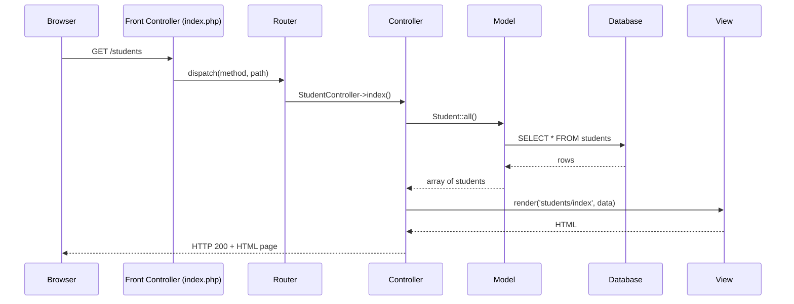
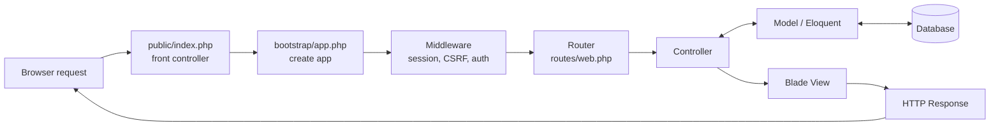

# Unit 8: PHP Framework
**Course:** Internet Technology II (CMP 273) · **Teaching hours:** 6

> **Version warning (read first):** Frameworks change fast. These notes use **Laravel 12 style** (the "slim" structure introduced in Laravel 11: no `app/Http/Kernel.php`, middleware and routing configured in `bootstrap/app.php`). CodeIgniter 4 and Symfony 7 are shown briefly. Commands, default settings, starter kits and minimum PHP versions may be different by the time you read this. **Always check the official documentation** before installing: [laravel.com/docs](https://laravel.com/docs), [codeigniter.com/user_guide](https://codeigniter.com/user_guide/), [symfony.com/doc](https://symfony.com/doc/current/index.html).

## Learning Objectives

After this unit, you will be able to:

- Explain the roles of the **Model**, **View** and **Controller** and describe how they interact in MVC to handle a request and manage data.
- Draw and explain the request lifecycle of an MVC application.
- Build a very small MVC application in plain PHP (front controller, router, controller, model, view).
- Discuss the benefits of using a PHP framework: reusability, modularity, built-in security and rapid development.
- Compare popular PHP frameworks (Laravel, Symfony, CodeIgniter) and decide when a framework is (or is not) the right choice.
- Install Laravel, understand its folder structure and configure a database.
- Use common framework features in Laravel: routing, controllers, Blade templating, migrations, Eloquent ORM, validation, CSRF protection, authentication and authorization.
- Build a complete Student CRUD application in Laravel.
- Recognise the basic structure of CodeIgniter 4 and Symfony applications.

---

## 8.1 MVC Model

### 8.1.1 What is MVC?

**MVC (Model-View-Controller)** is a **software design pattern** that divides an application into three connected parts, each with one clear job:

| Part | Responsibility | Knows about | In a PHP app it is usually |
|------|----------------|-------------|----------------------------|
| **Model** | Data and business rules: reading/writing the database, validation rules, calculations (e.g. GPA). | The database. Does **not** know about HTML. | A PHP class such as `Student` with methods `all()`, `find()`, `create()`. |
| **View** | Presentation: shows data to the user as HTML. | Only the data it is given. Contains **no SQL** and very little logic. | A template file such as `students/index.php` or `index.blade.php`. |
| **Controller** | Receives the request, decides what to do, asks the Model for data, chooses the View. | Both the Model and the View. | A PHP class such as `StudentController` with methods `index()`, `show()`, `store()`. |

The key idea is **separation of concerns**: each part does one thing, so a change in one part (for example, a new page design) does not force changes in the others (for example, the SQL queries).

**Why it matters:** In Units 1-7 we often wrote one PHP file that connected to the database, ran SQL, processed the form and printed HTML, all mixed together. This works for small pages, but in a real project with 50+ pages it becomes "spaghetti code": hard to read, hard to test and dangerous to change. MVC gives every piece of code a proper place.

### 8.1.2 How M, V and C interact (request lifecycle)

When a user visits `http://localhost:8000/students`, the following happens:

1. The browser sends an HTTP request.
2. All requests go to **one entry file**, the **front controller** (`public/index.php`).
3. The **router** looks at the URL and HTTP method and decides which **controller method** should handle it.
4. The **controller** asks the **model** for data.
5. The **model** runs SQL against the database and returns the data (an array or objects).
6. The controller passes the data to a **view**.
7. The view produces HTML, which is sent back to the browser as the HTTP response.



The same flow as a simple ASCII picture:

```
 Browser --request--> index.php --> Router --> Controller --(asks)--> Model <--> Database
    ^                                              |
    |                                              v
    +---------------- HTML response <---------- View (template)
```

Notice that the **Model and View never talk to each other directly** in this classic web version of MVC. The controller is the middle-man.

### 8.1.3 Analogy: a restaurant

| Restaurant | MVC | Explanation |
|------------|-----|-------------|
| Customer | Browser / user | Makes a request ("one plate of momo, please"). |
| Waiter | **Controller** | Takes the order, passes it to the kitchen, brings the food back. Does not cook. |
| Chef and kitchen store | **Model** | Prepares the actual food (data) using ingredients from the store (database). Does not talk to customers. |
| Plate and presentation | **View** | How the food is presented. The same momo can be served on a steel plate or a fancy plate without changing the recipe. |
| Menu / host at the door | **Router** | Decides which waiter/section handles the order. |

> **Teacher's Note:** Start the class with the restaurant analogy before showing any code. Ask students: "If we want to change the plate design, should the chef change the recipe?" The answer (no) is exactly why we separate View from Model. About 10 minutes is enough for 8.1.1 to 8.1.3.

### 8.1.4 Advantages and disadvantages of MVC

| Advantages | Disadvantages |
|------------|---------------|
| **Separation of concerns**: clean, organised code. | More files and folders; feels heavy for a 2-page site. |
| **Parallel development**: a designer works on views while a developer works on models/controllers. | Steeper learning curve for beginners. |
| **Reusability**: one model (e.g. `Student`) can be used by many controllers and pages. | Navigating between many files can be confusing at first. |
| **Easier testing**: models and controllers can be tested separately. | Poorly designed apps still end up with "fat controllers". |
| **Easier maintenance**: change the design without touching SQL, and vice versa. | Some overhead (routing, class loading) compared to a single script. |
| **Multiple views of the same data**: HTML page, JSON API, PDF report from the same model. | |

> **Exam Tip:** A typical 5-mark question is "Explain MVC architecture with a neat diagram." Write: (1) definition, (2) role of each component in 1-2 lines, (3) a labelled diagram showing request flow, (4) 3-4 advantages. Using a small example (Student list) earns extra marks.

### 8.1.5 Building a tiny MVC application in plain PHP

Before using a framework, let us build a **mini MVC** ourselves. This shows that a framework is not magic; it is just well-organised PHP. Our app lists students, shows one student and adds a new student.

#### Folder structure

```
mvc-demo/
├── app/
│   ├── Controllers/
│   │   └── StudentController.php
│   ├── Models/
│   │   └── Student.php
│   ├── Views/
│   │   ├── layout.php
│   │   └── students/
│   │       ├── index.php
│   │       ├── show.php
│   │       └── create.php
│   ├── Database.php
│   └── Router.php
└── public/
    ├── .htaccess        (only needed for Apache/XAMPP)
    └── index.php        (front controller: the ONLY file the browser reaches)
```

Only the `public/` folder is exposed to the web. The `app/` folder (with database passwords and classes) cannot be opened directly from the browser. Frameworks use the same idea.

#### Step 1: Database table

```sql
CREATE DATABASE IF NOT EXISTS college;
USE college;

CREATE TABLE students (
    id      INT AUTO_INCREMENT PRIMARY KEY,
    name    VARCHAR(100) NOT NULL,
    email   VARCHAR(150) NOT NULL UNIQUE,
    program VARCHAR(20)  NOT NULL
);

INSERT INTO students (name, email, program) VALUES
('Aarati Sharma', 'aarati@example.com', 'BCSIT'),
('Bikash Thapa',  'bikash@example.com', 'BCA'),
('Sita Gurung',   'sita@example.com',   'BCSIT');
```

#### Step 2: Database connection class (`app/Database.php`)

```php
<?php
// app/Database.php - one shared MySQLi connection for the whole request
declare(strict_types=1);

class Database
{
    private static ?mysqli $conn = null;

    public static function connect(): mysqli
    {
        if (self::$conn === null) {
            // Throw exceptions on errors instead of returning false
            mysqli_report(MYSQLI_REPORT_ERROR | MYSQLI_REPORT_STRICT);
            self::$conn = new mysqli('localhost', 'root', '', 'college');
            self::$conn->set_charset('utf8mb4');
        }
        return self::$conn;
    }
}
```

#### Step 3: The Model (`app/Models/Student.php`)

The model is the **only** place that contains SQL. All queries with user input use **prepared statements**.

```php
<?php
// app/Models/Student.php - all data access for the students table
declare(strict_types=1);

class Student
{
    /** Return every student as an array of associative arrays. */
    public static function all(): array
    {
        $db = Database::connect();
        $result = $db->query('SELECT id, name, email, program FROM students ORDER BY name');
        return $result->fetch_all(MYSQLI_ASSOC);
    }

    /** Return one student, or null if not found. */
    public static function find(int $id): ?array
    {
        $db = Database::connect();
        $stmt = $db->prepare('SELECT id, name, email, program FROM students WHERE id = ?');
        $stmt->bind_param('i', $id);
        $stmt->execute();
        $row = $stmt->get_result()->fetch_assoc();
        return $row ?: null;
    }

    /** Insert a student and return the new id. */
    public static function create(string $name, string $email, string $program): int
    {
        $db = Database::connect();
        $stmt = $db->prepare('INSERT INTO students (name, email, program) VALUES (?, ?, ?)');
        $stmt->bind_param('sss', $name, $email, $program);
        $stmt->execute();
        return $db->insert_id;
    }
}
```

#### Step 4: The Router (`app/Router.php`)

The router maps "HTTP method + path" to "controller class + method".

```php
<?php
// app/Router.php - a very small router (exact path matching only)
declare(strict_types=1);

class Router
{
    private array $routes = [];   // e.g. $routes['GET']['/students'] = [StudentController::class, 'index']

    public function get(string $path, array $action): void
    {
        $this->routes['GET'][$path] = $action;
    }

    public function post(string $path, array $action): void
    {
        $this->routes['POST'][$path] = $action;
    }

    public function dispatch(string $method, string $path): void
    {
        $path = rtrim($path, '/') ?: '/';            // "/students/" -> "/students"
        $action = $this->routes[$method][$path] ?? null;

        if ($action === null) {
            http_response_code(404);
            echo '404 - Page not found';
            return;
        }

        [$class, $methodName] = $action;             // array destructuring
        $controller = new $class();
        $controller->$methodName();                  // e.g. (new StudentController())->index()
    }
}
```

#### Step 5: The Controller (`app/Controllers/StudentController.php`)

```php
<?php
// app/Controllers/StudentController.php - handles all /students requests
declare(strict_types=1);

class StudentController
{
    // GET /students
    public function index(): void
    {
        $students = Student::all();                       // ask the Model
        $this->render('students/index', [                 // choose the View
            'title'    => 'All Students',
            'students' => $students,
        ]);
    }

    // GET /students/show?id=2
    public function show(): void
    {
        $id = filter_input(INPUT_GET, 'id', FILTER_VALIDATE_INT);
        $student = $id ? Student::find($id) : null;

        if ($student === null) {
            http_response_code(404);
            echo 'Student not found';
            return;
        }
        $this->render('students/show', ['title' => $student['name'], 'student' => $student]);
    }

    // GET /students/create
    public function create(): void
    {
        $this->render('students/create', ['title' => 'Add Student', 'errors' => []]);
    }

    // POST /students/store
    public function store(): void
    {
        $name    = trim((string) filter_input(INPUT_POST, 'name'));
        $email   = filter_input(INPUT_POST, 'email', FILTER_VALIDATE_EMAIL);
        $program = trim((string) filter_input(INPUT_POST, 'program'));

        $errors = [];
        if ($name === '')                       $errors[] = 'Name is required.';
        if (!$email)                            $errors[] = 'A valid email is required.';
        if (!in_array($program, ['BCSIT', 'BCA', 'BBA'], true)) $errors[] = 'Choose a valid program.';

        if ($errors) {
            $this->render('students/create', ['title' => 'Add Student', 'errors' => $errors]);
            return;
        }

        Student::create($name, $email, $program);
        header('Location: /students');                    // Post/Redirect/Get pattern
        exit;
    }

    /** Load a view file and make $data keys available as variables. */
    private function render(string $view, array $data = []): void
    {
        extract($data);                                   // ['title' => 'x'] becomes $title = 'x'
        ob_start();
        require __DIR__ . '/../Views/' . $view . '.php';
        $content = ob_get_clean();                        // HTML of the inner view
        require __DIR__ . '/../Views/layout.php';         // wrap it in the common layout
    }
}
```

#### Step 6: The Views (`app/Views/`)

`layout.php` is the common page shell (like a master page):

```php
<!-- app/Views/layout.php -->
<!DOCTYPE html>
<html lang="en">
<head>
    <meta charset="UTF-8">
    <title><?= htmlspecialchars($title) ?></title>
</head>
<body>
    <nav><a href="/students">Students</a> | <a href="/students/create">Add Student</a></nav>
    <h1><?= htmlspecialchars($title) ?></h1>
    <?= $content ?>  <!-- already-escaped HTML from the inner view -->
</body>
</html>
```

`students/index.php`:

```php
<!-- app/Views/students/index.php -->
<table border="1" cellpadding="6">
    <tr><th>Name</th><th>Email</th><th>Program</th></tr>
    <?php foreach ($students as $s): ?>
        <tr>
            <td><a href="/students/show?id=<?= (int) $s['id'] ?>"><?= htmlspecialchars($s['name']) ?></a></td>
            <td><?= htmlspecialchars($s['email']) ?></td>
            <td><?= htmlspecialchars($s['program']) ?></td>
        </tr>
    <?php endforeach; ?>
</table>
```

`students/show.php`:

```php
<!-- app/Views/students/show.php -->
<p><strong>Email:</strong> <?= htmlspecialchars($student['email']) ?></p>
<p><strong>Program:</strong> <?= htmlspecialchars($student['program']) ?></p>
<p><a href="/students">Back to list</a></p>
```

`students/create.php`:

```php
<!-- app/Views/students/create.php -->
<?php foreach ($errors as $error): ?>
    <p style="color:red"><?= htmlspecialchars($error) ?></p>
<?php endforeach; ?>

<form method="post" action="/students/store">
    <label>Name <input type="text" name="name" required></label><br>
    <label>Email <input type="email" name="email" required></label><br>
    <label>Program
        <select name="program">
            <option>BCSIT</option><option>BCA</option><option>BBA</option>
        </select>
    </label><br>
    <button type="submit">Save</button>
</form>
```

#### Step 7: The Front Controller (`public/index.php`)

Every request enters here. It loads the classes, registers routes and dispatches.

```php
<?php
// public/index.php - the single entry point (front controller)
declare(strict_types=1);

require __DIR__ . '/../app/Database.php';
require __DIR__ . '/../app/Router.php';
require __DIR__ . '/../app/Models/Student.php';
require __DIR__ . '/../app/Controllers/StudentController.php';

$router = new Router();
$router->get('/',                [StudentController::class, 'index']);
$router->get('/students',        [StudentController::class, 'index']);
$router->get('/students/show',   [StudentController::class, 'show']);
$router->get('/students/create', [StudentController::class, 'create']);
$router->post('/students/store', [StudentController::class, 'store']);

// "/students/show?id=2" -> path "/students/show" (query string is read by filter_input)
$path = parse_url($_SERVER['REQUEST_URI'], PHP_URL_PATH);
$router->dispatch($_SERVER['REQUEST_METHOD'], $path);
```

For Apache/XAMPP, `public/.htaccess` sends every URL that is not a real file to `index.php`:

```apache
# public/.htaccess
RewriteEngine On
RewriteCond %{REQUEST_FILENAME} !-f
RewriteCond %{REQUEST_FILENAME} !-d
RewriteRule ^ index.php [L]
```

#### Running it

```bash
cd mvc-demo
php -S localhost:8000 -t public
```

Open `http://localhost:8000/students`.

**Output (browser, shown as text):**

```
Students | Add Student
All Students
+---------------+--------------------+---------+
| Name          | Email              | Program |
+---------------+--------------------+---------+
| Aarati Sharma | aarati@example.com | BCSIT   |
| Bikash Thapa  | bikash@example.com | BCA     |
| Sita Gurung   | sita@example.com   | BCSIT   |
+---------------+--------------------+---------+
```

Clicking "Bikash Thapa" opens `/students/show?id=2`:

```
Students | Add Student
Bikash Thapa
Email: bikash@example.com
Program: BCA
Back to list
```

Visiting `/abc` prints `404 - Page not found`.

> **Teacher's Note:** Live-code this mini MVC in class (about 40 minutes). Then ask: "What is missing compared to a real app?" Students should list: CSRF protection, autoloading, URL parameters like `/students/2`, update/delete, login. This motivates section 8.2: a framework gives all of these ready-made.

> **Common Mistake:** Writing SQL inside the view, e.g. `<?php $r = $db->query(...) ?>` in `index.php`. This breaks MVC. **Correct:** the view only loops over `$students` that the controller passed to it; all SQL lives in the model.

> **Common Mistake:** Putting `index.php` and the `app/` folder side by side inside `htdocs`, so anyone can open `http://localhost/app/Database.php`. **Correct:** point the web server's document root to `public/` only.

---

## 8.2 Benefits of using the PHP Framework

### 8.2.1 What is a PHP framework?

A **PHP framework** is a ready-made collection of reusable code, folder structure and tools that gives you the foundation of a web application, so you only write the parts that are specific to your project. Most modern PHP frameworks follow the **MVC pattern** and are installed with **Composer** (PHP's package manager).

Think of it like building a house: plain PHP means making your own bricks; a framework gives you a strong frame, wiring and plumbing, and you decorate the rooms.

**Library vs framework:** you call a **library** when you need it (e.g. PHPMailer). A **framework** calls **your** code (your controller is called by the framework's router). This is called **Inversion of Control**.

### 8.2.2 Benefits

| Benefit | What it means | Example in Laravel |
|---------|---------------|--------------------|
| **Reusability** | Common tasks are already written and tested; you reuse them instead of rewriting. | Pagination with one call: `Student::paginate(10)`. |
| **Modularity** | The app is split into independent parts (routes, controllers, models, middleware, packages) that can be changed or replaced separately. | Swap the session store from files to Redis by changing one `.env` value. |
| **Built-in security** | Protection against common attacks is on by default. | **CSRF**: `@csrf` token checked automatically. **XSS**: `{{ $name }}` is escaped automatically. **SQL injection**: Eloquent/Query Builder use prepared statements. Passwords hashed with bcrypt/argon. |
| **Rapid development** | Code generators and conventions save time. | `php artisan make:model Student -mcr` creates model, migration and controller in one command. |
| **Conventions (structure)** | Every project has the same layout, so a new team member knows where things are. | Controllers always in `app/Http/Controllers`, views in `resources/views`. |
| **Community and ecosystem** | Documentation, tutorials, packages, forums, jobs. | Thousands of packages on Packagist; Laracasts video tutorials. |
| **Testing support** | Built-in tools for unit and feature tests. | `php artisan test` with Pest/PHPUnit. |
| **Database tools** | Migrations (version control for the schema), seeders, ORM. | `php artisan migrate`. |
| **Maintainability** | Clean separation and conventions make long-term changes easier. | Upgrade guides for each major version. |

> **Exam Tip:** For "Explain the benefits of using a PHP framework" (5 marks), list at least five benefits with **one-line explanation each**, and mention security (CSRF, XSS, SQL injection) specifically. Examiners like concrete examples.

### 8.2.3 Comparison: Laravel vs Symfony vs CodeIgniter

| Feature | **Laravel** | **Symfony** | **CodeIgniter 4** |
|---------|-------------|-------------|-------------------|
| First released | 2011 | 2005 | 2006 (CI4 in 2020) |
| Pattern | MVC | MVC (component-based) | MVC |
| Learning curve | Moderate; very beginner-friendly docs | Steep; very flexible but more configuration | Easy; small and simple |
| Template engine | **Blade** | **Twig** | Plain PHP views (optional parser) |
| ORM / database | **Eloquent** (Active Record) | **Doctrine** (Data Mapper) | Model class + Query Builder |
| CLI tool | `php artisan` | `php bin/console` | `php spark` |
| Authentication | Starter kits (Breeze, etc.), very quick | Security bundle (powerful, more setup) | Shield (official add-on) |
| Performance / size | Medium size, rich features | Modular; use only what you need | Very lightweight and fast |
| Best for | Most web apps, startups, rapid development | Large enterprise apps, long-term projects | Small/medium apps, shared hosting, beginners |
| Notable fact | Most popular PHP framework | Laravel itself uses many Symfony components | Very small download, minimal configuration |

### 8.2.4 When NOT to use a framework

A framework is not always the best choice:

- **Very small sites** (a one-page contact form or a static site with a little PHP). The framework would be bigger than the project.
- **Learning the basics.** Beginners should first understand plain PHP (forms, sessions, MySQLi) or the framework will feel like magic. That is why this unit comes last.
- **Very limited hosting** where you cannot run Composer or the required PHP version.
- **Extreme performance needs** for a tiny, specific task (e.g. a single high-traffic API endpoint), where every millisecond matters.
- **Short scripts and tools**, such as a cron job that cleans a table.

> **Teacher's Note:** A quick class discussion: show the plain-PHP mini MVC from 8.1 and ask "How many lines would CSRF protection, login, password reset and pagination add?" Then show that Laravel gives them in a few commands. Keep 8.2 to about 30 minutes.

---

## 8.3 Getting Started with PHP Framework

In this section we use **Laravel**, the primary framework in the syllabus. Short comparisons with CodeIgniter 4 and Symfony are at the end.

### 8.3.1 Requirements

| Requirement | Details |
|-------------|---------|
| **PHP** | Laravel 12 needs **PHP 8.2 or newer**. Newer Laravel versions may need a newer PHP. Check with `php -v`. |
| **PHP extensions** | Ctype, cURL, DOM, Fileinfo, Filter, Hash, Mbstring, OpenSSL, PCRE, PDO (+ pdo_mysql or pdo_sqlite), Session, Tokenizer, XML. XAMPP includes most of these. |
| **Composer** | PHP dependency manager. Download from [getcomposer.org](https://getcomposer.org). Check with `composer -V`. |
| **Database** | SQLite (default in new projects), MySQL/MariaDB (XAMPP), PostgreSQL, etc. |
| **Node.js and npm** (optional) | Needed to build CSS/JS with Vite, and for starter kits. |

> **Beyond the syllabus:** On Windows/macOS/Linux, the official installer at [php.new](https://php.new) can install PHP, Composer and the Laravel installer in one step. **Laravel Herd** is a free desktop app that does the same. Both are optional.

### 8.3.2 Installing Laravel

**Method 1: Composer (works everywhere)**

```bash
composer create-project laravel/laravel student-app
cd student-app
php artisan serve
```

**Method 2: Laravel installer (asks interactive questions, e.g. starter kit, database)**

```bash
composer global require laravel/installer
laravel new student-app
cd student-app
php artisan serve
```

**Output (terminal):**

```
   INFO  Server running on [http://127.0.0.1:8000].

  Press Ctrl+C to stop the server
```

Open `http://127.0.0.1:8000` and you will see the Laravel welcome page.

**What is Artisan?** `artisan` is Laravel's command-line tool (a PHP file in the project root). Useful commands:

| Command | Purpose |
|---------|---------|
| `php artisan serve` | Start the development server. |
| `php artisan list` | Show all commands. |
| `php artisan make:controller StudentController --resource` | Create a controller with 7 CRUD methods. |
| `php artisan make:model Student -m` | Create a model and its migration. |
| `php artisan migrate` | Run migrations (create tables). |
| `php artisan migrate:fresh --seed` | Drop all tables, re-run migrations and seeders (development only). |
| `php artisan route:list` | Show all routes. |
| `php artisan tinker` | Interactive PHP shell to try Eloquent queries. |

### 8.3.3 Laravel folder structure

| Folder / file | Purpose |
|---------------|---------|
| `app/Http/Controllers/` | Controllers (the **C** in MVC). |
| `app/Models/` | Eloquent models (the **M**). `User.php` is included. |
| `app/Providers/` | Service providers, e.g. `AppServiceProvider.php` (a good place to define Gates). |
| `bootstrap/app.php` | Creates the application; configures **routing, middleware and exception handling**. (Replaces the old `Http/Kernel.php` from Laravel 10 and earlier.) |
| `config/` | Configuration files (`app.php`, `database.php`, `auth.php`, ...). Values usually come from `.env`. |
| `database/migrations/` | Migrations: PHP files that create/alter tables. |
| `database/seeders/`, `database/factories/` | Fill tables with test data. |
| `public/` | Web document root. Contains `index.php` (the front controller), images, compiled CSS/JS. |
| `resources/views/` | Blade templates (the **V**). |
| `resources/css/`, `resources/js/` | Source CSS/JS compiled by Vite. |
| `routes/web.php` | Web routes (browser pages, with sessions and CSRF). |
| `routes/console.php` | Custom Artisan commands and scheduled tasks. (`routes/api.php` is added only when you run `php artisan install:api`.) |
| `storage/` | Logs, cache, compiled views, uploaded files. Must be writable. |
| `tests/` | Automated tests. |
| `vendor/` | Composer packages (never edit; never commit to Git). |
| `.env` | Environment settings: app key, database password, mail settings. **Never commit to Git.** |
| `artisan` | The CLI tool. |
| `composer.json` | Lists PHP dependencies. |

The Laravel request lifecycle follows the same MVC idea we built by hand:



### 8.3.4 The `.env` file and database configuration

New Laravel projects use **SQLite** by default (the file `database/database.sqlite`), so they work without any setup. To use **MySQL** from XAMPP, first create an empty database (e.g. `student_app`) in phpMyAdmin, then edit `.env`:

```ini
APP_NAME="Student App"
APP_ENV=local
APP_DEBUG=true
APP_URL=http://127.0.0.1:8000

DB_CONNECTION=mysql
DB_HOST=127.0.0.1
DB_PORT=3306
DB_DATABASE=student_app
DB_USERNAME=root
DB_PASSWORD=
```

Then run the default migrations (users, cache, jobs, sessions tables):

```bash
php artisan migrate
```

**Output (terminal, shortened):**

```
   INFO  Running migrations.

  0001_01_01_000000_create_users_table ............ 25.10ms DONE
  0001_01_01_000001_create_cache_table ............ 8.42ms DONE
  0001_01_01_000002_create_jobs_table ............. 20.35ms DONE
```

In PHP code you read config values with `config('app.name')` (or `env('APP_NAME')` but only inside `config/` files).

> **Common Mistake:** Setting `APP_DEBUG=true` on a live server. Error pages then show file paths and sometimes passwords. **Correct:** on production use `APP_ENV=production` and `APP_DEBUG=false`.

> **Common Mistake:** Changing `.env` and seeing no effect. If you ran `php artisan config:cache` earlier, Laravel reads the cached config. **Correct:** run `php artisan config:clear`, and restart `php artisan serve`.

### 8.3.5 Routing

**Routing** maps a URL and HTTP method to code. Web routes go in `routes/web.php`.

#### Basic routes

```php
<?php
// routes/web.php
use Illuminate\Support\Facades\Route;

// Return a view
Route::get('/', function () {
    return view('welcome');
});

// Return plain text
Route::get('/hello', function () {
    return 'Namaste from Laravel!';
});

// Shortcut when only a view is needed
Route::view('/about', 'about');

// Other HTTP methods
Route::post('/contact', function () { /* handle form */ });
// Route::put(), Route::patch(), Route::delete() also exist
```

**Output (browser, `/hello`):**

```
Namaste from Laravel!
```

#### Route parameters

```php
<?php
// Required parameter
Route::get('/students/{id}', function (int $id) {
    return "Student ID: $id";
})->whereNumber('id');   // only digits allowed; /students/abc gives 404

// Optional parameter with default value
Route::get('/greet/{name?}', function (?string $name = 'Guest') {
    return 'Hello, ' . e($name);   // e() = htmlspecialchars helper
});
```

**Output (browser):**

```
/students/7     -> Student ID: 7
/greet/Ramesh   -> Hello, Ramesh
/greet          -> Hello, Guest
```

#### Named routes

A **name** lets you generate URLs without hard-coding them. If the URL changes later, links still work.

```php
<?php
Route::get('/student/profile', function () {
    return 'Profile page';
})->name('profile');

// Generate the URL anywhere:
$url = route('profile');                  // http://127.0.0.1:8000/student/profile
// In Blade: <a href="{{ route('profile') }}">My Profile</a>
// Redirect:  return redirect()->route('profile');
```

#### Route groups and controller routes

```php
<?php
use App\Http\Controllers\StudentController;

Route::get('/students', [StudentController::class, 'index'])->name('students.index');

// Group routes that share a prefix and middleware
Route::prefix('admin')->middleware('auth')->group(function () {
    Route::get('/dashboard', fn () => view('admin.dashboard'))->name('admin.dashboard');
});
```

#### Resource routes

One line creates all seven standard CRUD routes:

```php
<?php
Route::resource('students', StudentController::class);
```

| HTTP method | URI | Controller method | Route name | Purpose |
|-------------|-----|-------------------|------------|---------|
| GET | `/students` | `index` | `students.index` | List all students |
| GET | `/students/create` | `create` | `students.create` | Show "add" form |
| POST | `/students` | `store` | `students.store` | Save new student |
| GET | `/students/{student}` | `show` | `students.show` | Show one student |
| GET | `/students/{student}/edit` | `edit` | `students.edit` | Show "edit" form |
| PUT/PATCH | `/students/{student}` | `update` | `students.update` | Save changes |
| DELETE | `/students/{student}` | `destroy` | `students.destroy` | Delete student |

Check them with `php artisan route:list`.

> **Exam Tip:** The seven resource routes table is a favourite short question ("List the routes created by `Route::resource`"). Learn the method, URI and controller method columns.

### 8.3.6 Controllers

A **controller** groups related request-handling logic in a class. Create a resource controller:

```bash
php artisan make:controller StudentController --resource
```

This creates `app/Http/Controllers/StudentController.php` with empty methods `index, create, store, show, edit, update, destroy`. A simple example:

```php
<?php
// app/Http/Controllers/StudentController.php (simple version)
namespace App\Http\Controllers;

use Illuminate\Http\Request;

class StudentController extends Controller
{
    public function index()
    {
        $students = ['Aarati', 'Bikash', 'Sita'];          // later: from the database
        return view('students.index', ['students' => $students]);
        // same as: return view('students.index', compact('students'));
    }

    public function show(string $id)
    {
        return "Showing student $id";
    }
}
```

`view('students.index')` loads `resources/views/students/index.blade.php` (dots mean folders).

The `Request $request` object gives access to input safely:

```php
<?php
public function store(Request $request)
{
    $name  = $request->input('name');        // from POST or query string
    $all   = $request->only(['name', 'email']);
    $has   = $request->has('email');         // true/false
    // ...
}
```

### 8.3.7 Blade templating

**Blade** is Laravel's template engine. Blade files end in `.blade.php` and are compiled into plain PHP and cached, so they are fast.

#### Echo and escaping

```blade
{{-- resources/views/greeting.blade.php --}}
{{-- This is a Blade comment: not sent to the browser --}}

<p>Hello, {{ $name }}</p>          {{-- escaped with htmlspecialchars: safe from XSS --}}
<p>Today is {{ date('Y-m-d') }}</p>
<div>{!! $trustedHtml !!}</div>   {{-- NOT escaped: use only for HTML you fully trust --}}
```

If `$name` is `<script>alert(1)</script>`, `{{ $name }}` prints it as harmless text: `&lt;script&gt;alert(1)&lt;/script&gt;`.

#### Control structures

```blade
{{-- resources/views/result.blade.php --}}
@if ($marks >= 80)
    <p>Distinction</p>
@elseif ($marks >= 45)
    <p>Pass</p>
@else
    <p>Fail</p>
@endif

<ul>
@foreach ($students as $student)
    <li>{{ $loop->iteration }}. {{ $student }}</li>
@endforeach
</ul>

@forelse ($courses as $course)
    <p>{{ $course }}</p>
@empty
    <p>No courses found.</p>
@endforelse

@isset($notice)
    <p class="notice">{{ $notice }}</p>
@endisset
```

With `$marks = 72`, `$students = ['Aarati', 'Bikash']`, `$courses = []` and no `$notice`:

**Output (HTML):**

```html
<p>Pass</p>
<ul>
    <li>1. Aarati</li>
    <li>2. Bikash</li>
</ul>
<p>No courses found.</p>
```

`$loop` is a special variable inside `@foreach` with `iteration` (1, 2, ...), `index` (0, 1, ...), `first`, `last`, `count`.

#### Layouts: `@extends`, `@section`, `@yield`

A **layout** is a parent template with the common HTML (header, menu, footer). Child pages fill in its "holes".

```blade
{{-- resources/views/layouts/app.blade.php (parent) --}}
<!DOCTYPE html>
<html lang="en">
<head>
    <meta charset="UTF-8">
    <title>@yield('title', 'Student App')</title>
</head>
<body>
    <nav>
        <a href="{{ route('students.index') }}">Students</a> |
        <a href="{{ route('students.create') }}">Add Student</a>
    </nav>

    <main>
        @yield('content')
    </main>

    <footer>&copy; {{ date('Y') }} Pokhara University</footer>
</body>
</html>
```

```blade
{{-- resources/views/about.blade.php (child) --}}
@extends('layouts.app')

@section('title', 'About Us')

@section('content')
    <h1>About</h1>
    <p>This app manages BCSIT student records.</p>
@endsection
```

| Directive | Used in | Meaning |
|-----------|---------|---------|
| `@yield('name')` | Parent | "Put the child's section called *name* here." |
| `@extends('layouts.app')` | Child | "Use this parent layout." Must be the first line. |
| `@section('name') ... @endsection` | Child | "Here is the content for *name*." |
| `@include('partials.menu')` | Any | Insert another Blade file. |

#### Components (brief)

**Components** are reusable pieces of UI, used like HTML tags. Create one with `php artisan make:component Alert --view`, which makes `resources/views/components/alert.blade.php`:

```blade
{{-- resources/views/components/alert.blade.php --}}
@props(['type' => 'info'])
<div class="alert alert-{{ $type }}">
    {{ $slot }}
</div>
```

```blade
{{-- Using it in any view --}}
<x-alert type="success">Student saved successfully.</x-alert>
```

**Output (HTML):**

```html
<div class="alert alert-success">
    Student saved successfully.
</div>
```

Layouts with `@extends` and components with `<x-...>` can both be used; starter kits mostly use components (e.g. `<x-app-layout>`).

> **Common Mistake:** Using `{!! $comment !!}` to print user comments "so the formatting shows". This opens an XSS hole. **Correct:** use `{{ $comment }}`; if you need line breaks use `{!! nl2br(e($comment)) !!}` which escapes first.

### 8.3.8 Migrations and Eloquent ORM

#### What is an ORM?

**ORM (Object-Relational Mapping)** lets you work with database rows as PHP **objects** instead of writing SQL by hand. In Laravel the ORM is called **Eloquent**. Each table has a **model** class: table `students` ↔ model `Student`; each row ↔ one `Student` object.

| Plain PHP (MySQLi) | Eloquent |
|--------------------|----------|
| `$db->query("SELECT * FROM students")` + `fetch_all()` | `Student::all()` |
| Prepare, bind, execute `SELECT ... WHERE id = ?` | `Student::find($id)` |
| Prepare, bind, execute `INSERT ...` | `Student::create([...])` |
| `UPDATE students SET ... WHERE id = ?` | `$student->update([...])` |
| `DELETE FROM students WHERE id = ?` | `$student->delete()` |

Eloquent uses **PDO prepared statements** internally, so values are always bound safely (protection from SQL injection).

#### Migrations

A **migration** is a PHP file that describes a change to the database schema (create table, add column). Migrations are like **version control for the database**: every team member runs `php artisan migrate` and gets the same tables.

Create a model together with its migration:

```bash
php artisan make:model Student -m
```

**Output (terminal):**

```
   INFO  Model [app/Models/Student.php] created successfully.
   INFO  Migration [database/migrations/2026_11_22_101500_create_students_table.php] created successfully.
```

Edit the migration:

```php
<?php
// database/migrations/xxxx_xx_xx_xxxxxx_create_students_table.php
use Illuminate\Database\Migrations\Migration;
use Illuminate\Database\Schema\Blueprint;
use Illuminate\Support\Facades\Schema;

return new class extends Migration
{
    /** Run the migration: create the table. */
    public function up(): void
    {
        Schema::create('students', function (Blueprint $table) {
            $table->id();                                   // BIGINT UNSIGNED AUTO_INCREMENT PRIMARY KEY
            $table->string('name', 100);
            $table->string('email')->unique();
            $table->string('program', 20);
            $table->unsignedTinyInteger('semester')->default(1);
            $table->timestamps();                           // created_at and updated_at
        });
    }

    /** Reverse the migration: drop the table. */
    public function down(): void
    {
        Schema::dropIfExists('students');
    }
};
```

```bash
php artisan migrate            # run new migrations
php artisan migrate:rollback   # undo the last batch (calls down())
```

#### The model and `$fillable`

```php
<?php
// app/Models/Student.php
namespace App\Models;

use Illuminate\Database\Eloquent\Model;

class Student extends Model
{
    // Columns that may be filled with create()/update() using an array.
    protected $fillable = ['name', 'email', 'program', 'semester'];
}
```

Eloquent **conventions**: model `Student` → table `students` (plural, snake_case), primary key `id`, timestamps `created_at`/`updated_at`. You can override them (`protected $table = 'tbl_student';`).

**Mass assignment protection:** `$fillable` lists the columns that may be set from an array like `$request->all()`. Without it, a hacker could add a hidden field `is_admin=1` to a form. Laravel throws an error (`MassAssignmentException`) if you try to mass-assign a column that is not fillable.

#### Basic Eloquent operations (CRUD)

You can try these in `php artisan tinker`:

```php
<?php
use App\Models\Student;

// CREATE
$s = Student::create([
    'name' => 'Aarati Sharma', 'email' => 'aarati@example.com',
    'program' => 'BCSIT', 'semester' => 3,
]);
echo $s->id;                                   // 1

// READ
$all   = Student::all();                       // Collection of all students
$one   = Student::find(1);                     // one Student or null
$one   = Student::findOrFail(1);               // or a 404 page if not found
$bcsit = Student::where('program', 'BCSIT')
                ->orderBy('name')
                ->get();                       // filtered list
$count = Student::count();

echo $one->name;                               // Aarati Sharma

// UPDATE
$one->update(['semester' => 4]);
// or: $one->semester = 4; $one->save();

// DELETE
$one->delete();
// or: Student::destroy(1);
```

**Output (tinker, for the two `echo` lines):**

```
1
Aarati Sharma
```

#### Relationships (brief)

Suppose each student belongs to one department, and a department has many students (`students.department_id` is a foreign key).

```php
<?php
// In the migration for students:
// $table->foreignId('department_id')->constrained()->cascadeOnDelete();

// app/Models/Department.php
class Department extends Model
{
    protected $fillable = ['name'];

    public function students()           // one department -> many students
    {
        return $this->hasMany(Student::class);
    }
}

// app/Models/Student.php (add this method)
public function department()             // one student -> one department
{
    return $this->belongsTo(Department::class);
}

// Usage:
$dept = Department::find(1);
foreach ($dept->students as $st) {        // property, not method call
    echo $st->name, PHP_EOL;
}
echo Student::find(1)->department->name;  // e.g. "Computer Science"
```

Other relationship types: `hasOne`, `belongsToMany` (many-to-many, e.g. students and courses).

> **Beyond the syllabus:** `Student::with('department')->get()` loads departments in one extra query instead of one query per student. This is called **eager loading** and fixes the "N+1 query problem".

### 8.3.9 Validation

Never trust user input. Laravel validates with `$request->validate()`. If validation **fails**, Laravel automatically redirects back to the form with error messages and the old input. If it **passes**, it returns only the validated data.

```php
<?php
public function store(Request $request)
{
    $validated = $request->validate([
        'name'     => 'required|string|max:100',
        'email'    => 'required|email|unique:students,email',
        'program'  => 'required|in:BCSIT,BCA,BBA',
        'semester' => 'required|integer|between:1,8',
    ]);

    Student::create($validated);
    return redirect()->route('students.index')->with('success', 'Student added.');
}
```

Common rules: `required`, `nullable`, `string`, `integer`, `numeric`, `email`, `min:3`, `max:100`, `between:1,8`, `in:a,b,c`, `unique:table,column`, `confirmed` (for password + password_confirmation), `date`, `image`, `mimes:jpg,png`, `max:2048` (file size in KB).

Showing errors and old input in Blade:

```blade
<input type="text" name="name" value="{{ old('name') }}">
@error('name')
    <span style="color:red">{{ $message }}</span>
@enderror
```

If the user leaves the name empty, the page shows: `The name field is required.`

### 8.3.10 CSRF protection

**CSRF (Cross-Site Request Forgery)** is an attack where a malicious site tricks a logged-in user's browser into submitting a form to your site (for example, deleting a student). Laravel protects every `POST`, `PUT`, `PATCH` and `DELETE` request in `routes/web.php` by checking a secret token stored in the session.

Add `@csrf` inside **every** form:

```blade
<form method="POST" action="{{ route('students.store') }}">
    @csrf
    ...
</form>
```

**Output (generated HTML):**

```html
<input type="hidden" name="_token" value="d8Jk3...random40chars...">
```

If the token is missing or wrong, Laravel returns **HTTP 419 Page Expired**.

HTML forms only support GET and POST. For PUT/PATCH/DELETE, use **method spoofing**:

```blade
<form method="POST" action="{{ route('students.destroy', $student) }}">
    @csrf
    @method('DELETE')     {{-- outputs <input type="hidden" name="_method" value="DELETE"> --}}
    <button>Delete</button>
</form>
```

> **Common Mistake:** Getting "419 Page Expired" after submitting a form. **Cause:** you forgot `@csrf`. **Fix:** add `@csrf` right after the `<form>` tag.

### 8.3.11 Authentication with a starter kit

**Authentication** = verifying **who** the user is (login). Laravel's starter kits generate the complete login system: registration, login, logout, password reset, email verification and profile page, with hashed passwords and session regeneration already done correctly.

**Laravel Breeze** (simple, Blade-based, ideal for learning):

```bash
composer require laravel/breeze --dev
php artisan breeze:install blade
php artisan migrate
npm install
npm run build
php artisan serve
```

Now `/register`, `/login`, `/dashboard` and `/profile` work.

> **Version note:** From Laravel 12, the official recommended starter kits (React, Vue, Livewire) are chosen when you run `laravel new`. Breeze still installs and works, and is easier for teaching Blade, but it may not receive new features. Check the "Starter Kits" page in the official docs for the current recommendation.

Using the logged-in user:

```php
<?php
use Illuminate\Support\Facades\Auth;

if (Auth::check()) {                 // is anyone logged in?
    $user = Auth::user();            // the User model (or auth()->user())
    echo $user->name;
}
$id = Auth::id();
```

```blade
@auth
    <p>Welcome, {{ auth()->user()->name }}</p>
    <form method="POST" action="{{ route('logout') }}">
        @csrf
        <button>Log out</button>
    </form>
@endauth

@guest
    <a href="{{ route('login') }}">Log in</a>
@endguest
```

### 8.3.12 Authorization: middleware, Gates and Policies

**Authorization** = deciding **what** a logged-in user is allowed to do.

| Authentication | Authorization |
|----------------|---------------|
| "Who are you?" | "Are you allowed to do this?" |
| Login with email + password | Only admins may delete a student |
| Happens first | Happens after authentication |
| Laravel: starter kit, `auth` middleware | Laravel: Gates, Policies, `can` middleware |

#### Middleware `auth`

**Middleware** is code that runs **before** (or after) the controller, like a security guard at the gate. The `auth` middleware redirects guests to the login page.

```php
<?php
// routes/web.php
Route::middleware('auth')->group(function () {
    Route::resource('students', StudentController::class);
});
```

In Laravel 11+, custom middleware is registered in `bootstrap/app.php` (there is no `Kernel.php`):

```php
<?php
// bootstrap/app.php (excerpt)
->withMiddleware(function (Middleware $middleware) {
    $middleware->alias([
        'admin' => \App\Http\Middleware\EnsureUserIsAdmin::class,
    ]);
})
```

#### Gates (brief)

A **Gate** is a simple closure that answers yes/no for an action. Define it in `app/Providers/AppServiceProvider.php`:

```php
<?php
// app/Providers/AppServiceProvider.php
use App\Models\User;
use Illuminate\Support\Facades\Gate;

public function boot(): void
{
    // Assumes the users table has a boolean "is_admin" column
    Gate::define('delete-student', fn (User $user) => $user->is_admin);
}
```

```php
<?php
// In a controller
Gate::authorize('delete-student');      // throws 403 Forbidden if not allowed

if (Gate::allows('delete-student')) { /* ... */ }
```

```blade
@can('delete-student')
    <button>Delete</button>          {{-- only admins see the button --}}
@endcan
```

#### Policies (brief)

A **Policy** is a class that groups all authorization rules for one model.

```bash
php artisan make:policy StudentPolicy --model=Student
```

```php
<?php
// app/Policies/StudentPolicy.php (excerpt)
public function update(User $user, Student $student): bool
{
    return $user->is_admin;
}
```

```php
<?php
// In StudentController@update
Gate::authorize('update', $student);    // uses StudentPolicy::update automatically
```

Laravel finds the policy automatically because of the naming convention (`Student` → `StudentPolicy`).

> **Exam Tip:** "Differentiate authentication and authorization" is a common 2-3 mark question. Use the table above and give one Laravel example of each (login via Breeze; `auth` middleware or Gate).

### 8.3.13 Complete Student CRUD in Laravel (step by step)

We now build a complete app to **C**reate, **R**ead, **U**pdate and **D**elete students.

**Step 1: Create the project and configure the database**

```bash
composer create-project laravel/laravel student-crud
cd student-crud
# edit .env for MySQL (see 8.3.4), or keep the default SQLite
```

**Step 2: Model, migration and resource controller in one command**

```bash
php artisan make:model Student -mcr
```

`-m` = migration, `-c` = controller, `-r` = resource controller. This creates `app/Models/Student.php`, a migration and `app/Http/Controllers/StudentController.php` (with route model binding type hints).

**Step 3: Migration** (`database/migrations/..._create_students_table.php`)

```php
<?php
use Illuminate\Database\Migrations\Migration;
use Illuminate\Database\Schema\Blueprint;
use Illuminate\Support\Facades\Schema;

return new class extends Migration
{
    public function up(): void
    {
        Schema::create('students', function (Blueprint $table) {
            $table->id();
            $table->string('name', 100);
            $table->string('email')->unique();
            $table->string('program', 20);
            $table->unsignedTinyInteger('semester');
            $table->timestamps();
        });
    }

    public function down(): void
    {
        Schema::dropIfExists('students');
    }
};
```

```bash
php artisan migrate
```

**Step 4: Model** (`app/Models/Student.php`)

```php
<?php
namespace App\Models;

use Illuminate\Database\Eloquent\Model;

class Student extends Model
{
    protected $fillable = ['name', 'email', 'program', 'semester'];
}
```

**Step 5: Routes** (`routes/web.php`)

```php
<?php
use App\Http\Controllers\StudentController;
use Illuminate\Support\Facades\Route;

Route::get('/', fn () => redirect()->route('students.index'));

Route::resource('students', StudentController::class);
// After installing Breeze you can protect it:
// Route::resource('students', StudentController::class)->middleware('auth');
```

**Step 6: Controller** (`app/Http/Controllers/StudentController.php`)

```php
<?php
namespace App\Http\Controllers;

use App\Models\Student;
use Illuminate\Http\Request;

class StudentController extends Controller
{
    // GET /students
    public function index()
    {
        $students = Student::orderBy('name')->paginate(10);
        return view('students.index', compact('students'));
    }

    // GET /students/create
    public function create()
    {
        return view('students.create');
    }

    // POST /students
    public function store(Request $request)
    {
        $validated = $request->validate([
            'name'     => 'required|string|max:100',
            'email'    => 'required|email|unique:students,email',
            'program'  => 'required|in:BCSIT,BCA,BBA',
            'semester' => 'required|integer|between:1,8',
        ]);

        Student::create($validated);

        return redirect()->route('students.index')
                         ->with('success', 'Student added successfully.');
    }

    // GET /students/{student}
    public function show(Student $student)      // route model binding: Laravel runs findOrFail for us
    {
        return view('students.show', compact('student'));
    }

    // GET /students/{student}/edit
    public function edit(Student $student)
    {
        return view('students.edit', compact('student'));
    }

    // PUT/PATCH /students/{student}
    public function update(Request $request, Student $student)
    {
        $validated = $request->validate([
            'name'     => 'required|string|max:100',
            // ignore the current student's own email in the unique check
            'email'    => 'required|email|unique:students,email,' . $student->id,
            'program'  => 'required|in:BCSIT,BCA,BBA',
            'semester' => 'required|integer|between:1,8',
        ]);

        $student->update($validated);

        return redirect()->route('students.index')
                         ->with('success', 'Student updated successfully.');
    }

    // DELETE /students/{student}
    public function destroy(Student $student)
    {
        $student->delete();

        return redirect()->route('students.index')
                         ->with('success', 'Student deleted.');
    }
}
```

**Route model binding:** because the parameter is `{student}` and the method asks for `Student $student`, Laravel automatically loads the student with that id, or shows a **404** page if it does not exist. No manual `find()` needed.

**Step 7: Layout** (`resources/views/layouts/app.blade.php`)

```blade
<!DOCTYPE html>
<html lang="en">
<head>
    <meta charset="UTF-8">
    <meta name="viewport" content="width=device-width, initial-scale=1">
    <title>@yield('title', 'Student CRUD')</title>
    <style>
        body { font-family: sans-serif; max-width: 900px; margin: 20px auto; padding: 0 16px; }
        table { border-collapse: collapse; width: 100%; }
        th, td { border: 1px solid #ccc; padding: 6px; text-align: left; }
        .success { background: #e6ffed; padding: 8px; border: 1px solid #34a853; }
        .error { color: #c00; font-size: 0.9em; }
    </style>
</head>
<body>
    <nav>
        <a href="{{ route('students.index') }}">All Students</a> |
        <a href="{{ route('students.create') }}">Add Student</a>
    </nav>
    <hr>

    @if (session('success'))
        <p class="success">{{ session('success') }}</p>
    @endif

    @yield('content')
</body>
</html>
```

**Step 8: Index view** (`resources/views/students/index.blade.php`)

```blade
@extends('layouts.app')

@section('title', 'All Students')

@section('content')
    <h1>All Students</h1>

    <table>
        <tr>
            <th>#</th><th>Name</th><th>Email</th><th>Program</th><th>Semester</th><th>Actions</th>
        </tr>
        @forelse ($students as $student)
            <tr>
                <td>{{ $students->firstItem() + $loop->index }}</td>
                <td><a href="{{ route('students.show', $student) }}">{{ $student->name }}</a></td>
                <td>{{ $student->email }}</td>
                <td>{{ $student->program }}</td>
                <td>{{ $student->semester }}</td>
                <td>
                    <a href="{{ route('students.edit', $student) }}">Edit</a>
                    <form method="POST" action="{{ route('students.destroy', $student) }}"
                          style="display:inline" onsubmit="return confirm('Delete this student?')">
                        @csrf
                        @method('DELETE')
                        <button type="submit">Delete</button>
                    </form>
                </td>
            </tr>
        @empty
            <tr><td colspan="6">No students yet.</td></tr>
        @endforelse
    </table>

    {{ $students->links() }}   {{-- pagination links --}}
@endsection
```

**Step 9: Create view** (`resources/views/students/create.blade.php`)

```blade
@extends('layouts.app')

@section('title', 'Add Student')

@section('content')
    <h1>Add Student</h1>

    <form method="POST" action="{{ route('students.store') }}">
        @csrf

        <p>
            <label>Name<br>
                <input type="text" name="name" value="{{ old('name') }}">
            </label>
            @error('name') <br><span class="error">{{ $message }}</span> @enderror
        </p>

        <p>
            <label>Email<br>
                <input type="email" name="email" value="{{ old('email') }}">
            </label>
            @error('email') <br><span class="error">{{ $message }}</span> @enderror
        </p>

        <p>
            <label>Program<br>
                <select name="program">
                    @foreach (['BCSIT', 'BCA', 'BBA'] as $p)
                        <option value="{{ $p }}" @selected(old('program') === $p)>{{ $p }}</option>
                    @endforeach
                </select>
            </label>
            @error('program') <br><span class="error">{{ $message }}</span> @enderror
        </p>

        <p>
            <label>Semester<br>
                <input type="number" name="semester" min="1" max="8" value="{{ old('semester', 1) }}">
            </label>
            @error('semester') <br><span class="error">{{ $message }}</span> @enderror
        </p>

        <button type="submit">Save</button>
    </form>
@endsection
```

**Step 10: Edit view** (`resources/views/students/edit.blade.php`)

The edit form is the same as create, but it sends `PUT` to the update route and pre-fills current values with `old('field', $student->field)` (old input first, then the database value).

```blade
@extends('layouts.app')

@section('title', 'Edit Student')

@section('content')
    <h1>Edit: {{ $student->name }}</h1>

    <form method="POST" action="{{ route('students.update', $student) }}">
        @csrf
        @method('PUT')

        <p>
            <label>Name<br>
                <input type="text" name="name" value="{{ old('name', $student->name) }}">
            </label>
            @error('name') <br><span class="error">{{ $message }}</span> @enderror
        </p>

        <p>
            <label>Email<br>
                <input type="email" name="email" value="{{ old('email', $student->email) }}">
            </label>
            @error('email') <br><span class="error">{{ $message }}</span> @enderror
        </p>

        <p>
            <label>Program<br>
                <select name="program">
                    @foreach (['BCSIT', 'BCA', 'BBA'] as $p)
                        <option value="{{ $p }}" @selected(old('program', $student->program) === $p)>{{ $p }}</option>
                    @endforeach
                </select>
            </label>
            @error('program') <br><span class="error">{{ $message }}</span> @enderror
        </p>

        <p>
            <label>Semester<br>
                <input type="number" name="semester" min="1" max="8"
                       value="{{ old('semester', $student->semester) }}">
            </label>
            @error('semester') <br><span class="error">{{ $message }}</span> @enderror
        </p>

        <button type="submit">Update</button>
        <a href="{{ route('students.index') }}">Cancel</a>
    </form>
@endsection
```

**Step 11: Show view** (`resources/views/students/show.blade.php`)

```blade
@extends('layouts.app')

@section('title', $student->name)

@section('content')
    <h1>{{ $student->name }}</h1>
    <p><strong>Email:</strong> {{ $student->email }}</p>
    <p><strong>Program:</strong> {{ $student->program }} (Semester {{ $student->semester }})</p>
    <p><strong>Added on:</strong> {{ $student->created_at->format('d M Y') }}</p>
    <a href="{{ route('students.edit', $student) }}">Edit</a>
@endsection
```

**Step 12: Run and test**

```bash
php artisan serve
```

Open `http://127.0.0.1:8000/students`, add two students and try each action.

**Output (browser, after adding two students, shown as text):**

```
All Students | Add Student
-------------------------------------------------------------------------
Student added successfully.

All Students
+---+---------------+--------------------+---------+----------+---------------+
| # | Name          | Email              | Program | Semester | Actions       |
+---+---------------+--------------------+---------+----------+---------------+
| 1 | Aarati Sharma | aarati@example.com | BCSIT   | 3        | Edit [Delete] |
| 2 | Bikash Thapa  | bikash@example.com | BCA     | 1        | Edit [Delete] |
+---+---------------+--------------------+---------+----------+---------------+
```

Submitting the create form with an empty name and an email already in use shows:

```
The name field is required.
The email has already been taken.
```

**Map of the CRUD app to MVC:**

| MVC part | File(s) |
|----------|---------|
| Model | `app/Models/Student.php` (+ migration for the table) |
| View | `resources/views/layouts/app.blade.php`, `students/index`, `create`, `edit`, `show` |
| Controller | `app/Http/Controllers/StudentController.php` |
| Router | `routes/web.php` (`Route::resource`) |
| Front controller | `public/index.php` (provided by Laravel) |

> **Teacher's Note:** Build this CRUD live over one 2-hour lab session. Compare it with the plain-PHP mini MVC from 8.1.5: the Laravel version has validation, CSRF, update/delete, pagination and 404 handling, with less code. A strong demo: remove `@csrf` from the create form and show the 419 error.

> **Common Mistake:** In `update`, using `'unique:students,email'` without the id. Then saving a student without changing the email fails with "The email has already been taken." **Correct:** `'unique:students,email,' . $student->id` (or `Rule::unique('students')->ignore($student->id)`).

> **Common Mistake:** Creating a delete link like `<a href="/students/5/delete">`. GET requests must never change data (search-engine crawlers and link prefetching can trigger them, and there is no CSRF check). **Correct:** a small form with `@csrf` and `@method('DELETE')`.

### 8.3.14 Brief look: CodeIgniter 4

CodeIgniter is a lightweight MVC framework known for its small size, speed and simple setup.

**Install and run:**

```bash
composer create-project codeigniter4/appstarter ci-demo
cd ci-demo
cp env .env            # then set CI_ENVIRONMENT = development and database values
php spark serve
```

**Route** (`app/Config/Routes.php`):

```php
<?php
// app/Config/Routes.php (excerpt)
use CodeIgniter\Router\RouteCollection;

/** @var RouteCollection $routes */
$routes->get('students', 'Students::index');
$routes->get('students/(:num)', 'Students::show/$1');
```

**Model** (`app/Models/StudentModel.php`):

```php
<?php
namespace App\Models;

use CodeIgniter\Model;

class StudentModel extends Model
{
    protected $table         = 'students';
    protected $allowedFields = ['name', 'email', 'program'];   // like Laravel's $fillable
}
```

**Controller** (`app/Controllers/Students.php`):

```php
<?php
namespace App\Controllers;

use App\Models\StudentModel;

class Students extends BaseController
{
    public function index()
    {
        $model = new StudentModel();
        return view('students/index', ['students' => $model->findAll()]);
    }

    public function show(int $id)
    {
        $student = (new StudentModel())->find($id);
        return 'Student: ' . esc($student['name'] ?? 'not found');   // esc() escapes output
    }
}
```

**View** (`app/Views/students/index.php`) uses plain PHP with the `esc()` helper:

```php
<?php foreach ($students as $s): ?>
    <p><?= esc($s['name']) ?> - <?= esc($s['program']) ?></p>
<?php endforeach; ?>
```

**Output (browser, `/students`):**

```
Aarati Sharma - BCSIT
Bikash Thapa - BCA
Sita Gurung - BCSIT
```

### 8.3.15 Brief look: Symfony

Symfony is a set of reusable PHP components plus a full-stack framework. It is popular for large, long-term enterprise projects. Laravel itself is built on many Symfony components (HTTP Foundation, Console, Routing).

**Install and run:**

```bash
# Full web app (includes Twig, Doctrine, forms, security)
composer create-project symfony/skeleton symfony-demo
cd symfony-demo
composer require webapp
php -S localhost:8000 -t public
# (or, with the Symfony CLI installed: symfony new symfony-demo --webapp && symfony server:start)
```

**Controller with route attribute** (`src/Controller/StudentController.php`):

```php
<?php
namespace App\Controller;

use Symfony\Bundle\FrameworkBundle\Controller\AbstractController;
use Symfony\Component\HttpFoundation\Response;
use Symfony\Component\Routing\Attribute\Route;

class StudentController extends AbstractController
{
    #[Route('/students', name: 'student_index')]
    public function index(): Response
    {
        $students = ['Aarati Sharma', 'Bikash Thapa', 'Sita Gurung'];   // normally from Doctrine

        return $this->render('student/index.html.twig', [
            'students' => $students,
        ]);
    }
}
```

In Symfony the route is written as a PHP **attribute** (`#[Route(...)]`) right above the method.

**Twig template** (`templates/student/index.html.twig`):

```twig



    <h1>Students</h1>
    <ul>
    
        <li>{{ s }}</li>   {# auto-escaped like Blade #}
    
    </ul>

```

**Output (browser, `/students`):**

```
Students
• Aarati Sharma
• Bikash Thapa
• Sita Gurung
```

**Same task in three frameworks:**

| Task | Laravel | CodeIgniter 4 | Symfony |
|------|---------|---------------|---------|
| Define a route | `routes/web.php`: `Route::get(...)` | `app/Config/Routes.php`: `$routes->get(...)` | `#[Route(...)]` attribute on the controller method |
| Controller location | `app/Http/Controllers` | `app/Controllers` | `src/Controller` |
| View | Blade `{{ }}` | Plain PHP + `esc()` | Twig `{{ }}` |
| Model / ORM | Eloquent model | `CodeIgniter\Model` | Doctrine entity + repository |
| CLI | `php artisan` | `php spark` | `php bin/console` |
| Dev server | `php artisan serve` | `php spark serve` | `symfony server:start` or `php -S` |

> **Exam Tip:** You do not need to memorise CodeIgniter or Symfony code for the exam. Know their names, template engines (Blade, Twig), ORMs (Eloquent, Doctrine), CLI tools and one-line strengths, so you can write a comparison.

---

## Summary

- **MVC** separates an application into **Model** (data and business rules), **View** (presentation/HTML) and **Controller** (handles the request and connects model and view).
- In the request lifecycle: browser → **front controller** (`public/index.php`) → **router** → controller → model ↔ database → view → HTML response.
- MVC gives separation of concerns, reusability, parallel development and easier testing, at the cost of more files and a learning curve.
- A tiny MVC can be built in plain PHP with a front controller, a router array, controller classes, MySQLi models with prepared statements and view templates using `htmlspecialchars`.
- A **framework** is reusable structure and code that calls your code (inversion of control). Benefits: reusability, modularity, built-in security (CSRF, XSS escaping, SQL injection protection, password hashing), rapid development, conventions, community and testing tools.
- **Laravel** (Blade, Eloquent, Artisan) is the most popular PHP framework; **Symfony** (Twig, Doctrine) suits large enterprise apps; **CodeIgniter** is lightweight and simple.
- Install Laravel with `composer create-project laravel/laravel app-name` and run it with `php artisan serve`. Settings live in `.env`.
- Laravel 11+ uses a slim structure: no `Http/Kernel.php`; middleware and routing are configured in `bootstrap/app.php`; web routes are in `routes/web.php`.
- `Route::resource('students', StudentController::class)` creates seven CRUD routes (index, create, store, show, edit, update, destroy).
- **Blade**: `{{ }}` escapes output, `{!! !!}` does not; `@if`, `@foreach`, `@forelse`; layouts with `@extends`, `@section`, `@yield`; reusable components with `<x-name>`.
- **Migrations** are version control for the database schema; **Eloquent** maps tables to model classes (`all`, `find`, `create`, `update`, `delete`); `$fillable` prevents mass-assignment attacks; relationships use `hasMany` and `belongsTo`.
- `$request->validate([...])` validates input and automatically redirects back with errors and `old()` input.
- Every web form needs `@csrf`; missing tokens cause **419**. Use `@method('PUT')` / `@method('DELETE')` for method spoofing.
- **Authentication** (who you are) is provided by starter kits such as Breeze; **authorization** (what you may do) uses the `auth` middleware, **Gates** and **Policies**.
- Framework versions and commands change; always confirm with the official documentation.

## Practice Questions

### Short Answer Questions (2-3 marks)

1. What is MVC? State the role of the Model, View and Controller in one sentence each.
2. What is a front controller? Why do MVC applications route every request through a single `index.php`?
3. Define a PHP framework. How is a framework different from a library?
4. List any four benefits of using a PHP framework.
5. What is Artisan in Laravel? Write any three Artisan commands with their purpose.
6. What is the purpose of the `.env` file in Laravel? Why should it never be committed to Git?
7. Differentiate between `{{ $var }}` and `{!! $var !!}` in Blade.
8. What is a migration? Why are migrations called "version control for the database"?
9. What is ORM? Name the ORMs used by Laravel and Symfony.
10. What is CSRF? How does Laravel protect against it?

### Long Answer Questions (5-10 marks)

1. Explain the MVC architecture with a neat diagram. Describe how a request to display a list of students flows through the model, view and controller. Write its advantages and disadvantages.
2. Explain the benefits of using a PHP framework. Compare Laravel, Symfony and CodeIgniter in a table. When should a framework not be used?
3. Explain routing in Laravel with examples of basic routes, route parameters, named routes and resource routes. List the seven routes created by `Route::resource('students', StudentController::class)`.
4. What is Blade templating? Explain Blade echo statements, control structures and layouts (`@extends`, `@section`, `@yield`) with a suitable example.
5. Explain migrations and Eloquent ORM in Laravel. Write a migration for a `books` table (id, title, author, price, timestamps) and show how to insert, retrieve, update and delete a book using Eloquent.
6. Differentiate authentication and authorization. Explain how authentication is set up in Laravel using a starter kit and how routes are protected with the `auth` middleware. Briefly explain Gates and Policies.

### Programming Exercises

1. **(Easy)** Create a Laravel route `/hello/{name}` that displays "Hello, <name>! Welcome to BCSIT." Make sure the name is escaped.
2. **(Easy)** Create a Blade layout `layouts/main.blade.php` with header, navigation and footer, and two child pages `home` and `contact` that extend it.
3. **(Easy-Medium)** Write a Blade view that receives an array of marks for five subjects and shows each subject with "Pass" (>= 45) or "Fail" using `@foreach` and `@if`, plus the total and percentage.
4. **(Medium)** Extend the plain-PHP mini MVC from 8.1.5 with a `delete` action that deletes a student using a POST form and a prepared statement.
5. **(Medium)** Create a `Course` model with migration (code, title, credit_hours) and a resource controller. Implement `index` and `store` with validation (`code` unique, `credit_hours` between 1 and 4).
6. **(Medium-Hard)** Add a `Department` model with a `hasMany` relationship to `Student`. Show each department with the list of its students on one page.
7. **(Hard)** Build a complete Book CRUD (title, author, ISBN unique, price) in Laravel with layouts, validation, flash messages, pagination and delete confirmation.
8. **(Hard)** Install Breeze in your Book CRUD project, protect all book routes with the `auth` middleware, and allow only users with `is_admin = true` to delete books using a Gate. Hide the Delete button for non-admins with `@can`.

## Lab Work

### Lab 1: Mini MVC in plain PHP

**Objective:** Understand how a front controller, router, controller, model and view work together without a framework.

**Steps:**

1. Create the `college` database and `students` table using the SQL in 8.1.5.
2. Create the folder structure `mvc-demo/app/...` and `mvc-demo/public/index.php` exactly as shown.
3. Type (do not copy-paste) `Database.php`, `Router.php`, `Student.php`, `StudentController.php` and the views.
4. Run `php -S localhost:8000 -t public` and open `/students`, `/students/show?id=1`, `/students/create` and an invalid URL.
5. Add a new route and action `GET /students/program?name=BCSIT` that lists only students of one program (add a `Student::byProgram(string $program)` method using a prepared statement).

**Expected outcome:** The list, detail, add and filter pages work; invalid URLs show the 404 message; HTML special characters entered in the name (e.g. `<b>Ram</b>`) are shown as text, not bold.

### Lab 2: Student CRUD in Laravel

**Objective:** Use Laravel routing, controllers, Blade, migrations, Eloquent, validation and CSRF to build a complete CRUD application.

**Steps:**

1. Check `php -v` and `composer -V`. Create a project: `composer create-project laravel/laravel student-crud`.
2. Configure `.env` for MySQL (database `student_crud`) or keep SQLite.
3. Run `php artisan make:model Student -mcr`, edit the migration and model, then `php artisan migrate`.
4. Add `Route::resource('students', StudentController::class);` to `routes/web.php` and check `php artisan route:list`.
5. Write the controller methods and the Blade views (`layouts/app`, `students/index`, `create`, `edit`, `show`) from 8.3.13.
6. Test: add, view, edit and delete students; submit empty and duplicate data to see validation errors; temporarily remove `@csrf` to observe the 419 error.
7. **Extension:** install Breeze (`composer require laravel/breeze --dev`, `php artisan breeze:install blade`, `php artisan migrate`, `npm install && npm run build`) and protect the student routes with `->middleware('auth')`.

**Expected outcome:** A working Student CRUD where all four operations succeed, validation messages appear next to fields with old input kept, success flash messages appear after each action, and (with the extension) guests are redirected to `/login` when they try to open `/students`.

> **Reminder:** If any command in this lab fails because of a newer Laravel version, read the error message and check the official installation and starter-kit pages at [laravel.com/docs](https://laravel.com/docs).
